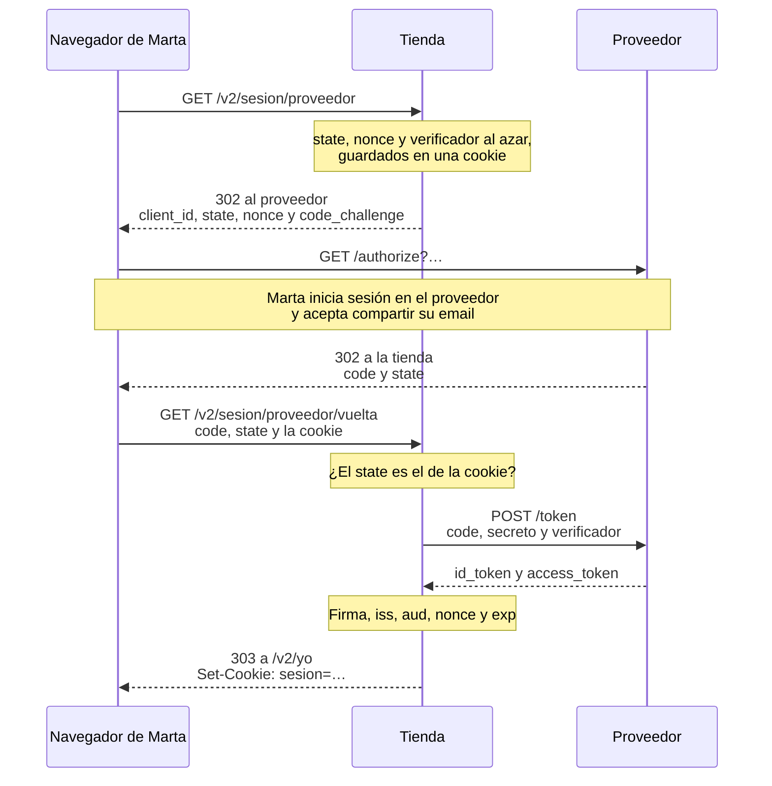

import Term from '~/components/Term.astro';
import TryIt from '~/components/TryIt.astro';
import Analogy from '~/components/Analogy.astro';
import Quiz from '~/components/Quiz.astro';
import QuizQuestion from '~/components/QuizQuestion.astro';
import QuizOption from '~/components/QuizOption.astro';
import ProjectCode from '~/components/ProjectCode.astro';

## El problema

Imagina una web para imprimir fotos que te pide tu contraseña de Google para traer tus fotos. Con ella puede leer tu correo, borrar tus archivos o cambiar la contraseña. Y para siempre: solo se lo quitas cambiando la contraseña. Si la web sufre una filtración, tu cuenta de Google va dentro.

La tienda tiene el problema al revés. Marta no quiere otra contraseña más, y quiere pulsar «Iniciar sesión con Google». **¿Cómo le dice Google a la tienda quién es Marta, sin que Marta le dé su contraseña?**

Lo resuelven dos estándares: OAuth 2.0 da permisos, y OpenID Connect dice quién eres. Los pruebas contra un proveedor que hace de Google en tu ordenador.

## La analogía

<Analogy>

Faltas al trabajo porque estás enfermo. Tu empresa no te examina: el médico te da un justificante sellado, con tu nombre y el día, y en la empresa reconocen el sello del centro de salud.

«Iniciar sesión con Google» es eso. La tienda no comprueba la contraseña de Marta: la comprueba Google, que le da a la tienda un justificante firmado.

<div slot="limits">

- El justificante lo llevas tú, y podrías cambiarlo. Aquí, el navegador solo lleva un número de recogida de un solo uso, y el justificante lo recoge la tienda del proveedor, con su propio secreto.
- Un sello se imita; la firma del proveedor no se fabrica sin su clave privada.
- Un justificante no da permisos. OAuth sí: ver tus fotos, y no tu correo.

</div>

</Analogy>

## Cómo funciona de verdad

### Cuatro papeles: quién es quién

<Term id="oauth">OAuth 2.0</Term> (RFC 6749, de 2012) reparte cuatro papeles. Con la web de fotos y con la tienda:

| Papel | Qué hace | Web de fotos | En la tienda |
|---|---|---|---|
| Propietario del recurso (*resource owner*) | Da el permiso | Tú | Marta |
| Cliente (*client*) | La aplicación que pide acceso | La web de fotos | La API de la tienda |
| Servidor de autorización (*authorization server*) | Comprueba quién eres y da los tokens | Google | Google, o el proveedor de práctica |
| Servidor de recursos (*resource server*) | La API con los datos | Google Fotos | Ninguno |

Ojo con «cliente»: aquí es la tienda, no el navegador ni una clienta. Y al servidor de autorización que dice quién eres se le llama **proveedor de identidad**, o proveedor, a secas.

### OAuth da permisos; OpenID Connect dice quién eres

**OAuth sirve para dar permisos.** Entras en la web de Google, y Google te pregunta: «¿Dejas que esta web vea tus fotos?». Si dices que sí, le da a la web un **access_token**: un token para llamar a la API de Google Fotos, con un permiso concreto (el *scope*) y una caducidad. La web nunca ve tu contraseña, y tú le quitas el permiso cuando quieras.

Pero un access_token no dice quién eres: es una llave para una API, no un carné.

**<Term id="openid-connect">OpenID Connect</Term> (2014) añade quién eres, encima de OAuth.** Si la web pide el scope `openid`, el proveedor le da además un **id_token**: un <Term id="jwt">JWT</Term>, como los de la lección 3, «JWT», firmado con la <Term id="private-key">clave privada</Term> del proveedor. Lleva quién lo emite (`iss`), para qué web es (`aud`), hasta cuándo vale (`exp`) y, sobre todo, **`sub`**: el identificador de la persona en ese proveedor, que no cambia nunca.

| | access_token (OAuth) | id_token (OpenID Connect) |
|---|---|---|
| Para quién es | Para una API | Para la web que pidió el inicio de sesión |
| Qué dice | Qué se puede hacer | Quién ha entrado, y para qué web |
| Quién lo usa | La web lo envía a la API, sin leerlo | La web lo comprueba y lo lee |

### El flujo del código de autorización, paso a paso

Para una web, el RFC 9700 (2025), las buenas prácticas de seguridad de OAuth, pide **el flujo del código de autorización con PKCE**.



1. Marta pulsa el botón, y su navegador pide `/v2/sesion/proveedor` a la tienda.
2. La tienda crea tres valores al azar, los guarda en una <Term id="cookie">cookie</Term> y contesta con una <Term id="redirect">redirección</Term> al proveedor ([lección 3 de la Fase 2](/fase-2/codigos-de-estado-http/#el-código-y-la-cabecera-location-las-redirecciones)).
3. Marta inicia sesión en el proveedor, con su contraseña de allí, y acepta.
4. El proveedor devuelve el navegador a la URL de vuelta de la tienda con un **`code`**: un código de un solo uso, que caduca en minutos.
5. La tienda comprueba el state y cambia el code por los tokens en una petición directa al proveedor, de <Term id="server">servidor</Term> a servidor.
6. Comprueba el id_token y abre una sesión, la de la lección 2, «Sesiones».

**¿Por qué un código, y no el token directamente?** Lo que pasa por el navegador queda a la vista: en el historial, en los logs, en las extensiones. El code solo no sirve: cambiarlo exige el secreto de la tienda y el verificador. El antiguo flujo «implícito» ponía el token en la URL, y el RFC 9700 lo desaconseja.

### PKCE: el code no sirve sin el verificador

<Term id="pkce">PKCE</Term> («pixi») protege el code por si alguien lo roba por el camino:

- Antes de la ida, la tienda inventa un **verificador**: 32 bytes al azar.
- En la ida manda solo su <Term id="hash">hash</Term> SHA-256, el `code_challenge` («reto»).
- Al cambiar el code, manda el verificador. El proveedor calcula su hash y lo compara con el reto.

Quien robe el code no tiene el verificador, y del reto no lo saca: un hash no se deshace. PKCE nació para las apps del móvil, que no pueden guardar un secreto; el RFC 9700 lo pide a todas.

### El state y el nonce: la vuelta, atada a quien la empezó

Sin state, alguien podría empezar un inicio de sesión con su propia cuenta, pararse antes de volver y mandarle a Marta el enlace de vuelta con su code. Marta lo abre y entra como el atacante: lo que guarde, su dirección o su tarjeta, queda en la cuenta del atacante. Es un <Term id="csrf">CSRF</Term> en el inicio de sesión.

**El state lo impide:** un valor al azar que la tienda guarda en el navegador de Marta y que el proveedor devuelve tal cual. Si no coinciden, esa vuelta no la empezó este navegador. **El nonce** viaja dentro del id_token y lo ata a este inicio de sesión.

La tienda los crea en `src/proveedor.ts`, con `openid-client`, del autor de `jose`:

<ProjectCode file="tienda-api/27-oauth/src/proveedor.ts" region="ida" />

- **`randomState()`, `randomNonce()` y `randomPKCECodeVerifier()`**: 32 bytes al azar cada uno.
- **`buildAuthorizationUrl`** monta la URL de la ida. Dónde está `/authorize` lo leyó en `/.well-known/openid-configuration`, un <Term id="json">JSON</Term> que todo proveedor publica con sus direcciones.
- **`scope`**: `openid` convierte OAuth en OpenID Connect.

La ruta de la ida, en `src/v2.ts`, guarda los tres valores en una cookie:

<ProjectCode file="tienda-api/27-oauth/src/v2.ts" region="proveedor-ida" />

- **`path`**: solo viaja a las dos rutas del proveedor, durante 10 minutos.
- **`sameSite: 'Lax'`, y no `Strict`**: la vuelta llega desde la web del proveedor, y con `Strict` el navegador no mandaría la cookie ([lección de cookies de la Fase 2](/fase-2/cookies-httponly-secure-samesite/#samesite-si-viaja-cuando-la-petición-viene-de-otra-web)).

La ruta de la vuelta lee la cookie y la borra: cada inicio se termina una sola vez. Después, el paso 5 es una función:

<ProjectCode file="tienda-api/27-oauth/src/proveedor.ts" region="cambiar-codigo" />

`authorizationCodeGrant` comprueba el state, cambia el code con el secreto y el verificador, y comprueba el id_token: la firma, con la <Term id="public-key">clave pública</Term> del proveedor, `iss`, `aud`, el nonce y `exp`. Si algo falla, la ruta contesta `400`, y el motivo va al log.

### Lo que guarda la tienda: el sub

La migración 008:

<ProjectCode file="tienda-api/27-oauth/bd/migraciones/008-proveedor.sql" region="sub-proveedor" />

**La tienda reconoce a Marta por su `sub`, no por su email,** que puede cambiar. Quien solo entra con el proveedor no tiene contraseña: `hash_contrasena` queda vacía.

Quién es, lo decide `usuarioDelProveedor`, en `src/usuarios.ts`:

<ProjectCode file="tienda-api/27-oauth/src/usuarios.ts" region="buscar-o-unir" />

- **Primero, por `sub`.** Si una cuenta lo tiene, es esa.
- **Si no, por email:** se une a la cuenta con ese email, apuntándole el `sub`, **solo si el proveedor dice que el email está verificado**. Si no, `409`.
- **Si no hay ninguna,** se crea, sin contraseña.

¿Por qué verificado? Si no, cualquiera crea en el proveedor una cuenta con `ana@tienda.example` y entra en la de Ana. En 2023 se encontraron webs que caían así con cuentas de Microsoft ([nOAuth, de Descope](https://www.descope.com/blog/post/noauth), en inglés).

### De la práctica a Google

Para usar Google, el código no cambia: cambian las cuatro variables del `.env`.

1. En la consola de Google Cloud, configuras la pantalla de consentimiento (lo que verá Marta) y creas un id de cliente de OAuth para una aplicación web.
2. Registras la URL de vuelta exacta. Google rechaza cualquier otra: nadie puede pedir que el code vaya a su web.
3. El id de cliente y el secreto que te da van a `OIDC_CLIENTE_ID` y `OIDC_CLIENTE_SECRETO`, [fuera del código y de Git](/fase-1/variables-de-entorno/#los-secretos-fuera-del-código).
4. `OIDC_EMISOR=https://accounts.google.com`: la tienda lee su `/.well-known/openid-configuration` y encuentra lo demás.

Google acepta `http://localhost` para probar; en producción, HTTPS. Esto lo describimos sin probarlo con una cuenta de Google: el flujo es el que vas a probar ahora.

## Pruébalo

El objetivo: entrar como Marta haciendo tú de navegador, ver qué guarda la tienda, y comprobar que un state cambiado y un code robado no sirven de nada.

Atacas tu propia tienda, en tu ordenador: hacerlo contra un sistema ajeno sin permiso es un delito.

### Actualiza tu proyecto

Partes de tu proyecto de la lección 3, «JWT». Instala la biblioteca de la tienda y, solo para desarrollo, la del proveedor:

<TryIt
  title="1. Dos paquetes"
  cmd={`npm install openid-client@6.8.8
npm install -D oauth2-mock-server@9.2.0`}
  output={`added 2 packages, and audited 73 packages in 835ms

11 packages are looking for funding
  run \`npm fund\` for details

4 moderate severity vulnerabilities

To address all issues (including breaking changes), run:
  npm audit fix --force

Run \`npm audit\` for details.

added 2 packages, and audited 75 packages in 663ms

11 packages are looking for funding
  run \`npm fund\` for details

4 moderate severity vulnerabilities

To address all issues (including breaking changes), run:
  npm audit fix --force

Run \`npm audit\` for details.`}
>

`-D` lo apunta en `devDependencies`: el proveedor de práctica nunca va a producción. Las 4 *vulnerabilities* son las de drizzle-kit, como en la lección 3. Las salidas son de Node 26.11.1 y PostgreSQL 18; tus códigos, tokens y horas serán otros.

</TryIt>

Añade la columna en `src/esquema.ts` (las líneas marcadas):

<ProjectCode file="tienda-api/27-oauth/src/esquema.ts" region="usuarios" mark={[9, 10]} />

Escribe `bd/migraciones/008-proveedor.sql` con el SQL de arriba, y genera la foto de drizzle-kit como en la lección 3:

<TryIt
  title="2. La migración"
  cmd={`npm run bd:generar -- --name=proveedor
npm run bd:migrar`}
  output={`> tienda-api@1.0.0 bd:generar
> drizzle-kit generate --name=proveedor

No config path provided, using default 'drizzle.config.ts'
Reading config file '/Users/ana/curso-backend/fase-3/tienda-api/drizzle.config.ts'
9 tables
categorias 2 columns 0 indexes 0 fks
claves_api 5 columns 0 indexes 0 fks
claves_idempotencia 6 columns 0 indexes 0 fks
eventos_procesados 2 columns 0 indexes 0 fks
pedidos 5 columns 1 indexes 1 fks
productos 4 columns 0 indexes 0 fks
productos_categorias 2 columns 1 indexes 2 fks
sesiones 4 columns 0 indexes 1 fks
usuarios 5 columns 1 indexes 0 fks

[✓] Your SQL migration file ➜ drizzle/0005_proveedor.sql 🚀

> tienda-api@1.0.0 bd:migrar
> node --env-file-if-exists=.env scripts/migrar.ts

Aplicada: 008-proveedor.sql`}
>

`usuarios` tiene ahora 5 columnas. Si sale `No schema changes`, no guardaste `esquema.ts`.

</TryIt>

Después:

1. Crea `src/proveedor.ts`; añade `usuarioDelProveedor` a `src/usuarios.ts`, las rutas a `src/contrato.ts` y `src/v2.ts`, y las variables a `src/config.ts`. Lo que no has visto, cópialo del paso.
2. Añade a tu `.env` las líneas marcadas. El proveedor de práctica acepta cualquier id y secreto:

<ProjectCode file="tienda-api/27-oauth/.env.ejemplo" mark={[14, 15, 16, 17]} />

3. Añade a `package.json` el script `proveedor` (la línea marcada):

<ProjectCode file="tienda-api/27-oauth/package.json" mark={20} />

El proveedor y las pruebas vienen en la carpeta de esta lección:

```sh
cd ~/curso-backend/fase-3
curl -O https://backenddesdecero.com/practicas/tienda-api/27-oauth.tar.gz
tar -xzf 27-oauth.tar.gz
cd tienda-api
cp ../27-oauth/scripts/proveedor.ts scripts/
cp ../27-oauth/test/*.ts test/
```

Si te atascas, compara con `27-oauth`. `npm test` debería acabar con `fail 0`: las pruebas arrancan su propio proveedor.

### Arranca el proveedor de práctica

Abre tres terminales en la carpeta del proyecto. En la primera:

<TryIt
  title="3. El proveedor, en localhost:9000"
  cmd="npm run proveedor"
  output={`> tienda-api@1.0.0 proveedor
> node scripts/proveedor.ts

Proveedor de práctica en http://localhost:9000
Su configuración: http://localhost:9000/.well-known/openid-configuration`}
>

Es `oauth2-mock-server`, un proveedor para pruebas: no pide contraseña, acepta a cualquier tienda y siempre dice que quien entra es esta Marta. Nunca lo uses fuera de tu ordenador. Se para con <kbd>Ctrl</kbd> + <kbd>C</kbd>.

</TryIt>

<ProjectCode file="tienda-api/27-oauth/scripts/proveedor.ts" region="persona" />

En la segunda terminal, `npm start`. Si dice `Configuración: OIDC_EMISOR: Falta OIDC_EMISOR, o no es una URL`, faltan las variables en tu `.env`.

### Haz de navegador, redirección a redirección

`curl` no sigue las redirecciones si no se lo pides: así ves cada salto. En la tercera terminal:

<TryIt
  title="4. La ida"
  cmd="curl -s -i -c cookies.txt localhost:3000/v2/sesion/proveedor"
  output={`HTTP/1.1 302 Found
location: http://localhost:9000/authorize?redirect_uri=http%3A%2F%2Flocalhost%3A3000%2Fv2%2Fsesion%2Fproveedor%2Fvuelta&scope=openid+email+profile&code_challenge=lfxafriZFb8esr1Zo2zVF39wJS9bQe1nyqOBE9CSGKs&code_challenge_method=S256&state=6UWHrvB2kIAL0JtTc7qfr0EcHAN7c3OjYdysUeIkO-k&nonce=FkUai5Ai2XTdTwWMvO5fHrdKTO-B_wYFglNvAC6R8bU&client_id=tienda&response_type=code
vary: Origin
x-request-id: c382c1c5-d14e-4183-a9b0-e36a5f296f7f
set-cookie: proveedor=eyJlc3RhZG8iOiI2VVdIcnZCMmtJQUwwSnRUYzdxZnIwRWNIQU43YzNPallkeXNVZUlrTy1rIiwibm9uY2UiOiJGa1VhaTVBaTJYVGRUd1dNdk81ZkhyZEtUTy1CX3dZRmdsTnZBQzZSOGJVIiwidmVyaWZpY2Fkb3IiOiJzTVV2Z3cxQXJDenlWMGF4SDk5d0FfSUh6OFpPdDNhVVlydnhnWVdheFdBIn0; Max-Age=600; Path=/v2/sesion/proveedor; HttpOnly; Secure; SameSite=Lax
Date: Wed, 14 Oct 2026 00:18:00 GMT
Connection: keep-alive
Keep-Alive: timeout=5
Transfer-Encoding: chunked`}
>

Un `302` con `location`, la URL del proveedor, y `set-cookie`, los tres valores en JSON y base64url: empieza por `eyJ`, como un JWT. Si sale un `500`, el proveedor no está en marcha: en la terminal del servidor verás `ECONNREFUSED`.

</TryIt>

Para no copiar esa URL a mano, pide otra ida y guárdala en una <Term id="variable">variable</Term> de la shell:

<TryIt
  title="5. La URL de la ida, parámetro a parámetro"
  cmd={`IDA=$(curl -s -o /dev/null -w '%{redirect_url}' -c cookies.txt localhost:3000/v2/sesion/proveedor)
echo "$IDA" | tr '?&' '\\n\\n'`}
  output={`http://localhost:9000/authorize
redirect_uri=http%3A%2F%2Flocalhost%3A3000%2Fv2%2Fsesion%2Fproveedor%2Fvuelta
scope=openid+email+profile
code_challenge=DXLtKJzNCRFHjQzdu9cRmrAgRZD1BdTTf946RjckRYE
code_challenge_method=S256
state=CLVl6RmuhurxQaBDtVnsls86u5xI0_34SywO4G6d1TE
nonce=ZPG5yD2bxOWU2uYxh1CSFhE2UBpm_T-h0tfImZTB4L0
client_id=tienda
response_type=code`}
>

`-w '%{redirect_url}'` escribe solo la dirección de `location`, y `-o /dev/null` tira el resto. `tr` cambia `?` y `&` por saltos de línea ([lección de pipes de la Fase 1](/fase-1/pipes-y-redirecciones/)).

`state`, `nonce` y `code_challenge` son otros que en el paso 4: cada inicio estrena los suyos, y la cookie nueva sustituye a la vieja.

</TryIt>

Ahora, lo que haría el navegador: ir al proveedor.

<TryIt
  title="6. En el proveedor"
  cmd={`VUELTA=$(curl -s -o /dev/null -w '%{redirect_url}' "$IDA")
echo "$VUELTA" | tr '?&' '\\n\\n'`}
  output={`http://localhost:3000/v2/sesion/proveedor/vuelta
code=589bb6fe-7c80-4d6f-8b14-5f8f1acdc0df
state=CLVl6RmuhurxQaBDtVnsls86u5xI0_34SywO4G6d1TE`}
>

Un proveedor de verdad enseñaría aquí su página para entrar. El de práctica redirige en el acto a la tienda, con un `code` y el `state` del paso 5.

</TryIt>

En la terminal del proveedor:

```text
/authorize: Marta Ruiz inicia sesión. Vuelta a http://localhost:3000/v2/sesion/proveedor/vuelta
  con code=589bb6fe-7c80-4d6f-8b14-5f8f1acdc0df y state=CLVl6RmuhurxQaBDtVnsls86u5xI0_34SywO4G6d1TE
```

<TryIt
  title="7. La vuelta"
  cmd={`curl -s -i -b cookies.txt -c cookies.txt "$VUELTA"`}
  output={`HTTP/1.1 303 See Other
location: /v2/yo
vary: Origin
x-request-id: 10140ac6-5a8e-4db4-b229-8d8b713d8ad7
set-cookie: proveedor=; Max-Age=0; Path=/v2/sesion/proveedor; HttpOnly; Secure; SameSite=Lax
set-cookie: sesion=cBtnAcZVyZ1JUZu6Rr-PP0vEJqeV7kBfT0heOcSUE-U; Max-Age=604800; Path=/; HttpOnly; Secure; SameSite=Lax
Date: Wed, 14 Oct 2026 00:18:00 GMT
Connection: keep-alive
Keep-Alive: timeout=5
Transfer-Encoding: chunked`}
>

`-b cookies.txt` devuelve la cookie de la ida. La tienda ha cambiado el code: en la terminal del proveedor aparece `/token: el code se cambia por un id_token de Marta Ruiz`. Dos `set-cookie`: la de la ida, borrada con `Max-Age=0`, y la de la sesión de la lección 2.

</TryIt>

<TryIt
  title="8. Quién eres"
  cmd={`curl -s -w '\\n' -b cookies.txt localhost:3000/v2/yo`}
  output={`{"tipo":"usuario","id":1,"email":"marta@ejemplo.com"}`}
>

**Es la cuenta 1, la que Marta creó con contraseña en la lección 1:** su email está verificado, y la tienda la ha unido. Si tu Marta tiene otro id, es el que le tocó.

</TryIt>

### La fila de Marta

<TryIt
  title="9. La fila de Marta"
  cmd={`psql -d tienda -c 'SELECT id, email, sub_proveedor, hash_contrasena IS NOT NULL AS con_contrasena FROM usuarios;'`}
  output={` id |       email       |    sub_proveedor     | con_contrasena
----+-------------------+----------------------+----------------
  1 | marta@ejemplo.com | proveedor-marta-0001 | t
(1 row)`}
>

`sub_proveedor` tiene el `sub` de Marta, y `con_contrasena` es `t` (*true*): Marta entra de las dos formas en la misma cuenta. Si tienes las cuentas de práctica, verás más filas.

</TryIt>

### Un state cambiado

Ahora haces de atacante: una vuelta con un state que tu navegador no guardó.

<TryIt
  title="10. El state de otro"
  cmd={`IDA=$(curl -s -o /dev/null -w '%{redirect_url}' -c cookies.txt localhost:3000/v2/sesion/proveedor)
VUELTA=$(curl -s -o /dev/null -w '%{redirect_url}' "$IDA")
TRUCADA=$(echo "$VUELTA" | sed 's/state=.*/state=el-de-otro-navegador/')
curl -s -w '\\n' -b cookies.txt -c cookies.txt "$TRUCADA"
curl -s -w '\\n' -b cookies.txt -c cookies.txt "$VUELTA"`}
  output={`{"type":"https://tienda.example/problemas/inicio-con-proveedor","title":"No se ha podido iniciar sesión con el proveedor","status":400,"detail":"La respuesta del proveedor no vale, o no la empezó este navegador: empieza otra vez"}
{"type":"https://tienda.example/problemas/inicio-con-proveedor","title":"No se ha podido iniciar sesión con el proveedor","status":400,"detail":"La respuesta del proveedor no vale, o no la empezó este navegador: empieza otra vez"}`}
>

`sed` cambia el state de la URL. **La vuelta trucada recibe un `400`**, y el log del servidor dice por qué: `unexpected "state" response parameter value`. La tienda ni llamó al proveedor: en su terminal no hay `/token`.

¿Y la segunda, con el state bueno? También `400`: la primera borró la cookie.

</TryIt>

### Un code robado, sin el verificador

Ahora haces tú de tienda, con PKCE a mano, y de ladrón de codes.

<TryIt
  title="11. El code, sin su verificador"
  cmd={`V=$(openssl rand -base64 32 | tr '+/' '-_' | tr -d '=')
C=$(printf '%s' "$V" | openssl dgst -sha256 -binary | base64 | tr '+/' '-_' | tr -d '=')
URL_VUELTA=http://localhost:3000/v2/sesion/proveedor/vuelta
CODE=$(curl -s -o /dev/null -w '%{redirect_url}' "localhost:9000/authorize?response_type=code&client_id=tienda&scope=openid+email&redirect_uri=$URL_VUELTA&state=1&nonce=n-0001&code_challenge=$C&code_challenge_method=S256" | sed 's/.*code=//; s/&.*//')
curl -s -w '\\n' -d grant_type=authorization_code -d client_id=tienda -d redirect_uri=$URL_VUELTA -d code=$CODE -d code_verifier=uno-inventado-por-quien-robo-el-code-0123456789 localhost:9000/token`}
  output={`{"type":"https://tools.ietf.org/html/rfc9110#section-15.5.1","title":"Bad Request","detail":"code_verifier provided does not match code_challenge"}`}
>

- **`V`** es el verificador: 32 bytes al azar, en base64url. **`C`**, su reto: el SHA-256 de `V`, en base64url.
- **`CODE`**: pides un code con el reto, y `sed` lo saca de la URL de vuelta.
- **El último `curl`** hace el paso 5 con el verificador del ladrón. `-d` manda cada dato en el cuerpo de un `POST`.

El verificador no cuadra con el reto, y no hay tokens. Y ese code ya no sirve: el proveedor lo borra al primer intento.

</TryIt>

Con el verificador bueno y un code nuevo:

<TryIt
  title="12. El id_token de Marta"
  cmd={`CODE=$(curl -s -o /dev/null -w '%{redirect_url}' "localhost:9000/authorize?response_type=code&client_id=tienda&scope=openid+email&redirect_uri=$URL_VUELTA&state=1&nonce=n-0001&code_challenge=$C&code_challenge_method=S256" | sed 's/.*code=//; s/&.*//')
curl -s -o tokens.json -d grant_type=authorization_code -d client_id=tienda -d redirect_uri=$URL_VUELTA -d code=$CODE -d code_verifier=$V localhost:9000/token
node -p "JSON.parse(Buffer.from(require('./tokens.json').id_token.split('.')[1], 'base64url'))"`}
  output={`{
  iss: 'http://localhost:9000',
  iat: 1791937772,
  exp: 1791941372,
  nbf: 1791937762,
  sub: 'proveedor-marta-0001',
  aud: 'tienda',
  nonce: 'n-0001',
  email: 'marta@ejemplo.com',
  email_verified: true,
  name: 'Marta Ruiz'
}`}
>

`tokens.json` guarda la respuesta: el access_token, el id_token y un token para renovarlos. `node` descodifica la segunda parte del id_token, como hiciste con `base64` en la lección 3.

Ahí está lo que la tienda comprueba y usa: `iss`, `aud` (el id de la tienda), tu `nonce`, `sub` y `email_verified`. `nbf` (*not before*) dice desde cuándo vale. Si sale `Cannot read properties of undefined`, el code estaba gastado: repite las dos primeras líneas.

</TryIt>

## Ya lo has visto

- **«Iniciar sesión con Google», «con Apple» o «con GitHub».** Es este flujo. La pantalla que te pide permiso es el paso 3, y lo que pide son los scopes.
- **La barra de direcciones.** Al pulsar el botón, ves un instante `accounts.google.com/…` con `client_id`, `redirect_uri`, `state` y `code_challenge`: la ida.
- **Las apps con acceso a tu cuenta.** Tu cuenta de Google lista los permisos que diste, y ahí los quitas.
- **La pestaña Red de DevTools** ([introducción de la Fase 2](/fase-2/#antes-de-empezar-devtools)). Con «Conservar registro» (*Preserve log*), cada redirección de un inicio de sesión es una fila.

## Errores comunes

- **Pedir la contraseña de otro servicio.** Para eso existe OAuth.
- **Usar el access_token como prueba de quién es alguien.** Es una llave para una API. Para eso está el id_token, comprobado.
- **Saltarse el state, o usar siempre el mismo.** La vuelta del atacante entra como si fuera tuya.
- **Reconocer por el email, o unir cuentas con un email sin verificar.** Usa el `sub`, y une solo con `email_verified`.
- **URLs de vuelta abiertas o con comodines.** El code acabaría donde diga quien ataca.
- **El secreto del cliente en el frontend o en Git.** Va en el `.env` del servidor.

## Resumen

- OAuth 2.0 da a una web un permiso limitado, el access_token, sin que vea tu contraseña. OpenID Connect añade quién eres: el id_token, un JWT firmado por el proveedor.
- El flujo del código con PKCE: el navegador solo lleva un code de un solo uso, y la tienda lo cambia por los tokens en una petición directa.
- PKCE inutiliza un code robado; el state ata la vuelta al navegador que empezó, y el nonce, el id_token a ese inicio.
- La tienda reconoce por el `sub`, y une cuentas por email solo si está verificado.
- Pasar a Google es cambiar el emisor, el id de cliente, el secreto y la URL de vuelta.

## ¿Lo has entendido?

<Quiz>

<QuizQuestion
  question="Una web para imprimir fotos te pide tu contraseña de Google para importar tus fotos, y promete no guardarla. ¿Qué le contestas?"
  review="OAuth da permisos; OpenID Connect dice quién eres"
>

<QuizOption text="Que vale, si la página va por HTTPS y la contraseña no viaja en claro.">

HTTPS protege el camino, no lo que haga la web con la contraseña: con ella puede hacer todo lo que haces tú.

</QuizOption>

<QuizOption text="Que use OAuth: entras en Google, y Google le da un permiso solo para tus fotos." correct>

La web nunca ve tu contraseña, recibe un permiso concreto, y se lo quitas cuando quieras.

</QuizOption>

<QuizOption text="Que vale, si después cambias la contraseña de Google para que deje de servirle.">

Hasta entonces puede leer tu correo, o cambiarla ella antes que tú.

</QuizOption>

</QuizQuestion>

<QuizQuestion
  question="Luis ha programado su propia vuelta del proveedor y no comprueba el state. ¿Qué ataque le queda abierto?"
  review="El state y el nonce: la vuelta, atada a quien la empezó"
>

<QuizOption text="Que una clienta acabe en la cuenta del atacante al abrir un enlace de vuelta suyo." correct>

Sin state, la tienda no sabe si ese navegador empezó la vuelta. Lo que la clienta guarde allí, lo ve el atacante.

</QuizOption>

<QuizOption text="Que alguien cambie el code por los tokens sin el verificador de PKCE.">

Eso lo impide PKCE, en el proveedor, con o sin state.

</QuizOption>

<QuizOption text="Que alguien falsifique la firma del id_token y entre como quien quiera.">

Sin la clave privada del proveedor nadie fabrica esa firma, haya state o no.

</QuizOption>

</QuizQuestion>

<QuizQuestion
  question="Un proxy apunta en su log las URL completas, y alguien lee ahí un code de la vuelta antes de que lo use la tienda. ¿Qué le impide cambiarlo por los tokens?"
  review="PKCE: el code no sirve sin el verificador"
>

<QuizOption text="El state: el proveedor rechaza el code si no le llega el state de la ida.">

El proveedor no comprueba el state: lo devuelve tal cual. Y el state iba en la misma URL que el code.

</QuizOption>

<QuizOption text="Nada: con el code y el id de cliente, que es público, el proveedor entrega los tokens.">

Cambiarlo exige el verificador de PKCE y, en una web, el secreto de la tienda.

</QuizOption>

<QuizOption text="El verificador de PKCE: en la URL solo viajó su hash, y sin él el proveedor no da tokens." correct>

Lo viste en el paso 11: un verificador inventado no cuadra con el reto.

</QuizOption>

</QuizQuestion>

<QuizQuestion
  question="Una app de recetas solo quiere saber quién eres, no leer tu correo ni tus fotos. ¿Qué pide al proveedor?"
  review="OAuth da permisos; OpenID Connect dice quién eres"
>

<QuizOption text="Un access_token con permiso para leer tu correo, y mira de quién es la dirección.">

Pediría un permiso que no necesita, y un access_token no es una prueba de quién eres.

</QuizOption>

<QuizOption text="El scope openid, y comprueba el id_token: la firma, para quién es y su sub." correct>

`openid` convierte OAuth en OpenID Connect: el id_token dice quién eres, sin dar acceso a nada.

</QuizOption>

<QuizOption text="Tu contraseña del proveedor, que comprueba enviándola al proveedor por HTTPS.">

Es lo que OAuth vino a evitar: la contraseña solo se escribe en la web del proveedor.

</QuizOption>

</QuizQuestion>

<QuizQuestion
  question="Alguien crea en un proveedor una cuenta con el email ana@tienda.example, sin verificarlo, y entra en la tienda con ella. Ana ya tenía cuenta. ¿Qué hace la tienda?"
  review="Lo que guarda la tienda: el sub"
>

<QuizOption text="Unirla a la de Ana: el email es el mismo, así que es la misma persona.">

Un email sin verificar puede ponerlo cualquiera: unirlas sería darle la cuenta de Ana.

</QuizOption>

<QuizOption text="Dejarle entrar en la de Ana: el proveedor ya ha comprobado su contraseña.">

Ha comprobado la contraseña de su cuenta en el proveedor, no que el email sea suyo.

</QuizOption>

<QuizOption text="No unirla: sin email_verified, contesta 409 y no abre ninguna sesión." correct>

Solo un email verificado demuestra que la persona lo controla.

</QuizOption>

</QuizQuestion>

<QuizQuestion
  question="Marta cambia en el proveedor su email, de marta@ejemplo.com a marta.ruiz@ejemplo.com. ¿Qué pasa la próxima vez que entra en la tienda con el proveedor?"
  review="Lo que guarda la tienda: el sub"
>

<QuizOption text="Entra en su misma cuenta: la tienda la busca primero por su sub, que no ha cambiado." correct>

El `sub` no cambia con el email: por eso la tienda lo guarda.

</QuizOption>

<QuizOption text="La tienda le crea una cuenta nueva, porque reconoce a cada persona por su email.">

La tienda reconoce por el `sub`. El email solo cuenta la primera vez, para unir una cuenta.

</QuizOption>

<QuizOption text="No puede entrar hasta que cambie también el email en la tienda, porque ya no coinciden.">

Con el `sub`, la tienda no mira el email: encuentra la cuenta y abre la sesión.

</QuizOption>

</QuizQuestion>

</Quiz>

## Para profundizar

- [RFC 6749: The OAuth 2.0 Authorization Framework](https://www.rfc-editor.org/rfc/rfc6749.html) (en inglés).
- [RFC 9700: Best Current Practice for OAuth 2.0 Security](https://www.rfc-editor.org/rfc/rfc9700.html) (en inglés): por qué el código con PKCE.
- [RFC 7636: Proof Key for Code Exchange](https://www.rfc-editor.org/rfc/rfc7636.html) (en inglés).
- [OpenID Connect Core 1.0](https://openid.net/specs/openid-connect-core-1_0.html) (en inglés): el id_token.
- [OAuth 2.0 Cheat Sheet](https://cheatsheetseries.owasp.org/cheatsheets/OAuth2_Cheat_Sheet.html) (OWASP, en inglés).
- [OpenID Connect en Google](https://developers.google.com/identity/openid-connect/openid-connect?hl=es): cómo registrar una web.
- [openid-client](https://github.com/panva/openid-client) y [oauth2-mock-server](https://github.com/axa-group/oauth2-mock-server) (en inglés): las bibliotecas de la lección.
