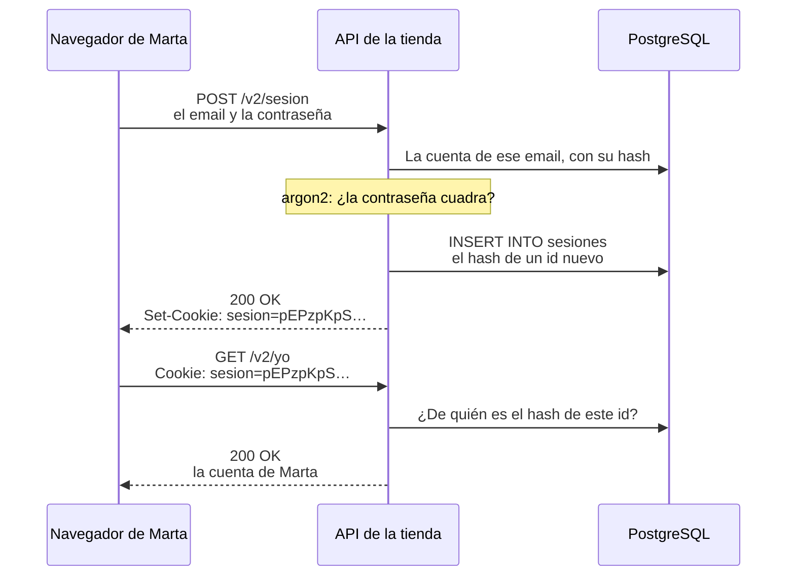

import Term from '~/components/Term.astro';
import TryIt from '~/components/TryIt.astro';
import Analogy from '~/components/Analogy.astro';
import SelfCheck from '~/components/SelfCheck.astro';
import Quiz from '~/components/Quiz.astro';
import QuizQuestion from '~/components/QuizQuestion.astro';
import QuizOption from '~/components/QuizOption.astro';
import ProjectCode from '~/components/ProjectCode.astro';

## El problema

En la lección 1, «Contraseñas», Marta creó su cuenta. Hoy entra: escribe su email y su contraseña una vez, y después hace diez peticiones más. ¿Cómo sabe la API que las diez son de Marta?

HTTP no recuerda nada de una petición a otra ([lección 5 de la Fase 2](/fase-2/cookies-httponly-secure-samesite/)). Mandar la contraseña en cada una obligaría al navegador a guardarla, y cada petición pagaría los 20 ms del hash lento.

La respuesta es una <Term id="session">sesión</Term>, y trae tres preguntas:

- ¿Qué guarda el navegador, y qué guarda el servidor?
- ¿Qué pasa si alguien copia lo que guarda el navegador?
- Cuando Marta pulsa «Cerrar sesión» en el ordenador de una biblioteca, ¿queda cerrada de verdad?

## La analogía

<Analogy>

En la puerta de un festival te piden la entrada y el DNI, una sola vez, y te ponen una pulsera con un código largo. En cada barra escanean el código, y el ordenador del festival dice si vale y de quién es.

Si pierdes la pulsera, en la entrada anulan el código. Cortártela no basta si alguien le hizo una foto. Y vale hasta el último día del festival.

<div slot="limits">

- Nadie te quita la pulsera sin que lo notes. Una cookie se copia sin que te enteres, y la copia vale igual que la original.
- En la barra te ven la cara. El servidor no ve a nadie: quien trae el id es Marta.
- El festival guarda los códigos tal cual; la tienda, solo su hash.

</div>

</Analogy>

## Cómo funciona de verdad

### Entrar: la contraseña una vez, y un id a cambio



Son dos momentos: entrar, una vez, y cada petición después. La ruta de entrar, en `src/v2.ts`:

<ProjectCode file="tienda-api/25-sesiones/src/v2.ts" region="iniciar-sesion" />

- **`comprobarCredenciales(email, contrasena)`** busca la cuenta y verifica la contraseña con argon2, como en la lección 1.
- **Si no vale, un `400`** con <Term id="problem-details">Problem Details</Term>, el mismo para cualquier fallo (más abajo, por qué).
- **`abrirSesion(c, usuario.id)`** crea la sesión y manda su id en la <Term id="cookie">cookie</Term>.
- **La respuesta es la cuenta**, el id y el email: nunca el hash.

La contraseña va en el cuerpo de un `POST`, nunca en la URL, que acaba en logs e historiales.

### Un id largo y al azar

<ProjectCode file="tienda-api/25-sesiones/src/sesiones.ts" region="crear-sesion" />

- **`randomBytes(32)`**: 32 bytes del generador al azar pensado para secretos, el que se usa para fabricar claves. Son 256 bits: hay más ids posibles que átomos en la Tierra.
- **`toString('base64url')`** escribe esos bytes como 43 letras, cifras, `-` y `_`, que caben en una cookie tal cual.
- **`bd.insert(sesiones)`** guarda el hash del id, de quién es y hasta cuándo vale: `now()` más una semana. El id solo sale hacia la cookie.

¿Por qué tan largo? En la [introducción](/fase-6/) pediste los pedidos del 1 al 25 en menos de un segundo. Si las sesiones fueran `1`, `2`, `3`…, se robarían igual. Tampoco valen la hora o `Math.random()`: se pueden predecir.

### En la tabla, solo su hash

La tabla nueva, en la migración 006:

<ProjectCode file="tienda-api/25-sesiones/bd/migraciones/006-sesiones.sql" region="sesiones" />

- **`id_hash bytea`**: los 32 bytes del <Term id="hash">hash</Term> SHA-256 del id, como <Term id="primary-key">clave primaria</Term>.
- **`ON DELETE CASCADE`**: si se borra una cuenta, sus sesiones se van con ella.

**¿Por qué el hash y no el id?** Porque el id funciona como una contraseña: quien lo tiene, entra. Quien se llevara una copia de la tabla (una copia de seguridad perdida, una inyección SQL de la lección 6) con los ids en claro entraría en cada cuenta con la sesión abierta. Con el hash, no: un hash no se deshace.

¿Y por qué SHA-256, si en la lección 1 un hash rápido era un error? Allí el peligro era probar contraseñas probables, una lista que existe. De un id al azar no hay lista. Y este hash se calcula en cada petición: con argon2, cada una tardaría 20 ms más.

### Cada petición: de la cookie a la cuenta

Este <Term id="middleware">middleware</Term> pasa por todas las rutas, en `src/middleware/sesion.ts`:

<ProjectCode file="tienda-api/25-sesiones/src/middleware/sesion.ts" region="cargar-sesion" />

- **`idDeSesion(c)`** busca el id en la cookie `sesion` y, si no está, en la cabecera `Authorization: Bearer …`, para programas que no guardan cookies, como una app del móvil.
- **`usuarioDeSesion(id)`** busca de quién es el hash de ese id (más abajo).
- **`c.set('usuario', usuario)`** deja la cuenta en `c.var.usuario` para las rutas (`src/entorno.ts` le dice a TypeScript qué hay ahí). Sin sesión, no hace nada: si una ruta la exige, lo decide `exigirIdentidad`.

Una consulta en cada petición es el precio de las sesiones. En la lección 3, «JWT», verás quién se la ahorra, y a qué coste.

### La cookie: qué frena cada atributo

<ProjectCode file="tienda-api/25-sesiones/src/middleware/sesion.ts" region="cookie" />

Los atributos los viste en la [lección de cookies de la Fase 2](/fase-2/cookies-httponly-secure-samesite/). Lo que frena cada uno, aquí:

| Atributo | En la tienda |
|---|---|
| `HttpOnly` | Un script colado en una página de la tienda (XSS, lección 6) no puede leer el id |
| `Secure` | El id solo viaja por <Term id="https">HTTPS</Term>: en la wifi de una cafetería, nadie lo lee por el camino |
| `SameSite=Lax` | Otra web no puede hacer que tu navegador mande un `POST` a la tienda con tu sesión: el <Term id="csrf">CSRF</Term> de la lección 7 |
| `Path=/` | Vale para toda la API |
| `Max-Age=604800` | El navegador la olvida en una semana, lo que dura la sesión |

¿Y `Secure` sin HTTPS, en tu ordenador? Chrome, Firefox y `curl` tratan `http://localhost` como seguro. Pero `http://127.0.0.1:3000` es otro sitio para el navegador, con sus propias cookies: allí no te reconocería.

### Cerrar sesión es borrar la fila

`cerrarSesion` hace dos cosas: borra la fila de la tabla (`borrarSesion`) y le pide al navegador que olvide la cookie (`deleteCookie`, que la reenvía vacía y con `Max-Age=0`).

La que importa es la primera. **Borrar la cookie solo la borra de ese navegador:** una copia (de un programa malicioso, una extensión, un fichero de `curl`) sigue valiendo mientras la fila exista.

`DELETE /v2/sesion` responde `204` aunque no haya sesión: el resultado es el mismo. Y «cerrar sesión en todos los dispositivos» es borrar todas las filas de una cuenta, algo que conviene hacer cuando alguien cambia su contraseña.

### La caducidad la decide el servidor

`Max-Age` es un ruego al navegador, y una copia de la cookie no tiene por qué hacerle caso. Por eso el servidor comprueba `expira_en` en cada petición:

<ProjectCode file="tienda-api/25-sesiones/src/sesiones.ts" region="buscar-sesion" />

- **El `select`** une `sesiones` con `usuarios` (un <Term id="join">JOIN</Term>) y busca por el hash del id.
- **`fila.expiraEn <= new Date()`**: si la hora ya pasó, no vale, y de paso se borra.

Una semana es una elección. OWASP recomienda además cerrarla tras un rato sin uso: el banco te echa en minutos; una red social, en meses. Cuanto más vale la cuenta, más corta la sesión.

### Un id nuevo en cada inicio de sesión

**La fijación de sesión** (*session fixation*) es hacer que la víctima entre con un id que el atacante ya conoce. Muchas webs dan una sesión a cada visitante, para el carrito, y al entrar le apuntan la cuenta. Si el id no cambia, alguien puede conseguir uno, dejarlo en el navegador de Marta (en un ordenador compartido) y esperar: cuando Marta entra, ese id es su sesión.

Lo impide `abrirSesion`, en la región de la cookie: si la petición ya traía una sesión, la borra y crea otra. **Después de entrar, siempre un id nuevo.**

### El mismo error para un email que no existe

<ProjectCode file="tienda-api/25-sesiones/src/usuarios.ts" region="comprobar-credenciales" />

El login no debe delatar qué emails tienen cuenta (*user enumeration*, en inglés). Hacen falta dos cosas:

- **La misma respuesta.** Un email que no existe y una contraseña mala dan el mismo `400` con el mismo cuerpo: «El email o la contraseña no son correctos».
- **El mismo tiempo.** Sin cuenta no habría hash que verificar, y la respuesta llegaría 20 ms antes. `HASH_DE_RELLENO`, el hash de una contraseña que nadie sabe, hace que siempre se verifique uno.

¿Qué importa? Ser cliente de una tienda ya es un dato personal (piensa en una farmacia), y quien prueba contraseñas robadas se ahorra las cuentas que no existen.

Una salvedad: `POST /v2/cuentas` sí lo dice, con su `409`. Las webs grandes contestan siempre lo mismo y mandan un correo; la lección 8, «Rate limiting», limitará cuántas veces se puede preguntar.

### 400 al entrar, 401 después, con WWW-Authenticate

<ProjectCode file="tienda-api/25-sesiones/src/middleware/sesion.ts" region="exigir-identidad" />

- **`GET /v2/yo` sin sesión: `401`.** El estándar pide que todo `401` diga en `WWW-Authenticate` cómo identificarse ([lección 6 de la Fase 3](/fase-3/que-es-middleware/#un-guardia-que-responde-401)). HTTP no tiene un esquema para «manda tu cookie», y muchas APIs con sesiones la omiten. Esta la hace verdad: acepta el mismo id como `Authorization: Bearer …`, así que `Bearer realm="tienda-api"` (`realm`, el nombre de la zona protegida) promete algo cierto.
- **`POST /v2/sesion` con una contraseña mala: `400`.** Un `401` pediría identificarse, y esta ruta es justo donde uno se identifica. Lo mismo responde OAuth 2.0 (lección 4), y la firma de los webhooks de la [Fase 4](/fase-4/webhooks-idempotencia/#comprobar-la-firma-el-cuerpo-tal-cual-en-tiempo-constante). Otras APIs contestan `401`: lo importante es que sea igual para los dos fallos.

### Un segundo factor, cuando la contraseña no basta

Una contraseña robada abre la cuenta. La autenticación en dos pasos pide además algo que solo tiene la persona: un código **TOTP**, seis cifras que una app calcula cada 30 segundos con un secreto y la hora, o una **passkey**, un par de claves como las de la [Fase 0](/fase-0/tls-y-https/#dos-llaves-la-criptografía-de-clave-pública) guardado en tu dispositivo, sin nada que teclear en una web falsa. La sesión se abre después del segundo paso. La tienda no lo construye; la [guía de OWASP](https://cheatsheetseries.owasp.org/cheatsheets/Multifactor_Authentication_Cheat_Sheet.html) (en inglés) cuenta cómo.

## Pruébalo

El objetivo: entrar como Marta con `curl`, encontrar su sesión en la tabla, y demostrar que tras cerrar sesión una copia de la cookie ya no abre nada. Después, en el navegador.

Vas a reutilizar una cookie robada, la tuya, en `localhost`. Hacerlo con la de otra persona, en un sistema que no es tuyo, es un delito.

### Escribe el código

Partes de tu proyecto de la lección 1, «Contraseñas»:

1. En `src/esquema.ts`, la tabla `sesiones`. Genera su migración con `npm run bd:generar -- --name=sesiones` y guárdala como `bd/migraciones/006-sesiones.sql`.
2. Crea `src/sesiones.ts`, `src/entorno.ts` y `src/middleware/sesion.ts`.
3. En `src/usuarios.ts`, `comprobarCredenciales`; en `src/esquemas.ts`, `esquemaCredenciales`.
4. En `src/contrato.ts`, las tres rutas; en `src/v2.ts`, sus funciones; en `src/app.ts`, `app.use(cargarSesion)`.

Lo que no has visto aquí, cópialo del paso. Las pruebas vienen en su carpeta:

```sh
cd ~/curso-backend/fase-3
curl -O https://backenddesdecero.com/practicas/tienda-api/25-sesiones.tar.gz
tar -xzf 25-sesiones.tar.gz
cd tienda-api
cp ../25-sesiones/test/*.ts test/
```

<TryIt
  title="1. La tabla de sesiones"
  cmd="npm run bd:migrar"
  output={`> tienda-api@1.0.0 bd:migrar
> node --env-file-if-exists=.env scripts/migrar.ts

Aplicada: 006-sesiones.sql`}
>

Si sale `No se ha aplicado`, lee el error de PostgreSQL que viene detrás.

</TryIt>

<TryIt
  title="2. Las pruebas de esta lección"
  cmd="npm test -- test/sesiones.test.ts"
  output={`> tienda-api@1.0.0 test
> node --env-file=test/.env --test --test-concurrency=1 test/sesiones.test.ts

✔ iniciar sesión (con el email en otras mayúsculas): 200 con la cuenta; /v2/yo la reconoce (67.938365ms)
✔ la cookie: un id largo al azar, HttpOnly, Secure, SameSite=Lax, Path=/ y una semana (22.841095ms)
✔ en la tabla, solo el SHA-256 del id, y caduca dentro de una semana (26.195151ms)
✔ una contraseña mala y un email que no existe: la misma respuesta, sin cookie (39.398164ms)
✔ una cuenta sin contraseña (de un proveedor de identidad) no puede entrar con una (21.503839ms)
✔ /v2/yo sin sesión, o con un id inventado: 401 con WWW-Authenticate (3.177513ms)
✔ cerrar sesión: 204, la cookie se borra, y el id viejo ya no vale aunque se guarde (22.634177ms)
✔ una sesión caducada no vale, y se borra (23.749431ms)
✔ al iniciar sesión, un id nuevo: el que traía el navegador se borra (fijación de sesión) (48.377743ms)
ℹ tests 9
ℹ suites 0
ℹ pass 9
ℹ fail 0
ℹ cancelled 0
ℹ skipped 0
ℹ todo 0
ℹ duration_ms 873.954023`}
>

Una prueba por cada idea de la lección. Las salidas son de Node 26 y PostgreSQL 18; tus tiempos, ids y fechas serán otros.

</TryIt>

### Entra con curl

Arranca la API con `npm start` y abre otra terminal en la carpeta del proyecto. Marta entra con la contraseña que le diste en la lección 1:

<TryIt
  title="3. Iniciar sesión"
  cmd={`curl -s -i -w '\\n' -c cookies.txt --json '{"email":"marta@ejemplo.com","contrasena":"una frase larga que solo sé yo"}' localhost:3000/v2/sesion`}
  output={`HTTP/1.1 200 OK
content-type: application/json
vary: Origin
x-request-id: 1cb4d9eb-cfa9-4094-b8ca-3b2df465dc95
set-cookie: sesion=pEPzpKpSvXpPjmduXl3Xawyesm2EgyZ8liZHELDRTD8; Max-Age=604800; Path=/; HttpOnly; Secure; SameSite=Lax
content-length: 36
Date: Wed, 14 Oct 2026 00:04:15 GMT
Connection: keep-alive
Keep-Alive: timeout=5

{"id":1,"email":"marta@ejemplo.com"}`}
>

Fíjate en `set-cookie`: el id, 43 caracteres al azar, y los cinco atributos. `-c cookies.txt` guarda la cookie en un fichero, como en la Fase 2. Si sale un `400`, revisa la contraseña de Marta.

</TryIt>

<TryIt
  title="4. Lo que guardó curl"
  cmd="cat cookies.txt"
  output={`# Netscape HTTP Cookie File
# https://curl.se/docs/http-cookies.html
# This file was generated by libcurl! Edit at your own risk.

#HttpOnly_localhost	FALSE	/	TRUE	1792541055	sesion	pEPzpKpSvXpPjmduXl3Xawyesm2EgyZ8liZHELDRTD8`}
>

La cuarta columna, `TRUE`, es `Secure`, y `1792541055`, la caducidad: una semana después, en segundos desde 1970. **Este fichero es una sesión abierta:** quien lo tenga, es Marta.

</TryIt>

<TryIt
  title="5. ¿Quién soy?, con y sin la cookie"
  cmd={`curl -s -w '\\n' -b cookies.txt localhost:3000/v2/yo
curl -s -i -w '\\n' localhost:3000/v2/yo`}
  output={`{"id":1,"email":"marta@ejemplo.com"}
HTTP/1.1 401 Unauthorized
content-type: application/problem+json
vary: Origin
www-authenticate: Bearer realm="tienda-api"
x-request-id: 7685da88-b4ab-4b9c-a8e9-8cb792be8fd5
content-length: 92
Date: Wed, 14 Oct 2026 00:04:15 GMT
Connection: keep-alive
Keep-Alive: timeout=5

{"type":"about:blank","title":"Unauthorized","status":401,"detail":"Inicia sesión primero"}`}
>

Con `-b cookies.txt`, la cuenta de Marta. Sin ella, el `401` con su `www-authenticate`.

</TryIt>

### Busca la sesión en la tabla

<TryIt
  title="6. La fila de la sesión"
  cmd={`psql -d tienda -c "SELECT encode(id_hash, 'hex') AS id_hash, usuario_id, creada_en, expira_en FROM sesiones;"`}
  output={`                             id_hash                              | usuario_id |           creada_en           |           expira_en
------------------------------------------------------------------+------------+-------------------------------+-------------------------------
 cf8ac67afd0f57005647792dd440c40da13581784f0e21af1d2344dcc46defa1 |          1 | 2026-10-14 00:04:15.024408+00 | 2026-10-21 00:04:15.024408+00
(1 row)`}
>

`encode(…, 'hex')` escribe los bytes como texto. El id de la cookie, `pEPzpKpS…`, no está. Y `expira_en` es una semana después de `creada_en`.

</TryIt>

¿Seguro que ese hash es el del id? Calcúlalo tú:

<TryIt
  title="7. El SHA-256 del id"
  cmd={`ID=$(grep sesion cookies.txt | cut -f7)
printf %s "$ID" | shasum -a 256`}
  output="cf8ac67afd0f57005647792dd440c40da13581784f0e21af1d2344dcc46defa1  -"
>

`$(…)` guarda en `ID` lo que escribe la orden de dentro: la columna 7 (`cut -f7`) de la línea de la cookie. `printf %s` lo escribe sin salto de línea, que cambiaría el hash. Sale el de la tabla: del id se llega al hash, y del hash no se vuelve.

</TryIt>

<TryIt
  title="8. La misma sesión, sin cookie"
  cmd={`curl -s -w '\\n' -H "Authorization: Bearer $ID" localhost:3000/v2/yo`}
  output={`{"id":1,"email":"marta@ejemplo.com"}`}
>

Lo que prometía el `WWW-Authenticate`: el id en `Authorization` vale lo mismo que en la cookie.

</TryIt>

### Un email que no existe y una contraseña mala

<TryIt
  title="9. Dos fallos, una respuesta"
  cmd={`curl -s -w ' %{http_code} %{time_total}s\\n' --json '{"email":"marta@ejemplo.com","contrasena":"otra frase cualquiera"}' localhost:3000/v2/sesion
curl -s -w ' %{http_code} %{time_total}s\\n' --json '{"email":"nadie@ejemplo.com","contrasena":"otra frase cualquiera"}' localhost:3000/v2/sesion`}
  output={`{"type":"https://tienda.example/problemas/credenciales-no-validas","title":"El email o la contraseña no son correctos","status":400,"detail":"Comprueba los dos y vuelve a intentarlo"} 400 0.025667s
{"type":"https://tienda.example/problemas/credenciales-no-validas","title":"El email o la contraseña no son correctos","status":400,"detail":"Comprueba los dos y vuelve a intentarlo"} 400 0.024823s`}
>

`%{time_total}` es lo que tardó la respuesta. El cuerpo y el código, idénticos; los tiempos, parecidos. Si lo repites, bailan, pero ninguno de los dos se salta el hash.

</TryIt>

### Sal, y vuelve con la copia

Antes de salir, copia el fichero de la cookie, como haría quien te la robara:

<TryIt
  title="10. Cerrar sesión y reutilizar la copia"
  cmd={`cp cookies.txt copia.txt
curl -s -i -b cookies.txt -c cookies.txt -X DELETE localhost:3000/v2/sesion
curl -s -w '\\n' -b copia.txt localhost:3000/v2/yo`}
  output={`HTTP/1.1 204 No Content
vary: Origin
x-request-id: 2e39031b-859a-40ca-b0f4-c809d0293012
set-cookie: sesion=; Max-Age=0; Path=/; HttpOnly; Secure; SameSite=Lax
Date: Wed, 14 Oct 2026 00:04:15 GMT
Connection: keep-alive
Keep-Alive: timeout=5

{"type":"about:blank","title":"Unauthorized","status":401,"detail":"Inicia sesión primero"}`}
>

El `DELETE` borra la fila, y su `Max-Age=0` quita la cookie de `cookies.txt`. Lo que importa es la última línea: **la copia, que aún tiene el id, recibe un `401`**. Si la ruta solo borrara la cookie, la copia seguiría siendo Marta una semana.

</TryIt>

<SelfCheck question="Reto: inicia sesión otra vez con -c cookies.txt, copia el fichero como antes.txt e inicia sesión una segunda vez enviando la cookie que ya tienes (-b cookies.txt -c cookies.txt). ¿Cambia el id? ¿Qué responde /v2/yo con antes.txt?">

El id cambia. Con `grep sesion antes.txt cookies.txt | cut -f7` verás dos distintos, como estos:

```
PtkRfu7Pzo20E717LsleBxhB6nCvbPMWSdfrebaflz8
zEwhUH-guJKidHWUTjZLLepnu9h1qyoMvNoddu4fEwI
```

Y `curl -s -o /dev/null -w '%{http_code}\n' -b antes.txt localhost:3000/v2/yo` da `401` (con `cookies.txt`, `200`): `abrirSesion` borró la sesión que traía la petición. Es la defensa contra la fijación de sesión.

</SelfCheck>

Al terminar, borra los ficheros con `rm cookies.txt copia.txt antes.txt`: guardan sesiones, y no deben acabar en Git.

### En el navegador

Abre Chrome en `http://localhost:3000/v2/yo`: el `401`. Abre <Term id="devtools">DevTools</Term> como en la [introducción de la Fase 2](/fase-2/#antes-de-empezar-devtools) y escribe esto a mano en la **Consola** (Chrome frena lo pegado):

```js
await fetch('/v2/sesion', { method: 'POST', headers: { 'Content-Type': 'application/json' }, body: JSON.stringify({ email: 'marta@ejemplo.com', contrasena: 'una frase larga que solo sé yo' }) })
```

La consola enseña un `Response` con `status: 200`. Ahora:

1. **La cookie.** En **Aplicación** (*Application*) › **Cookies** › `http://localhost:3000`, la fila `sesion`, con `HttpOnly` y `Secure` marcados, `SameSite` en `Lax` y una caducidad dentro de una semana.
2. **Lo que ve JavaScript.** En la consola, `document.cookie` da `''`.
3. **Quién eres.** Recarga la pestaña: la cuenta de Marta.
4. **Salir.** `await fetch('/v2/sesion', { method: 'DELETE' })` da `status: 204`; la fila desaparece de **Cookies** al recargar la lista, y la pestaña vuelve al `401`.

Lo comprobamos con Chromium 153, controlado por Playwright en Docker.

## Ya lo has visto

- **«Cerrar sesión en todos los dispositivos»**, en Google o en Netflix: todas tus sesiones a la vez, una por navegador o app. En la tienda, sería borrar todas las filas de tu cuenta.
- **«Tu sesión ha caducado»**, en la web del banco, a los pocos minutos sin tocarla: una caducidad por inactividad.
- **«El email o la contraseña no son correctos»**, sin decir cuál de los dos: a propósito.

## Errores comunes

- **Guardar el id en claro** en la tabla: guarda su hash.
- **Ids que se pueden adivinar:** números seguidos, la hora o `Math.random()`. Usa `randomBytes(32)`.
- **Cerrar sesión borrando solo la cookie.** Borra la fila.
- **Fiarse de `Max-Age`.** La caducidad la comprueba el servidor.
- **Mantener el id de antes del login.**
- **Decir «ese email no existe»**, o contestar antes cuando no existe.
- **Guardar el id en `localStorage` o en la URL.** Cualquier script lee `localStorage`, y la URL acaba en logs. Va en una cookie `HttpOnly`.

## Resumen

- Iniciar sesión es comprobar la contraseña una vez y dar a cambio un id de 32 bytes al azar, en una cookie `HttpOnly`, `Secure` y `SameSite=Lax`.
- La tabla guarda el hash SHA-256 del id, la cuenta y la caducidad: quien se la lleve no tiene ninguna sesión.
- Cerrar sesión es borrar la fila, y la caducidad la comprueba el servidor: sin la fila, una copia de la cookie no sirve.
- Al entrar, siempre un id nuevo (fijación de sesión). Y el mismo error, con el mismo tiempo, para un email que no existe y una contraseña mala.

## ¿Lo has entendido?

<Quiz>

<QuizQuestion
  question="Un compañero propone guardar el id de cada sesión tal cual en la tabla: «es al azar, no es una contraseña». Meses después se pierde una copia de seguridad de la base de datos. ¿Qué puede hacer quien la encuentre?"
  review="En la tabla, solo su hash"
>

<QuizOption text="Nada: sin la contraseña de cada persona, un id no abre ninguna cuenta.">

El id es lo único que pide la API en cada petición: quien lo tiene, entra. Lo hiciste con `-b cookies.txt`.

</QuizOption>

<QuizOption text="Entrar en cada cuenta con una sesión abierta." correct>

Basta con poner cada id en una cookie. Con el hash en la tabla no podría: del hash no se vuelve al id.

</QuizOption>

<QuizOption text="Ver los ids, pero no usarlos, porque la cookie lleva HttpOnly.">

`HttpOnly` esconde la cookie del JavaScript de la página, nada más. Quien tiene el id lo manda con `curl`.

</QuizOption>

</QuizQuestion>

<QuizQuestion
  question="Las contraseñas se guardan con argon2, un hash lento. ¿Por qué el id de la sesión se guarda con SHA-256, que es rápido?"
  review="En la tabla, solo su hash"
>

<QuizOption text="Porque el id son 256 bits al azar: no hay una lista de ids probables que probar." correct>

La lentitud de argon2 frena a quien prueba contraseñas probables. Un id al azar no tiene valores probables, y un hash rápido no se nota en cada petición.

</QuizOption>

<QuizOption text="Porque SHA-256 es más seguro que argon2.">

Para contraseñas es al revés: SHA-256 es tan rápido que permite probar miles de millones por segundo, como viste en la lección 1.

</QuizOption>

<QuizOption text="Porque el servidor tiene que deshacer el hash para leer el id que viene en la cookie.">

Un hash no se deshace. El servidor calcula el hash del id que llega y busca ese hash en la tabla.

</QuizOption>

</QuizQuestion>

<QuizQuestion
  question="Marta entra en la tienda desde el ordenador de una biblioteca. Al irse pulsa «Cerrar sesión», y la web solo borra la cookie de ese navegador. Alguien había copiado la cookie un rato antes. ¿Le sirve la copia?"
  review="Cerrar sesión es borrar la fila"
>

<QuizOption text="No: al borrar la cookie, el id deja de existir.">

El id existe donde haya una copia, y la fila sigue en la tabla: para el servidor, la sesión está abierta.

</QuizOption>

<QuizOption text="No: el navegador avisa al servidor cuando borra una cookie, y el servidor cierra la sesión.">

Borrar una cookie pasa solo en el navegador. El servidor se entera de un cierre de sesión cuando recibe una petición, como `DELETE /v2/sesion`.

</QuizOption>

<QuizOption text="Sí, hasta que la sesión caduque, porque la fila sigue en la tabla." correct>

Cerrar sesión de verdad es borrar la fila: después del `DELETE`, tu `copia.txt` recibió un `401`.

</QuizOption>

</QuizQuestion>

<QuizQuestion
  question="En otra API, un email que no existe recibe «No hay ninguna cuenta con ese email», y una contraseña mala, «Contraseña incorrecta». ¿Qué problema tiene?"
  review="El mismo error para un email que no existe"
>

<QuizOption text="Solo los textos: con el mismo mensaje en los dos casos, ya no se sabría nada.">

El tiempo también habla: sin cuenta no hay hash que verificar, y la respuesta llega antes. Por eso la tienda verifica siempre uno.

</QuizOption>

<QuizOption text="Que dice a cualquiera qué emails tienen cuenta." correct>

Saber que alguien es cliente ya es un dato personal, y quien prueba contraseñas robadas se ahorra las cuentas que no existen.

</QuizOption>

<QuizOption text="Ninguno: decir qué falla no ayuda a quien ataca, solo a quien se equivoca.">

Ayuda a quien ataca: con una lista de emails, sabe en qué cuentas probar contraseñas.

</QuizOption>

</QuizQuestion>

<QuizQuestion
  question="Una tienda da una sesión a cada visitante para el carrito y, cuando entra, apunta su cuenta en esa misma sesión, sin cambiar el id. ¿Qué riesgo corre?"
  review="Un id nuevo en cada inicio de sesión"
>

<QuizOption text="Que alguien deje un id suyo en el navegador de la víctima y herede su sesión." correct>

Es la fijación de sesión. Con un id nuevo al entrar, el del atacante deja de valer.

</QuizOption>

<QuizOption text="Ninguno: un id al azar no se puede adivinar, así que nadie más lo tiene.">

Nadie adivina nada: el atacante tiene el id desde antes y se lo pone a la víctima. Que sea al azar no ayuda.

</QuizOption>

<QuizOption text="Ninguno si la cookie lleva HttpOnly, porque nadie puede tocar el id.">

`HttpOnly` impide leer la cookie con JavaScript, no que alguien deje la suya en un ordenador compartido antes de que entres.

</QuizOption>

</QuizQuestion>

<QuizQuestion
  question="Alguien consigue colar un script en una página de la tienda, y el script intenta leer la cookie de sesión con document.cookie. ¿Qué atributo se lo impide?"
  review="La cookie: qué frena cada atributo"
>

<QuizOption text="Secure, porque cifra la cookie para que solo la lea el servidor.">

`Secure` no cifra la cookie: decide que solo viaje por HTTPS. Dentro del navegador, sin `HttpOnly`, la página la leería igual.

</QuizOption>

<QuizOption text="SameSite=Lax, porque el script viene de otra web.">

El script corre dentro de la página de la tienda, no en otra web. `SameSite` decide si la cookie viaja en peticiones que provoca otro sitio.

</QuizOption>

<QuizOption text="HttpOnly: el JavaScript de la página no puede leer la cookie." correct>

La cookie sigue viajando, pero `document.cookie` no la enseña, como viste en el navegador.

</QuizOption>

</QuizQuestion>

</Quiz>

## Para profundizar

- [Session Management Cheat Sheet](https://cheatsheetseries.owasp.org/cheatsheets/Session_Management_Cheat_Sheet.html) (OWASP, en inglés): el id, la cookie, la caducidad, el cierre de sesión y la fijación.
- [Authentication Cheat Sheet](https://cheatsheetseries.owasp.org/cheatsheets/Authentication_Cheat_Sheet.html) (OWASP, en inglés): incluye los mensajes de error que no delatan qué cuentas existen.
- [Multifactor Authentication Cheat Sheet](https://cheatsheetseries.owasp.org/cheatsheets/Multifactor_Authentication_Cheat_Sheet.html) (OWASP, en inglés): TOTP, passkeys y otros segundos factores.
- [Set-Cookie](https://developer.mozilla.org/es/docs/Web/HTTP/Reference/Headers/Set-Cookie) (MDN): todos los atributos de una cookie.
- [Cookie helper](https://hono.dev/docs/helpers/cookie) (Hono, en inglés): `setCookie`, `getCookie` y `deleteCookie`.
