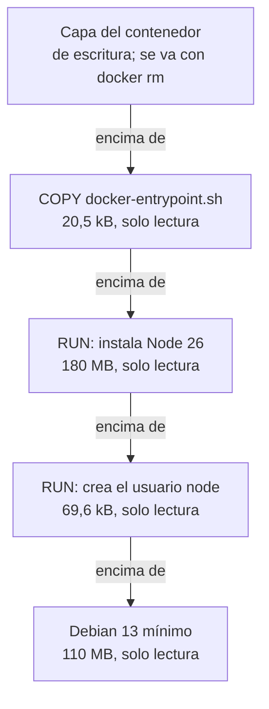

import Term from '~/components/Term.astro';
import TryIt from '~/components/TryIt.astro';
import Analogy from '~/components/Analogy.astro';
import SelfCheck from '~/components/SelfCheck.astro';
import Quiz from '~/components/Quiz.astro';
import QuizQuestion from '~/components/QuizQuestion.astro';
import QuizOption from '~/components/QuizOption.astro';
import DockerLayers from '~/playgrounds/docker-layers/DockerLayers';

## El problema

Imagina que Ana mete la API de la tienda en una imagen. Cambia una frase en un fichero de `src/`, vuelve a construir la imagen y espera: Docker reinstala los 161 MB de dependencias. Con cada cambio, otra vez.

Luis tiene los mismos ficheros y casi la misma receta: una línea más, y otro orden. Su imagen se reconstruye en un segundo y sale igual que la de Ana.

¿Por qué el orden cambia tanto? Porque Docker construye una imagen **por capas**, y guarda cada capa para reutilizarla la próxima vez. De eso salen casi todas las reglas de un buen Dockerfile.

## La analogía

<Analogy>

Piensa en una pastelería que hace tartas por pisos. Abajo va un bizcocho comprado, luego crema, luego fruta y arriba la decoración. Cada piso se pone sobre el anterior.

Si el cliente cambia la decoración, el pastelero guarda la tarta y rehace solo el último piso. Si cambia la crema, tiene que quitar la fruta y la decoración, aunque no hayan cambiado, porque están encima. Por eso un buen pastelero pone arriba lo que los clientes cambian más a menudo.

Una imagen es esa tarta: el bizcocho es la imagen base, cada piso una capa, y cambiar uno obliga a rehacer los de encima.

<div slot="limits">

- Dos tartas necesitan dos bizcochos. Dos imágenes construidas sobre la misma base guardan sus capas una sola vez.
- El pastelero ve qué ha cambiado. Docker no mira lo que hace cada paso: compara el texto de la instrucción y la huella de los ficheros que copia.
- Una capa de arriba puede tapar un fichero de una capa de abajo, pero no quitarlo: la imagen no adelgaza por borrar algo en un paso posterior.

</div>

</Analogy>

## Cómo funciona de verdad

Un <Term id="dockerfile">Dockerfile</Term> es la receta de una imagen: un fichero de texto con una instrucción por línea, que Docker ejecuta de arriba abajo. Escribirás el de la tienda en la [lección 3](/fase-7/dockerfile/).

### Una imagen es una pila de capas

`node:26-slim` es la imagen de la que partirá tu API: Node 26 sobre un Debian mínimo. `docker history` enseña los pasos con los que se construyó:

<TryIt
  title="Los pasos de node:26-slim"
  cmd="docker history node:26-slim"
  output={`IMAGE          CREATED      CREATED BY                                      SIZE      COMMENT
193fe51b64e7   5 days ago   CMD ["node"]                                    0B        buildkit.dockerfile.v0
<missing>      5 days ago   ENTRYPOINT ["docker-entrypoint.sh"]             0B        buildkit.dockerfile.v0
<missing>      5 days ago   COPY docker-entrypoint.sh /usr/local/bin/ # …   20.5kB    buildkit.dockerfile.v0
<missing>      5 days ago   RUN /bin/sh -c ARCH= OPENSSL_ARCH= && dpkgAr…   180MB     buildkit.dockerfile.v0
<missing>      5 days ago   ENV NODE_VERSION=26.11.1                        0B        buildkit.dockerfile.v0
<missing>      5 days ago   RUN /bin/sh -c groupadd --gid 1000 node   &&…   69.6kB    buildkit.dockerfile.v0
<missing>      9 days ago   # debian.sh --arch 'arm64' out/ 'trixie' '@1…   110MB     debuerreotype 0.17`}
>

Si no tienes la imagen, descárgala antes con `docker pull node:26-slim`.

- **`CREATED BY`** es la instrucción de cada paso, recortada con `…`. Con `--no-trunc` (*no truncate*, «no recortar») sale entera.
- **`SIZE`** es lo que añadió, sin comprimir.
- **`<missing>`** no es un error: esos pasos se construyeron en las máquinas de Docker, y tú solo descargaste el resultado.

Tus fechas, IDs y tamaños serán otros: la imagen se actualiza a menudo. En un PC verás `amd64` en lugar de `arm64`.

</TryIt>

Se lee de abajo arriba, en el orden en que se construyó:

| Paso | Qué hace | Tamaño |
|---|---|---|
| `# debian.sh … 'trixie'` | Un Debian 13 («trixie») mínimo: la base | 110 MB |
| `RUN … groupadd … node` | Crea el <Term id="user">usuario</Term> `node` | 69,6 kB |
| `ENV NODE_VERSION=26.11.1` | Apunta qué versión de Node instala | 0 B |
| `RUN … dpkgArch …` | Descarga Node 26, comprueba su firma y lo instala | 180 MB |
| `COPY docker-entrypoint.sh …` | Copia un script de arranque | 20,5 kB |
| `ENTRYPOINT` y `CMD ["node"]` | Qué ejecutar al arrancar un contenedor | 0 B |

Cada paso con tamaño es una <Term id="image-layer">capa</Term>: **un paquete de ficheros de solo lectura con lo que ese paso añadió, cambió o borró**. Siete pasos y cuatro capas, que suman unos 290 MB sin comprimir. Lo que se descarga va comprimido: 88 MB, la columna `CONTENT SIZE` de `docker image ls` que viste en la [lección 1](/fase-7/imagen-contenedor-docker/).

### Algunas instrucciones no añaden capa

Solo los pasos que tocan ficheros crean una capa:

- **`RUN`** ejecuta una orden durante la construcción, como `apt-get install`, y guarda lo que cambió en el disco.
- **`COPY`** copia ficheros de tu ordenador a la imagen.
- **`WORKDIR`** elige la carpeta de trabajo y, si no existe, la crea: una capa de pocos kB.

Las demás, como `ENV`, `CMD`, `ENTRYPOINT`, `EXPOSE` o `USER`, **solo guardan datos** en la ficha de la imagen, un pequeño fichero de configuración: por eso salen con `0B`. Aun así cuentan para la caché.

### Las capas se apilan, y el contenedor escribe en la suya

Cuando arrancas un contenedor, Docker pone las capas una encima de otra y les añade la capa de escritura de la lección 1:



Dentro, el programa ve una sola carpeta `/` con todo junto. Cuando busca un fichero, Docker mira de arriba abajo y le da el primero que encuentra. Si el programa cambia un fichero de una capa de abajo, Docker lo copia antes a la capa del contenedor y lo cambia allí: las de abajo no se tocan nunca.

Borrar funciona igual: en la capa de arriba queda una marca que dice «este fichero ya no está». El fichero desaparece de la vista, pero **sigue ocupando sitio en la capa de abajo**.

### Varias imágenes comparten las mismas capas

Una capa no pertenece a una imagen: se guarda una vez y cada imagen que la necesita la apunta en su lista. Si construyes tres imágenes sobre `node:26-slim`, sus cuatro capas están una sola vez en tu disco, y `docker pull` no baja las que ya tienes.

### Cada capa se nombra por su huella

¿Cómo sabe Docker que dos capas son la misma? Por su **huella**: un <Term id="hash">hash</Term> SHA-256 de su contenido, la misma idea que el hash que nombra cada commit en [Git](/fase-1/git-por-dentro/). Los mismos bytes dan siempre la misma huella, y un byte distinto da otra completamente diferente.

La imagen entera también tiene la suya, el *digest*:

<TryIt
  title="La huella de node:26-slim"
  cmd="docker image ls --digests node:26-slim"
  output={`REPOSITORY   TAG       DIGEST                                                                    IMAGE ID       CREATED      SIZE
node         26-slim   sha256:193fe51b64e77981119c98c2002c9e32a70e2f006fb4d25068ce0558998917f0   193fe51b64e7   5 days ago   378MB`}
>

`--digests` añade la columna `DIGEST`: `sha256:` y 64 caracteres. Es la huella de la ficha que describe la imagen, que apunta cada capa por su huella: si cambia un byte de cualquier capa, cambia el *digest*. El `IMAGE ID` son sus primeros 12 caracteres.

Con `--digests`, la tabla vuelve a su formato antiguo. Su `SIZE`, 378 MB, es lo que ocupa en tu disco: las capas sin comprimir más la descarga, que Docker también guarda. Tu *digest* será otro si tu imagen es más nueva, no por tu procesador.

</TryIt>

**Mismo contenido, misma huella, en cualquier ordenador del mundo.** Una etiqueta como `26-slim` puede apuntar mañana a otra imagen; `node:26-slim@sha256:193f…` es siempre exactamente esta. La lección 8 lo usa para fijar versiones.

### La caché de construcción reutiliza lo que no ha cambiado

Cuando construyes una imagen, Docker guarda cada capa en su <Term id="build-cache">caché de construcción</Term>. La próxima vez, recorre el Dockerfile de arriba abajo y en cada paso se pregunta dos cosas:

1. ¿Reutilicé el paso anterior?
2. ¿Este paso es igual que la última vez? En un `RUN`, un `ENV` o un `CMD`, igual significa **el mismo texto**. En un `COPY`, además, **los mismos ficheros**: Docker calcula la huella de su contenido y la compara.

Si las dos respuestas son sí, reutiliza la capa guardada: `CACHED`, cero segundos. **En el primer paso que cambia, lo ejecuta, y desde ahí ejecuta también todos los de detrás**, aunque no usen lo que cambió. Cada capa se construye sobre la anterior: si cambia la de abajo, la de arriba ya no vale, como el piso de la tarta.

Docker nunca mira qué hace un `RUN`. Si el texto es el mismo, lo reutiliza, aunque la orden hoy diera otro resultado.

### Por qué package.json va antes que el código

En una API de Node, el paso lento es `npm ci`: instala exactamente las versiones del *lockfile* `package-lock.json` (lo viste en la [Fase 3](/fase-3/que-es-node-js/)). Su capa es la más grande: 161 MB en la tienda.

Compara los dos órdenes posibles:

| | Orden de Ana | Orden de Luis |
|---|---|---|
| Primero | `COPY . .`: copia todo | `COPY package*.json ./`: copia `package.json` y `package-lock.json` |
| Después | `RUN npm ci` | `RUN npm ci` |
| Al final | | `COPY . .`: copia el resto |
| Cambias un fichero de `src/` | Cambia lo que copia `COPY . .`, así que `npm ci` se repite | `npm ci` se reutiliza: sus ficheros no han cambiado. Solo se repite el último `COPY` |

El `*` de `package*.json` vale por cualquier texto, como en la terminal. La regla general: **lo que cambia poco, arriba; lo que cambias a menudo, abajo**. Las dependencias cambian cuando añades una; el código, cada día.

## Pruébalo

El objetivo: averiguar cuánto tiempo te ahorra el orden de Luis, primero con el Dockerfile de la tienda en el laboratorio y después con una imagen tuya, construida de verdad.

### En el laboratorio

El laboratorio muestra el Dockerfile de la tienda, el de la [lección 3](/fase-7/dockerfile/), junto a las capas que construye, con tamaños y segundos de construcciones reales. Sigue el orden de Luis, pero copia los ficheros por su nombre y, con ellos, `.npmrc`, la configuración de npm: la lección 3 explica por qué.

<DockerLayers client:visible lang="es" />

1. Pulsa «Construir»: la primera vez, sin caché, se ejecutan todos los pasos. Fíjate en cuál es el lento.
2. Pulsa «Cambiar un fichero de src/» y después «Reconstruir». ¿Qué capas se reutilizan?
3. Haz lo mismo con «Cambiar package.json». ¿Desde qué línea se repite todo?
4. Cambia «Orden» a «incorrecto», el de Ana, construye y repite el paso 2. Compara el tiempo.
5. Pon «Multi-stage» en «sí»: verás qué partes no llegan a la imagen final. La [lección 4](/fase-7/docker-multi-stage/) te lo explica.

### En tu terminal: una imagen de dos ficheros

Ahora, la misma idea con una imagen pequeña. Las salidas son de Docker Engine 29 en un Mac, dentro de una máquina virtual con Linux; las capturamos con otro nombre de imagen, cambiado por `hola`, y nada más cambia. Tus IDs, huellas, tamaños y tiempos serán otros.

Crea la carpeta:

```sh
mkdir -p ~/curso-backend/fase-7/hola
cd ~/curso-backend/fase-7/hola
```

Dentro, crea con tu editor un fichero `hola.js` con esta línea:

```js
console.log('Hola desde la tienda de Ana y Luis');
```

Y otro, llamado `Dockerfile`, sin extensión:

```dockerfile
FROM node:26-slim
RUN apt-get update && apt-get install -y --no-install-recommends curl
WORKDIR /app
COPY hola.js ./
CMD ["node", "hola.js"]
```

La [lección 3](/fase-7/dockerfile/) explica cada instrucción. Por ahora:

- **`FROM`** parte de `node:26-slim`, con sus cuatro capas.
- **`RUN`** instala `curl` con `apt`, como en la [Fase 1](/fase-1/servicios-systemd-apt/). Hace el papel de `npm ci`: tarda, y lo que instala cambia poco.
- **`WORKDIR`** y **`COPY`** crean `/app` y copian ahí tu fichero.
- **`CMD`** dice qué ejecutar al arrancar.

<TryIt
  title="1. Construye la imagen"
  cmd="docker build --progress=plain -t hola ."
  output={`…
#5 [1/4] FROM docker.io/library/node:26-slim@sha256:193fe51b64e77981119c98c2002c9e32a70e2f006fb4d25068ce0558998917f0
#5 resolve docker.io/library/node:26-slim@sha256:193fe51b64e77981119c98c2002c9e32a70e2f006fb4d25068ce0558998917f0 0.1s done
#5 CACHED

#6 [2/4] RUN apt-get update && apt-get install -y --no-install-recommends curl
…
#6 DONE 5.9s

#7 [3/4] WORKDIR /app
#7 DONE 0.1s

#8 [4/4] COPY hola.js ./
#8 DONE 0.0s

#9 exporting to image
#9 exporting layers
#9 exporting layers 1.1s done
#9 exporting manifest sha256:99f125cafddb610ef3f45b97b45c448f8c9e0a7f1fb2c870dc2eadfcaf37e701 0.0s done
…
#9 naming to docker.io/library/hola:latest done
…`}
>

Palabra a palabra:

- **`docker build`** construye una imagen a partir del `Dockerfile` de una carpeta.
- **`--progress=plain`** escribe cada paso en sus propias líneas. Sin él, Docker dibuja un resumen que se va reescribiendo y se recoge al terminar.
- **`-t hola`** (de *tag*) le pone nombre a la imagen. Sin etiqueta, Docker añade `latest`.
- **`.`** es la carpeta actual: sus ficheros son lo único que `COPY` puede copiar.

Hemos quitado (`…`) las primeras líneas, `[internal]`, que leen el Dockerfile y tus ficheros, y las de `apt`. Fíjate en `[2/4]`: el paso 2 de 4 tardó 5,9 segundos, y los demás casi nada. En `FROM`, la etiqueta se ha convertido en *digest*. Apunta el `exporting manifest sha256:99f1…`: es la huella de la ficha que describe tu imagen.

Si sale `"/hola.js": not found`, el fichero no está en la carpeta o tiene otro nombre: compruébalo con `ls`.

</TryIt>

<TryIt
  title="2. Constrúyela otra vez, sin cambiar nada"
  cmd="docker build --progress=plain -t hola ."
  output={`…
#6 [2/4] RUN apt-get update && apt-get install -y --no-install-recommends curl
#6 CACHED

#7 [3/4] WORKDIR /app
#7 CACHED

#8 [4/4] COPY hola.js ./
#8 CACHED

#9 exporting to image
#9 exporting layers done
#9 exporting manifest sha256:99f125cafddb610ef3f45b97b45c448f8c9e0a7f1fb2c870dc2eadfcaf37e701 done
…`}
>

Todos los pasos dicen **`CACHED`**: nada ha cambiado, así que Docker no ejecuta ninguno. Y la huella es **la misma `99f1…`** que antes: mismo contenido, misma huella.

Otras huellas que hemos quitado sí cambian: Docker guarda junto a la imagen una nota con la hora de la construcción. Por eso el `IMAGE ID` cambia cada vez.

</TryIt>

Ahora cambia el texto de `hola.js` con tu editor, por ejemplo a `'Hola desde la tienda de Ana y Luis. Abrimos el lunes.'`, y guárdalo.

<TryIt
  title="3. Cambia el código y reconstruye"
  cmd={`docker build --progress=plain -t hola .\ndocker run --rm hola`}
  output={`…
#6 [2/4] RUN apt-get update && apt-get install -y --no-install-recommends curl
#6 CACHED

#7 [3/4] WORKDIR /app
#7 CACHED

#8 [4/4] COPY hola.js ./
#8 DONE 0.4s
…
Hola desde la tienda de Ana y Luis. Abrimos el lunes.`}
>

`RUN` y `WORKDIR` siguen en caché; solo `COPY hola.js` se ejecuta, porque la huella del fichero ha cambiado. Es el orden de Luis: los 5,9 segundos de `apt` no se repiten. `docker run --rm hola` arranca la imagen nueva.

Si `RUN` no dice `CACHED`, revisa que no hayas tocado su línea: un espacio de más ya es otro texto.

</TryIt>

<TryIt
  title="4. ¿Cuánto ocupa de verdad?"
  cmd={`docker history hola\ndocker system df -v | grep -E 'REPOSITORY|hola|26-slim'`}
  output={`IMAGE          CREATED          CREATED BY                                      SIZE      COMMENT
6929548d524b   19 seconds ago   CMD ["node" "hola.js"]                          0B        buildkit.dockerfile.v0
<missing>      19 seconds ago   COPY hola.js ./ # buildkit                      12.3kB    buildkit.dockerfile.v0
<missing>      3 minutes ago    WORKDIR /app                                    8.19kB    buildkit.dockerfile.v0
<missing>      3 minutes ago    RUN /bin/sh -c apt-get update && apt-get ins…   35.9MB    buildkit.dockerfile.v0
<missing>      5 days ago       CMD ["node"]                                    0B        buildkit.dockerfile.v0
<missing>      5 days ago       ENTRYPOINT ["docker-entrypoint.sh"]             0B        buildkit.dockerfile.v0
<missing>      5 days ago       COPY docker-entrypoint.sh /usr/local/bin/ # …   20.5kB    buildkit.dockerfile.v0
<missing>      5 days ago       RUN /bin/sh -c ARCH= OPENSSL_ARCH= && dpkgAr…   180MB     buildkit.dockerfile.v0
<missing>      5 days ago       ENV NODE_VERSION=26.11.1                        0B        buildkit.dockerfile.v0
<missing>      5 days ago       RUN /bin/sh -c groupadd --gid 1000 node   &&…   69.6kB    buildkit.dockerfile.v0
<missing>      9 days ago       # debian.sh --arch 'arm64' out/ 'trixie' '@1…   110MB     debuerreotype 0.17
REPOSITORY   TAG       IMAGE ID       CREATED              SIZE      SHARED SIZE   UNIQUE SIZE   CONTAINERS
hola         latest    6929548d524b   About a minute ago   433MB     375.4MB       57.56MB       0
node         26-slim   193fe51b64e7   5 days ago           378MB     375.4MB       2.235MB       0`}
>

`docker history hola` enseña tus cuatro pasos encima de los siete de `node:26-slim`. Tu `RUN` añadió 35,9 MB; tu `COPY`, unos kB.

`docker system df` (*disk free*) cuenta lo que ocupa Docker en tu disco, y `-v` (*verbose*) lo desglosa por imagen. `grep -E 'A|B|C'` deja las líneas con cualquiera de los tres textos ([lección 3 de la Fase 1](/fase-1/pipes-y-redirecciones/)). **`SHARED SIZE`, 375,4 MB, son las capas de `node:26-slim`**: están en las dos imágenes y en tu disco una sola vez. `UNIQUE SIZE` es lo de cada una.

Hemos ajustado el espacio entre columnas, que en nuestra máquina ensanchaban otras imágenes.

</TryIt>

<SelfCheck question="Reto: en el Dockerfile, baja la línea RUN hasta debajo de COPY hola.js ./, con el orden de Ana. Construye, cambia otra vez la frase de hola.js y vuelve a construir. ¿Qué pasos se repiten en la segunda construcción, y por qué?">

En la segunda construcción, `COPY` y todo lo de detrás se ejecutan otra vez, `apt` incluido:

```text
#7 [3/4] COPY hola.js ./
#7 DONE 0.0s

#8 [4/4] RUN apt-get update && apt-get install -y --no-install-recommends curl
…
#8 DONE 5.5s
```

`apt` no usa `hola.js`, pero va detrás de un paso que cambió, y Docker no mira qué hace cada orden. Es el orden de Ana: cada cambio en el código paga los segundos de la instalación.

</SelfCheck>

Para terminar, borra la imagen:

<TryIt
  title="5. Limpia"
  cmd="docker image rm hola"
  output={`Untagged: hola:latest
Deleted: sha256:6929548d524b327e6d9c03f255f61fcca66d15c9cf7a834c114b21c46b6b2f7c`}
>

`node:26-slim` se queda: la usarás en la lección 3. La caché de construcción también, y ocupa espacio: `docker system df` la enseña en la fila `Build Cache`.

</TryIt>

## Ya lo has visto

- **Las líneas de `docker pull`.** En la [lección 1](/fase-7/imagen-contenedor-docker/), cada línea con un código era una pieza de la imagen, casi todas capas, nombrada por el principio de su huella.
- **La caché de HTTP.** El `ETag` de la [Fase 2](/fase-2/cache-http/) es una huella del contenido para saber si ha cambiado sin descargarlo otra vez. La caché de construcción hace lo mismo con tus ficheros.

## Errores comunes

- **Copiar todo antes de instalar.** Con `COPY . .` antes de `npm ci`, cada cambio en el código reinstala las dependencias.
- **Borrar en un paso aparte.** `RUN rm` en otra línea no hace la imagen más pequeña: el fichero sigue en la capa de abajo. Se borra en el mismo `RUN` que lo crea, como en la [lección 4](/fase-7/docker-multi-stage/).
- **Esperar que la caché sepa lo que hace un `RUN`.** `RUN apt-get update` puede seguir `CACHED` meses después. Para construir de cero, `docker build --no-cache`.
- **Copiar de más.** `COPY . .` también se lleva `node_modules` o tu `.env`, y si cambian, invalidan la caché. Un fichero `.dockerignore` los deja fuera ([lección 3](/fase-7/dockerfile/)).
- **Sumar los tamaños de `docker image ls`.** Las capas compartidas cuentan en cada imagen, pero están una vez en el disco: mira `docker system df`.

## Resumen

- Una imagen es una pila de capas de solo lectura. `RUN`, `COPY` y `WORKDIR` añaden una; `ENV`, `CMD` o `EXPOSE` solo guardan datos en su ficha.
- El contenedor ve las capas como una sola carpeta y escribe en la suya. Borrar en una capa de arriba tapa el fichero, pero no libera su sitio.
- Cada capa y cada imagen se nombran por la huella SHA-256 de su contenido: mismo contenido, misma huella. Por eso varias imágenes comparten capas.
- La caché reutiliza un paso si el anterior se reutilizó y el suyo no ha cambiado: el mismo texto y, en un `COPY`, los mismos ficheros. Desde el primer cambio, se repite todo.
- Lo que cambia poco va arriba: `COPY package*.json` y `npm ci` antes de copiar el código.

## ¿Lo has entendido?

<Quiz>

<QuizQuestion
  question="El Dockerfile de tu API copia package*.json, ejecuta npm ci y después copia el resto (COPY . .). Cambias un mensaje en src/productos.ts y reconstruyes. ¿Qué se ejecuta otra vez?"
  review="Por qué package.json va antes que el código"
>

<QuizOption text="Todo desde COPY package*.json: la carpeta del proyecto ha cambiado.">

Docker no compara la carpeta, sino los ficheros que copia cada paso. `package.json` y el *lockfile* no han cambiado, así que ese `COPY` y `npm ci` se reutilizan.

</QuizOption>

<QuizOption text="Solo el último COPY . ., que es el que copia src/." correct>

Los pasos de antes son iguales que la última vez y salen de la caché. Solo cambia lo que copia `COPY . .`, y detrás no hay más pasos con capa.

</QuizOption>

<QuizOption text="npm ci y el último COPY: npm ci se ejecuta siempre para tener las dependencias al día.">

`npm ci` sale de la caché mientras no cambie su texto ni lo que hay antes. Docker no lo repite por precaución.

</QuizOption>

</QuizQuestion>

<QuizQuestion
  question="Con el mismo Dockerfile, añades una dependencia con npm install, que cambia package.json y package-lock.json. ¿Qué pasos se repiten?"
  review="La caché de construcción reutiliza lo que no ha cambiado"
>

<QuizOption text="Solo npm ci: es el único que usa esos ficheros.">

También se repite `COPY package*.json`, que copia los ficheros cambiados, y `COPY . .`, que va detrás: desde el primer cambio, se repite todo.

</QuizOption>

<QuizOption text="Ninguno: npm install ya instaló la dependencia en tu ordenador.">

La imagen no usa tu `node_modules`: instala dentro sus propias dependencias, y el *lockfile* ha cambiado.

</QuizOption>

<QuizOption text="COPY package*.json, npm ci y COPY . ., en ese orden." correct>

El primer `COPY` copia ficheros con otra huella, así que se ejecuta, y con él todo lo que va detrás. Es justo lo que quieres: la dependencia nueva entra en la imagen.

</QuizOption>

</QuizQuestion>

<QuizQuestion
  question="En docker history de una imagen ves una fila ENV NODE_ENV=production con 0B. ¿Qué es?"
  review="Algunas instrucciones no añaden capa"
>

<QuizOption text="Una capa vacía que Docker guarda y descarga igual que las demás.">

No hay capa: `ENV` no toca ficheros. La variable va a la ficha de configuración de la imagen.

</QuizOption>

<QuizOption text="Un dato de la ficha de la imagen: no tiene capa." correct>

`ENV` solo guarda una variable en la configuración. No añade ficheros, pero sí cuenta para la caché: si cambias su texto, ese paso y los de detrás se repiten.

</QuizOption>

<QuizOption text="Un paso que falló al construir: por eso no añadió nada.">

Si un paso falla, la construcción se para con un error y no hay imagen. `0B` es lo normal en las instrucciones que solo guardan datos.

</QuizOption>

</QuizQuestion>

<QuizQuestion
  question="Tienes tres imágenes construidas sobre node:26-slim. docker image ls dice que cada una ocupa unos 400 MB. ¿Ocupan 1,2 GB en tu disco?"
  review="Varias imágenes comparten las mismas capas"
>

<QuizOption text="No: las capas de node:26-slim están una sola vez en el disco." correct>

Las capas se nombran por su huella, y las tres imágenes apuntan a las mismas; cada una solo suma las suyas. `docker system df -v` lo muestra en `SHARED SIZE`.

</QuizOption>

<QuizOption text="Sí: cada imagen es una copia completa, con su propio Debian y su Node.">

Las imágenes no copian las capas de su base, las apuntan. Por eso `docker pull` no vuelve a bajar las capas que ya tienes.

</QuizOption>

<QuizOption text="No: Docker comprime todas las imágenes juntas en un solo fichero de 88 MB.">

88 MB es lo que se descarga de `node:26-slim`, comprimido. El ahorro viene de compartir capas.

</QuizOption>

</QuizQuestion>

<QuizQuestion
  question="Tu Dockerfile tiene RUN apt-get update && apt-get install -y curl. Lo construiste hace un mes; hoy reconstruyes, ese paso dice CACHED, y esperabas los arreglos de seguridad de este mes. ¿Qué ha pasado?"
  review="La caché de construcción reutiliza lo que no ha cambiado"
>

<QuizOption text="La caché solo dura unos días: si dice CACHED, es que no había nada nuevo que instalar.">

La caché no caduca en unos días. `CACHED` solo dice que la instrucción y lo de antes no han cambiado, no que el catálogo de Debian siga igual.

</QuizOption>

<QuizOption text="apt no actualiza nada dentro de una imagen: hay que cambiar de imagen base.">

`apt` funciona dentro de una construcción como en cualquier Debian. El problema es que Docker ni siquiera lo ha ejecutado.

</QuizOption>

<QuizOption text="Docker ve el mismo texto de la orden y reutiliza la capa de hace un mes." correct>

Docker no sabe qué hace un `RUN`: si el texto y los pasos de antes son iguales, reutiliza la capa. Con `docker build --no-cache` se ejecuta todo de nuevo.

</QuizOption>

</QuizQuestion>

<QuizQuestion
  question="Luis y tú descargáis node:26-slim@sha256:193fe51b… en dos ordenadores distintos, con días de diferencia. ¿Tenéis la misma imagen?"
  review="Cada capa se nombra por su huella"
>

<QuizOption text="Solo si la descargasteis el mismo día: la etiqueta puede haber cambiado entre medias.">

Eso pasa con una etiqueta como `26-slim`, que puede apuntar a otra imagen mañana. El *digest* nombra un contenido concreto, y no cambia.

</QuizOption>

<QuizOption text="Sí, byte a byte: el digest es la huella del contenido." correct>

Mismo contenido, misma huella, y un byte distinto daría otra. Si la huella coincide, la imagen es la misma, donde y cuando sea.

</QuizOption>

<QuizOption text="No: cada ordenador calcula su propio digest al descargarla.">

El *digest* depende solo del contenido, no de quién lo calcula. Por eso Docker puede comprobar que lo descargado es exactamente lo que pediste.

</QuizOption>

</QuizQuestion>

</Quiz>

## Para profundizar

- [Understanding the image layers](https://docs.docker.com/get-started/docker-concepts/building-images/understanding-image-layers/) y [Using the build cache](https://docs.docker.com/get-started/docker-concepts/building-images/using-the-build-cache/), de la documentación de Docker, en inglés.
- [Cache invalidation](https://docs.docker.com/build/cache/invalidation/) y [Optimize cache usage](https://docs.docker.com/build/cache/optimize/), en inglés: qué invalida cada instrucción y cómo ordenar un Dockerfile.
- [La referencia de `docker history`](https://docs.docker.com/reference/cli/docker/image/history/), en inglés.
- [Descriptor](https://github.com/opencontainers/image-spec/blob/main/descriptor.md), de la especificación de imágenes de OCI, en inglés: cómo se calculan y se usan los *digests*.
