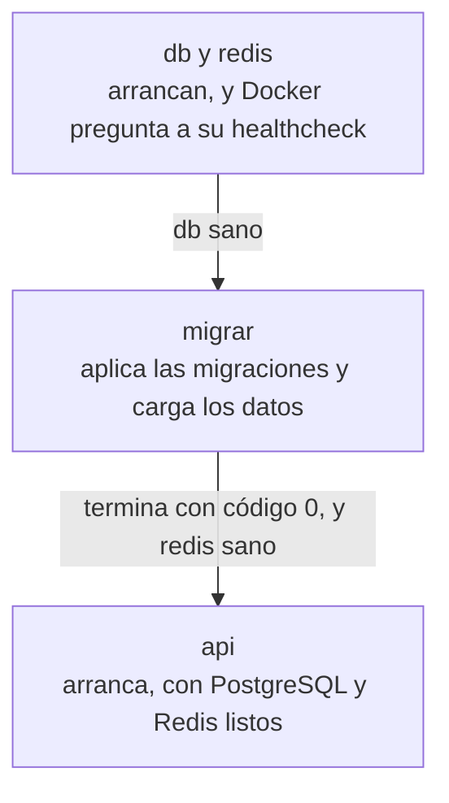

import Term from '~/components/Term.astro';
import TryIt from '~/components/TryIt.astro';
import Analogy from '~/components/Analogy.astro';
import ProjectCode from '~/components/ProjectCode.astro';
import Quiz from '~/components/Quiz.astro';
import QuizQuestion from '~/components/QuizQuestion.astro';
import QuizOption from '~/components/QuizOption.astro';

## El problema

Imagina que Luis se une al proyecto y quiere la tienda en su portátil. Ana le pasa las órdenes de las lecciones [5](/fase-7/volumenes-docker/) y [6](/fase-7/redes-docker/), más o menos estas:

```sh
docker network create tienda
docker run -d --name db --network tienda -v datos:/var/lib/postgresql \
  -e POSTGRES_USER=tienda -e POSTGRES_PASSWORD=TU-CONTRASEÑA postgres:18
docker run -d --name api --network tienda --env-file .env \
  -e DATABASE_URL=postgres://tienda:TU-CONTRASEÑA@db:5432/tienda \
  -p 127.0.0.1:3000:3000 tienda-api
```

Faltan las migraciones y Redis. Los nombres tienen que coincidir, la contraseña va en dos sitios, y el orden importa: si la API arranca antes de que PostgreSQL acepte conexiones, falla. Luis se equivoca en una letra y pierde la tarde.

**Docker Compose convierte esas órdenes en un fichero**, y la tienda entera arranca con `docker compose up`.

## La analogía

<Analogy>

Piensa en cómo abre una panadería por la mañana. Primero se enciende el horno y se espera a que llegue a 200 grados. Después se hornea la primera tanda. Solo entonces se abre la puerta. Si alguien se salta la espera, el pan sale crudo.

La dueña no se lo explica a cada empleado nuevo: lo escribe en una hoja pegada en la pared. Quien llegue sigue la hoja, y la panadería abre igual cada día.

`compose.yaml` es esa hoja. El horno a 200 grados es PostgreSQL sano; la primera tanda, las migraciones; abrir la puerta, arrancar la API. `docker compose up` es seguir la hoja, y `docker compose down`, cerrar al final del día.

<div slot="limits">

- Un empleado nota si algo huele raro. Compose solo comprueba lo que la hoja dice.
- La hoja dice cómo abrir, no qué hacer si el horno se apaga a mediodía. Compose ordena el arranque; si PostgreSQL se cae después, la API sigue en marcha y su `/salud` responde `503`.
- Cerrar con `down -v` es cerrar y tirar el género: la base de datos de este proyecto, no las de los demás.

</div>

</Analogy>

## Cómo funciona de verdad

### Un fichero en lugar de tres órdenes

<Term id="docker-compose">Docker Compose</Term> es la parte de Docker que arranca varios contenedores a partir de un fichero. Lo instalaste con Docker en la [introducción](/fase-7/), y `docker compose version` dice cuál tienes.

El fichero se llama `compose.yaml` y vive en la carpeta del proyecto. Está escrito en **YAML**, un formato de texto para datos, como JSON pero sin llaves: la sangría dice qué va dentro de qué, y `#` empieza un comentario. Este es el de la tienda:

<ProjectCode file="tienda-api/34-compose/compose.yaml" />

`compose.yaml` va a Git, como el `Dockerfile`: describe la tienda, sin ningún secreto.

### Un proyecto, cuatro servicios

- **`name: tienda`**: el nombre del proyecto. Compose lo pone delante de todo lo que crea: los contenedores se llaman `tienda-db-1`, `tienda-api-1`… (el número es la copia). Sin `name`, usaría el nombre de la carpeta.
- **`services`**: cada servicio es un programa de la tienda, y cada uno corre en su contenedor. Son cuatro: `db`, `redis`, `migrar` y `api`.
- **`image: postgres:18@sha256:…`**: la imagen que se descarga. Detrás de la `@` va su <Term id="image-digest">huella</Term> (*digest*), que la fija byte a byte; la [lección 8](/fase-7/docker-hub-registro/) lo explica.
- **`build: .`**: en lugar de descargar una imagen, la construye con el `Dockerfile` de esta carpeta, el de la [lección 4](/fase-7/docker-multi-stage/). Compose la llama `tienda-api`, como la tuya: la sustituye.
- **`command`**: cambia el `CMD` de la imagen. Redis arranca sin guardar nada en disco; `migrar`, con la misma imagen que la API, ejecuta los dos scripts de la [Fase 5](/fase-5/migraciones-base-de-datos/) y termina.

`migrar` no es un servidor, sino una tarea: aplica las migraciones que falten, carga los datos de práctica y sale. Se ejecuta en cada `up`, y las migraciones ya aplicadas no se repiten. Para eso, el `Dockerfile` copia ahora también `bd/` y esos dos scripts a la imagen final.

### Las variables llegan de tu .env

Las <Term id="environment-variable">variables de entorno</Term> de cada contenedor se escriben de dos formas:

- **`environment`**: una lista de variables, como varios `-e` en `docker run`.
- **`env_file: .env`**: todas las de tu `.env`, como `--env-file .env`. La API recibe así sus secretos de la [Fase 6](/fase-6/rate-limiting-secretos/).

Si una variable está en los dos, **manda `environment`**, como mandaba `-e` en la [lección 6](/fase-7/redes-docker/). Por eso tu `.env` puede seguir con la `DATABASE_URL` de `localhost`, para arrancar la API sin Docker, y dentro de Compose vale la de `db`.

Y Compose usa `.env` para algo más: **lo lee solo**, si está junto a `compose.yaml`, y cambia cada `${POSTGRES_PASSWORD}` del fichero por su valor. Con `${POSTGRES_PASSWORD:?mensaje}`, si falta, se para y escribe el mensaje.

La contraseña de PostgreSQL es nueva y la generas con `openssl rand -hex 24`: 24 bytes al azar, escritos en hexadecimal, solo con `0`–`9` y `a`–`f`. **No con `-base64`**, como los secretos de la Fase 6, porque esta va dentro de una URL, `postgres://tienda:CONTRASEÑA@db:5432/tienda`, y base64 usa `/`, `+` y `=`, que en una URL significan otra cosa.

La imagen de PostgreSQL solo usa `POSTGRES_USER`, `POSTGRES_DB` y `POSTGRES_PASSWORD` **la primera vez**, con el volumen vacío: crea el usuario `tienda`, su base de datos y su contraseña. Después, están guardados en el volumen.

### Puertos, volúmenes y una red que no escribes

**`ports: '127.0.0.1:3000-3001:3000'`** <Term id="port-publishing">publica</Term> el puerto 3000 de la API, solo en tu ordenador, como en la lección 6. A la izquierda va un rango: cada copia de la API toma un puerto libre de él. Con una, el 3000 o el 3001; con dos, uno cada una. Con un solo puerto, la segunda copia no podría arrancar.

`db` y `redis` no publican nada: solo los ven los contenedores de la tienda. Tu PostgreSQL de la Fase 5 sigue en el 5432 sin chocar.

**`volumes`** dentro de `db` monta el volumen `datos` en la carpeta donde PostgreSQL guarda sus ficheros, como `-v` en la [lección 5](/fase-7/volumenes-docker/). El `volumes:` del final declara ese volumen, y Compose lo llama `tienda_datos`: otro distinto del `datos` de la lección 5, y empieza vacío.

**La <Term id="docker-network">red</Term> no se escribe.** Compose crea `tienda_default` y mete en ella los cuatro servicios, cada uno con el nombre del servicio como nombre en la red: la API llega a `db` y a `redis` por su nombre, con el DNS de Docker de la lección 6.

### Arrancar en orden: depends_on y los healthchecks

`depends_on` dice de quién depende un servicio. Escrito solo, Compose espera a que el otro contenedor **arranque**, pero PostgreSQL tarda unos segundos en aceptar conexiones. Por eso cada dependencia lleva una **condición**:

- **`service_healthy`**: espera a que el otro esté sano.
- **`service_completed_successfully`**: espera a que el otro termine con código de salida 0, sin error.

Sano lo decide un <Term id="healthcheck">healthcheck</Term>: una orden que Docker ejecuta dentro del contenedor, como el `HEALTHCHECK` de la lección 4. En `db` es **`pg_isready -U tienda -d tienda`**, que pregunta a PostgreSQL si acepta conexiones; en `redis`, **`redis-cli ping`**, que espera un `PONG`. `interval: 2s` pregunta cada dos segundos; `timeout: 5s` da cinco para contestar, y a los quince fallos seguidos (`retries: 15`), lo marca `unhealthy`.

La API ya trae el suyo, el de la lección 4, que pregunta a `/salud`. `migrar` usa esa imagen, pero no es la API: `disable: true` le quita el healthcheck.

Así queda el arranque:



Si `migrar` falla, la API no arranca: mejor parada que sirviendo con tablas a medias.

### Las órdenes de cada día

Todas se escriben en la carpeta de `compose.yaml` y empiezan por `docker compose`:

| Orden | Qué hace |
|---|---|
| `up --build -d` | Construye la imagen si cambió algo, crea la red y el volumen, y arranca todo en orden |
| `ps` | Los contenedores del proyecto; con `-a`, también los que terminaron, como `migrar` |
| `logs -f api` | Los registros de la API, y sigue escribiendo los nuevos |
| `exec db psql -U tienda` | Abre `psql` dentro del contenedor de PostgreSQL |
| `port api 3000` | En qué puerto de tu ordenador quedó el 3000 de la API |
| `down` | Para y borra los contenedores y la red; el volumen se queda |
| `down -v` | Lo mismo, y borra también el volumen: **los datos** |

Palabra a palabra, la primera:

- **`up`**: crea lo que falte y arranca los servicios.
- **`--build`**: construye antes la imagen de `build: .`. Sin él, Compose usa la que ya tenga, aunque hayas cambiado el código.
- **`-d`**: en segundo plano, como `docker run -d` en la [lección 1](/fase-7/imagen-contenedor-docker/). Sin él, Compose mezcla los registros de todos en tu terminal, y <kbd>Ctrl</kbd> + <kbd>C</kbd> lo para todo.

`exec` ya da una terminal, sin `-it`. Y `down` no borra las imágenes: el siguiente `up` tarda segundos.

### Dos copias de la API, una sola cuenta en Redis

En la [lección de rate limiting de la Fase 6](/fase-6/rate-limiting-secretos/#en-memoria-vale-para-un-solo-servidor), el límite de intentos guardaba su cuenta en la memoria del servidor. Con dos copias de la API, cada una lleva la suya: quien ataca prueba diez contraseñas en una y diez en la otra.

La solución es un almacén compartido: **Redis**, el <Term id="key-value-store">almacén clave-valor</Term> de la [Fase 5](/fase-5/sql-vs-nosql/). Es un servidor aparte que guarda los datos en memoria, y las dos copias le preguntan al mismo. La tienda lo usa solo si existe `REDIS_URL`, y `compose.yaml` la pone:

<ProjectCode file="tienda-api/34-compose/src/limites.ts" region="almacen-elegido" />

Sin `REDIS_URL`, como con `npm start`, todo sigue como en la Fase 6. El almacén de Redis tiene las mismas dos funciones que el de memoria, así que el limitador no cambia:

<ProjectCode file="tienda-api/34-compose/src/almacen-redis.ts" region="almacen-redis" />

- **Un conjunto ordenado** (*sorted set*) por clave: cada intento es un miembro, con su instante como puntuación. Redis los guarda ordenados, así que borrar los que salieron de la ventana es una sola orden.
- **`multi()`** manda varias órdenes juntas: Redis las ejecuta seguidas, sin que se cuele otra entre ellas.
- **`pExpire`**: la clave caduca sola a las 24 horas sin intentos.

El último comentario reconoce un hueco: entre comprobar y apuntar, la otra copia puede colar un intento. Para frenar la fuerza bruta, basta.

## Pruébalo

El objetivo: arrancar la tienda entera con una orden, demostrar que dos copias de la API comparten el límite de intentos, y ver qué borra cada `down`.

Las salidas son de Docker Engine 29 y Compose 5.5 en un Mac, dentro de una máquina virtual con Linux, como la de Docker Desktop. Las capturamos con otros nombres y otros puertos, cambiados por los de la lección: nada más cambia. Hemos quitado columnas y ajustado espacios para que quepan. Tus IDs, tiempos y contraseñas serán otros.

### Actualiza tu proyecto

Trabajas en `~/curso-backend/fase-3/tienda-api`, con el proyecto de la lección 4. Descarga el paso y copia lo que cambia:

```sh
cd ~/curso-backend/fase-3
curl -O https://backenddesdecero.com/practicas/tienda-api/34-compose.tar.gz
tar -xzf 34-compose.tar.gz
cd tienda-api
cp ../34-compose/compose.yaml ../34-compose/Dockerfile ../34-compose/.dockerignore ../34-compose/.env.ejemplo .
cp ../34-compose/src/almacen-redis.ts ../34-compose/src/limites.ts ../34-compose/src/config.ts src/
cp ../34-compose/test/almacen-redis.test.ts ../34-compose/test/compose.test.ts test/
npm install redis@6.3.0
```

`compose.yaml` y `almacen-redis.ts` son nuevos. `limites.ts` elige el almacén, `config.ts` lee `REDIS_URL`, el `Dockerfile` copia también `bd/` y los dos scripts, y `.dockerignore` deja fuera `compose.yaml`.

Si tu PostgreSQL de la Fase 5 está en marcha, puede seguir: Compose no usa el 5432 de tu ordenador. Si la API de la lección 6 sigue en marcha, bórrala con `docker rm -f api`: usa el 3000.

### Arranca la tienda

<TryIt
  title="1. Una contraseña para PostgreSQL"
  cmd="openssl rand -hex 24"
  output="40da6c92412f1e8054dd79a82184746507103bf5c7f906ab"
>

48 caracteres, solo números y letras de la `a` a la `f`. Añade a tu `.env` una línea `POSTGRES_PASSWORD=` con la tuya, que será otra.

</TryIt>

<TryIt
  title="2. Todo, con una orden"
  cmd="docker compose up --build -d"
  output={`…
[+] up 8/8
 ✔ Image tienda-migrar        Built      0.7s
 ✔ Image tienda-api           Built      0.7s
 ✔ Network tienda_default     Created    0.0s
 ✔ Volume tienda_datos        Created    0.0s
 ✔ Container tienda-redis-1   Healthy    3.6s
 ✔ Container tienda-db-1      Healthy    3.6s
 ✔ Container tienda-migrar-1  Exited     4.5s
 ✔ Container tienda-api-1     Started    4.6s`}
>

Fíjate en el orden: `db` y `redis` llegan a `Healthy`, `migrar` termina (`Exited`) y solo entonces arranca la API. `tienda-api` y `tienda-migrar` salen del mismo `Dockerfile` y comparten todas sus capas. La primera vez, antes salen los pasos de la construcción, como en la lección 4, y la descarga de PostgreSQL y Redis: tarda unos minutos.

Si dice `required variable POSTGRES_PASSWORD is missing a value`, falta la línea del paso 1 en tu `.env`.

</TryIt>

<TryIt
  title="3. ¿Quién está en marcha?"
  cmd="docker compose ps"
  output={`NAME             SERVICE   STATUS                    PORTS
tienda-api-1     api       Up 25 seconds (healthy)   127.0.0.1:3000->3000/tcp
tienda-db-1      db        Up 29 seconds (healthy)   5432/tcp
tienda-redis-1   redis     Up 30 seconds (healthy)   6379/tcp`}
>

Los tres, `healthy`. Solo la API tiene flecha en `PORTS`: publicada en el 3000. **La tuya puede estar en el `3001`**: Docker va turnando los puertos del rango.

`migrar` no sale porque ya terminó; `docker compose ps -a` lo enseña con `Exited (0)`, sin error. Si la API dice `(health: starting)`, espera unos segundos.

</TryIt>

<TryIt
  title="4. Pregúntale a la tienda"
  cmd={`docker compose port api 3000\ncurl -s localhost:3000/salud`}
  output={`127.0.0.1:3000
{"estado":"ok"}`}
>

Si `port` dice `3001`, usa ese puerto en el resto de la práctica. `{"estado":"ok"}`: la API habla con PostgreSQL por su nombre, `db`.

</TryIt>

<TryIt
  title="5. Los registros de la API"
  cmd="docker compose logs -f api"
  output={`api-1  | {"level":30,"time":1791953689600,"pid":1,"hostname":"74890bef7be8","msg":"La tienda escucha en http://localhost:3000"}
api-1  | {"level":30,"time":1791953698951,"pid":1,"hostname":"74890bef7be8","requestId":"44e980f7-b952-4a58-bd80-24805d30fc5d","metodo":"GET","ruta":"/salud","estado":200,"ms":13,"msg":"petición"}
api-1  | {"level":30,"time":1791953703053,"pid":1,"hostname":"74890bef7be8","requestId":"5c8550bc-aa4b-4253-9772-1f8fe1e0e3b9","metodo":"GET","ruta":"/salud","estado":200,"ms":1,"msg":"petición"}
api-1  | {"level":30,"time":1791953704230,"pid":1,"hostname":"74890bef7be8","requestId":"b01ba026-7aff-44e9-8c53-049c8f844688","metodo":"GET","ruta":"/v2/productos","estado":200,"ms":153,"msg":"petición"}`}
>

Cada línea empieza por la copia que la escribe, `api-1`. La primera dice `3000` aunque te tocara el `3001`: es el puerto de dentro del contenedor. Las de `/salud` son tu `curl` y el healthcheck; la última, un `curl` a `/v2/productos` desde otra terminal. `-f` (*follow*) se queda esperando líneas nuevas: <kbd>Ctrl</kbd> + <kbd>C</kbd> deja de mirar, y la API sigue.

</TryIt>

<TryIt
  title="6. Dentro de PostgreSQL"
  cmd="docker compose exec db psql -U tienda -c 'SELECT nombre, precio_centimos FROM productos;'"
  output={`  nombre  | precio_centimos 
----------+-----------------
 Camiseta |            2000
 Taza     |             850
 Sudadera |            3500
 Gorra    |            1500
(4 rows)`}
>

`exec db` ejecuta `psql` en el contenedor de `db`, y `-c` le pasa la consulta: los productos que cargó `migrar`. Sin `-c`, entras en `psql`, y `\q` sale.

</TryIt>

### Dos copias, un solo límite

<TryIt
  title="7. Una segunda copia de la API"
  cmd={`docker compose up -d --scale api=2\ndocker compose ps`}
  output={`…
NAME             SERVICE   STATUS                            PORTS
tienda-api-1     api       Up 47 seconds (healthy)           127.0.0.1:3000->3000/tcp
tienda-api-2     api       Up 3 seconds (health: starting)   127.0.0.1:3001->3000/tcp
tienda-db-1      db        Up 51 seconds (healthy)           5432/tcp
tienda-redis-1   redis     Up 51 seconds (healthy)           6379/tcp`}
>

**`--scale api=2`** pide dos contenedores de `api`. El nuevo toma el otro puerto del rango. Hemos recortado las líneas de `up`.

</TryIt>

Ahora, diez contraseñas malas para Ana, una a cada copia, como en la Fase 6:

<TryIt
  title="8. Diez fallos, repartidos"
  cmd={`for i in {1..5}; do
  for puerto in 3000 3001; do
    printf '%s: ' $puerto
    curl -s -o /dev/null -D - --json '{"email":"ana@tienda.example","contrasena":"una contraseña cualquiera"}' localhost:$puerto/v2/sesion | grep -i '^ratelimit:'
  done
done`}
  output={`3000: ratelimit: "sesion-email";r=9;t=900, "sesion-ip";r=29;t=900
3001: ratelimit: "sesion-email";r=8;t=900, "sesion-ip";r=28;t=900
3000: ratelimit: "sesion-email";r=7;t=900, "sesion-ip";r=27;t=900
3001: ratelimit: "sesion-email";r=6;t=900, "sesion-ip";r=26;t=900
3000: ratelimit: "sesion-email";r=5;t=900, "sesion-ip";r=25;t=900
3001: ratelimit: "sesion-email";r=4;t=900, "sesion-ip";r=24;t=900
3000: ratelimit: "sesion-email";r=3;t=900, "sesion-ip";r=23;t=900
3001: ratelimit: "sesion-email";r=2;t=900, "sesion-ip";r=22;t=900
3000: ratelimit: "sesion-email";r=1;t=900, "sesion-ip";r=21;t=900
3001: ratelimit: "sesion-email";r=0;t=900, "sesion-ip";r=20;t=900`}
>

El bucle de dentro alterna los dos puertos, y `printf` escribe cuál. **Fíjate en `r`**: baja de uno en uno aunque cada petición caiga en una copia distinta. Con el almacén en memoria, cada copia empezaría su propia cuenta en 9.

</TryIt>

<TryIt
  title="9. El undécimo, en las dos"
  cmd={`curl -s -o /dev/null -w '%{http_code}\\n' --json '{"email":"ana@tienda.example","contrasena":"otra contraseña cualquiera"}' localhost:3000/v2/sesion
curl -s -o /dev/null -w '%{http_code}\\n' --json '{"email":"ana@tienda.example","contrasena":"otra contraseña cualquiera"}' localhost:3001/v2/sesion
docker compose exec redis redis-cli zcard limites:sesion-email:ana@tienda.example`}
  output={`429
429
(integer) 10`}
>

`429` en las dos copias: ninguna deja pasar a quien ya falló diez veces. `zcard` cuenta los miembros del conjunto ordenado: los diez intentos, guardados en Redis.

</TryIt>

### down y down -v

Crea una cuenta, y mira qué le pasa al parar la tienda:

<TryIt
  title="10. down: los datos se quedan"
  cmd={`curl -s -w '\\n' --json '{"email":"marta@ejemplo.com","contrasena":"una frase larga que solo sé yo"}' localhost:3000/v2/cuentas
docker compose down
docker compose up -d
docker compose exec db psql -U tienda -c "SELECT email FROM usuarios WHERE email = 'marta@ejemplo.com';"`}
  output={`{"id":9,"email":"marta@ejemplo.com","rol":"cliente"}
[+] down 6/6
 ✔ Container tienda-api-1     Removed   0.4s
 ✔ Container tienda-api-2     Removed   0.5s
 ✔ Container tienda-migrar-1  Removed   0.0s
 ✔ Container tienda-redis-1   Removed   0.2s
 ✔ Container tienda-db-1      Removed   0.1s
 ✔ Network tienda_default     Removed   0.1s
…
       email       
-------------------
 marta@ejemplo.com
(1 row)`}
>

`down` borra los cinco contenedores y la red, pero **no el volumen**: Marta sigue ahí. Los intentos de Ana, en cambio, se han olvidado: Redis no guarda nada en disco. Tu `id` puede ser otro.

</TryIt>

<TryIt
  title="11. down -v: los datos se van"
  cmd={`docker compose down -v
docker compose up -d
docker compose exec db psql -U tienda -c "SELECT email FROM usuarios WHERE email = 'marta@ejemplo.com';"`}
  output={`[+] down 6/6
 ✔ Container tienda-api-1     Removed   0.5s
 ✔ Container tienda-migrar-1  Removed   0.0s
 ✔ Container tienda-redis-1   Removed   0.2s
 ✔ Container tienda-db-1      Removed   0.1s
 ✔ Network tienda_default     Removed   0.1s
 ✔ Volume tienda_datos        Removed   0.0s
…
 email 
-------
(0 rows)`}
>

La línea que `down` no tenía: **`Volume tienda_datos Removed`**. El `up` siguiente crea un volumen vacío y `migrar` carga otra vez los datos de práctica, pero Marta se fue con el volumen.

</TryIt>

Para terminar, `docker compose down`. Si no vas a volver a la tienda con Docker, `docker compose down -v` borra también sus datos.

## Ya lo has visto

- **El `HEALTHCHECK` de la lección 4.** Compose lo usa para saber que la API está lista, y `docker compose ps` lo enseña igual que `docker ps`.
- **La red de la lección 6.** `tienda_default` es la red `tienda` que creaste a mano, con su DNS.
- **El CI de este curso.** Sus pruebas esperan a PostgreSQL con `pg_isready`, y con el paso 34 hacen `docker compose up`, preguntan a la API y terminan con `docker compose down -v`.

## Errores comunes

- **Cambiar `POSTGRES_PASSWORD` cuando el volumen ya existe.** PostgreSQL guardó la primera, y `migrar` termina con `password authentication failed for user "tienda"`. La API se queda en `Created`, sin arrancar. Vuelve a poner la contraseña de antes o, si no te importan los datos, `docker compose down -v`.
- **`down -v` para «empezar limpio».** Borra la base de datos del proyecto. Para reiniciar sin perder nada, `docker compose down` y `up`.
- **Dar por hecho que la API está en el 3000.** Con el rango, puede tocarle el 3001: `docker compose port api 3000` lo dice.
- **Más copias que puertos.** `--scale api=3` con un rango de dos deja la tercera en `Created`, con `all ports are allocated`.
- **Iniciar sesión con el proveedor de práctica.** Dentro de Compose responde `500`: la API busca al proveedor en `localhost:9000`, que dentro de su contenedor es ella misma, y esa dirección tiene que ser la misma para tu navegador y para la API. Con email y contraseña, sí funciona.

## Resumen

- `compose.yaml` describe la tienda: cada servicio con su imagen (descargada o construida), sus variables, sus puertos y sus volúmenes. `docker compose up` crea la red y lo arranca todo.
- `environment` manda sobre `env_file`, y Compose sustituye `${VARIABLE}` con los valores de tu `.env`: los secretos nunca van en el fichero.
- `depends_on` con `service_healthy` espera a que un healthcheck diga que el servicio está listo; con `service_completed_successfully`, a que una tarea como `migrar` termine bien.
- `down` borra contenedores y red; `down -v`, también los volúmenes, con los datos.
- Con Redis, dos copias de la API llevan una sola cuenta de intentos: el undécimo fallo es `429` en las dos.

## ¿Lo has entendido?

<Quiz>

<QuizQuestion
  question="El lunes creaste varias cuentas en la tienda de Compose. El martes haces docker compose down -v y luego up -d. ¿Qué pasa con esas cuentas?"
  review="Las órdenes de cada día"
>

<QuizOption text="Siguen ahí: down -v solo borra los contenedores y la red.">

Eso hace `down` sin `-v`. Con `-v`, Compose borra también el volumen `tienda_datos`, y con él la base de datos.

</QuizOption>

<QuizOption text="Desaparecen: se fueron con el volumen." correct>

`-v` borra los volúmenes del proyecto. `migrar` vuelve a cargar los datos de práctica, no tus cuentas.

</QuizOption>

<QuizOption text="Vuelven al arrancar: migrar carga otra vez todo lo que había.">

`migrar` carga los datos de práctica, siempre los mismos. Lo que creaste tú solo estaba en el volumen.

</QuizOption>

</QuizQuestion>

<QuizQuestion
  question="Cambias el depends_on de migrar por depends_on: [db], sin condición. Algunas veces migrar falla nada más arrancar. ¿Por qué?"
  review="Arrancar en orden: depends_on y los healthchecks"
>

<QuizOption text="Compose espera a que db arranque, no a que acepte conexiones." correct>

Sin condición, `depends_on` solo ordena el arranque. Que PostgreSQL está listo lo dice el healthcheck.

</QuizOption>

<QuizOption text="Sin condición, Compose arranca los servicios en cualquier orden.">

El orden se mantiene: `db` arranca antes. Lo que no espera es a que esté sano.

</QuizOption>

<QuizOption text="migrar necesita que db publique el 5432 para conectarse.">

Entre contenedores de la misma red no hace falta publicar nada: `migrar` llega a `db` por su nombre.

</QuizOption>

</QuizQuestion>

<QuizQuestion
  question="Arrancas la tienda con docker compose up -d, y curl localhost:3000/salud dice Couldn't connect to server. docker compose ps dice que la API está healthy. ¿Qué miras?"
  review="Puertos, volúmenes y una red que no escribes"
>

<QuizOption text="Que db publique el 5432: sin él, la API no responde.">

La API está `healthy`: habla con PostgreSQL. El problema es por dónde llegas tú.

</QuizOption>

<QuizOption text="El HOST de la API: dentro escucha en 127.0.0.1, y hay que cambiarlo.">

El `Dockerfile` pone `HOST=0.0.0.0`. Con `127.0.0.1` dentro, `curl` diría otra cosa, `Empty reply from server` (lección 6). Lo que falla es el puerto de tu lado.

</QuizOption>

<QuizOption text="El puerto: con el rango 3000-3001, puede estar en el 3001." correct>

Cada copia toma un puerto libre del rango, y Docker los va turnando. `docker compose port api 3000`, o la columna `PORTS`, dice cuál.

</QuizOption>

</QuizQuestion>

<QuizQuestion
  question="Generas POSTGRES_PASSWORD con openssl rand -base64 24 y sale a/Xk3+9w… PostgreSQL arranca, pero migrar no conecta. ¿Por qué?"
  review="Las variables llegan de tu .env"
>

<QuizOption text="PostgreSQL no acepta contraseñas con símbolos.">

PostgreSQL acepta esa contraseña sin problema: con ella crea el usuario. Lo que se rompe es otra cosa.

</QuizOption>

<QuizOption text="La contraseña va dentro de DATABASE_URL, y la / parte la URL." correct>

En una URL, `/` separa la ruta y `+` o `=` tienen su propio significado. Con `-hex`, solo salen números y letras.

</QuizOption>

<QuizOption text="Compose deja de leer el .env cuando una línea tiene símbolos como / o +.">

Compose la lee entera y la sustituye tal cual: por eso la URL acaba con la `/` dentro.

</QuizOption>

</QuizQuestion>

<QuizQuestion
  question="Con --scale api=2 y sin REDIS_URL, alguien prueba contraseñas de Ana, y cada petición cae en una copia distinta. ¿Cuántos fallos le caben antes del primer 429?"
  review="Dos copias de la API, una sola cuenta en Redis"
>

<QuizOption text="Diez: las dos copias guardan la cuenta en la misma base de datos.">

La cuenta de intentos no va en PostgreSQL: sin Redis, va en la memoria de cada copia.

</QuizOption>

<QuizOption text="Cinco: cada copia cuenta la mitad del límite.">

Cada copia aplica el límite entero, 10, sin saber nada de la otra.

</QuizOption>

<QuizOption text="Veinte: cada copia lleva su cuenta en su memoria, diez y diez." correct>

Es el problema que resuelve Redis: un almacén aparte, el mismo para las dos, con una sola cuenta.

</QuizOption>

</QuizQuestion>

<QuizQuestion
  question="Tu POSTGRES_PASSWORD se ha filtrado: generas otra, la pones en .env y haces docker compose up -d. migrar falla con password authentication failed. ¿Por qué?"
  review="Las variables llegan de tu .env"
>

<QuizOption text="PostgreSQL guardó la primera en el volumen, y no la cambia." correct>

La imagen solo usa `POSTGRES_PASSWORD` con el volumen vacío, y el usuario `tienda` sigue con la antigua. Para cambiarla, se cambia en PostgreSQL (`ALTER ROLE`) y en `.env`, los dos lados, como en la Fase 6.

</QuizOption>

<QuizOption text="Compose no ha leído el .env nuevo: para eso hace falta docker compose up --build.">

Compose lee `.env` en cada `up`; `--build` solo reconstruye la imagen. `migrar` ya usa la contraseña nueva, y por eso falla.

</QuizOption>

<QuizOption text="La contraseña nueva es demasiado larga para PostgreSQL.">

48 caracteres no son un problema. La primera era igual de larga y funcionaba.

</QuizOption>

</QuizQuestion>

</Quiz>

## Para profundizar

- [Docker Compose](https://docs.docker.com/compose/), de la documentación de Docker, en inglés: qué es y cómo empezar.
- [La referencia de los servicios](https://docs.docker.com/reference/compose-file/services/), en inglés: `image`, `build`, `environment`, `ports`, `depends_on`, `healthcheck` y el resto.
- [Control startup order](https://docs.docker.com/compose/how-tos/startup-order/), en inglés: `depends_on` y sus condiciones.
- [Environment variables precedence](https://docs.docker.com/compose/how-tos/environment-variables/envvars-precedence/), en inglés: quién manda cuando una variable está en varios sitios.
- [Redis sorted sets](https://redis.io/docs/latest/develop/data-types/sorted-sets/), de la documentación de Redis, en inglés: los conjuntos ordenados.
