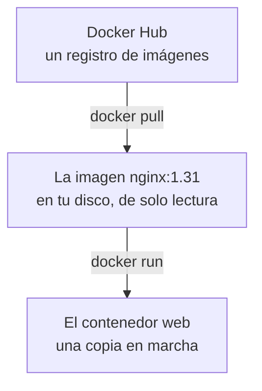

import Term from '~/components/Term.astro';
import TryIt from '~/components/TryIt.astro';
import Analogy from '~/components/Analogy.astro';
import SelfCheck from '~/components/SelfCheck.astro';
import Quiz from '~/components/Quiz.astro';
import QuizQuestion from '~/components/QuizQuestion.astro';
import QuizOption from '~/components/QuizOption.astro';

## El problema

En la [lección 6 de la Fase 1](/fase-1/servicios-systemd-apt/) instalaste nginx en tu máquina virtual: crearla, `apt install`, `systemctl`… Con Docker, el mismo nginx arranca en tu portátil con una sola orden, sin instalarlo, y responde en `localhost:8080`.

Imagina que Ana lo hace. Entra en el contenedor y cambia la portada por «Tienda de Ana y Luis». Al día siguiente lo borra con `docker rm` y lo arranca otra vez con la misma orden. La portada vuelve a decir «Welcome to nginx!»: su cambio ha desaparecido.

¿Dónde estaba ese cambio, y por qué no estaba en lo que Docker descargó? La respuesta son dos palabras que se usan sin parar, y muchas veces mezcladas: **imagen** y **contenedor**.

## La analogía

<Analogy>

Piensa en la ficha de inscripción de un gimnasio. En la oficina guardan el original, y nadie escribe en él. Cada persona que llega recibe una fotocopia y la rellena a su manera.

Ana escribe su nombre en la suya; la de Luis sigue en blanco, y el original también. Si Ana tira su fotocopia, lo que escribió se va con ella. Para empezar de cero, pide otra copia del original, limpia.

La imagen es el original; cada contenedor, una fotocopia en uso.

<div slot="limits">

- Docker no fotocopia la imagen entera: todos los contenedores leen los mismos ficheros, y cada uno guarda aparte solo lo que cambia. Por eso uno arranca en un segundo, y diez no ocupan diez veces más.
- Una fotocopia es papel quieto. Un contenedor tiene, además, un programa en marcha.
- Parar un contenedor no es tirar la fotocopia: con `docker stop` se guarda, con lo escrito. Solo `docker rm` la tira.

</div>

</Analogy>

## Cómo funciona de verdad

### La imagen es la plantilla; el contenedor, la copia en marcha

Así llega nginx a tu ordenador y se pone en marcha:



Una <Term id="image">imagen</Term> es un paquete con dos cosas:

- **Ficheros:** el propio nginx, las bibliotecas que usa y un Debian mínimo con sus carpetas de siempre (`/etc`, `/usr`, `/bin`). Todo lo que nginx necesita, menos el núcleo del sistema operativo, que comparte con tu máquina, como viste en [la introducción](/fase-7/).
- **Instrucciones:** qué orden ejecutar al arrancar (`nginx -g 'daemon off;'`), en qué puerto escucha (el 80) y algún dato más.

Es de **solo lectura**: nada de lo que pase después la cambia. Se nombra con un nombre y una etiqueta (*tag*), separados por dos puntos: `nginx:1.31` es la versión 1.31 de nginx.

Un <Term id="container">contenedor</Term> es lo que sale de `docker run`: los ficheros de la imagen, una **capa de escritura** propia encima y un programa en marcha. Cuando alguien escribe un fichero dentro, sea nginx o tú, el cambio va a esa capa. La imagen no se toca, y los demás contenedores de la misma imagen no ven nada. Cómo se apilan esas capas lo verás en la [lección 2](/fase-7/capas-docker/).

| | Imagen | Contenedor |
|---|---|---|
| Qué es | Una plantilla: ficheros e instrucciones | Una copia en marcha, con su capa de escritura |
| ¿Se puede escribir en ella? | No | Sí, en su capa |
| Se consigue con | `docker pull` | `docker run` |
| Se listan con | `docker image ls` | `docker ps` |
| Se borran con | `docker image rm` | `docker rm` |

### Las imágenes vienen de un registro

Las imágenes se guardan en un <Term id="registry">registro</Term>, un servicio del que se descargan, como una tienda de aplicaciones. El que Docker usa si no le dices otro es **Docker Hub** (`hub.docker.com`). La lección 8 los explica a fondo.

Descarga la imagen de nginx. Necesitas Docker en marcha, como en la introducción:

<TryIt
  title="Descarga la imagen de nginx"
  cmd="docker pull nginx:1.31"
  output={`1.31: Pulling from library/nginx
b496ef725cba: Pull complete
95266651b1b5: Pull complete
74db6078a267: Pull complete
a0eaca4f4a89: Pull complete
848dbae53a0f: Pull complete
c6d8c112974b: Pull complete
58f461baacaf: Download complete
10ef391a6a66: Download complete
Digest: sha256:f9ea18bfa4fad859e1ed38259d711da7ccad2c3516e875cec3351a57c859f571
Status: Downloaded newer image for nginx:1.31
docker.io/library/nginx:1.31`}
>

Cada línea con un código es una parte de la imagen, casi todas capas (lección 2). Mientras baja, verás barras de progreso.

La última línea es el nombre completo: `docker.io` es Docker Hub; `library`, las imágenes oficiales; y `nginx:1.31`, el nombre y la etiqueta. Sin etiqueta, Docker pone `latest`, que no siempre es la última versión (lección 8).

Si nginx ha publicado un arreglo desde entonces, tus códigos serán otros. Si sale `Cannot connect to the Docker daemon`, Docker no está en marcha: arráncalo como en la introducción.

</TryIt>

Si no la descargas antes, `docker run` lo hace por ti, como viste con `hello-world`.

### `docker run`, palabra a palabra

Esta orden crea un contenedor de nginx y lo arranca:

```sh
docker run -d --name web -p 127.0.0.1:8080:80 nginx:1.31
```

Palabra a palabra:

- `docker run`: crea un contenedor a partir de una imagen y lo arranca.
- `-d` (*detached*, «separado»): lo deja en segundo plano, como el `&` de la [lección 5 de la Fase 1](/fase-1/procesos-y-senales/), y te devuelve el prompt. Sin `-d`, la terminal se queda enseñando lo que escribe nginx, y <kbd>Ctrl</kbd> + <kbd>C</kbd> lo para.
- `--name web`: le pone nombre. Sin él, Docker inventa uno al azar.
- `-p 127.0.0.1:8080:80` (*publish*, «publicar»): une el <Term id="port">puerto</Term> 8080 de tu ordenador con el 80 del contenedor, donde escucha nginx. Primero el de fuera, después el de dentro. El `127.0.0.1:` hace que solo responda a tu propio ordenador: la [lección 6](/fase-7/redes-docker/) explica por qué.
- `nginx:1.31`: la imagen. Lo que escribas detrás sustituye la orden de arrancar que trae la imagen.

Tres opciones más que usarás a menudo:

- `--rm`: borra el contenedor en cuanto termina. Sin él, cada prueba deja un contenedor parado que ocupa su nombre y su sitio.
- `-e NOMBRE=valor` (de *environment*): crea una [variable de entorno](/fase-1/variables-de-entorno/) dentro. Así se configuran casi todos los programas en Docker: la contraseña de PostgreSQL o el `DATABASE_URL` de tu API.
- `-it`: `-i` (*interactive*) deja que le escribas, y `-t` (de *TTY*) le da una terminal. Las necesitas para usar una shell dentro.

<TryIt
  title="Una variable, y el contenedor se borra solo"
  cmd={`docker run --rm -e TIENDA="Ana y Luis" nginx:1.31 printenv TIENDA`}
  output="Ana y Luis"
>

`printenv TIENDA` sustituye a nginx: escribe la variable y termina. Con el programa termina el contenedor, y `--rm` lo borra.

</TryIt>

### Ver, leer y entrar: `ps`, `logs` y `exec`

Con el contenedor en marcha, tres órdenes te dicen qué pasa dentro:

- `docker ps`: los contenedores en marcha. Con `-a` (*all*, «todos»), también los parados.
- `docker logs web`: lo que el programa ha escrito en su salida, la normal y la de errores ([lección 3 de la Fase 1](/fase-1/pipes-y-redirecciones/)). Con `-f` (*follow*, «seguir») se queda esperando las líneas nuevas, como `journalctl -f`. <kbd>Ctrl</kbd> + <kbd>C</kbd> deja de mirar, y el contenedor sigue.
- `docker exec -it web sh`: arranca otro programa dentro de un contenedor que ya está en marcha, aquí `sh`, una <Term id="shell">shell</Term>. `exit` sale de ella, y el contenedor sigue.

### Parar, arrancar y borrar

| Orden | Qué hace | Qué pasa con la capa del contenedor |
|---|---|---|
| `docker stop web` | Para el programa | Se queda, con tus cambios |
| `docker start web` | Arranca otra vez el mismo contenedor | Sigue con los cambios de antes |
| `docker rm web` | Borra el contenedor | Desaparece con él. Si está en marcha, se niega; con `-f` (*force*), lo para y lo borra |
| `docker image ls` | Lista las imágenes (`docker images` es su nombre antiguo) | Nada: las imágenes no cambian |
| `docker image rm nginx:1.31` | Borra una imagen | Se niega si algún contenedor, aunque esté parado, la usa |

Esa es la respuesta al problema de Ana: **lo que cambias dentro de un contenedor vive en su capa**. Sobrevive a `stop` y `start`, y se va con `rm`. Para conservar algo, o lo metes en la imagen (la lección 3 enseña a fabricarlas) o lo guardas fuera, en un volumen ([lección 5](/fase-7/volumenes-docker/)).

### Un contenedor es un proceso

Como viste en [la introducción](/fase-7/), un contenedor es un <Term id="process">proceso</Term> de Linux, aislado de los demás. Dentro, el programa de la imagen tiene el <Term id="pid">PID</Term> 1, el número del primer proceso, el que en tu máquina virtual era systemd.

Desde fuera, `docker top` enseña los procesos de un contenedor con su número de verdad:

<TryIt
  title="Los procesos de nginx, vistos desde fuera"
  cmd="docker top web"
  output={`UID                 PID                 PPID                C                   STIME               TTY                 TIME                CMD
root                4163230             4163207             0                   01:35               ?                   00:00:00            nginx: master process nginx -g daemon off;
message+            4163285             4163230             0                   01:35               ?                   00:00:00            nginx: worker process
message+            4163286             4163230             0                   01:35               ?                   00:00:00            nginx: worker process
message+            4163287             4163230             0                   01:35               ?                   00:00:00            nginx: worker process
message+            4163288             4163230             0                   01:35               ?                   00:00:00            nginx: worker process`}
>

El proceso principal de nginx, el *master*, es el 1 dentro y el 4163230 fuera. Los *workers* («trabajadores»), que atienden las peticiones, son sus hijos: su `PPID`, el padre, es 4163230. Tus números serán otros, y cuántos *workers* hay depende de tus procesadores.

¿`message+` y no `nginx`? Para Linux, un usuario es un número ([lección 4 de la Fase 1](/fase-1/usuarios-y-permisos-linux/)), y fuera ese número tiene otro nombre, o ninguno. En macOS y Windows, «fuera» es la máquina virtual de Docker Desktop: `ps` en tu terminal no los ve.

</TryIt>

### `docker stop`: primero una señal, después SIGKILL

`docker stop` hace lo que aprendiste en la [lección 5 de la Fase 1](/fase-1/procesos-y-senales/): primero `kill` y, si hace falta, `kill -9`. Envía una <Term id="signal">señal</Term> de parada al PID 1, espera diez segundos y, si el proceso sigue vivo, le envía `SIGKILL`.

La señal de parada es `SIGTERM`, salvo que la imagen pida otra. La de nginx pide `SIGQUIT`, que para nginx significa «acaba las peticiones que tienes a medias y sal».

El PID 1 tiene una regla especial en Linux: **ignora las señales que no ha preparado**, incluida `SIGTERM`, porque si cae, cae todo el contenedor. Un programa que no las atiende tarda diez segundos en parar:

<TryIt
  title="Un contenedor que no atiende la señal"
  cmd={`docker run -d --name dormilon nginx:1.31 sleep 1000\ntime docker stop dormilon\ndocker ps -a`}
  output={`ac00b012122b7b61b2790095fd2847da3ee4636f5c99acf688247fbce69e99f6
dormilon
docker stop dormilon  0.01s user 0.01s system 0% cpu 10.156 total
CONTAINER ID   IMAGE        COMMAND                  CREATED          STATUS                                PORTS     NAMES
ac00b012122b   nginx:1.31   "/docker-entrypoint.…"   12 seconds ago   Exited (137) Less than a second ago             dormilon`}
>

`sleep 1000` sustituye a nginx: espera mil segundos, y es el PID 1. `time` mide cuánto tarda una orden: diez segundos, porque `sleep` no atiende la señal y Docker acabó enviando `SIGKILL`. En bash, `time` escribe `real 0m10.156s`.

`Exited (137)` es el código de salida: 128 más 9, el número de `SIGKILL`, como en la Fase 1. `docker ps -a` enseña también tus otros contenedores. Borra este con `docker rm dormilon`.

</TryIt>

En la [lección 3](/fase-7/dockerfile/) verás cómo arrancar tu API para que pare a la primera.

## Pruébalo

El objetivo: poner en marcha el nginx de la [Fase 2](/fase-2/#antes-de-empezar-el-servidor-de-la-tienda) en un contenedor, cambiarle la portada y averiguar qué sobrevive a `docker stop` y qué a `docker rm`. Necesitas la imagen `nginx:1.31` del paso anterior.

Las salidas son de Docker Engine 29 en un Mac, dentro de una máquina virtual con Linux, como la de Docker Desktop. Las capturamos con otro puerto y otros nombres, cambiados por los de la lección: nada más cambia. Tus IDs, horas y tiempos serán otros. En Linux y WSL, las salidas son iguales.

<TryIt
  title="1. Arranca nginx en un contenedor"
  cmd="docker run -d --name web -p 127.0.0.1:8080:80 nginx:1.31"
  output="b3a57b2d264ba78c880bd12f21c040cc747d6d90ba9a90f3fa4b58e4af160126"
>

Es el ID del contenedor, su número completo. Si sale `port is already allocated`, otro programa usa ya el 8080: mira «Errores comunes».

</TryIt>

<TryIt
  title="2. Míralo y pregúntale"
  cmd={`docker ps\ncurl -sI localhost:8080\ncurl -s localhost:8080 | grep h1`}
  output={`CONTAINER ID   IMAGE        COMMAND                  CREATED          STATUS          PORTS                    NAMES
b3a57b2d264b   nginx:1.31   "/docker-entrypoint.…"   11 seconds ago   Up 10 seconds   127.0.0.1:8080->80/tcp   web
HTTP/1.1 200 OK
Server: nginx/1.31.6
Date: Tue, 13 Oct 2026 23:34:26 GMT
Content-Type: text/html
Content-Length: 896
Last-Modified: Tue, 15 Sep 2026 12:54:15 GMT
Connection: keep-alive
ETag: "6aa93ff7-380"
Accept-Ranges: bytes

<h1>Welcome to nginx!</h1>`}
>

En `docker ps`, fíjate en `STATUS`, `Up` («en marcha»), y en `PORTS`, el 8080 de tu ordenador unido al 80 del contenedor. El ID sale recortado, y `docker` acepta los dos.

Responde el nginx de la Fase 2, en otra versión: `nginx/1.31.6`, en lugar del 1.24.0 de Ubuntu.

</TryIt>

<TryIt
  title="3. Lee sus registros"
  cmd="docker logs web"
  output={`/docker-entrypoint.sh: /docker-entrypoint.d/ is not empty, will attempt to perform configuration
/docker-entrypoint.sh: Looking for shell scripts in /docker-entrypoint.d/
/docker-entrypoint.sh: Launching /docker-entrypoint.d/10-listen-on-ipv6-by-default.sh
10-listen-on-ipv6-by-default.sh: info: Getting the checksum of /etc/nginx/conf.d/default.conf
10-listen-on-ipv6-by-default.sh: info: Enabled listen on IPv6 in /etc/nginx/conf.d/default.conf
/docker-entrypoint.sh: Sourcing /docker-entrypoint.d/15-local-resolvers.envsh
/docker-entrypoint.sh: Launching /docker-entrypoint.d/20-envsubst-on-templates.sh
/docker-entrypoint.sh: Launching /docker-entrypoint.d/30-tune-worker-processes.sh
/docker-entrypoint.sh: Configuration complete; ready for start up
2026/10/13 23:34:15 [notice] 1#1: using the "epoll" event method
2026/10/13 23:34:15 [notice] 1#1: nginx/1.31.6
2026/10/13 23:34:15 [notice] 1#1: built by gcc 14.2.0 (Debian 14.2.0-19) 
2026/10/13 23:34:15 [notice] 1#1: OS: Linux 6.8.0-117-generic
2026/10/13 23:34:15 [notice] 1#1: getrlimit(RLIMIT_NOFILE): 1024:524288
2026/10/13 23:34:15 [notice] 1#1: start worker processes
2026/10/13 23:34:15 [notice] 1#1: start worker process 28
2026/10/13 23:34:15 [notice] 1#1: start worker process 29
2026/10/13 23:34:15 [notice] 1#1: start worker process 30
2026/10/13 23:34:15 [notice] 1#1: start worker process 31
172.17.0.1 - - [13/Oct/2026:23:34:26 +0000] "HEAD / HTTP/1.1" 200 0 "-" "curl/8.7.1" "-"
172.17.0.1 - - [13/Oct/2026:23:34:26 +0000] "GET / HTTP/1.1" 200 896 "-" "curl/8.7.1" "-"`}
>

Tres partes:

- `/docker-entrypoint.sh`: un script de la imagen que prepara la configuración antes de arrancar nginx.
- `[notice]`: nginx arrancando. `1#1` es el PID 1. `OS: Linux`: aunque estés en un Mac, nginx corre en Linux.
- Tus dos peticiones, `HEAD` y `GET`, en el formato del `access.log` de la Fase 1. Llegan desde `172.17.0.1`, una dirección de la red de Docker (lección 6).

Para verlas en directo: `docker logs -f web` en otra terminal, y repite el `curl`.

</TryIt>

<TryIt
  title="4. Entra y cambia la portada"
  cmd="docker exec -it web sh"
  output={`# whoami
root
# cat /proc/1/cmdline; echo
nginx: master process nginx -g daemon off;
# echo '<h1>Tienda de Ana y Luis</h1>' > /usr/share/nginx/html/index.html
# exit`}
>

Ya estás dentro, con el prompt `#`. Escribe las órdenes una a una:

- `whoami`: dentro del contenedor eres `root`. La [lección 4](/fase-7/docker-multi-stage/) cambia eso para tu API.
- `cat /proc/1/cmdline`: Linux guarda la orden de cada proceso en `/proc/<PID>/cmdline`, y el 1 es el *master* de nginx. El `echo` solo añade el salto de línea que le falta.
- `echo '…' > …/index.html`: sustituye la portada de nginx por una línea tuya.
- `exit` te devuelve a tu terminal. El contenedor sigue en marcha.

</TryIt>

<TryIt
  title="5. Comprueba el cambio"
  cmd="curl -s localhost:8080"
  output="<h1>Tienda de Ana y Luis</h1>"
>

nginx sirve la portada nueva. El cambio está en la capa del contenedor: la imagen `nginx:1.31` no sabe nada de él.

</TryIt>

<TryIt
  title="6. Páralo y arráncalo otra vez"
  cmd={`docker stop web\ndocker ps -a\ndocker start web\ncurl -s localhost:8080`}
  output={`web
CONTAINER ID   IMAGE        COMMAND                  CREATED          STATUS                      PORTS     NAMES
b3a57b2d264b   nginx:1.31   "/docker-entrypoint.…"   43 seconds ago   Exited (0) 13 seconds ago             web
web
<h1>Tienda de Ana y Luis</h1>`}
>

Parado, `docker ps` no lo enseña, pero `docker ps -a` sí: `Exited (0)`, terminó bien, con código 0. Sin programa en marcha, `PORTS` está vacío. Al arrancarlo, la portada sigue siendo la tuya: **`stop` y `start` conservan la capa**.

</TryIt>

<TryIt
  title="7. ¿Qué señal recibió nginx?"
  cmd="docker logs web 2>&1 | grep SIGQUIT"
  output="2026/10/13 23:35:33 [notice] 1#1: signal 3 (SIGQUIT) received, shutting down"
>

La que pide la imagen de nginx, `SIGQUIT` (la 3), al PID 1. El `2>&1` hace falta porque nginx escribe estos avisos en la salida de errores.

</TryIt>

<TryIt
  title="8. Bórralo y vuelve a empezar"
  cmd={`docker rm web`}
  output={`Error response from daemon: cannot remove container "web": container is running: stop the container before removing or force remove`}
>

Docker no borra un contenedor en marcha: «páralo antes, o fuerza el borrado».

</TryIt>

<TryIt
  title="9. Fuerza el borrado y arranca otro"
  cmd={`docker rm -f web\ndocker run -d --name web -p 127.0.0.1:8080:80 nginx:1.31\ncurl -s localhost:8080 | grep h1`}
  output={`web
6533e657eaff85b8f276173d88718983f51b7d9cbcf10259360f355b41b63e4f
<h1>Welcome to nginx!</h1>`}
>

Es lo que le pasó a Ana. El contenedor nuevo, con otro ID, nace de la imagen, que nunca cambió: tu portada se fue con la capa del anterior.

</TryIt>

Y ahora, el reto. Esta vez escribe tú las órdenes:

<SelfCheck question="Reto: con web en marcha, arranca un segundo nginx, web2, en el puerto 8081. Cambia la portada solo en web y comprueba que web2 sigue con la de nginx. ¿Cuántas veces se ha descargado la imagen?">

```sh
docker run -d --name web2 -p 127.0.0.1:8081:80 nginx:1.31
docker exec -it web sh
```

Dentro de `web`, el mismo `echo` del paso 4, y `exit`. Después, `curl -s localhost:8080` enseña tu portada, y `curl -s localhost:8081 | grep h1`, `<h1>Welcome to nginx!</h1>`.

La imagen se descargó una sola vez. Los dos contenedores leen sus mismos ficheros, y cada uno escribe en su propia capa: un cambio en uno no llega al otro.

</SelfCheck>

Para terminar, limpia:

<TryIt
  title="10. Borra los contenedores; la imagen se queda"
  cmd={`docker rm -f web web2\ndocker image ls nginx`}
  output={`web
web2
IMAGE        ID             DISK USAGE   CONTENT SIZE   EXTRA
nginx:1.31   f9ea18bfa4fa        261MB           65MB        `}
>

Borrar contenedores no borra la imagen. `CONTENT SIZE`, 65 MB, es lo que se descargó, comprimido; `DISK USAGE`, lo que ocupa en tu disco. En `EXTRA`, una `U` (*in use*) marca las imágenes que usa algún contenedor. Si quieres el espacio, `docker image rm nginx:1.31`: si la necesitas otra vez, Docker la descarga de nuevo.

</TryIt>

## Ya lo has visto

- **La máquina virtual de la Fase 1.** `multipass launch 24.04` descargó una imagen de Ubuntu y creó una máquina a partir de ella. Con la misma imagen podrías crear diez.
- **nginx con systemd.** `systemctl start`, `stop` y `status`, y `journalctl -u nginx`, hacían lo mismo que `docker start`, `stop`, `ps` y `logs`, para un programa instalado en el sistema.
- **`ps` y `kill`.** `docker ps` y `docker stop` son sus parientes: un contenedor es un proceso.
- **Este curso.** Para probar los proyectos guiados, GitHub arranca PostgreSQL en un contenedor de `postgres:18`, y lo tira al terminar.

## Errores comunes

- **Guardar algo importante dentro de un contenedor.** `docker rm` se lo lleva. Dentro solo va lo que se puede perder; lo demás, en la imagen (lección 3) o en un volumen ([lección 5](/fase-7/volumenes-docker/)).
- **El nombre ya está en uso.** `Conflict. The container name "/web" is already in use by container "6533e657…"`: un contenedor parado también ocupa su nombre. Búscalo con `docker ps -a` y bórralo, o usa otro nombre.
- **El puerto ya está ocupado.** `Bind for 127.0.0.1:8080 failed: port is already allocated`: otro contenedor, u otro programa, usa ese puerto. Cambia solo el de fuera, `-p 127.0.0.1:8081:80`: nginx sigue en el 80 dentro. Y ojo: Docker deja creado el contenedor que no pudo arrancar (`Created` en `docker ps -a`); bórralo antes de repetir.
- **Buscar herramientas que no están.** `docker exec web ps` responde `exec: "ps": executable file not found in $PATH`. Una imagen trae lo que necesita su programa y poco más: ni `ps` ni `vim`. Para ver procesos, `docker top`.
- **Quitar el `127.0.0.1:`.** Con `-p 8080:80`, nginx responde a cualquiera de tu red. La lección 6 lo explica.

## Resumen

- Una imagen es una plantilla de solo lectura: ficheros e instrucciones para arrancar. Se descarga de un registro, como Docker Hub, con `docker pull`.
- Un contenedor es una copia en marcha de una imagen, con su propia capa de escritura. De una imagen salen tantos como quieras, y ninguno la cambia.
- `docker run` crea y arranca; `ps`, `logs` y `exec` miran dentro; `stop`, `start` y `rm` paran, arrancan y borran.
- Lo que cambias dentro sobrevive a `stop` y a `start`, y se pierde con `rm`.
- Un contenedor es un proceso: su programa es el PID 1, y `docker stop` le envía su señal de parada y, a los diez segundos, `SIGKILL`.

## ¿Lo has entendido?

<Quiz>

<QuizQuestion
  question="Ana arranca tres contenedores de nginx:1.31 y cambia la portada en uno de ellos. ¿Qué portada sirven los otros dos?"
  review="La imagen es la plantilla; el contenedor, la copia en marcha"
>

<QuizOption text="La nueva: el cambio se guarda en la imagen nginx:1.31, y de ahí lo leen los tres.">

La imagen es de solo lectura: ningún contenedor escribe en ella. El cambio va a la capa de escritura del contenedor donde se hizo.

</QuizOption>

<QuizOption text="La de nginx: cada contenedor tiene su propia capa de escritura." correct>

Los tres leen los mismos ficheros de la imagen, pero cada uno guarda sus cambios en su capa. Lo que pasa en uno no llega a los otros.

</QuizOption>

<QuizOption text="La nueva, en cuanto los otros dos se paran y se vuelven a arrancar.">

`docker start` arranca el mismo contenedor, con su misma capa. No copia nada de otros contenedores.

</QuizOption>

</QuizQuestion>

<QuizQuestion
  question="Has estropeado la configuración de nginx dentro de tu contenedor web y quieres volver a la original. ¿Qué haces?"
  review="Parar, arrancar y borrar"
>

<QuizOption text="docker stop web y docker start web: al arrancar, el contenedor empieza de cero.">

`stop` y `start` conservan la capa del contenedor, así que la configuración estropeada sigue ahí.

</QuizOption>

<QuizOption text="docker pull nginx:1.31 otra vez, para recuperar los ficheros buenos.">

La imagen nunca se estropeó: tu cambio está en la capa del contenedor. Volver a descargarla no toca ningún contenedor.

</QuizOption>

<QuizOption text="Borrar el contenedor y crear otro con docker run." correct>

El contenedor nuevo nace de la imagen, que sigue intacta, con una capa vacía: la configuración vuelve a ser la original.

</QuizOption>

</QuizQuestion>

<QuizQuestion
  question="Paras un contenedor con docker stop, tarda diez segundos y docker ps -a dice Exited (137). ¿Qué ha pasado?"
  review="docker stop: primero una señal, después SIGKILL"
>

<QuizOption text="El programa no atendió la señal de parada, y Docker lo cortó con SIGKILL." correct>

137 es 128 más 9, el número de `SIGKILL`. Docker esperó los diez segundos de cortesía y lo paró a la fuerza: si estaba guardando algo, se quedó a medias.

</QuizOption>

<QuizOption text="Nada raro: 137 es el código con el que termina todo contenedor parado con docker stop.">

Un programa que atiende la señal termina con su propio código, normalmente 0, como el `Exited (0)` de nginx. 137 dice que hubo que usar `SIGKILL`.

</QuizOption>

<QuizOption text="La imagen está dañada, y hay que borrarla y descargarla otra vez.">

La imagen no tiene nada que ver: el código de salida habla del proceso que corría en el contenedor y de cómo terminó.

</QuizOption>

</QuizQuestion>

<QuizQuestion
  question="Arrancas tu API con docker run -d -p 127.0.0.1:3000:8080 mi-api. ¿En qué puerto tiene que escuchar la API dentro, y a cuál llamas con curl?"
  review="docker run, palabra a palabra"
>

<QuizOption text="Dentro escucha en el 3000, y llamas a localhost:8080.">

Es al revés: en `-p`, primero va el puerto de tu ordenador y después el del contenedor.

</QuizOption>

<QuizOption text="Dentro escucha en el 8080, y llamas a localhost:3000." correct>

`3000` es el de fuera, el que usas desde tu ordenador, y `8080` el de dentro, donde tiene que escuchar la API para que Docker le pase las peticiones.

</QuizOption>

<QuizOption text="En el 3000 los dos: -p hace que el contenedor use el mismo puerto que tu ordenador.">

`-p` une dos puertos que pueden ser distintos. Si la API escucha en el 3000 dentro, Docker le pasa las peticiones al 8080, donde no hay nadie.

</QuizOption>

</QuizQuestion>

<QuizQuestion
  question="Borras tu contenedor con docker rm, y docker image ls sigue enseñando nginx:1.31. ¿Es un error?"
  review="Parar, arrancar y borrar"
>

<QuizOption text="Sí: docker rm borra el contenedor y también su imagen.">

`docker rm` borra contenedores, nunca imágenes. La imagen se queda para crear otros contenedores sin descargarla de nuevo.

</QuizOption>

<QuizOption text="Sí: la imagen se queda bloqueada hasta que reinicias Docker.">

No hay nada bloqueado: ningún contenedor la usa, y `docker image rm nginx:1.31` la borraría ya.

</QuizOption>

<QuizOption text="No: imagen y contenedor son distintos, y cada uno se borra con su orden." correct>

El contenedor se borra con `docker rm`, y la imagen con `docker image rm`. Borrar las copias no tira el original.

</QuizOption>

</QuizQuestion>

<QuizQuestion
  question="Dentro de un contenedor de nginx en marcha, escribes ps y responde executable file not found. ¿Por qué?"
  review="Errores comunes"
>

<QuizOption text="La imagen no trae ps: lleva lo que necesita nginx y poco más." correct>

Una imagen trae su programa y lo imprescindible. Para ver los procesos de un contenedor, `docker top` desde fuera, o `/proc` dentro.

</QuizOption>

<QuizOption text="En un contenedor no hay procesos que listar: es una imagen, no un programa.">

Un contenedor es justo eso, un proceso en marcha: nginx es el PID 1, y sus *workers*, sus hijos.

</QuizOption>

<QuizOption text="Dentro de un contenedor solo puede haber un proceso, así que ps está desactivado.">

Puede haber varios: los *workers* de nginx, o la shell que abres con `docker exec`. Lo que falta es el programa `ps`.

</QuizOption>

</QuizQuestion>

</Quiz>

## Para profundizar

- [What is an image?](https://docs.docker.com/get-started/docker-concepts/the-basics/what-is-an-image/) y [What is a container?](https://docs.docker.com/get-started/docker-concepts/the-basics/what-is-a-container/), de la documentación de Docker, en inglés.
- Las referencias de [`docker run`](https://docs.docker.com/reference/cli/docker/container/run/) y de [`docker stop`](https://docs.docker.com/reference/cli/docker/container/stop/), en inglés: todas sus opciones.
- [La imagen oficial de nginx](https://hub.docker.com/_/nginx) en Docker Hub, en inglés: sus etiquetas y cómo servir tus páginas.
