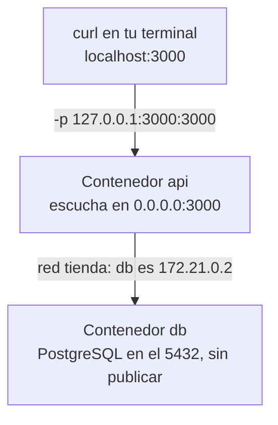

import Term from '~/components/Term.astro';
import TryIt from '~/components/TryIt.astro';
import Analogy from '~/components/Analogy.astro';
import SelfCheck from '~/components/SelfCheck.astro';
import Quiz from '~/components/Quiz.astro';
import QuizQuestion from '~/components/QuizQuestion.astro';
import QuizOption from '~/components/QuizOption.astro';

## El problema

Imagina que Ana tiene ya la API en una imagen ([lección 4](/fase-7/docker-multi-stage/)) y PostgreSQL en un contenedor con sus datos en un volumen ([lección 5](/fase-7/volumenes-docker/)). Arranca la API con su `.env` de siempre, el de `DATABASE_URL=postgres://tienda:…@localhost:5432/tienda`, y pregunta a `/salud`: `503`, «La base de datos no responde». Y PostgreSQL está en marcha.

Luis, mientras tanto, ha copiado de un tutorial `docker run -p 3000:3000`. Está en una cafetería, y cualquiera conectado a la misma wifi puede abrir la tienda en su portátil.

Los dos problemas tienen la misma raíz: **un contenedor tiene su propia red**, y Docker decide qué entra y qué sale de ella.

## La analogía

<Analogy>

Piensa en un edificio de oficinas. Cada empresa tiene su centralita, con sus extensiones. Si en la empresa A marcas «recepción», suena la recepción de la A, nunca la de la B, aunque estén en la misma planta.

Para llamar a otra empresa, pasas por la centralita del edificio. En unos edificios solo conoce números: tienes que saber la extensión exacta. En otros tiene una guía, y basta con decir «pásame con Contabilidad».

Y para que entre alguien de la calle, abres una puerta. Puedes abrirla a la calle, y entra cualquiera, o solo al pasillo interior, y entra solo quien ya está en el edificio.

El edificio es tu ordenador; cada empresa, un contenedor; «recepción», `localhost`; la centralita con guía, una red que creas tú; y la puerta, un puerto publicado.

<div slot="limits">

- En un edificio, la centralita no cambia de números. En Docker, la IP de un contenedor puede cambiar cada vez que lo creas: por eso importa llamar por el nombre.
- Una puerta al pasillo es tan segura como el edificio. Con `127.0.0.1` llega cualquier programa de tu ordenador, no solo los tuyos de confianza.
- En el Mac y en Windows hay un edificio dentro de otro: los contenedores viven en la máquina virtual de Docker Desktop, y Docker lleva las puertas hasta tu ordenador.

</div>

</Analogy>

## Cómo funciona de verdad

### Cada contenedor tiene su propia red

El núcleo de Linux le da a cada contenedor un **espacio de red** propio (*network namespace*): sus tarjetas de red, su IP, sus puertos y su propio `127.0.0.1`. Es el mismo aislamiento que separa sus procesos, el de [la introducción](/fase-7/), aplicado a la red.

Docker conecta ese espacio a una <Term id="docker-network">red de Docker</Term>, una red privada dentro de tu ordenador, con direcciones del rango `172.16.0.0` a `172.31.255.255` que viste en la [lección 5 de la Fase 0](/fase-0/ip-puertos-y-sockets/). Si no le dices otra, la red se llama `bridge` («puente»).

### localhost dentro de un contenedor es el contenedor

Esto es lo que le pasó a Ana, y lo que avisó la [lección 3](/fase-7/dockerfile/#la-base-de-datos-está-fuera-del-contenedor). Las salidas de esta lección son de Docker Engine 29 en un Mac, dentro de una máquina virtual con Linux, como la de Docker Desktop. Las capturamos con otros puertos y nombres, cambiados por los de la lección: nada más cambia. Tus IDs, IPs y tiempos serán otros.

Trabajas en la carpeta de tu proyecto; si sigue en marcha el contenedor `tienda` de la lección 4, bórralo antes con `docker rm -f tienda`, porque usa el mismo puerto.

<TryIt
  title="La API con tu .env de siempre"
  cmd={`docker run -d --name api --env-file .env -p 127.0.0.1:3000:3000 tienda-api\ncurl -s localhost:3000/salud`}
  output={`47a61c502db3fdbf549584dbf757cb9020d6141273de3f0f2ccd56b6d82e0b68
{"type":"about:blank","title":"Service Unavailable","status":503,"detail":"La base de datos no responde"}`}
>

`--env-file .env` crea dentro una variable por cada línea de tu `.env`, como en la lección 3. Entre ellas, `DATABASE_URL`, que apunta a `localhost:5432`.

La API arranca y contesta, pero su ruta `/salud` (lección 4) no consigue hablar con PostgreSQL. Da igual que tu PostgreSQL esté en marcha.

</TryIt>

¿A quién contesta `localhost` ahí dentro? Pregúntaselo a la propia API. La imagen no trae `curl`, pero trae Node, y su `fetch` hace lo mismo, como el `HEALTHCHECK` de la lección 4:

<TryIt
  title="Dentro del contenedor, localhost es él mismo"
  cmd={`docker exec api node -e "fetch('http://localhost:3000/salud').then((r) => r.text()).then(console.log)"\ndocker exec api hostname -i`}
  output={`{"type":"about:blank","title":"Service Unavailable","status":503,"detail":"La base de datos no responde"}
172.17.0.3`}
>

- **`node -e "…"`** ejecuta el código entre comillas: pide `localhost:3000/salud` y escribe la respuesta.
- Contesta **la propia API**, con su `503`: `localhost` dentro del contenedor es el contenedor.
- **`hostname -i`** escribe la IP del contenedor en la red `bridge`: `172.17.0.3`, no la de tu ordenador.

</TryIt>

Así que `localhost:5432` dentro del contenedor busca un PostgreSQL **en el propio contenedor de la API**, donde no hay ninguno.

| Desde dónde | `localhost` es |
|---|---|
| Tu terminal | Tu ordenador, donde está tu PostgreSQL de la Fase 5 |
| El contenedor `api` | El contenedor `api`, sin PostgreSQL |
| El contenedor `db` | El contenedor `db` |

Para llegar a tu ordenador desde un contenedor, la lección 3 usó el nombre especial `host.docker.internal`. Para llegar a otro contenedor, lo que necesitas es una red con nombres, un poco más abajo.

### Publicar un puerto abre una puerta en tu ordenador

Desde fuera de Docker, a un contenedor se llega por un puerto publicado. <Term id="port-publishing">Publicar un puerto</Term> es unir uno de tu ordenador con uno del contenedor, con `-p`, como en la [lección 1](/fase-7/imagen-contenedor-docker/#docker-run-palabra-a-palabra). En `-p 127.0.0.1:3000:3000`:

- **`127.0.0.1`**: en qué dirección de tu ordenador escucha Docker. Esta es la de <Term id="localhost">localhost</Term>: solo llegan los programas de tu propio ordenador.
- **El primer `3000`**: el <Term id="port">puerto</Term> de tu ordenador; **el segundo**, el del contenedor, donde escucha la API.

Dentro, la API escucha en `0.0.0.0` (`ENV HOST=0.0.0.0`, lección 3), porque lo publicado entra por la red del contenedor, no por su `127.0.0.1`. **Quién puede llegar lo decide la dirección del `-p`**, no la de la API.

### Sin IP delante, el puerto se abre a toda tu red

Si quitas `127.0.0.1:`, Docker escucha en **todas** las direcciones de tu ordenador, `0.0.0.0` y `[::]`, como la tabla de la [lección 5 de la Fase 0](/fase-0/ip-puertos-y-sockets/#lo-que-une-las-tres-cosas-los-sockets). Compruébalo sin abrir nada: `docker create` prepara un contenedor sin arrancarlo.

<TryIt
  title="A quién abre cada -p"
  cmd={`docker create --name abierto -p 3000:3000 tienda-api\ndocker inspect --format '{{json .HostConfig.PortBindings}}' api abierto\ndocker rm abierto`}
  output={`586dc56ee4739c00f1d5b85c94cc51214bb988ea25e5dae29d35c189b0f63901
{"3000/tcp":[{"HostIp":"127.0.0.1","HostPort":"3000"}]}
{"3000/tcp":[{"HostIp":"","HostPort":"3000"}]}
abierto`}
>

`api` es el contenedor de antes, todavía en marcha. `docker inspect` enseña todo lo que Docker sabe de un contenedor; `--format` elige un trozo, aquí sus puertos publicados. `"HostIp":""`, vacío, significa «todas»: con `docker run`, `docker ps` lo enseñaría como `0.0.0.0:3000->3000/tcp, [::]:3000->3000/tcp`.

</TryIt>

Con `127.0.0.1`, ni tu propio portátil llega por su IP de la wifi. Busca la tuya con `ipconfig getifaddr en0` en el Mac, o `hostname -I` en Linux:

<TryIt
  title="Desde la wifi no se llega"
  cmd={`curl -sS -m 3 http://192.168.1.133:3000/salud`}
  output="curl: (7) Failed to connect to 192.168.1.133 port 3000 after 3 ms: Couldn't connect to server"
>

`-m 3` deja de esperar a los tres segundos. Nadie escucha en la IP de la wifi: es lo que quieres. Con `-p 3000:3000`, contestaría la tienda, a ti y a cualquiera de la cafetería. Tu IP será otra.

</TryIt>

Ya puedes borrar este contenedor: `docker rm -f api`.

La [documentación de Docker](https://docs.docker.com/engine/network/port-publishing/) lo dice sin rodeos: «*Publishing container ports is insecure by default*», publicar puertos es inseguro por defecto.

**En Linux hay algo peor.** Un cortafuegos (*firewall*) es un programa que decide qué conexiones dejar entrar; en Ubuntu, el habitual es `ufw`, y lo configurarás en la [Fase 8](/fase-8/proteger-servidor-linux/). Docker publica los puertos con sus propias reglas en el núcleo, y esas reglas se aplican **antes** que las de `ufw`. La [documentación de Docker](https://docs.docker.com/engine/network/packet-filtering-firewalls/) lo explica: los paquetes se desvían «*before the firewall rules can be applied, effectively ignoring your firewall configuration*», ignorando tu configuración. Aunque `ufw` cierre el 3000, un `-p 3000:3000` lo deja abierto a internet en un servidor.

La regla del curso: **siempre `127.0.0.1:` delante**. Cuando algo tenga que ser público, en la [Fase 8](/fase-8/nginx-proxy-inverso/), delante irá un servidor web que lo decida.

### La red por defecto no conoce nombres

Docker trae tres redes:

<TryIt
  title="Las redes de Docker"
  cmd="docker network ls"
  output={`NETWORK ID     NAME      DRIVER    SCOPE
fc409dd26ee2   bridge    bridge    local
662a6ec1c404   host      host      local
612be13019d0   none      null      local`}
>

- **`bridge`** es la red por defecto: si no dices otra, cada contenedor entra en ella.
- **`host`** quita el aislamiento: el contenedor usa la red de la máquina. En el Mac, esa máquina es la virtual de Docker, no tu Mac.
- **`none`**, sin red.

`DRIVER` es el tipo de red. Si ya has creado otras redes, también salen.

</TryIt>

En `bridge`, los contenedores se ven por IP, pero **no por nombre**. Si arrancas PostgreSQL con `--name db` y preguntas por `db` desde otro contenedor, nadie lo encuentra:

<TryIt
  title="En la red por defecto, db no existe"
  cmd={`docker run --rm tienda-api getent hosts db\necho $?`}
  output="2"
>

`getent hosts db` pregunta qué IP tiene el nombre `db`, como hace la API al conectarse. No escribe nada: no lo encuentra. `echo $?` escribe su <Term id="exit-code">código de salida</Term>, y `2` significa «ese nombre no existe».

</TryIt>

Usar la IP, `172.17.0.2`, funcionaría hasta que recrees el contenedor y le toque otra.

### En una red tuya, el nombre del contenedor es su dirección

Una red que creas con `docker network create` trae algo que `bridge` no tiene: **su propio <Term id="dns">DNS</Term>**. Dentro de cada contenedor, Docker escucha en `127.0.0.11` y contesta con la IP de cualquier contenedor de la red, por su nombre. Lo que no conoce, como `example.com`, lo pregunta fuera, al DNS de tu ordenador, como en la [lección 7 de la Fase 0](/fase-0/que-es-dns/).

| | La red `bridge` | Una red tuya (`docker network create`) |
|---|---|---|
| Los contenedores se encuentran | Solo por IP | Por nombre |
| Quién entra | Todos los que no dicen otra | Solo los que arrancas con `--network` |
| Aislamiento | Comparten red con cualquier contenedor | Solo ven a los de su red |

Por eso la documentación de Docker recomienda redes propias. La API, con `DATABASE_URL=postgres://tienda:…@db:5432/tienda`, pregunta por `db`, y Docker le contesta con la IP que tenga ese día.

El camino completo de una petición queda así:



`db` no publica ningún puerto: solo llegan a él los contenedores de su red. Tu PostgreSQL de la Fase 5 puede seguir en el 5432 de tu ordenador sin chocar.

### Compose crea la red por ti

En la [lección 7](/fase-7/docker-compose/), un fichero `compose.yaml` arranca la API, PostgreSQL y Redis con una orden. Compose crea él solo una red para el proyecto, `tienda_default`, y mete en ella todos los servicios, cada uno con su nombre: `db`, `redis`, `api`. Es lo mismo que vas a hacer a mano ahora.

## Pruébalo

El objetivo: que la API hable con el PostgreSQL de la lección 5 por su nombre, y averiguar por qué una segunda copia no puede.

Necesitas la imagen `tienda-api` de la lección 4 (si no la tienes, `docker build -t tienda-api .` en tu proyecto) y el volumen `datos` de la [lección 5](/fase-7/volumenes-docker/), con tus datos. Si el contenedor de PostgreSQL de la lección 5 sigue en marcha, páralo con `docker stop` y bórralo con `docker rm`: el volumen se queda. Si la API de la lección 4 sigue en marcha, bórrala con `docker rm -f tienda`.

<TryIt
  title="1. Crea la red"
  cmd="docker network create tienda"
  output="813ed3771c672d066d71e22c40bce0ca44a331ca81cb9126a139f9ba8f2290c6"
>

El ID de la red nueva. Si sale `network with name tienda already exists`, ya la tenías: sigue.

</TryIt>

<TryIt
  title="2. PostgreSQL, en la red y con su volumen"
  cmd="docker run -d --name db --network tienda -v datos:/var/lib/postgresql postgres:18"
  output="8747e2ef13a6d20d6d31587c6e805246bb42e7dc44e530684a3c9dfe025e1684"
>

- **`--name db`** es también su nombre en la red.
- **`--network tienda`** lo mete en tu red, en lugar de en `bridge`.
- **`-v datos:/var/lib/postgresql`**, el volumen de la lección 5, con tus datos, tu usuario y su contraseña.
- **Sin `-e POSTGRES_PASSWORD`:** la imagen solo la usa la primera vez, con el volumen vacío. Ya está guardada.
- **Sin `-p`:** nadie de fuera lo necesita.

</TryIt>

<TryIt
  title="3. ¿Se encuentra db por su nombre?"
  cmd="docker run --rm --network tienda tienda-api getent hosts db"
  output="172.21.0.2      db"
>

Ahora sí: el DNS de Docker contesta con la IP de `db`. La tuya puede ser otra, como `172.18.0.2`: aquí había otras redes. Si no escribe nada, `db` no está en `tienda`: repasa el paso 2.

</TryIt>

<TryIt
  title="4. La API, en la misma red"
  cmd={`docker run -d --name api --network tienda --env-file .env \\\n  -e DATABASE_URL=postgres://tienda:TU-CONTRASEÑA@db:5432/tienda \\\n  -p 127.0.0.1:3000:3000 tienda-api`}
  output="200fefd93aee44745c79ff174f6229b3f596fdc24a3b7877addbbf70dce349d1"
>

Cambia `TU-CONTRASEÑA` por la contraseña de PostgreSQL de la [lección 5](/fase-7/volumenes-docker/). La `\` al final de la línea sigue la orden en la siguiente.

**`-e` manda sobre `--env-file`:** tu `.env` sigue con `localhost`, para cuando arrancas la API sin Docker, y en el contenedor vale el `DATABASE_URL` con `db`.

</TryIt>

<TryIt
  title="5. Pregúntale a la tienda"
  cmd={`curl -s localhost:3000/salud\ndocker ps`}
  output={`{"estado":"ok"}
CONTAINER ID   IMAGE         COMMAND                  CREATED          STATUS                    PORTS                      NAMES
200fefd93aee   tienda-api    "docker-entrypoint.s…"   19 seconds ago   Up 17 seconds (healthy)   127.0.0.1:3000->3000/tcp   api
8747e2ef13a6   postgres:18   "docker-entrypoint.s…"   29 seconds ago   Up 26 seconds             5432/tcp                   db`}
>

`{"estado":"ok"}`: la API ha hablado con PostgreSQL. Fíjate en `PORTS`. La API tiene una flecha, `127.0.0.1:3000->3000/tcp`: publicado, solo en tu ordenador. `db` dice `5432/tcp`, sin flecha: es el puerto que usa dentro, sin publicar.

`(healthy)` sale a los diez segundos, cuando el `HEALTHCHECK` de la lección 4 ha preguntado a `/salud`; antes, `(health: starting)`. Si `curl` dice `503`, espera unos segundos, por si PostgreSQL aún arranca, y después revisa la contraseña y que los dos tengan `--network tienda`.

</TryIt>

<TryIt
  title="6. Quién contesta los nombres"
  cmd="docker exec api cat /etc/resolv.conf"
  output={`# Generated by Docker Engine.
…
nameserver 127.0.0.11
options ndots:0
…`}
>

`/etc/resolv.conf` dice a qué servidor DNS pregunta un programa. Aquí, `127.0.0.11`: el DNS de Docker, dentro del contenedor. Hemos recortado los comentarios (`…`).

</TryIt>

<TryIt
  title="7. Mira la red por dentro"
  cmd="docker network inspect tienda"
  output={`[
    {
        "Name": "tienda",
        "Id": "813ed3771c672d066d71e22c40bce0ca44a331ca81cb9126a139f9ba8f2290c6",
        "Created": "2026-10-14T06:41:49.831998237+02:00",
        "Scope": "local",
        "Driver": "bridge",
        …
            "Config": [
                {
                    "Subnet": "172.21.0.0/16",
                    "Gateway": "172.21.0.1"
                }
            ]
        …
        "Containers": {
            "200fefd93aee44745c79ff174f6229b3f596fdc24a3b7877addbbf70dce349d1": {
                "Name": "api",
                …
                "IPv4Address": "172.21.0.3/16",
                …
            },
            "8747e2ef13a6d20d6d31587c6e805246bb42e7dc44e530684a3c9dfe025e1684": {
                "Name": "db",
                …
                "IPv4Address": "172.21.0.2/16",
                …
            }
        },
        …
    }
]`}
>

- **`Driver: bridge`**: es del mismo tipo que la red por defecto, pero tuya, con DNS.
- **`Subnet`**: las direcciones de la red, `172.21.0.0/16`, privadas. **`Gateway`**, `172.21.0.1`, es su <Term id="gateway">puerta de enlace</Term>, la salida hacia tu ordenador.
- **`Containers`**: quién está dentro y con qué IP. Si recreas `db`, su IP puede cambiar; su nombre, no.

Hemos recortado la salida (`…`).

</TryIt>

<SelfCheck question="Reto: arranca una segunda API, api2, en el puerto 3001 y con el mismo DATABASE_URL, pero sin --network. ¿Qué responde /salud, y por qué? Arréglalo sin borrarla.">

```sh
docker run -d --name api2 --env-file .env \
  -e DATABASE_URL=postgres://tienda:TU-CONTRASEÑA@db:5432/tienda \
  -p 127.0.0.1:3001:3000 tienda-api
curl -s localhost:3001/salud
```

Responde `503`, «La base de datos no responde». `api2` está en la red `bridge`, donde nadie conoce el nombre `db`: `docker exec api2 getent hosts db` no escribe nada.

`docker network connect tienda api2` la conecta a tu red sin pararla, y el siguiente `curl -s localhost:3001/salud` dice `{"estado":"ok"}`. Un contenedor puede estar en varias redes a la vez.

</SelfCheck>

Para terminar, limpia. El volumen `datos` se queda, con tus datos:

```sh
docker rm -f api api2
docker stop db && docker rm db
docker network rm tienda
```

`docker stop` antes de `rm` deja que PostgreSQL se apague bien. Una red solo se borra cuando no queda ningún contenedor en ella.

## Ya lo has visto

- **Tu casa.** El router reparte IP privadas a tus dispositivos, como en la [Fase 0](/fase-0/ip-puertos-y-sockets/). Docker hace de router para tus contenedores.
- **El `access.log` de nginx en la lección 1.** Tus peticiones llegaban desde `172.17.0.1`: la puerta (*gateway*) de la red `bridge`, por donde entra lo que llega a un puerto publicado.
- **`docker ps`.** Su columna `PORTS`, desde la lección 1, dice qué está publicado y dónde.
- **El servidor de desarrollo de una web.** Vite escucha solo en `localhost` hasta que le pides `--host`, como contó la [Fase 0](/fase-0/ip-puertos-y-sockets/#ya-lo-has-visto): la misma decisión que el `127.0.0.1:` de `-p`.

## Errores comunes

- **`localhost` en la configuración de un contenedor.** `DATABASE_URL` o `REDIS_URL` con `localhost` apuntan, dentro del contenedor, al propio contenedor. Usa el nombre del otro contenedor, en una red tuya.
- **`-p 3000:3000` sin `127.0.0.1:`.** Abre el puerto a toda tu red y, en un servidor Linux, a internet aunque `ufw` diga que no.
- **Esperar nombres en la red por defecto.** Si `getent hosts db` no escribe nada, uno de los dos no está en tu red: arráncalo con `--network` o usa `docker network connect`.
- **Un servidor que escucha en `127.0.0.1` dentro del contenedor.** Con `-e HOST=127.0.0.1`, `curl -sS localhost:3000/salud` dice `curl: (52) Empty reply from server`: el puerto está publicado, pero dentro nadie escucha en la red del contenedor. Dentro, `0.0.0.0`.
- **Publicar el puerto de la base de datos «por si acaso».** `-p 5432:5432` abre tu base de datos a toda tu red, y puede chocar con el 5432 de tu PostgreSQL de la Fase 5. La API llega a `db` por la red de Docker sin publicar nada.

## Resumen

- Cada contenedor tiene su propia red: su IP, sus puertos y su `localhost`, que es él mismo.
- Publicar un puerto con `-p` abre una puerta desde fuera. Sin IP delante, se abre en todas las direcciones de tu ordenador y, en Linux, se salta `ufw`: siempre `127.0.0.1:` delante.
- En la red por defecto, `bridge`, los contenedores no se encuentran por nombre. En una red tuya, con `docker network create`, Docker resuelve cada nombre a su IP.
- La API llega a PostgreSQL con `DATABASE_URL=postgres://tienda:…@db:5432/tienda`, y `db` no necesita ningún puerto publicado.
- `docker network inspect` dice quién está en una red y con qué IP. En la lección 7, Compose crea esa red por ti.

## ¿Lo has entendido?

<Quiz>

<QuizQuestion
  question="La API, en un contenedor, tiene REDIS_URL=redis://localhost:6379, y Redis está en otro contenedor de la misma red, llamado redis. ¿Llega?"
  review="localhost dentro de un contenedor es el contenedor"
>

<QuizOption text="Sí: los dos están en tu ordenador, y localhost es tu ordenador.">

Dentro de un contenedor, `localhost` es el propio contenedor, con su propia red. Ahí no escucha ningún Redis.

</QuizOption>

<QuizOption text="No: tiene que usar redis://redis:6379, el nombre del contenedor." correct>

En una red tuya, el DNS de Docker resuelve `redis` a la IP de ese contenedor. `localhost` se quedaría dentro del de la API.

</QuizOption>

<QuizOption text="Sí, siempre que Redis publique su puerto con -p 127.0.0.1:6379:6379.">

Publicar abre el puerto en tu ordenador, no en el contenedor de la API. Su `localhost` sigue siendo él mismo, y entre contenedores no hace falta publicar nada.

</QuizOption>

</QuizQuestion>

<QuizQuestion
  question="En una cafetería, arrancas la tienda con -p 3000:3000. ¿Quién puede abrirla?"
  review="Sin IP delante, el puerto se abre a toda tu red"
>

<QuizOption text="Cualquiera conectado a la misma wifi que sepa tu IP." correct>

Sin IP delante, Docker escucha en todas las direcciones de tu ordenador, también en la de la wifi. Con `127.0.0.1:` delante, solo llegarías tú.

</QuizOption>

<QuizOption text="Solo tú: los contenedores están aislados, y nada de fuera entra en ellos.">

Están aislados hasta que publicas un puerto: eso es justo abrir una puerta. Lo que importa es en qué dirección la abres.

</QuizOption>

<QuizOption text="Solo tú, porque la API dentro del contenedor escucha en 127.0.0.1.">

Dentro escucha en `0.0.0.0`, y aunque no fuera así, quién llega lo decide la dirección del `-p`, que aquí son todas.

</QuizOption>

</QuizQuestion>

<QuizQuestion
  question="En tu servidor Ubuntu, ufw solo deja entrar el 22 y el 443. Arrancas PostgreSQL con -p 5432:5432. ¿Está el 5432 abierto a internet?"
  review="Sin IP delante, el puerto se abre a toda tu red"
>

<QuizOption text="No: ufw bloquea todo lo que no está en su lista, también lo que publica Docker.">

Las reglas de Docker se aplican antes que las de `ufw`, así que `ufw` ni lo ve. Es la trampa que avisa la documentación de Docker.

</QuizOption>

<QuizOption text="No: Docker solo publica puertos para tu propio ordenador.">

Eso pasa solo con `127.0.0.1:` delante. Sin IP, Docker escucha en todas las direcciones del servidor, también en la pública.

</QuizOption>

<QuizOption text="Sí: Docker publica con sus propias reglas, que se saltan las de ufw." correct>

Los paquetes van al contenedor antes de que `ufw` los mire. Con `-p 127.0.0.1:5432:5432`, o sin publicar el puerto, no pasaría.

</QuizOption>

</QuizQuestion>

<QuizQuestion
  question="Arrancas db y api sin --network, y la API dice que no encuentra el nombre db. ¿Qué haces?"
  review="La red por defecto no conoce nombres"
>

<QuizOption text="Publicar el 5432 de db, para que la API lo encuentre.">

Publicar abre un puerto en tu ordenador, pero no da nombres: en la red por defecto, `db` sigue sin existir.

</QuizOption>

<QuizOption text="Meter los dos en una red creada con docker network create." correct>

Solo las redes que creas tú tienen DNS. Con los dos dentro, `db` se resuelve a su IP.

</QuizOption>

<QuizOption text="Esperar unos segundos: Docker tarda en apuntar el nombre db en la red por defecto.">

No es cuestión de tiempo: la red por defecto no tiene DNS para los contenedores, y `db` no existirá nunca en ella.

</QuizOption>

</QuizQuestion>

<QuizQuestion
  question="docker ps enseña 5432/tcp en la columna PORTS de db, sin flecha. ¿Qué significa?"
  review="Publicar un puerto abre una puerta en tu ordenador"
>

<QuizOption text="Que PostgreSQL está publicado en el 5432 de tu ordenador.">

Publicado se ve con flecha: `127.0.0.1:5432->5432/tcp`. Sin flecha, nadie de fuera llega.

</QuizOption>

<QuizOption text="Que PostgreSQL no está escuchando, y la API no podrá conectarse.">

PostgreSQL escucha en el 5432 del contenedor. La API, en la misma red, llega sin problemas.

</QuizOption>

<QuizOption text="Que es el puerto de dentro del contenedor, sin publicar." correct>

Es lo que quieres para una base de datos: la API llega por la red de Docker, y nadie de fuera la ve.

</QuizOption>

</QuizQuestion>

<QuizQuestion
  question="Recreas el contenedor db con el mismo nombre y el mismo volumen, y su IP pasa de 172.18.0.2 a 172.18.0.4. ¿Qué le pasa a la API, con DATABASE_URL apuntando a db?"
  review="En una red tuya, el nombre del contenedor es su dirección"
>

<QuizOption text="Sigue funcionando: el DNS de Docker le da la IP nueva." correct>

La API resuelve el nombre al conectarse. Por eso se usan nombres y no IPs: la IP es de un contenedor, el nombre es del servicio.

</QuizOption>

<QuizOption text="Deja de funcionar hasta que recrees la API con la IP nueva.">

La API no guarda la IP en su configuración, solo el nombre `db`, que sigue valiendo.

</QuizOption>

<QuizOption text="Pierde los datos: un contenedor nuevo es una base de datos vacía.">

Los datos están en el volumen `datos` ([lección 5](/fase-7/volumenes-docker/)), no en el contenedor. El nuevo los encuentra donde estaban.

</QuizOption>

</QuizQuestion>

</Quiz>

## Para profundizar

- [Networking overview](https://docs.docker.com/engine/network/), de la documentación de Docker, en inglés: los tipos de red y cómo se conectan los contenedores.
- [Port publishing and mapping](https://docs.docker.com/engine/network/port-publishing/), en inglés: por qué publicar es inseguro por defecto, y cómo cambiar la dirección que Docker usa si no le dices otra.
- [Docker with iptables and ufw](https://docs.docker.com/engine/network/packet-filtering-firewalls/), en inglés: por qué Docker y `ufw` no se entienden.
- [Bridge network driver](https://docs.docker.com/engine/network/drivers/bridge/), en inglés: las diferencias entre la red por defecto y las tuyas.
