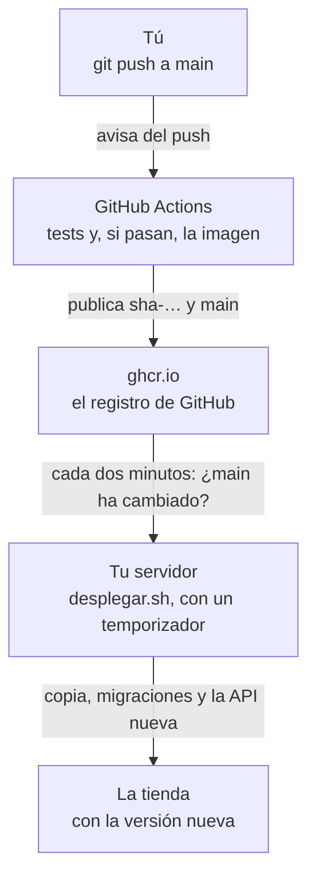

import { Aside } from '@astrojs/starlight/components';
import Term from '~/components/Term.astro';
import TryIt from '~/components/TryIt.astro';
import Analogy from '~/components/Analogy.astro';
import ProjectCode from '~/components/ProjectCode.astro';
import Quiz from '~/components/Quiz.astro';
import QuizQuestion from '~/components/QuizQuestion.astro';
import QuizOption from '~/components/QuizOption.astro';

## El problema

Imagina que Ana cambia el título de la tienda. Para que llegue al servidor, copia la carpeta con `rsync`, entra por SSH, escribe `docker compose up --build` y espera a que se construya la imagen. Cinco pasos a mano, y cada uno se puede olvidar.

Un viernes por la noche se olvida de pasar los tests. La versión nueva no arranca, la tienda contesta `502` y Ana no recuerda qué versión había antes.

**Cada paso a mano es un paso que alguien se salta.** En esta lección, un `git push` pasa los tests, publica la imagen y llega al servidor sin que entres en él; y si la versión nueva no funciona, el servidor vuelve solo a la anterior.

## La analogía

<Analogy>

Piensa en un quiosco de prensa. La imprenta (GitHub) solo imprime una edición si la correctora (los tests) la aprueba, y la deja en el almacén del distribuidor (ghcr.io).

El quiosquero (tu servidor) pasa por el almacén cada poco rato. Si hay una edición nueva, se la lleva, la pone en el escaparate y guarda la de ayer bajo el mostrador. Si la nueva ha salido mal impresa, vuelve a poner la de ayer.

<div slot="limits">

- El almacén no lleva nada al quiosco: es el quiosquero quien va. Eso sí se parece: GitHub no entra en tu servidor.
- Cambiar el periódico del escaparate es instantáneo. Cambiar la API deja la tienda unos segundos sin contestar.
- Volver al periódico de ayer no cambia nada más. Volver a la versión anterior no deshace lo que cambiaron las migraciones de la nueva.

</div>

</Analogy>

## Cómo funciona de verdad

### CI y CD: comprobar cada cambio y desplegarlo solo

Son dos mitades de la misma idea:

- **La <Term id="continuous-integration">integración continua</Term> (CI)** junta los cambios en la rama principal a menudo, y un programa comprueba cada uno antes: instala, revisa los tipos y pasa los tests. Si algo se rompe, lo sabes en minutos y sabes qué cambio fue.
- **El <Term id="continuous-deployment">despliegue continuo</Term> (CD)** lleva a producción, sin nadie en medio, cada cambio que pasa esas comprobaciones. Si el último paso es un botón que pulsa una persona, se llama entrega continua (*continuous delivery*), con las mismas siglas.

En la tienda, el camino de un cambio es este:



### GitHub Actions: un ordenador prestado para cada push

<Term id="github-actions">GitHub Actions</Term> ejecuta tareas cuando pasa algo en un repositorio. Se describen en un **workflow**, un fichero YAML en `.github/workflows`, con **trabajos** (*jobs*) hechos de **pasos** (*steps*). Cada trabajo corre en una máquina virtual nueva que GitHub presta, el **ejecutor** (*runner*), y que se borra al terminar.

**GitHub solo lee los workflows de la raíz de un repositorio.** En la carpeta del paso, dentro del repositorio del curso, `publicar.yml` no hace nada: en «Pruébalo», el paso será la raíz de tu propio repositorio. En octubre de 2026, Actions es gratis en los repositorios públicos; en los privados, una cuenta gratis tiene 2000 minutos al mes, y cada push a `main` gasta unos 4.

### Cuándo se ejecuta: pull request y push a main

<ProjectCode file="tienda-api/36-despliegue/.github/workflows/publicar.yml" region="cuando" />

- **`pull_request`**: con cada pull request, una propuesta de cambio que se revisa antes de juntarla con `main`. Solo comprueba.
- **`push` a `main`**: el tuyo, o el que hace GitHub al aceptar una pull request. Comprueba y publica.
- **`concurrency`**: en una pull request, un push nuevo cancela la comprobación anterior; en `main` no se corta ninguno a medias.

### comprobar: los tests, con su PostgreSQL

El primer trabajo empieza con una base de datos:

<ProjectCode file="tienda-api/36-despliegue/.github/workflows/publicar.yml" region="servicio" />

**`services`** arranca contenedores que viven mientras dura el trabajo: el PostgreSQL 18 de la tienda, fijado por su <Term id="image-digest">huella</Term> y con su <Term id="healthcheck">healthcheck</Term>, al que los pasos esperan. Después, el usuario de los tests y las órdenes que usas en tu ordenador desde la [Fase 3](/fase-3/):

<ProjectCode file="tienda-api/36-despliegue/.github/workflows/publicar.yml" region="base-de-datos" />

<ProjectCode file="tienda-api/36-despliegue/.github/workflows/publicar.yml" region="comprobaciones" />

### Acciones fijadas por su SHA

Los pasos con `uses:` son **acciones**, programas que otros publican en GitHub: `checkout` descarga tu repositorio y `setup-node` instala Node.

<ProjectCode file="tienda-api/36-despliegue/.github/workflows/publicar.yml" region="acciones" />

Detrás de la `@` no va `v7`, sino el **SHA del commit** de la acción. Es la regla de las huellas de la [Fase 7](/fase-7/docker-hub-registro/#fijar-por-huella-y-que-un-robot-la-actualice): una etiqueta se puede mover a otro código, como en el ataque a `trivy-action`, y un SHA no. **`persist-credentials: false`** no deja el token de `checkout` en el disco, donde otro programa podría leerlo.

### publicar: solo en main, y solo si comprobar pasa

<ProjectCode file="tienda-api/36-despliegue/.github/workflows/publicar.yml" region="publicar" />

- **`needs: comprobar`**: espera a que `comprobar` termine bien. Si falla, `publicar` ni empieza.
- **`if: … == 'push'`**: en una pull request se salta. Una propuesta no publica nada.
- **`permissions`**: el único trabajo que puede escribir paquetes, `packages: write`. Arriba, para todo el workflow, solo hay lectura: `permissions: contents: read`.

Es el <Term id="least-privilege">mínimo privilegio</Term> de la Fase 6: `comprobar` ejecuta el código de cada pull request y de cientos de paquetes de npm, y su token no sirve para publicar.

### El GITHUB_TOKEN: una llave que dura una ejecución

En la [Fase 7](/fase-7/docker-hub-registro/#publicar-en-docker-hub-o-en-ghcrio) entraste en ghcr.io con un token que creabas tú. En Actions no hace falta:

<ProjectCode file="tienda-api/36-despliegue/.github/workflows/publicar.yml" region="token" />

**`secrets.GITHUB_TOKEN`** lo crea GitHub al empezar cada trabajo, con los permisos de ese trabajo, y deja de valer cuando el trabajo termina: no hay contraseña que guardar ni que se filtre. En una pull request desde la copia de otra persona (un *fork*), solo puede leer.

### Una imagen para dos procesadores

<ProjectCode file="tienda-api/36-despliegue/.github/workflows/publicar.yml" region="plataformas" />

La imagen se construye dos veces: **`linux/amd64`**, para Intel y AMD, los de la mayoría de los VPS, y **`linux/arm64`**, para ARM, como la VM de Multipass en un Mac con chip de Apple. QEMU imita ARM en el ejecutor, que es amd64, y Buildx junta las dos en un **índice**, como el de `node:26-slim` en la [Fase 7](/fase-7/docker-hub-registro/#una-huella-para-cada-procesador):

```
$ docker buildx imagetools inspect ghcr.io/backendfromscratch/tienda-api:main
Name:      ghcr.io/backendfromscratch/tienda-api:main
MediaType: application/vnd.oci.image.index.v1+json
Digest:    sha256:b7938de6433cfabf103e37b01ef25e072d140ed0e1e8b13c637dc02df9ecbcab
…
  Platform:    linux/amd64
…
  Platform:    linux/arm64
…
  Platform:    unknown/unknown
…
  Platform:    unknown/unknown
…
```

Una imagen por procesador, y dos notas `unknown/unknown` sobre cómo se construyeron. Tu servidor descarga solo la suya.

### Dos etiquetas: sha-… para siempre, main para la última

<ProjectCode file="tienda-api/36-despliegue/.github/workflows/publicar.yml" region="etiquetas" />

Cada imagen sale con dos <Term id="tag">etiquetas</Term>:

- **`sha-` y las 7 primeras letras del commit**, como `sha-34626fe`: esta versión, para siempre.
- **`main`**: la última que pasó los tests. Se mueve con cada push, y la sigue tu servidor.

### La imagen nace privada

La primera vez, ghcr.io crea el paquete `tienda-api` **privado**, aunque tu repositorio sea público, y tu servidor, sin cuenta en GitHub, no lo descarga:

```
$ docker pull ghcr.io/backendfromscratch/tienda-api:main
Error response from daemon: error from registry: unauthorized
unauthorized
```

Hazla pública una vez, en «Pruébalo». **No se puede volver a hacer privada**, pero no lleva secretos: viven en el `.env` del servidor. Para una imagen privada, el servidor necesitaría `docker login ghcr.io` con un token tuyo de un solo permiso, `read:packages`.

### El servidor pregunta, GitHub no entra

GitHub no le manda nada a tu servidor. **Es el servidor quien pregunta**, cada dos minutos, si `main` apunta a otra imagen:

- **GitHub no llega a tu VM.** Tiene una <Term id="private-ip">IP privada</Term> tras tu router, y desde internet nadie empieza una conversación con ella: el [NAT de la Fase 0](/fase-0/ip-puertos-y-sockets/#cómo-sale-tu-ip-privada-a-internet-nat). Preguntando, la VM y un VPS funcionan igual.
- **GitHub no guarda ninguna llave de tu servidor.** Quien entre en tu cuenta de GitHub podrá publicar una imagen, pero no abrir una terminal en tu servidor. Ojo: esa imagen tu servidor la despliega solo, con tus secretos. Protege tu cuenta con verificación en dos pasos.
- **No hay puerta nueva.** El servidor solo sale hacia fuera, y `ufw` sigue como en la [lección 2](/fase-8/proteger-servidor-linux/).

Pregunta un <Term id="systemd">temporizador de systemd</Term>, como el de la copia de cada noche de la [lección 3](/fase-8/docker-compose-produccion/#una-copia-cada-noche), con su servicio:

<ProjectCode file="tienda-api/36-despliegue/despliegue/tienda-despliegue.timer" />

<ProjectCode file="tienda-api/36-despliegue/despliegue/tienda-despliegue.service" />

**`OnUnitActiveSec=2min`** es «dos minutos después de que empezara la vez anterior». systemd puede retrasarlo hasta un minuto para juntar tareas: en la práctica, entre dos y tres.

### desplegar.sh, paso a paso

El servicio ejecuta `despliegue/desplegar.sh`. Lo primero, que no haya dos a la vez:

<ProjectCode file="tienda-api/36-despliegue/despliegue/desplegar.sh" region="uno-a-la-vez" />

`flock` es un candado sobre un fichero: si el temporizador y tú lo lanzáis a la vez, el segundo termina sin hacer nada. Después, guarda la imagen que corre con un nombre propio, `:anterior`:

<ProjectCode file="tienda-api/36-despliegue/despliegue/desplegar.sh" region="anterior" />

Así, volver atrás no depende del registro, que puede estar caído. Solo si la API está sana: a una versión rota no merece la pena volver. Ahora sí, pregunta al registro y compara:

<ProjectCode file="tienda-api/36-despliegue/despliegue/desplegar.sh" region="preguntar" />

Se compara el **ID de la imagen**, su <Term id="hash">hash</Term>, porque `main` se llama igual siempre. Sin novedades, termina sin escribir nada. `pull` descarga solo las <Term id="image-layer">capas</Term> que no tiene: es la espera de cada despliegue que te anunció la [Fase 7](/fase-7/docker-multi-stage/). Con una imagen nueva, primero la copia de seguridad y las migraciones:

<ProjectCode file="tienda-api/36-despliegue/despliegue/desplegar.sh" region="migrar" />

Las <Term id="migration">migraciones</Term> corren con la imagen nueva mientras la API vieja sigue atendiendo; si fallan, la API no se toca. Después, la API nueva:

<ProjectCode file="tienda-api/36-despliegue/despliegue/desplegar.sh" region="arrancar" />

- **`--no-build`**: el servidor nunca construye; usa la imagen descargada.
- **`--no-deps`**: solo la API. **PostgreSQL y Redis tienen que estar ya en marcha**, como los dejaste en la lección 3.
- **`esperar_salud`** pregunta a Docker cada 2 segundos, hasta 60, si el healthcheck de la [Fase 7](/fase-7/docker-multi-stage/#healthcheck-la-tienda-está-bien) la da por sana (`healthy`).

Cada despliegue deja la imagen vieja en el disco, y nada la borra: `docker image prune` libera las que ya no tienen nombre (sin `-a`, para no llevarse `:anterior`), y un disco lleno tumba PostgreSQL.

### Si la versión nueva no se pone sana, vuelve sola

Si en 60 segundos la API nueva no está sana, el script vuelve a `:anterior`:

<ProjectCode file="tienda-api/36-despliegue/despliegue/desplegar.sh" region="volver" />

`fallar` apunta la imagen en `.despliegue-fallido`, y las vueltas siguientes no la repiten:

<ProjectCode file="tienda-api/36-despliegue/despliegue/desplegar.sh" region="fallida" />

Así se vio en nuestra VM, con una versión que preparamos para la prueba (en un registro de prueba, `localhost:5000`, sin pasar por GitHub): pedía una variable nueva, `CORREO_AVISOS`, que el `.env` del servidor no tenía (hemos recortado líneas, `…`):

```
$ journalctl -u tienda-despliegue --since 23:54 --no-pager
Oct 17 23:55:43 curso systemd[1]: Starting tienda-despliegue.service - Despliega la imagen nueva de la tienda, si la hay...
Oct 17 23:55:43 curso desplegar.sh[87453]: despliegue: imagen nueva: 2e831191c74a -> 1c14bec4d388 (la que corre queda como localhost:5000/tienda-api:anterior)
…
Oct 17 23:55:46 curso desplegar.sh[87453]: despliegue: esperando a /salud (hasta 60 s)
Oct 17 23:56:48 curso desplegar.sh[87453]: despliegue: la imagen nueva no arrancó o no llegó a estar sana: vuelvo a 2e831191c74a
…
Oct 17 23:56:58 curso desplegar.sh[87453]: despliegue: vuelta hecha: la API corre otra vez con 2e831191c74a. Las migraciones de la imagen nueva siguen aplicadas
Oct 17 23:56:58 curso systemd[1]: tienda-despliegue.service: Main process exited, code=exited, status=1/FAILURE
…
Oct 17 23:57:45 curso systemd[1]: Starting tienda-despliegue.service - Despliega la imagen nueva de la tienda, si la hay...
Oct 17 23:57:46 curso desplegar.sh[95028]: despliegue: la imagen 1c14bec4d388 ya falló: espero a una nueva (para reintentarla: rm /opt/tienda/.despliegue-fallido)
…
```

Mientras esperaba, `docker compose -f compose.produccion.yaml logs api` repetía el porqué: `Configuración: CORREO_AVISOS: Falta CORREO_AVISOS, o no es un email`. **Mira los logs mientras espera:** tras la vuelta, ese contenedor ya no existe. La imagen no se reintenta sola, porque cada intento es un minuto sin API:

- **Si el fallo es del servidor,** arréglalo y borra el fichero. Nosotros añadimos `CORREO_AVISOS` al `.env` e hicimos `rm .despliegue-fallido`: en la vuelta siguiente, `hecho`.
- **Si es del código,** no borres nada: arréglalo y haz push. La imagen nueva tendrá otro ID.

### Unos segundos sin tienda

Para cambiar de imagen, Compose para el contenedor viejo y arranca el nuevo. Entre medias, nginx contesta `502`, como en la [lección 4](/fase-8/nginx-proxy-inverso/#cuando-la-api-falla-502-y-504). Así se vio un despliegue, preguntando a `/salud` cada 0,2 segundos:

```
23:52:17 200
23:52:19 502
23:52:20 200
23:52:24 502
23:52:27 200
…
```

**Dos ventanas:** el segundo sin contenedor y, después, unos segundos en los que nginx sigue apartando las copias que fallaron: tras un fallo, las aparta 10 segundos ([lección 4](/fase-8/nginx-proxy-inverso/#dos-copias-y-nginx-que-se-entera-solo)), y cada proceso de nginx lleva su propia cuenta.

En nuestras pruebas, **unos segundos** sin contestar por despliegue (entre 1 y 11); uno que falla, más de un minuto. Para una tienda pequeña se acepta; desplegar sin cortes (dos copias que se relevan, o *blue-green*) es tema de la Fase 9.

### Volver atrás devuelve el código, no el esquema

Una <Term id="rollback">vuelta atrás</Term> cambia la imagen, pero las migraciones de la versión nueva **siguen aplicadas**: como en la [Fase 5](/fase-5/migraciones-base-de-datos/#solo-hacia-delante-y-una-tabla-que-lo-apunta), solo van hacia delante. Una migración mala solo se deshace a mano, con la copia de antes de migrar. No es el `ROLLBACK` de una [transacción de la Fase 5](/fase-5/transacciones-acid/#begin-y-commit-varias-órdenes-como-una-sola): aquí no se deshace nada en la base de datos.

La regla que hace seguras las vueltas atrás se llama **expandir y contraer** (*expand and contract*). Imagina que quieres renombrar la columna `nombre` de `productos` a `titulo`:

1. **Expandir:** una migración que solo añade `titulo`, copiando lo que hay en `nombre`, y un código que escribe en las dos y lee la nueva. El código viejo sigue funcionando, porque `nombre` sigue ahí.
2. **Contraer:** días después, cuando ya no vas a volver a la versión vieja, otra migración borra `nombre`.

### El otro modelo: GitHub entra por SSH

Muchos tutoriales hacen lo contrario, el **modelo push**: un trabajo de Actions guarda una <Term id="private-key">clave privada</Term> SSH en los secretos del repositorio, entra en el servidor y ejecuta `docker compose pull` y `up`. [Kamal](https://kamal-deploy.org/), por ejemplo, despliega así. Si lo usas, limita esa clave: en el `authorized_keys` de la [Fase 1](/fase-1/que-es-ssh/#authorized_keys-la-lista-de-llaves-que-abren-la-puerta), puede llevar delante una orden forzada:

```
command="/opt/tienda/despliegue/desplegar.sh",restrict ssh-ed25519 AAAAC3Nz… github-actions
```

Quien entre con ella solo lanza el despliegue: **`restrict`** le quita la terminal, los túneles y todo lo demás.

| | El servidor pregunta (pull) | GitHub entra (push) |
|---|---|---|
| Servidor sin IP pública (tu VM) | Funciona | No llega |
| Una llave del servidor en GitHub | No | Sí, limitada con `command=` |
| Cuándo llega el cambio | Hasta 2 o 3 minutos después | En cuanto termina el workflow |
| Varios servidores | Cada uno pregunta solo | El workflow entra en todos |
| Ver el despliegue en GitHub | No: en el diario del servidor | Sí, en la misma ejecución |

**El pull encaja** con un servidor al que no se llega desde internet, o si no quieres llaves fuera. **El push**, si quieres ver el despliegue en GitHub o encadenar más pasos detrás.

### Esta web: GitHub Actions comprueba, Cloudflare despliega

El workflow de esta web, `.github/workflows/ci.yml`, se lanza así:

```yaml
on:
  push:
    branches: [main]
  pull_request:
  workflow_dispatch:
  # Once a week, everything, even if nothing changed: what changes outside the repository (a new
  # Node 26 release, a package removed from npm) shows up here, not in the next unrelated PR.
  schedule:
    - cron: '17 5 * * 1'
```

Los mismos `push` a `main` y `pull_request`, más un botón (`workflow_dispatch`) y los lunes a las 5:17 UTC (`schedule`). Comprueba la web y los proyectos guiados. **No despliega.**

Despliega Cloudflare, con [Workers Builds](https://developers.cloudflare.com/workers/ci-cd/builds/): con cada push a `main`, GitHub le avisa, y Cloudflare descarga el commit, construye la web y la publica. Es el diagrama de la [Fase 1](/fase-1/git-por-dentro/#avance-un-push-que-despliega). Cloudflare no espera a Actions: lo que llega a `main` ya pasó los checks en su pull request, porque `main` exige que pasen. Tampoco aquí guarda GitHub una llave de nadie: es Cloudflare quien tiene permiso para leer el repositorio.

## Pruébalo

El objetivo: que un cambio llegue de un `git push` a tu servidor sin que entres en él; que uno roto se quede en GitHub; y volver a la versión anterior a propósito.

Necesitas una cuenta de GitHub, tu clave SSH en ella (de la [Fase 1](/fase-1/que-es-ssh/)) y la tienda en marcha en tu servidor, como la dejaste en la lección 5.

**Las salidas son de dos sitios.** Las de GitHub, de nuestro repositorio de prácticas, `backendfromscratch/shop-practice`. Las del servidor, de la VM de la lección 3, que descarga de ghcr.io. Nuestras imágenes llevan nuestro usuario, `backendfromscratch`; las tuyas, el tuyo. Tus IDs, SHA, horas y tiempos serán otros.

### Tu repositorio en GitHub

En la web de GitHub, crea un repositorio vacío, `tienda-api`, sin README. Público, para no gastar minutos. En **tu ordenador**:

```sh
curl -O https://backenddesdecero.com/practicas/tienda-api/36-despliegue.tar.gz
tar -xzf 36-despliegue.tar.gz
cd 36-despliegue
git init -b main
git add .
git commit -m "La tienda, lista para publicarse"
git remote add origin git@github.com:ana/tienda-api.git
git push -u origin main
```

Cambia `ana` por tu usuario. En Windows, escríbelas en WSL, como en las fases anteriores: crear el repositorio no necesita la VM. **El paso queda en la raíz**, con `.github/workflows/publicar.yml` junto a `package.json`, donde GitHub lo busca. En la pestaña *Actions* de tu repositorio verás la ejecución de *Publicar*. La nuestra, con la orden `gh` de GitHub:

```
$ gh run view 39123843909 -R backendfromscratch/shop-practice

✓ main Publicar · 39123843909
Triggered via push about 3 minutes ago

JOBS
✓ comprobar in 1m14s (ID 117664756131)
✓ publicar in 1m56s (ID 117665005294)
…
```

Las dos marcas `✓`: `comprobar` pasó los tests y `publicar` subió la imagen. Si una sale en rojo, su log dice qué paso falló.

Ahora **haz pública la imagen**: en tu perfil de GitHub, *Packages* → `tienda-api` → *Package settings* → *Change visibility* → *Public*.

### El servidor sigue tu imagen

Copia al servidor la carpeta `despliegue/` del paso, que trae el script y el temporizador. Desde **tu ordenador**, con tu usuario y la IP de tu servidor:

```sh
rsync -av 36-despliegue/despliegue ubuntu@192.168.5.15:/opt/tienda/
```

En Windows, desde PowerShell como en la lección 3, con el paso descargado allí (`curl.exe -O` y `tar -xzf`): `scp -r` en lugar de `rsync -av`. Solo esa carpeta: el resto de `/opt/tienda` lo has cambiado en las lecciones 3 a 5, y no quieres pisarlo.

**Dentro del servidor**, en `/opt/tienda`, dale permiso de ejecución a los scripts (la descarga no lo trae, y al copiar se lo has podido quitar a la copia de seguridad) y dile qué imagen seguir, con tu usuario, en minúsculas:

```sh
cd /opt/tienda
chmod +x despliegue/*.sh
echo "IMAGEN=ghcr.io/ana/tienda-api:main" >> .env
```

Lanza el primer despliegue a mano:

<TryIt
  title="1. El primer despliegue"
  cmd="despliegue/desplegar.sh"
  output={`despliegue: imagen nueva: 23e44ac842b1 -> 5f8bedeb0966 (la que corre queda como ghcr.io/backendfromscratch/tienda-api:anterior)
despliegue: copia de seguridad antes de migrar
Copia hecha: copias/tienda-2026-10-18-133918.sql.gz (4.0K)
despliegue: migraciones
…
No hay migraciones nuevas: la base de datos está al día
Sin cuentas de práctica: no se cargan (--sin-cuentas)
La base de datos ya tiene productos: los de ejemplo no se cargan otra vez
despliegue: arrancando la API con la imagen nueva
…
 Container tienda-api-1 Recreate 
 Container tienda-api-1 Recreated 
 Container tienda-api-1 Starting 
 Container tienda-api-1 Started 
despliegue: esperando a /salud (hasta 60 s)
despliegue: hecho: la API corre con 5f8bedeb0966`}
>

La primera línea cambia la imagen que construiste en el servidor (`23e4…`) por la que publicó GitHub (`5f8b…`), y guarda la vieja como `:anterior`. Después, los pasos del script, hasta `hecho`. Hemos recortado líneas (`…`). Si dice `unauthorized`, la imagen sigue privada; si dice `Permission denied`, falta el `chmod`.

</TryIt>

Y ahora, el temporizador:

<TryIt
  title="2. Cada dos minutos"
  cmd={`sudo cp despliegue/tienda-despliegue.service despliegue/tienda-despliegue.timer /etc/systemd/system/
sudo systemctl daemon-reload
sudo systemctl enable --now tienda-despliegue.timer
systemctl list-timers tienda-despliegue.timer`}
  output={`Created symlink '/etc/systemd/system/timers.target.wants/tienda-despliegue.timer' → '/etc/systemd/system/tienda-despliegue.timer'.
NEXT LEFT LAST                          PASSED UNIT                    ACTIVATES
-       - Sun 2026-10-18 13:39:46 CEST 7ms ago tienda-despliegue.timer tienda-despliegue.service
…`}
>

Al encenderlo, el temporizador lanza la primera vuelta: `LAST` es ahora mismo, y `NEXT` sale `-` mientras dura. Unos segundos después, `NEXT` dirá la siguiente, dos minutos más tarde. Si tu usuario o tu carpeta no son `ubuntu` y `/opt/tienda`, cambia el `.service` antes de copiarlo.

</TryIt>

### Un cambio, de git push al servidor

En **tu ordenador**, en una rama nueva, cambia el título de la tienda en `src/tienda.ts`: las dos líneas `La tienda de Ana y Luis` pasan a ser `La tienda de Ana y Luis (versión 2)`. Súbela y abre una pull request:

```sh
git switch -c cambio-titulo
git commit -am "La tienda dice que es la versión 2"
git push -u origin cambio-titulo
```

GitHub te da el enlace para crear la pull request. En ella, los *checks* dicen esto:

```
$ gh pr checks 1 -R backendfromscratch/shop-practice
publicar	skipping	0	https://github.com/backendfromscratch/shop-practice/actions/runs/39055686727/job/117463404491	
…
comprobar	pass	1m38s	https://github.com/backendfromscratch/shop-practice/actions/runs/39055686727/job/117463063867	
```

`comprobar` pasa, y `publicar` se salta (`skipping`): es una pull request.

Antes de aceptarla, prepara una medida: ¿cuánto tiempo estará la tienda sin contestar? En otra terminal de tu ordenador, deja corriendo esto:

<TryIt
  title="3. Los segundos sin tienda"
  cmd={`while true; do echo "$(date +%T) $(curl -s -o /dev/null -w '%{http_code}' --cacert ~/ca/ca.crt https://tienda.example/salud)"; sleep 0.2; done | uniq -f1`}
  output={`13:39:59 200
13:44:32 502
13:44:37 200`}
>

Cada 0,2 segundos pregunta a `/salud` y escribe la hora y el código. **`uniq -f1`** se salta la primera columna, la hora, y solo deja pasar una línea cuando cambia el código: al principio verás un solo `200`, y las otras llegan con el despliegue. Aquí, unos cinco segundos de `502`. Páralo con <kbd>Ctrl</kbd> + <kbd>C</kbd>.

Pon tu nombre de la lección 5 y tu `ca.crt` (con Let's Encrypt, sin `--cacert`). Lo medimos en el propio servidor; desde tu ordenador sale lo mismo. En Windows, en WSL; si WSL no llega a tu VM, sáltate la medida.

</TryIt>

Ahora acepta la pull request con *Merge pull request*. El push a `main` lanza el workflow otra vez, esta vez con publicación:

```
$ gh run view 39124162303 -R backendfromscratch/shop-practice --log | grep 'pushing manifest'
publicar	Run docker/build-push-action@c3c9e263c25d99ce0380d002d59b67737d91b0dc	2026-10-18T11:43:01.5995677Z #27 pushing manifest for ghcr.io/backendfromscratch/tienda-api:main@sha256:b7938de6433cfabf103e37b01ef25e072d140ed0e1e8b13c637dc02df9ecbcab
…
publicar	Run docker/build-push-action@c3c9e263c25d99ce0380d002d59b67737d91b0dc	2026-10-18T11:43:03.6380796Z #27 pushing manifest for ghcr.io/backendfromscratch/tienda-api:sha-34626fe@sha256:b7938de6433cfabf103e37b01ef25e072d140ed0e1e8b13c637dc02df9ecbcab
…
```

La misma huella, `b793…`, con las dos etiquetas: `main` y `sha-34626fe`, el commit nuevo de `main`. No entres en el servidor: espera unos minutos y mira su diario.

<TryIt
  title="4. El servidor la despliega solo"
  cmd="journalctl -u tienda-despliegue --since 13:43 --no-pager"
  output={`Oct 18 13:44:26 curso systemd[1]: Starting tienda-despliegue.service - Despliega la imagen nueva de la tienda, si la hay...
Oct 18 13:44:30 curso desplegar.sh[39229]: despliegue: imagen nueva: 5f8bedeb0966 -> b7938de6433c (la que corre queda como ghcr.io/backendfromscratch/tienda-api:anterior)
Oct 18 13:44:30 curso desplegar.sh[39229]: despliegue: copia de seguridad antes de migrar
Oct 18 13:44:30 curso desplegar.sh[39480]: Copia hecha: copias/tienda-2026-10-18-134430.sql.gz (4.0K)
Oct 18 13:44:30 curso desplegar.sh[39229]: despliegue: migraciones
…
Oct 18 13:44:32 curso desplegar.sh[39229]: despliegue: arrancando la API con la imagen nueva
…
Oct 18 13:44:32 curso desplegar.sh[39229]: despliegue: esperando a /salud (hasta 60 s)
Oct 18 13:44:43 curso desplegar.sh[39229]: despliegue: hecho: la API corre con b7938de6433c
Oct 18 13:44:43 curso systemd[1]: tienda-despliegue.service: Deactivated successfully.
Oct 18 13:44:43 curso systemd[1]: Finished tienda-despliegue.service - Despliega la imagen nueva de la tienda, si la hay.`}
>

Pon tu hora en `--since`. El temporizador vio una imagen nueva y la desplegó en 17 segundos, sin que nadie entrara; el `502` de la medida empezó a las `13:44:32`, cuando arrancaba la API nueva. Del push a `main` al `hecho` pasaron 4 minutos y 40 segundos: tres, en Actions. Si no ves nada, espera otra vuelta y comprueba que `publicar` terminó.

</TryIt>

<TryIt
  title="5. ¿Ha llegado?"
  cmd="curl -s --cacert ~/ca/ca.crt https://tienda.example/tienda | grep h1"
  output={`        <h1>La tienda de Ana y Luis (versión 2)</h1>`}
>

Con tu nombre y tu `ca.crt`, como en la medida. O ábrelo en el navegador: `/tienda` dice que es la versión 2.

</TryIt>

### Un cambio roto se queda en GitHub

Ahora rompe algo a propósito, en otra rama: en `src/app.ts`, haz que `/salud` conteste `{ estado: 'bien' }` en lugar de `'ok'`. Súbelo y abre otra pull request. Esta vez:

```
$ gh pr checks 2 -R backendfromscratch/shop-practice
comprobar	fail	1m39s	https://github.com/backendfromscratch/shop-practice/actions/runs/39055868613/job/117463595905	
publicar	skipping	0	https://github.com/backendfromscratch/shop-practice/actions/runs/39055868613/job/117463941536	
…
```

`comprobar` falla. El log dice qué test y por qué:

```
$ gh run view 39055868613 -R backendfromscratch/shop-practice --log-failed | grep -E 'not ok|ℹ (tests|pass|fail)|expected|actual|\+ |\- |Process completed' | cut -c1-200 | head -30
comprobar	tests	2026-10-17T17:57:20.5810711Z ℹ tests 230
comprobar	tests	2026-10-17T17:57:20.5811260Z ℹ pass 225
comprobar	tests	2026-10-17T17:57:20.5811478Z ℹ fail 1
comprobar	tests	2026-10-17T17:57:20.5822759Z   + actual - expected
comprobar	tests	2026-10-17T17:57:20.5823386Z   +   estado: 'bien'
comprobar	tests	2026-10-17T17:57:20.5823619Z   -   estado: 'ok'
…
comprobar	tests	2026-10-17T17:57:20.5954410Z ##[error]Process completed with exit code 1.
```

Un test esperaba `ok` (`expected`) y recibió `bien` (`actual`). **No la aceptes.** No se ha publicado ninguna imagen, así que el servidor no tiene nada que hacer:

<TryIt
  title="6. El servidor, en silencio"
  cmd="journalctl -u tienda-despliegue -n 3 --no-pager"
  output={`Oct 18 13:46:28 curso systemd[1]: Starting tienda-despliegue.service - Despliega la imagen nueva de la tienda, si la hay...
Oct 18 13:46:29 curso systemd[1]: tienda-despliegue.service: Deactivated successfully.
Oct 18 13:46:29 curso systemd[1]: Finished tienda-despliegue.service - Despliega la imagen nueva de la tienda, si la hay.`}
>

Arranca, pregunta y termina en un segundo, sin escribir una línea suya: `main` no ha cambiado. Cierra la pull request.

</TryIt>

GitHub te deja aceptar una pull request con los *checks* en rojo. Para impedirlo, protege `main`, como el repositorio de esta web: en *Settings* → *Rules* de tu repositorio, una regla que exija que `comprobar` pase antes de fusionar.

### Vuelve atrás a propósito

Imagina que la versión 2 no gusta. Vuelve a la primera por su etiqueta, `sha-` y las 7 primeras letras de tu primer commit (`git log --oneline`). En el servidor:

<TryIt
  title="7. A la versión anterior"
  cmd={`sed -i "s|^IMAGEN=.*|IMAGEN=ghcr.io/ana/tienda-api:sha-b794033|" .env
despliegue/desplegar.sh
curl -s --cacert ~/ca/ca.crt https://tienda.example/tienda | grep h1`}
  output={`despliegue: imagen nueva: b7938de6433c -> 5f8bedeb0966 (la que corre queda como ghcr.io/backendfromscratch/tienda-api:anterior)
despliegue: copia de seguridad antes de migrar
…
despliegue: arrancando la API con la imagen nueva
…
despliegue: esperando a /salud (hasta 60 s)
despliegue: hecho: la API corre con 5f8bedeb0966
        <h1>La tienda de Ana y Luis</h1>`}
>

`sed` cambia la línea `IMAGEN` del `.env`. Fíjate en `5f8b…`, el ID del primer despliegue. **Mientras `IMAGEN` nombre un `sha-`, el servidor no sigue `main`.** Si el temporizador se te adelanta, `desplegar.sh` no escribe nada: mira el diario.

</TryIt>

Para volver a seguir `main`, devuelve la línea a su sitio:

<TryIt
  title="8. Otra vez con main"
  cmd={`sed -i "s|^IMAGEN=.*|IMAGEN=ghcr.io/ana/tienda-api:main|" .env
despliegue/desplegar.sh`}
  output={`despliegue: imagen nueva: 5f8bedeb0966 -> b7938de6433c (la que corre queda como ghcr.io/backendfromscratch/tienda-api:anterior)
…
despliegue: hecho: la API corre con b7938de6433c`}
>

`b793…` es la versión 2 otra vez. Esta vuelta atrás fue segura porque el cambio solo tocaba el código. Con una migración, piensa antes en «Volver atrás devuelve el código, no el esquema».

</TryIt>

## Ya lo has visto

- **Las apps de tu móvil.** Se actualizan solas por la noche: el móvil pregunta a la tienda de apps si hay versión nueva, como tu servidor a ghcr.io.
- **La marca verde o la cruz roja junto a un commit en GitHub.** Son los *checks* de la integración continua de ese proyecto.

## Errores comunes

- **Olvidar hacer pública la imagen.** El servidor dice `unauthorized` cada dos minutos y la tienda se queda en la versión vieja.
- **`packages: write` para todo el workflow.** El código de una pull request, o de un paquete de npm, podría publicar una imagen con tu nombre.
- **Acciones por etiqueta, `@v4`.** Quien mueva esa etiqueta ejecuta código en tu CI: fíjalas por SHA y deja que Dependabot proponga los nuevos.
- **Renombrar o borrar una columna en el mismo despliegue que el código.** Si vuelves atrás, el código viejo no encuentra lo que busca: primero expandir, después contraer.
- **Borrar `.despliegue-fallido` sin arreglar nada.** El servidor vuelve a intentar la misma imagen, con otro minuto sin tienda.
- **Ejecutar `desplegar.sh` con `sudo`.** El candado y las copias quedan de `root`, y el temporizador, que es `ubuntu`, ya no puede usarlos.

## Resumen

- La integración continua comprueba cada cambio antes de juntarlo; el despliegue continuo lleva a producción, solo, cada uno que pasa.
- `publicar.yml` pasa los tests con un PostgreSQL en cada pull request y, en `main`, publica en ghcr.io una imagen para amd64 y arm64, con las etiquetas `sha-…` y `main`. Acciones fijadas por SHA, y `packages: write` solo donde se publica.
- El servidor pregunta cada dos minutos con un temporizador de systemd: copia, migraciones, la API nueva y, si no se pone sana en 60 segundos, vuelta a la anterior. GitHub no tiene ninguna llave del servidor.
- Cada despliegue deja la tienda unos segundos sin contestar; sin cortes, en la Fase 9.
- Volver atrás devuelve el código, no el esquema: migraciones que solo añaden, y lo viejo se borra en otro despliegue.

## ¿Lo has entendido?

<Quiz>

<QuizQuestion
  question="Abres una pull request y comprobar sale en rojo, con publicar en skipping. ¿Qué pasa en tu servidor?"
  review="publicar: solo en main, y solo si comprobar pasa"
>

<QuizOption text="Nada: no se ha publicado ninguna imagen nueva, y main sigue apuntando a la misma." correct>

`publicar` no corre en una pull request, y aunque fuera `main`, `needs: comprobar` lo pararía. El temporizador pregunta, ve el mismo ID y termina en silencio.

</QuizOption>

<QuizOption text="El servidor descarga la imagen de la pull request y vuelve atrás al ver que falla.">

Una pull request nunca publica, y la vuelta atrás es para imágenes que no se ponen sanas, no para tests en rojo.

</QuizOption>

<QuizOption text="La tienda se queda sin API hasta que arregles el test.">

La tienda sigue con la imagen que tenía. Lo roto se queda en GitHub, que es lo que busca la integración continua.

</QuizOption>

</QuizQuestion>

<QuizQuestion
  question="Tu primer push a main publica la imagen sin errores, pero el diario del servidor dice unauthorized cada dos minutos. ¿Qué falta?"
  review="La imagen nace privada"
>

<QuizOption text="Darle al servidor el GITHUB_TOKEN del workflow para que descargue.">

Ese token solo vale mientras dura la ejecución, y no sale de GitHub. Guardarlo en el servidor tampoco serviría al día siguiente.

</QuizOption>

<QuizOption text="Hacer pública la imagen en ghcr.io, que nace privada." correct>

ghcr.io crea el paquete privado la primera vez. Hecho público, el servidor lo descarga sin credenciales. La otra salida: un token con `read:packages` y `docker login` en el servidor.

</QuizOption>

<QuizOption text="Añadir packages: write al trabajo comprobar.">

Publicar ya funcionó. El problema está en quien lee: tu servidor, sin cuenta.

</QuizOption>

</QuizQuestion>

<QuizQuestion
  question="Una versión renombra la columna nombre de productos a titulo, y su código usa el nombre nuevo. No se pone sana y el script vuelve atrás. ¿Cómo queda la tienda?"
  review="Volver atrás devuelve el código, no el esquema"
>

<QuizOption text="Bien: la vuelta atrás deshace también la migración.">

El script solo cambia la imagen. Las migraciones van hacia delante, y la de la versión nueva sigue aplicada.

</QuizOption>

<QuizOption text="Bien: el script restaura la copia de seguridad que hizo antes de migrar.">

El script hace la copia, pero no la restaura: eso es a mano. Restaurarla, además, borraría lo que entró después.

</QuizOption>

<QuizOption text="Rota también: el código viejo busca nombre, que ya no existe." correct>

Por eso se expande y se contrae: primero se añade la columna nueva y el código usa las dos, y la vieja se borra en un despliegue posterior.

</QuizOption>

</QuizQuestion>

<QuizQuestion
  question="Un compañero propone poner permissions: packages: write arriba del workflow, para no repetirlo. ¿Qué le contestas?"
  review="publicar: solo en main, y solo si comprobar pasa"
>

<QuizOption text="Que da igual: el token deja de valer al terminar la ejecución.">

Una ejecución basta para publicar una imagen maliciosa que tu servidor desplegaría.

</QuizOption>

<QuizOption text="Que no: en comprobar corre código ajeno." correct>

`comprobar` instala cientos de paquetes y ejecuta el código de cada pull request. Con el permiso solo en `publicar`, un paquete malicioso no puede tocar el registro.

</QuizOption>

<QuizOption text="Que no: GitHub rechaza ese permiso fuera de un trabajo.">

GitHub lo acepta en las dos posiciones. Se pone en el trabajo por mínimo privilegio, no porque sea obligatorio.

</QuizOption>

</QuizQuestion>

<QuizQuestion
  question="Tu servidor es la VM de tu portátil. Lees un tutorial en el que un trabajo de Actions entra por SSH a desplegar. ¿Te sirve?"
  review="El servidor pregunta, GitHub no entra"
>

<QuizOption text="Sí, si abres el 22 en ufw.">

`ufw` no es el problema. La VM tiene una IP privada detrás de tu router, y desde internet nadie puede empezar una conversación con ella.

</QuizOption>

<QuizOption text="Sí, con una clave limitada con command= en authorized_keys.">

Limitar la clave está bien en un servidor alcanzable. Aquí la conexión no llega ni a pedir la clave.

</QuizOption>

<QuizOption text="No: desde internet nadie llega a tu VM." correct>

Tras el NAT, las conversaciones solo se empiezan desde dentro. Por eso el servidor pregunta: sale él hacia ghcr.io, y así funciona igual en tu VM y en un VPS.

</QuizOption>

</QuizQuestion>

<QuizQuestion
  question="A las tres de la mañana, el diario dice «vuelta hecha» y, desde entonces, «ya falló: espero a una nueva». Los logs dicen que falta una variable en el .env. ¿Qué haces?"
  review="Si la versión nueva no se pone sana, vuelve sola"
>

<QuizOption text="Añadir la variable al .env y borrar .despliegue-fallido." correct>

El fallo era del servidor, no de la imagen. Con la variable puesta y el fichero borrado, la siguiente vuelta del temporizador la vuelve a intentar.

</QuizOption>

<QuizOption text="Hacer push del mismo commit otra vez para que se publique de nuevo.">

Sin la variable, la imagen nueva falla igual, y la tienda pasa otro minuto sin API. Primero hay que arreglar el `.env`.

</QuizOption>

<QuizOption text="Reiniciar el temporizador con systemctl restart.">

Reiniciarlo no cambia ni `.despliegue-fallido` ni el `.env`: seguirá esperando.

</QuizOption>

</QuizQuestion>

</Quiz>

## Para profundizar

- [Understand GitHub Actions](https://docs.github.com/en/actions/get-started/understand-github-actions), de la documentación de GitHub, en inglés: workflows, trabajos, pasos y ejecutores.
- [GITHUB_TOKEN](https://docs.github.com/en/actions/concepts/security/github_token), en inglés: qué es, cuánto dura y cómo limitar sus permisos.
- [Publishing Docker images](https://docs.github.com/en/actions/tutorials/publish-packages/publish-docker-images), en inglés: publicar en ghcr.io desde Actions.
- [Parallel Change](https://martinfowler.com/bliki/ParallelChange.html), de Martin Fowler, en inglés: expandir y contraer.
