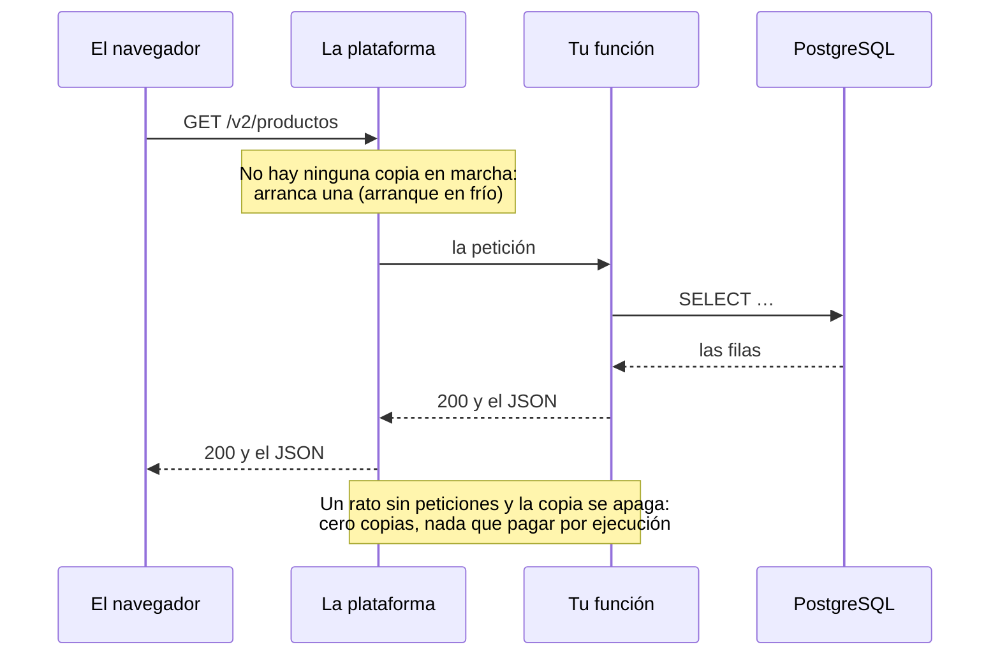

import Term from '~/components/Term.astro';
import TryIt from '~/components/TryIt.astro';
import Analogy from '~/components/Analogy.astro';
import SelfCheck from '~/components/SelfCheck.astro';
import Quiz from '~/components/Quiz.astro';
import QuizQuestion from '~/components/QuizQuestion.astro';
import QuizOption from '~/components/QuizOption.astro';

## El problema

Imagina que Ana le enseña a una amiga su tienda, ya en su VPS, con HTTPS y desplegada con cada `git push`. La amiga le pregunta: «¿Y por qué no la subes a la nube? En mi empresa lo tenemos todo en AWS, con Lambda y RDS».

Ana no sabe qué contestar. ¿Su VPS no es la nube? Y en las ofertas de trabajo lee lo mismo: «experiencia con AWS (EC2, S3, RDS) y serverless».

**La nube no es un sitio, es una forma de alquilar ordenadores.** Hay varias, y cambian en una cosa: cuánto trabajo haces tú y cuánto hace el proveedor. Esta lección las ordena con la misma tienda, y te traduce los nombres de AWS a lo que ya has hecho.

## La analogía

<Analogy>

Piensa en cómo dar de comer a cien invitados.

- **Alquilas una cocina equipada.** El horno es del dueño; tú compras, cocinas, sirves y friegas.
- **Contratas un catering con tu receta.** Tú das la receta; ellos cocinan, sirven y recogen.
- **Pagas por plato a un puesto que solo enciende el fuego cuando alguien pide.** Sin pedidos, no pagas; con mil, aparecen más cocineros.
- **Vas a un restaurante.** Eliges de la carta y no cocinas nada.

La cocina alquilada es **IaaS**; el catering, **PaaS**; el puesto que cobra por plato, **serverless**; y el restaurante, **SaaS**.

<div slot="limits">

- Si cambias de catering, te llevas tu receta. En la nube, cuanto más te dan hecho, más cuesta irse: tu código acaba usando piezas que solo tiene ese proveedor.
- Pagar por plato no siempre sale más caro que cocinar. Con pocas visitas, serverless puede salirte gratis; con muchas y constantes, un servidor alquilado suele salir más barato.

</div>

</Analogy>

## Cómo funciona de verdad

### La nube es alquilar ordenadores ajenos, por internet

La definición más citada es la del NIST, el instituto de normas de Estados Unidos, en su documento [SP 800-145](https://csrc.nist.gov/pubs/sp/800/145/final), de 2011: recursos compartidos (servidores, almacenamiento, redes, aplicaciones) que usas por la red, y que pides y devuelves rápido, sin hablar con nadie. Pide cinco características, y **tu VPS de la [lección 1](/fase-8/que-es-un-vps/) las cumple todas**:

| Característica | En tu VPS |
|---|---|
| Lo pides tú solo, cuando quieres | Lo creaste desde un panel |
| Llegas por la red | Entras por SSH desde tu terminal |
| Recursos compartidos entre clientes | Comparte el ordenador físico con otros VPS |
| Crece y se encoge rápido | Pasas a un plan mayor en minutos |
| Se mide lo que usas, y se cobra | El proveedor cuenta tu servidor, tu disco y tu IP |

Así que **Ana ya está en la nube.** Lo que cambia con AWS es cuántas cosas le dan hechas.

### Tres modelos según lo que te dan hecho

El mismo documento define tres modelos. Parte tu tienda en capas y mira quién se ocupa de cada una:

| Capa | Tu VPS (IaaS) | Una plataforma (PaaS) | Un programa terminado (SaaS) |
|---|---|---|---|
| El edificio, los ordenadores y la red | El proveedor | El proveedor | El proveedor |
| El sistema operativo: Ubuntu, sus actualizaciones, `ufw` | Tú | El proveedor | El proveedor |
| Lo que ejecuta tu código: Docker, Node, nginx, el certificado | Tú | El proveedor | El proveedor |
| Tu aplicación y su configuración | Tú | Tú | El proveedor |
| Tus datos | Tú | Tú | Tú, dentro de lo que el programa deja |

- **<Term id="iaas">IaaS</Term>** (*Infrastructure as a Service*, infraestructura como servicio): alquilas procesador, memoria, disco y red, e instalas lo que quieras, **sistema operativo incluido**. Es tu VPS.
- **<Term id="paas">PaaS</Term>** (*Platform as a Service*, plataforma como servicio): subes tu aplicación y la plataforma la ejecuta. En palabras del NIST, no controlas «la red, los servidores, el sistema operativo ni el almacenamiento».
- **<Term id="saas">SaaS</Term>** (*Software as a Service*, software como servicio): usas el programa de otro, casi siempre desde el navegador. El ejemplo del NIST es el correo web; GitHub también lo es.

### Serverless: tampoco ves el servidor

<Term id="serverless">Serverless</Term> («sin servidor») no está en el documento del NIST: se hizo popular después, con AWS Lambda, en 2014. **Sí hay servidores, pero no los ves nunca:** subes funciones, y la plataforma arranca copias cuando llegan peticiones y las apaga cuando no hay ninguna. También lo verás como **FaaS** (*Functions as a Service*).

Dos cosas lo separan de un PaaS: **puede bajar a cero copias**, y entonces no pagas por ejecución, y **se cobra por petición**. [AWS Lambda](https://docs.aws.amazon.com/lambda/latest/dg/welcome.html) cobra cada petición y el tiempo que tu código se ejecuta. Así va una:



La primera petición tras un rato sin visitas espera a que arranque una copia: es el **arranque en frío** (*cold start*).

### La misma tienda, en cada modelo

**En IaaS, como ya la tienes.** Todo lo de esta fase es trabajo tuyo, del cortafuegos al despliegue, y a cambio lo ves y lo cambias todo. En AWS sería igual, con un servidor de EC2 en lugar de tu VPS.

**En PaaS, le das el repositorio.** Plataformas como [Render](https://render.com/docs/deploys) o Railway se conectan a tu GitHub y, con cada push a `main`, construyen la imagen con tu `Dockerfile` de la [Fase 7](/fase-7/dockerfile/), la arrancan y le dan un nombre con HTTPS. [Fly.io](https://docs.fly.io/launch/deploy) hace lo mismo con su propia orden, `fly deploy`. Heroku funciona parecido, con su propia forma de construir.

Desaparece casi toda esta fase: el servidor, su seguridad, nginx, el certificado y el script de despliegue. Sigue siendo tuyo el código, los secretos (en el panel de la plataforma, no en un `.env`) y las migraciones. PostgreSQL y Redis te los ofrecen casi todas, gestionados.

Heroku, de Salesforce, fue de los primeros en desplegar con un `git push`. En 2026 pasó a un modelo de mantenimiento (*sustaining engineering*), centrado en que la plataforma sea estable y segura ([su anuncio](https://www.heroku.com/blog/march-2026-update/)).

**En serverless, cada petición puede caer en una copia distinta**, y las copias aparecen y desaparecen solas. Tres consecuencias:

- **Nada se guarda en la memoria.** El límite de intentos de la Fase 6, en memoria, no aguantaría; el compartido en Redis de la [Fase 7](/fase-7/docker-compose/#dos-copias-de-la-api-una-sola-cuenta-en-redis), sí.
- **Las conexiones a PostgreSQL se multiplican.** Cien copias son cien <Term id="connection-pool">pools de conexiones</Term>, y PostgreSQL acepta un número limitado.
- **Cada petición tiene un tiempo máximo:** en Lambda, 30 segundos por defecto y hasta 15 minutos por petición HTTP, según su [documentación](https://docs.aws.amazon.com/lambda/latest/dg/welcome.html). El SSE de la [Fase 4](/fase-4/websockets-sse/), que deja la conexión abierta, encaja mal.

### Los nombres de AWS, traducidos

AWS (*Amazon Web Services*) tiene cientos de servicios. Estos son los que vas a oír primero:

| Nombre | Qué es | En este curso |
|---|---|---|
| **EC2** (*Elastic Compute Cloud*) | Servidores virtuales: IaaS | Tu VPS de la lección 1 |
| **S3** (*Simple Storage Service*) | Almacenamiento de objetos: ficheros enteros, por su nombre, por HTTP | Un sitio fuera del servidor para la copia de cada noche |
| **RDS** (*Relational Database Service*) | Bases de datos gestionadas, PostgreSQL entre ellas | El servicio `db` de tu `compose.produccion.yaml` |
| **IAM** (*Identity and Access Management*) | Quién puede hacer qué en tu cuenta | Los roles y permisos de la [Fase 6](/fase-6/roles-permisos-rbac/) |
| **Lambda** | Funciones serverless | El apartado anterior |
| **Regiones y zonas** | Dónde están las máquinas | La región que elegiste en la lección 1 |

**S3 guarda ficheros, pero no es un disco.** Según su [documentación](https://docs.aws.amazon.com/AmazonS3/latest/userguide/Welcome.html), guarda objetos dentro de *buckets*, cada uno con su nombre, su clave: `copias/tienda-2026-10-18.sql.gz`. Un objeto se sube y se descarga entero, con peticiones HTTP como las de la [Fase 2](/fase-2/metodos-http/). Para cambiar una letra, lo vuelves a subir.

**IAM es el RBAC de la Fase 6, para tu cuenta de AWS.** Cada persona y cada programa tiene una política con lo que puede hacer, y nada más: el <Term id="least-privilege">mínimo privilegio</Term>. Esta deja que el servidor suba copias al *bucket* `tienda-copias`:

```json
{
  "Version": "2012-10-17",
  "Statement": [
    {
      "Effect": "Allow",
      "Action": "s3:PutObject",
      "Resource": "arn:aws:s3:::tienda-copias/*"
    }
  ]
}
```

`Action` es lo que se permite, subir un objeto; `Resource`, dónde. `2012-10-17` es la versión del idioma de las políticas, no una fecha tuya. Si alguien roba las credenciales del servidor, puede subir ficheros, pero no leer tus copias ni borrarlas. Sí podría sobrescribir una con el mismo nombre: el versionado de S3, si lo activas, guarda la anterior.

**Una región es un lugar del mundo**, como `eu-south-2`, la de España. Dentro tiene varias **zonas de disponibilidad**: centros de datos separados, para que un fallo en una zona no alcance a las otras. En octubre de 2026, según su [lista](https://docs.aws.amazon.com/global-infrastructure/latest/regions/aws-regions.html), AWS tenía 34 regiones, y la de España, 3 zonas.

### Bases de datos gestionadas: lo que te quitan y lo que cuestan

En la [introducción de la Fase 5](/fase-5/#por-qué-postgresql) te contamos que los servicios que dan una base de datos ya instalada ofrecen casi todos PostgreSQL. Son <Term id="managed-service">servicios gestionados</Term>: Amazon RDS, el PostgreSQL de DigitalOcean, el de Render… Te conectas con una `DATABASE_URL`, como siempre.

La [documentación de RDS](https://docs.aws.amazon.com/AmazonRDS/latest/UserGuide/Welcome.html) compara quién hace qué. Resumida:

| Tarea | PostgreSQL en tu servidor | PostgreSQL gestionado (RDS) |
|---|---|---|
| Instalarlo y actualizarlo, con su sistema | Tú | El proveedor |
| Las copias de seguridad | Tú: tu `copia-seguridad.sh` de la [lección 3](/fase-8/docker-compose-produccion/#una-copia-cada-noche) | El proveedor, y puedes volver a cualquier minuto de los días que guarde |
| Seguir si se rompe su máquina | Tú, o nadie | El proveedor, si la pagas: una copia en espera en otra zona toma el relevo |
| El esquema, las consultas, los índices y las migraciones | Tú | **Tú** |

La última fila no cambia nunca: una consulta lenta sigue necesitando su índice y su `EXPLAIN`, como en la [Fase 5](/fase-5/indices-sql-explain/).

**Lo que cuesta.** El 18 de octubre de 2026, el PostgreSQL gestionado más pequeño de DigitalOcean costaba 15,15 dólares al mes, con 1 GiB de memoria, 1 procesador y 10 GiB de disco ([sus precios](https://www.digitalocean.com/pricing/managed-databases)). Su VPS más barato, con la mitad de memoria, costaba 4. Y la copia en espera es otra máquina: se paga aparte.

**Compensa** cuando perder datos o una hora sin base de datos te cuesta más que la factura, o cuando nadie del equipo quiere restaurar copias a las tres de la mañana. Para aprender, o para una tienda pequeña con copias que has probado a restaurar, tu PostgreSQL en Compose sirve.

### Atado a un proveedor: el lock-in

Cuanto más te dan hecho, más usas piezas que solo tiene ese proveedor: sus funciones, sus políticas, su fichero de configuración. Irte es reescribirlas: se llama ***lock-in*** (quedarte atado al proveedor). Dos cosas del curso te dejan la puerta abierta:

- **Tu imagen de Docker** arranca igual en tu VPS, en EC2, en Render o en Fly.io.
- **PostgreSQL es estándar:** un `pg_dump` de RDS se restaura en tu Compose, y al revés.

### Esta web es serverless; tu tienda, IaaS

**Esta web vive en Cloudflare Workers,** una plataforma serverless, y usa su parte más sencilla: ficheros, sin código de servidor. Astro la genera al construirla, y Cloudflare entrega los ficheros desde sus centros de datos, como una <Term id="cdn">CDN</Term>. Su configuración, `wrangler.jsonc`, solo dice qué carpeta publicar.

No hay Ubuntu que actualizar, ni nginx, ni certificado que renovar. Y según la [documentación de Cloudflare](https://developers.cloudflare.com/workers/static-assets/billing-and-limitations/), el 18 de octubre de 2026, las peticiones a ficheros estáticos son gratis y sin límite. Lo que no puede es ejecutar la API de la tienda tal cual, con su PostgreSQL al lado y un proceso siempre en marcha.

Por eso **tu tienda es IaaS:** todo a la vista y todo cambiable, y también todo responsabilidad tuya. Cómo llega cada cambio de esta web a Cloudflare lo viste en la [lección 6](/fase-8/ci-cd-github-actions/#esta-web-github-actions-comprueba-cloudflare-despliega).

### Cómo elegir

| | IaaS: tu VPS, EC2 | PaaS: Render, Railway, Fly.io | Serverless: Lambda, Workers |
|---|---|---|---|
| Qué subes | Lo que quieras | Tu repositorio o tu imagen | Funciones, o ficheros |
| Quién administra el sistema | Tú | La plataforma | La plataforma |
| Qué pagas | El servidor, lo uses o no | Tu aplicación encendida, y sus extras | Cada petición y su tiempo |
| Sin ninguna visita | Pagas igual | Pagas, salvo planes (a menudo gratis) que la duermen | Casi nada |
| Qué no puedes cambiar | Casi nada | El sistema, la red y cómo se construye | El tiempo máximo y lo que se guarda entre peticiones |

Tres preguntas lo deciden casi siempre: **¿quién va a cuidar el servidor?** Si nadie quiere, PaaS o serverless. **¿Cómo es el tráfico?** Constante, un servidor sale barato; a picos o casi nulo, serverless. **¿Necesitas conexiones abiertas,** como SSE o WebSocket? Un servidor o un PaaS.

## Pruébalo

El objetivo: averiguar quién contesta en cada web, solo con sus cabeceras. `curl -I` envía un `HEAD`, el `GET` sin contenido de la [Fase 2](/fase-2/metodos-http/#head-y-options-preguntar-sin-pedir-el-contenido).

### Quién sirve esta web

En **tu ordenador**:

<TryIt
  title="1. Las cabeceras de esta web"
  cmd="curl -I https://backenddesdecero.com/"
  output={`HTTP/2 200 
date: Sat, 17 Oct 2026 22:30:20 GMT
content-type: text/html
cf-cache-status: HIT
cache-control: public, max-age=0, must-revalidate
…
server: cloudflare
cf-ray: a4c2bf495ae1ec89-MAD
alt-svc: h3=":443"; ma=86400`}
>

Ninguna línea habla de un servidor nuestro:

- **`server: cloudflare`**: quien contesta es Cloudflare.
- **`cf-ray`**: el número de tu petición en Cloudflare. Las tres letras del final son el centro de datos que te ha contestado, con el código de su aeropuerto: `MAD`, Madrid. El tuyo será el más cercano a ti.
- **`cf-cache-status: HIT`**: el fichero ya estaba en la <Term id="cache">caché</Term> de ese centro de datos.

Hemos quitado dos líneas largas (`…`). Tu hora y tu `cf-ray` serán otros.

</TryIt>

### Quién sirve tu tienda

En el camino gratis, la tienda tiene que estar en marcha en tu VM, como la dejaste en la [lección 5](/fase-8/lets-encrypt-nginx/). En **tu ordenador**, en la carpeta donde copiaste `ca.crt` y con tu nombre de sslip.io:

<TryIt
  title="2. Las cabeceras de tu tienda"
  cmd="curl -I --cacert ca.crt https://192-168-5-15.sslip.io/"
  windows="curl.exe --ssl-no-revoke -I --cacert ca.crt https://192-168-5-15.sslip.io/"
  output={`HTTP/2 200 
server: nginx/1.28.3 (Ubuntu)
date: Sat, 17 Oct 2026 22:31:15 GMT
content-type: application/json
cross-origin-opener-policy: same-origin
…
strict-transport-security: max-age=15552000; includeSubDomains
…
x-request-id: 0aaf245e-bd73-4caa-b515-c20b3ca5e0eb
x-xss-protection: 0`}
>

Aquí **contesta tu nginx**: `server: nginx/1.28.3 (Ubuntu)`, y ningún `cf-`. Las demás cabeceras son de tu API: las de seguridad de la [Fase 6](/fase-6/owasp-top-10/) y el `x-request-id` de sus logs.

Si sale `Could not resolve host`, usa el plan B de la lección 5, el fichero `hosts`. Si sale `Failed to connect`, la VM está apagada: `multipass start curso`. Si sale `502`, falta la API: en la VM, `docker compose -f compose.produccion.yaml up -d`.

</TryIt>

La línea `server` la pone quien da la cara, no quien hace el trabajo. Compruébalo **dentro de la VM**, pidiéndole lo mismo a la API sin nginx:

<TryIt
  title="3. La API, sin nginx delante"
  cmd="curl -I http://127.0.0.1:3000/"
  output={`HTTP/1.1 200 OK
content-type: application/json
cross-origin-opener-policy: same-origin
…
x-request-id: 9aaf8d76-1e2a-4250-88ad-3fb79e1fd8a2
x-xss-protection: 0
Date: Sat, 17 Oct 2026 22:31:22 GMT
Connection: keep-alive
Keep-Alive: timeout=5`}
>

Las cabeceras de la API son las mismas, pero **no hay línea `server`**: la ponía nginx. Con Cloudflare pasa igual: `server: cloudflare` dice quién está delante, no qué hay detrás. Si sale `Connection refused`, la API está parada.

</TryIt>

En el camino de pago, haz el paso 2 con tu dominio y sin `--cacert`: tu certificado de Let's Encrypt lo acepta cualquier curl. Las cabeceras son las mismas.

<SelfCheck question="Reto: pones tu dominio detrás del proxy de Cloudflare, y curl -I dice ahora server: cloudflare. ¿Ha dejado tu tienda de estar en tu VPS?">

No. Sigue en tu VPS, con tu nginx y tu API: Cloudflare se ha puesto delante, como nginx delante de la API, y le pasa las peticiones a tu servidor. La línea `server` la pone quien da la cara, y ahora es Cloudflare.

</SelfCheck>

## Ya lo has visto

- **Tu correo, tus fotos del móvil y tus documentos compartidos** son SaaS: un programa de otro, en sus servidores.
- **GitHub Actions**, de la [lección 6](/fase-8/ci-cd-github-actions/), te presta un ordenador para cada ejecución que no administras.
- **Si has publicado un frontend en Vercel o Netlify,** has usado un PaaS, y sus funciones son serverless.

## Errores comunes

- **Creer que en la nube el proveedor se ocupa de la seguridad.** Se ocupa de lo que administra él. En EC2, el sistema operativo es tuyo. Y un *bucket* de S3 que haces público lo lee cualquiera, aunque S3 los crea privados.
- **Dejar algo encendido y llevarte una sorpresa en la factura.** Pon una alerta de gasto el primer día (en AWS, con AWS Budgets), y borra lo que no uses.
- **Usar la cuenta principal de AWS para todo.** Es tu `root`: úsala solo para empezar, y trabaja con usuarios de IAM con lo justo. Sus claves de acceso son secretos: nunca en el código ni en Git.
- **Tratar S3 como un disco.** No sirve para un log que crece línea a línea ni para la carpeta de PostgreSQL.

## Resumen

- La nube es alquilar ordenadores por internet: los pides tú, crecen y se encogen, y pagas lo que usas. Tu VPS ya lo es.
- IaaS te da el servidor y lo administras tú; PaaS ejecuta tu código sin que veas el servidor; serverless ejecuta funciones solo cuando llegan peticiones; SaaS es un programa terminado.
- En AWS, EC2 es tu VPS, S3 guarda ficheros enteros, RDS es PostgreSQL gestionado e IAM decide quién puede hacer qué.
- Una base de datos gestionada te quita las copias, las actualizaciones y las caídas de su máquina, a cambio de pagar más; el esquema y las consultas siguen siendo tuyos.
- Cuanto más te dan hecho, más te atas. Docker y PostgreSQL te dejan la puerta abierta.

## ¿Lo has entendido?

<Quiz>

<QuizQuestion
  question="Ana tiene la tienda en un servidor de EC2. Sale un fallo de seguridad grave en OpenSSH. ¿Quién instala la actualización?"
  review="Tres modelos según lo que te dan hecho"
>

<QuizOption text="AWS: en la nube, el proveedor parchea los servidores de sus clientes.">

En IaaS, el proveedor cuida el hardware y la red, no tu sistema.

</QuizOption>

<QuizOption text="Ana: en IaaS, el sistema operativo es suyo." correct>

EC2 es como su VPS: el Ubuntu de dentro lo administra ella. Con las actualizaciones automáticas de la lección 2, se instalaría solo.

</QuizOption>

<QuizOption text="Nadie: a los servidores de EC2 no se entra por SSH, sino desde el panel de AWS.">

A EC2 se entra por SSH, como a cualquier VPS. Por eso le afecta el fallo.

</QuizOption>

</QuizQuestion>

<QuizQuestion
  question="Quieres que la API escriba su log en un fichero de S3, añadiendo una línea con cada petición. ¿Qué pasa?"
  review="Los nombres de AWS, traducidos"
>

<QuizOption text="Nada raro: S3 es un disco en la nube, y se escribe en él como en cualquier otro.">

S3 guarda objetos enteros por su nombre. No es un disco donde añadir una línea.

</QuizOption>

<QuizOption text="Que no se puede: S3 solo acepta imágenes y vídeos.">

S3 guarda cualquier fichero. El problema es escribirlo poco a poco.

</QuizOption>

<QuizOption text="Que cada línea obliga a subir el objeto entero otra vez." correct>

Un objeto se sube entero. Los logs se escriben en el servidor, y a S3 se suben los ficheros ya terminados.

</QuizOption>

</QuizQuestion>

<QuizQuestion
  question="Llevas la API a funciones serverless con el límite de intentos en la memoria del proceso, como en la Fase 6. ¿Funciona?"
  review="La misma tienda, en cada modelo"
>

<QuizOption text="No: cada copia tiene su memoria, y las copias aparecen y desaparecen." correct>

Un intento contado en una copia no lo ve la siguiente. El límite tiene que estar fuera, en Redis, como en la Fase 7.

</QuizOption>

<QuizOption text="Sí: la plataforma comparte la memoria entre todas las copias de la misma función.">

Cada copia es un proceso aparte, a menudo en otra máquina. No hay memoria común.

</QuizOption>

<QuizOption text="Sí, pero más lento: la plataforma guarda la memoria en disco entre peticiones.">

Lo que guarda una copia en memoria se pierde al apagarla, y nada se lo pasa a las demás.

</QuizOption>

</QuizQuestion>

<QuizQuestion
  question="curl -I a una web responde con server: cloudflare y un cf-ray. ¿Qué sabes de cómo está hecha?"
  review="Quién sirve tu tienda"
>

<QuizOption text="Que es una web de ficheros estáticos, porque Cloudflare solo sirve ficheros.">

Cloudflare también se pone delante de servidores con su API y su base de datos.

</QuizOption>

<QuizOption text="Que Cloudflare contesta delante, pero detrás puede haber cualquier cosa." correct>

La línea `server` la pone quien da la cara, como nginx delante de tu API. Detrás puede haber ficheros, un VPS o funciones.

</QuizOption>

<QuizOption text="Que está alojada en un VPS de Cloudflare, en el centro de datos que dice el cf-ray.">

El `cf-ray` dice qué centro de datos de Cloudflare te contestó, no dónde está la web.

</QuizOption>

</QuizQuestion>

<QuizQuestion
  question="La tienda vende mucho, una hora sin base de datos cuesta más que un año de PostgreSQL gestionado, y nadie del equipo ha restaurado nunca una copia. ¿Qué haces?"
  review="Bases de datos gestionadas: lo que te quitan y lo que cuestan"
>

<QuizOption text="Seguir con PostgreSQL en Compose: ya hay un script que hace copias cada noche.">

Una copia que nadie ha restaurado no se sabe si sirve, y el script no cubre que se rompa la máquina.

</QuizOption>

<QuizOption text="Pasar a uno gestionado, y olvidarte también del esquema y de los índices.">

El proveedor cuida la máquina y las copias. El esquema, las consultas lentas y los índices siguen siendo tuyos.

</QuizOption>

<QuizOption text="Pasar a un PostgreSQL gestionado, con copia en espera en otra zona." correct>

La factura cuesta menos que el riesgo: el proveedor hace las copias y cambia a la copia en espera si se rompe la máquina.

</QuizOption>

</QuizQuestion>

<QuizQuestion
  question="Despliegas la tienda en un PaaS y quieres poder irte si sube los precios. ¿Qué te ayuda más?"
  review="Atado a un proveedor: el lock-in"
>

<QuizOption text="Nada especial: en cualquier PaaS tu código es tuyo, y te lo llevas sin cambios.">

El código sí, pero no los servicios propios de la plataforma ni su configuración.

</QuizOption>

<QuizOption text="Mantener la tienda en una imagen de Docker y la base de datos en PostgreSQL." correct>

La imagen arranca igual en cualquier sitio, y un `pg_dump` se restaura en cualquier PostgreSQL.

</QuizOption>

<QuizOption text="Usar todos los servicios propios de la plataforma, para migrarlo todo junto el día que te vayas.">

Es al revés: cada servicio propio no existe en el siguiente proveedor, y tendrás que sustituirlo.

</QuizOption>

</QuizQuestion>

</Quiz>

## Para profundizar

- [The NIST Definition of Cloud Computing (SP 800-145)](https://csrc.nist.gov/pubs/sp/800/145/final), en inglés: tres páginas con las características y los modelos.
- [What is Amazon RDS?](https://docs.aws.amazon.com/AmazonRDS/latest/UserGuide/Welcome.html), en inglés: la tabla entera de quién hace qué.
- [What is Amazon S3?](https://docs.aws.amazon.com/AmazonS3/latest/userguide/Welcome.html), en inglés: *buckets*, objetos y claves.
- [What is AWS Lambda?](https://docs.aws.amazon.com/lambda/latest/dg/welcome.html), en inglés: los tipos de funciones y cómo se cobran.
