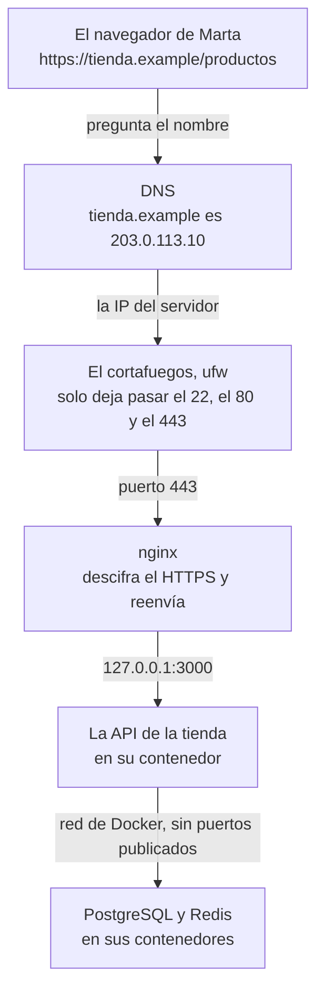

import { Aside } from '@astrojs/starlight/components';
import Term from '~/components/Term.astro';
import TryIt from '~/components/TryIt.astro';
import Analogy from '~/components/Analogy.astro';

Al terminar la Fase 7, la tienda entera arranca con un `docker compose up`: la API, PostgreSQL y Redis. Pero arranca en tu ordenador. Cierras la tapa del portátil y la tienda desaparece.

En esta fase la pones en un **servidor** que responde a otras personas, con su nombre y su candado de HTTPS. Y al final, cada `git push` a `main` llega a ese servidor sin que tengas que entrar en él.

## Qué es desplegar

Imagina que le pasas a Marta, una clienta, la dirección de tu tienda: `http://localhost:3000/productos`. Marta la abre en su móvil y no ve nada. <Term id="localhost">localhost</Term> es siempre la máquina donde se escribe: para Marta, su propio móvil, donde no hay ninguna tienda.

Para que Marta llegue, la tienda tiene que estar en un ordenador que siga encendido cuando apagas el tuyo, con una dirección a la que llegue cualquiera. Ponerla allí, y después cada versión nueva, es **desplegar**: un <Term id="deployment">despliegue</Term>, la palabra que ya viste en la [lección de Git de la Fase 1](/fase-1/git-por-dentro/).

Desplegar tiene dos partes, y esta fase hace las dos:

- **La primera vez:** preparar el servidor, cerrarlo bien, arrancar la tienda, ponerle delante un servidor web y darle un nombre con HTTPS. Son las lecciones 1 a 5.
- **Cada vez después:** que una versión nueva llegue sola, con los tests pasados, y que puedas volver a la anterior si algo sale mal. Es la lección 6.

## Adónde llega la tienda al final de la fase

Este es el camino que hace una petición de Marta cuando la fase termine, desde su navegador hasta la base de datos:



Cada pieza es de una lección:

- **El nombre** (`tienda.example`) lo traduce el <Term id="dns">DNS</Term>, como en la [Fase 0](/fase-0/que-es-dns/), a la IP del servidor. Lección 5.
- **La IP del servidor** es una <Term id="public-ip">IP pública</Term>: llega cualquiera desde internet. Tu router de casa no te da eso, y por eso los servidores viven en centros de datos. Lección 1.
- **El cortafuegos** (*firewall*) del servidor, `ufw`, cierra todos los <Term id="port">puertos</Term> menos tres: el 22 para entrar tú por <Term id="ssh">SSH</Term>, y el 80 y el 443 para la web. Lección 2.
- **La API, PostgreSQL y Redis** arrancan con Docker Compose, como en la Fase 7, pero con la configuración de un servidor de verdad. Lección 3.
- **nginx** recibe las peticiones en el 443, el puerto de HTTPS, y se las pasa a la API, que solo escucha dentro del servidor. Lecciones 4 y 5.

<Analogy>

Piensa en las oficinas de una empresa, en un edificio con recepción. Quien viene de visita busca la dirección (el DNS), llega al edificio (la IP) y solo puede entrar por la puerta principal: las demás están cerradas con llave (el cortafuegos).

En la entrada, la recepción (nginx) atiende a todo el mundo, comprueba lo que trae cada visita y la acompaña a la oficina que busca (la API). El archivo del sótano (PostgreSQL y Redis) no tiene puerta a la calle: solo bajan a él los de la oficina.

<div slot="limits">

- La recepción de un edificio pide el nombre a quien entra. nginx no sabe quién eres: eso lo comprueba la API, con las cuentas de la Fase 6.
- Un edificio tiene una sola dirección. Un servidor puede tener varios nombres, y nginx atiende a cada uno con su web.
- Al edificio llegan unas pocas visitas al día. A un servidor en internet llegan programas que prueban puertas sin parar desde el primer minuto, como verás en la lección 2.

</div>

</Analogy>

## Dos caminos: gratis o de pago

Para todo esto necesitas un servidor. Esta fase te deja elegir entre dos, y **las lecciones son las mismas para los dos**. Donde cambia algo, cada lección enseña primero el camino gratis, que puede hacer todo el mundo, y después el de pago.

| | Gratis: tu máquina virtual | De pago: un servidor alquilado |
|---|---|---|
| Qué es | La VM `curso` de la Fase 1, en tu ordenador | Un servidor en un centro de datos, con Ubuntu 26.04 |
| Cuánto cuesta | Nada | Unos euros al mes, y un dominio si quieres uno |
| Quién llega a la tienda | Solo tu ordenador | Cualquiera, desde internet |
| Su dirección | Una <Term id="private-ip">IP privada</Term>, como `192.168.64.2` | Una IP pública |
| El nombre | Un nombre que apunta a la IP de tu VM, o el fichero `hosts` de tu ordenador | Tu propio dominio |
| HTTPS | Con un certificado de tu propia autoridad: el navegador avisa, y aprenderás por qué | Con Let's Encrypt, gratis y sin avisos |
| Ataques de verdad | No: nadie de fuera la ve | Sí, desde que la enciendes |

### Gratis: tu máquina virtual

Tu servidor es la <Term id="virtual-machine">máquina virtual</Term> `curso`, la que creaste con Multipass en la [lección 4 de la Fase 1](/fase-1/usuarios-y-permisos-linux/). Lleva Ubuntu, como casi todos los servidores alquilados, así que SSH, usuarios, cortafuegos, systemd, Docker, nginx y el despliegue se hacen igual que en uno de verdad.

En las introducciones de las [Fases 3](/fase-3/) y [4](/fase-4/) te dijimos que esa máquina descansaba hasta ahora. Aquí la despiertas: **esta misma API sube a ella**.

**Lo que no puede tener:** una IP pública, un dominio que resuelva cualquiera ni un certificado de Let's Encrypt, que necesita comprobar desde internet que el nombre es tuyo. Solo llegas a ella desde tu ordenador, por su dirección privada.

### De pago: un servidor alquilado

Un **VPS** es un servidor virtual que alquilas por meses en un centro de datos. La lección 1 te cuenta qué es por dentro y cómo elegirlo. Algunos proveedores son Hetzner, DigitalOcean, OVHcloud y Scaleway.

Los precios cambian. El 17 de octubre de 2026, dos planes pequeños eran estos:

- **Hetzner Cloud CX23:** 2 procesadores, 4 GB de memoria y 40 GB de disco, por 5,49 € al mes sin IVA y sin la IPv4.
- **DigitalOcean Basic:** 4 dólares al mes, pero con 512 MB de memoria, poco para la tienda. Necesitas unos 2 GB, y los planes con eso cuestan más.

El dominio se paga aparte, cada año, a un registrador; la lección 5 te cuenta cómo. Sin él, puedes seguir la fase entera con la IP del servidor, como en el camino gratis.

**Lo que ganas:** tu tienda en internet de verdad, con un nombre, un certificado que el navegador acepta y bots que la atacan desde el primer minuto. **Lo que cuesta:** dinero cada mes, y un servidor que es responsabilidad tuya mientras esté encendido. Si lo eliges, bórralo en el panel del proveedor cuando acabes: un servidor apagado se sigue cobrando.

### En Windows

En las fases anteriores, en Windows, tu servidor de prácticas era tu Ubuntu de WSL. **En esta fase no sirve como servidor:** WSL no es un ordenador aparte. Windows lo arranca y lo conecta por su cuenta, así que no tienes una máquina a la que entrar por SSH como a un servidor de verdad, ni forma de comprobar desde fuera qué deja pasar el cortafuegos y que solo llega nginx.

Para el camino gratis, instala **Multipass para Windows** ([guía de instalación](https://canonical.com/multipass/docs/stable/how-to-guides/install-multipass/)). Necesita Windows 10 o 11 y una forma de crear máquinas virtuales:

- **En Windows Pro o Enterprise,** Hyper-V, que viene con Windows y Multipass usa por defecto.
- **En Windows Home,** que no trae Hyper-V, VirtualBox: instálalo y dile a Multipass que lo use con `multipass set local.driver=virtualbox`.

Las órdenes de `multipass` se escriben en PowerShell, no en WSL. Si en tu ordenador no funciona ninguna de las dos, el camino de pago funciona igual en cualquier sistema: solo necesitas una terminal con `ssh`.

## Las lecciones

1. [VPS](/fase-8/que-es-un-vps/)
2. Seguridad del servidor
3. Producción
4. Proxy inverso
5. HTTPS
6. CI/CD
7. Modelos de nube
8. Terraform

Las dos primeras preparan el servidor. De la 3 a la 6, tu proyecto gana ficheros nuevos, con su carpeta descargable como en las fases anteriores. Las dos últimas miran más allá de tu servidor:

| Lección | Lo que gana la tienda | Carpeta |
|---|---|---|
| 1. VPS | Nada todavía: tienes un servidor y entras en él por SSH | — |
| 2. Seguridad | Nada en la tienda: el servidor se cierra (tu usuario, SSH solo con clave, cortafuegos y actualizaciones solas) | — |
| 3. Producción | La tienda en el servidor: secretos que solo están allí, arranque solo tras un reinicio, tu cuenta de administrador y una copia de la base de datos cada noche | `35-produccion` |
| 4. Proxy inverso | nginx delante, y la API que sabe la IP de quien le habla | `35-produccion` |
| 5. HTTPS | Un nombre y su certificado | `35-produccion` |
| 6. CI/CD | Cada `git push` a `main` pasa los tests, publica la imagen y llega al servidor; y la vuelta atrás | `36-despliegue` |
| 7. Modelos de nube | Nada: la misma tienda en IaaS, PaaS y serverless, y los nombres de AWS | — |
| 8. Terraform | Nada en la tienda: describes un servidor en un fichero, y practicas con Docker en tu ordenador | — |

## Dónde vas a practicar

Hay dos sitios, tu ordenador y el servidor:

| Dónde | Para qué | Desde |
|---|---|---|
| Tu ordenador | Tu proyecto, en `~/curso-backend/fase-3/tienda-api`; desde él copias la tienda al servidor | La lección 3 |
| El servidor (la VM `curso` o tu VPS) | Docker, nginx y la tienda en marcha. Entras por SSH | La lección 1 |
| GitHub | Tu propio repositorio, donde se pasan los tests y se publica la imagen. Basta una cuenta gratis | La lección 6 |

- **Las salidas** están capturadas en una máquina virtual con Ubuntu 26.04, procesador ARM, 2 GB de memoria y 15 GB de disco, con Docker Engine 29.9.1. Tus versiones, horas y direcciones serán otras.
- **Tu VM `curso` lleva Ubuntu 24.04**, el de la Fase 1, y un servidor alquilado hoy, el 26.04. Los dos son versiones LTS, de soporte largo. Las órdenes son las mismas, pero algunas versiones y mensajes cambian: si tu pantalla difiere de la salida, es lo primero que mirar.
- **Los nombres:** tú eres `ana` en tu `portatil`, y en el servidor, `ubuntu` en `curso`. Las IP públicas de los ejemplos, como `203.0.113.10`, están reservadas para documentación: la de tu servidor será otra.

## Antes de empezar: prepara el servidor

### Camino gratis: más memoria y disco para curso

En la Fase 1, Multipass creó `curso` con lo mínimo: 1 GB de memoria y 5 GB de disco. PostgreSQL, Redis, la imagen de la API y nginx no caben ahí. **Dale 2 GB de memoria y 15 GB de disco.** Multipass solo cambia eso con la máquina parada:

<TryIt
  title="Más memoria y disco para curso"
  cmd={`multipass stop curso
multipass set local.curso.memory=2G
multipass set local.curso.disk=15G
multipass start curso`}
>

Escríbelo en la terminal de tu ordenador (en Windows, en PowerShell), no dentro de la VM:

- **`stop`** apaga la VM, como un ordenador que se apaga bien.
- **`set local.curso.memory=2G`** cambia la memoria que Multipass le da. La memoria de tu ordenador solo se gasta según la VM la usa, no toda de golpe.
- **`set local.curso.disk=15G`** agranda su disco. **El disco solo puede crecer:** si pides menos de lo que tiene, Multipass se niega, porque encoger un disco puede borrar datos.
- **`start`** la vuelve a encender.

Son las órdenes de la [documentación de Multipass](https://canonical.com/multipass/docs/stable/how-to-guides/manage-instances/modify-an-instance/). Si dice que la VM no está parada, espera a que `stop` termine y repite. Si no existe `curso`, mira el aviso de abajo.

</TryIt>

<Aside type="note" title="Si no tienes la VM curso">

Si estás en Windows, o borraste la VM, créala ahora, ya con la memoria y el disco de esta fase y con Ubuntu 26.04, el mismo de las salidas:

```sh
multipass launch 26.04 --name curso --memory 2G --disk 15G
```

Si Multipass no encuentra la imagen `26.04`, `multipass find` te enseña las que tiene. La lección 1 te cuenta cómo entrar en ella por SSH con tu clave.

</Aside>

Comprueba el cambio con `multipass info curso`, desde tu ordenador. Fíjate en tres cosas: `State`, que dice que está encendida; `IPv4`, la dirección de la VM, que usarás en todas las lecciones; y `Memory usage` y `Disk usage`, que terminan en `out of` y el total, algo menos de 2G y de 15G, porque el sistema se guarda una parte.

Ahora entra en la VM con `multipass shell curso` y compruébalo desde dentro:

<TryIt
  title="La memoria y el disco, desde dentro"
  cmd={`free -h\ndf -h /`}
  output={`               total        used        free      shared  buff/cache   available
Mem:           1.9Gi       478Mi       186Mi       1.1Mi       1.3Gi       1.4Gi
Swap:             0B          0B          0B
Filesystem      Size  Used Avail Use% Mounted on
/dev/vda1        14G  3.5G   11G  26% /`}
>

`free -h` cuenta la memoria (`-h`, *human*, en unidades legibles), y `df -h /`, el espacio del disco donde está `/`. Fíjate en el `total` de `Mem:`, cerca de 2 GB, y en el `Size` del disco, cerca de 15 GB.

Si `df` sigue diciendo unos 5 GB, el disco creció pero la partición de dentro no. La [documentación de Multipass](https://canonical.com/multipass/docs/stable/how-to-guides/manage-instances/modify-an-instance/) explica cómo agrandarla. Tus números de `used` y `free` serán otros.

</TryIt>

### Si tu ordenador tiene 8 GB de memoria

Con la VM encendida, Docker Desktop abierto, el navegador y el editor, un portátil de 8 GB va justo. Docker Desktop lleva su propia máquina virtual, y en esta fase no la necesitas: **Docker trabaja dentro del servidor.**

- **Cierra Docker Desktop mientras practicas en la VM:** en el Mac, desde el icono de la ballena de la barra de menús, *Quit Docker Desktop*; en Windows, desde el mismo icono, junto al reloj.
- **Apaga la VM cuando acabes** con `multipass stop curso`: deja de usar memoria hasta que la vuelvas a encender.
- **La lección 8** vuelve a usar Docker en tu ordenador: ábrelo de nuevo entonces.

### Instala Docker en la VM

Dentro de `curso`, Docker se instala como en Linux: con `apt`, desde el repositorio del propio Docker. Son las mismas órdenes que en la [introducción de la Fase 7](/fase-7/#en-ubuntu-y-en-wsl-docker-engine), donde se explican palabra a palabra. **Escríbelas dentro de la VM,** con el prompt `ubuntu@curso:~$`, no en tu ordenador.

Primero, la clave con la que Docker firma sus paquetes:

<TryIt
  title="La clave del repositorio de Docker"
  cmd={`sudo apt update\nsudo apt install -y ca-certificates curl\nsudo install -m 0755 -d /etc/apt/keyrings\nsudo curl -fsSL https://download.docker.com/linux/ubuntu/gpg -o /etc/apt/keyrings/docker.asc\nsudo chmod a+r /etc/apt/keyrings/docker.asc`}
>

Actualizan el catálogo de `apt`, instalan lo necesario para descargar por HTTPS, y guardan la clave pública de Docker en `/etc/apt/keyrings`, donde `apt` busca las claves de otros repositorios.

</TryIt>

Después, dónde está el repositorio:

<TryIt
  title="Añade el repositorio de Docker"
  cmd={`sudo tee /etc/apt/sources.list.d/docker.sources <<EOF
Types: deb
URIs: https://download.docker.com/linux/ubuntu
Suites: $(. /etc/os-release && echo "\${UBUNTU_CODENAME:-$VERSION_CODENAME}")
Components: stable
Architectures: $(dpkg --print-architecture)
Signed-By: /etc/apt/keyrings/docker.asc
EOF
sudo apt update`}
  output={`Types: deb
URIs: https://download.docker.com/linux/ubuntu
Suites: resolute
Components: stable
Architectures: arm64
Signed-By: /etc/apt/keyrings/docker.asc
…
Get:1 https://download.docker.com/linux/ubuntu resolute InRelease [32.5 kB]
Get:2 https://download.docker.com/linux/ubuntu resolute/stable arm64 Packages [31.8 kB]
…
Reading package lists...`}
>

Fíjate en `Suites:`: es el nombre de tu Ubuntu. Las salidas son de Ubuntu 26.04, `resolute`; **en tu VM de la Fase 1, con Ubuntu 24.04, verás `noble`.** `Architectures` es tu procesador: `arm64` en un Mac con Apple Silicon, `amd64` en casi todos los PC y en muchos VPS.

Las líneas `Get:` de `download.docker.com` dicen que `apt` ya lee el catálogo de Docker. Si sale `NO_PUBKEY` o `not signed`, falta la clave: repite el paso anterior. Hemos recortado la salida (`…`).

</TryIt>

Y Docker, con Compose:

<TryIt
  title="Instala Docker Engine"
  cmd="sudo apt install -y docker-ce docker-ce-cli containerd.io docker-buildx-plugin docker-compose-plugin"
  output={`…
Setting up containerd.io (2.4.2-2~ubuntu.26.04~resolute) ...
…
Setting up docker-compose-plugin (5.6.0-1~ubuntu.26.04~resolute) ...
…
Setting up docker-ce-cli (5:29.9.1-1~ubuntu.26.04~resolute) ...
…
Setting up docker-ce (5:29.9.1-1~ubuntu.26.04~resolute) ...
…
Created symlink '/etc/systemd/system/multi-user.target.wants/docker.service' → '/usr/lib/systemd/system/docker.service'.
Created symlink '/etc/systemd/system/sockets.target.wants/docker.socket' → '/usr/lib/systemd/system/docker.socket'.
…`}
>

Son los cinco paquetes de la Fase 7: el motor (`docker-ce`), la orden `docker`, `containerd`, y los complementos para construir imágenes y para `docker compose`. Las líneas `Created symlink` dejan el motor como servicio de <Term id="systemd">systemd</Term>: **arranca solo cada vez que se enciende el servidor**, y eso es lo que hará que la tienda vuelva sola tras un reinicio, en la lección 3.

Capturamos esta salida en un contenedor con Ubuntu 26.04, donde el servicio no puede arrancar: quitamos dos líneas que solo salen allí (`…`). Tus versiones pueden ser más nuevas.

</TryIt>

Comprueba que el motor está en marcha:

<TryIt
  title="¿Está en marcha el motor?"
  cmd="systemctl status docker"
  output={`● docker.service - Docker Application Container Engine
     Loaded: loaded (/usr/lib/systemd/system/docker.service; enabled; preset: enabled)
     Active: active (running) since Sat 2026-10-17 18:20:35 CEST; 1h 49min ago
…`}
>

Es el `systemctl status` con el que miraste nginx en la [lección 6 de la Fase 1](/fase-1/servicios-systemd-apt/). Fíjate en dos palabras: `enabled`, que arranca al encender, y `active (running)`, que está en marcha ahora. Si dice `inactive`, arráncalo con `sudo systemctl start docker`. Sal con <kbd>q</kbd> si la salida no cabe en la pantalla. Tu fecha y tu hora serán otras.

</TryIt>

### Sin sudo: el grupo docker

Igual que en la Fase 7, la orden `docker` solo puede hablar con el motor si estás en el grupo `docker`. Añade a `ubuntu`:

```sh
sudo usermod -aG docker $USER
exit
```

Un grupo nuevo solo cuenta en sesiones nuevas: por eso `exit`. Vuelve a entrar con `multipass shell curso`.

<Aside type="caution" title="El grupo docker equivale a ser root">

Quien está en el grupo `docker` puede hacer en el servidor lo mismo que `root`, como viste en la [Fase 7](/fase-7/#sin-sudo-el-grupo-docker). Aquí el usuario `ubuntu` ya puede ser root con `sudo`, así que no le das nada que no tuviera. En un servidor con más gente, mete en el grupo solo a quien ya pueda usar `sudo`.

</Aside>

### Hola, Docker, desde el servidor

Ya puedes arrancar tu primer contenedor en el servidor, sin `sudo`:

<TryIt
  title="Hola, Docker, en la VM"
  cmd="docker run hello-world"
  output={`Unable to find image 'hello-world:latest' locally
latest: Pulling from library/hello-world
58dee6a49ef1: Pulling fs layer
58dee6a49ef1: Download complete
58dee6a49ef1: Pull complete
c3bdf82c34d1: Download complete
Digest: sha256:11a3eb1597e864c51b3f56733cb2e8a90bf0c284bfc05f9444d81c558bc848aa
Status: Downloaded newer image for hello-world:latest

Hello from Docker!
This message shows that your installation appears to be working correctly.
…`}
>

Es el mismo `hello-world` de la [Fase 7](/fase-7/#tu-primer-contenedor), pero ahora lo descarga y lo ejecuta el servidor, no tu ordenador. Fíjate en `Hello from Docker!`. El resto de la salida es igual que entonces, y la hemos recortado (`…`).

Si dice `permission denied`, tu sesión todavía no tiene el grupo `docker`: sal con `exit` y vuelve a entrar. Si dice `failed to connect`, el motor no está en marcha: vuelve a `systemctl status docker`.

</TryIt>

Comprueba también que tienes Compose, que usarás desde la lección 3:

<TryIt
  title="Docker Compose, en la VM"
  cmd="docker compose version"
  output="Docker Compose version v5.6.0"
>

Si en lugar de la versión sale un error, falta el paquete `docker-compose-plugin`: instálalo con `apt`, como antes.

</TryIt>

### Camino de pago

Si eliges un VPS, todavía no tienes servidor: **la lección 1 te enseña a alquilarlo** y a entrar en él por primera vez, y la lección 2, a cerrarlo bien. Cuando lo tengas listo, instala Docker con estas mismas órdenes, dentro del VPS. Allí `Suites:` dirá `resolute`, como en las salidas, y `Architectures:` será casi siempre `amd64`.

## Lista para empezar

Antes de la lección 1, comprueba que tienes esto:

- **En el camino gratis:** `multipass info curso` dice que está encendida, con unos 2 GB de memoria y 15 GB de disco; dentro de la VM, `docker run hello-world` escribe `Hello from Docker!` sin `sudo`, y `docker compose version` contesta.
- **En el camino de pago:** una cuenta en un proveedor, o la decisión de cuál, y una forma de pago. Lo demás llega en la lección 1.
- **En los dos:** tu proyecto, en `~/curso-backend/fase-3/tienda-api`, al día con la Fase 7, y tu clave SSH de la [Fase 1](/fase-1/que-es-ssh/).

Empieza por la [lección 1, «VPS»](/fase-8/que-es-un-vps/): sabrás qué es exactamente un servidor alquilado y qué te da un centro de datos que no te da tu casa, y entrarás en el tuyo por SSH.
