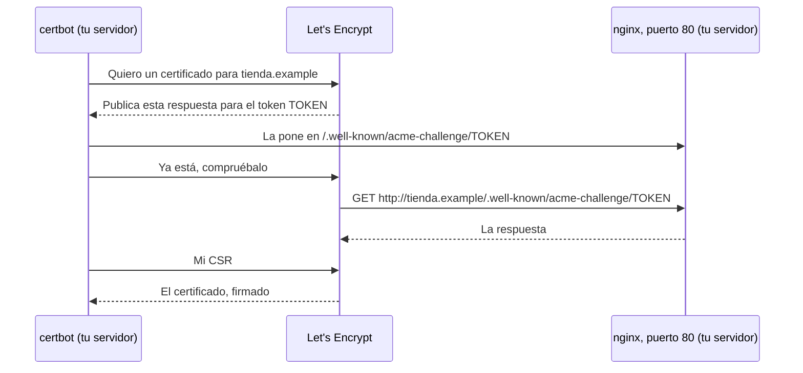

import Term from '~/components/Term.astro';
import TryIt from '~/components/TryIt.astro';
import Analogy from '~/components/Analogy.astro';
import ProjectCode from '~/components/ProjectCode.astro';
import Quiz from '~/components/Quiz.astro';
import QuizQuestion from '~/components/QuizQuestion.astro';
import QuizOption from '~/components/QuizOption.astro';

## El problema

Al final de la [lección 4](/fase-8/nginx-proxy-inverso/), la tienda contesta por HTTPS, pero solo con `curl -k`, que se salta la comprobación del certificado. Marta abre la dirección en el navegador y ve una pantalla roja: «La conexión no es privada». No va a comprar ahí.

El certificado provisional dice ser de `tienda.example`, un nombre que no apunta a tu servidor, y no lo firma nadie que el navegador conozca. **Faltan dos cosas: un nombre de verdad y una firma en la que confiar.**

## La analogía

<Analogy>

Piensa en abrir una tienda en la calle. Primero, una dirección que salga en los mapas: el dominio. Después, un sello en la puerta, de un organismo que todos conocen: «este local es de quien dice ser».

Ese organismo, Let's Encrypt, no te pide papeles: te da un código y pasa a ver si lo has puesto en el escaparate. Si está, controlas el local.

Sin dirección en los mapas, como tu máquina virtual, te haces tu propio sello. Vale en tu casa, donde lo conocen; un desconocido no tiene por qué creérselo.

<div slot="limits">

- El organismo no comprueba quién eres ni si tu tienda es honrada: solo que controlas la dirección. Una web de estafas también puede tener candado.
- El sello de una tienda dura años. Un certificado de Let's Encrypt dura 90 días, y lo renueva un programa sin que te enteres.

</div>

</Analogy>

## Cómo funciona de verdad

### Un nombre: el dominio y sus registros

Un <Term id="domain-name">nombre de dominio</Term>, como `tienda.example`, se compra por años a un **registrador**: Cloudflare Registrar, Porkbun o Namecheap, por ejemplo. Los precios cambian: el 17 de octubre de 2026, un `.com` costaba en Porkbun 11,08 dólares al año.

Desde su panel decides a dónde apunta, con los <Term id="dns-record">registros</Term> que viste en la [Fase 0](/fase-0/que-es-dns/#los-tipos-de-registro):

| Nombre | Tipo | Valor | TTL |
|---|---|---|---|
| `tienda.example` | A | `203.0.113.10`, la IPv4 de tu servidor | 300 |
| `tienda.example` | AAAA | `2001:db8::10`, su IPv6, si la tiene | 300 |

El <Term id="ttl">TTL</Term> son los segundos que cada caché puede guardar la respuesta. **Mientras montas el servidor, ponlo bajo** (300, cinco minutos): si te equivocas de IP, el arreglo llega pronto. Es la falsa «propagación» de la [Fase 0](/fase-0/que-es-dns/#el-ttl-y-la-propagación).

### Cómo sabe Let's Encrypt que el dominio es tuyo

<Term id="lets-encrypt">Let's Encrypt</Term> es la autoridad certificadora gratis y automática que te prometimos en la [Fase 0](/fase-0/tls-y-https/#certificados-y-autoridades-certificadoras). Habla con un programa de tu servidor, **certbot**, mediante un protocolo, <Term id="acme">ACME</Term>. La comprobación más común se llama **HTTP-01**:



Let's Encrypt pide el fichero **desde internet**: si le llega, quien pide el certificado controla el servidor del nombre. Y **siempre empieza por el puerto 80**, por http: la [documentación de Let's Encrypt](https://letsencrypt.org/docs/challenge-types/) lo dice así: «*The HTTP-01 challenge can only be done on port 80*».

Por eso el sitio de la tienda deja esa ruta fuera de la redirección:

<ProjectCode file="tienda-api/35-produccion/nginx/tienda.conf" region="puerto-80" />

Lo que pida `/.well-known/acme-challenge/` se busca en `/var/www/html`; lo demás se redirige. Así el reto no depende del 443. Mientras dura, certbot añade además su propia respuesta, y la quita al acabar.

La <Term id="csr">CSR</Term> (*Certificate Signing Request*) es la petición de firma: tu clave pública y los nombres que debe cubrir el certificado. **La clave privada no sale nunca de tu servidor.**

### certbot: pedir, instalar y renovar

Con `sudo certbot --nginx -d tienda.example`, certbot hace todo eso y además cambia tu sitio de nginx. Busca el bloque con `server_name tienda.example` y sustituye las dos líneas del certificado por las de Let's Encrypt, que el fichero ya trae comentadas:

<ProjectCode file="tienda-api/35-produccion/nginx/tienda.conf" region="https" />

- **`fullchain.pem`**: tu certificado y, detrás, el de la autoridad intermedia que lo firmó. El navegador necesita los dos para llegar a una raíz de su lista.
- **`privkey.pem`**: la clave privada, que solo lee `root`.

Los certificados de Let's Encrypt **duran 90 días** en octubre de 2026, y bajarán a 64 en febrero de 2027 y a 45 en 2028, según su [calendario](https://letsencrypt.org/2025/12/02/from-90-to-45/). Nadie los renueva a mano: certbot instala un temporizador de systemd que lo intenta dos veces al día y solo renueva los que caducan pronto.

### Por qué tu VM no puede tener uno

Tu VM tiene una <Term id="private-ip">IP privada</Term>: desde internet, nadie llega a ella. Lo probamos en la VM de las salidas con `certbot certonly --dry-run`, que usa los servidores de prueba de Let's Encrypt: no guarda ningún certificado, pero registra una cuenta de prueba allí:

```
Certbot failed to authenticate some domains (authenticator: nginx). The Certificate Authority reported these problems:
  Identifier: 192-168-5-15.sslip.io
  Type:   dns
  Detail: no valid A records found for 192-168-5-15.sslip.io; no valid AAAA records found for 192-168-5-15.sslip.io
```

**Ni siquiera lo intenta:** el nombre apunta a una dirección privada, y Let's Encrypt la descarta.

### Sin dominio: sslip.io y tu propia autoridad

Para la VM, dos piezas gratis:

- **Un nombre:** [sslip.io](https://sslip.io) es un servidor DNS público que contesta con la IP que lleva el nombre escrita: `192-168-5-15.sslip.io` es `192.168.5.15`. Algunos routers de casa descartan las respuestas del DNS público con IP privadas (la protección contra *DNS rebinding*: un ataque en el que una web cambia su IP por una de tu red para que tu navegador hable con tus aparatos). Si te pasa, el plan B es el fichero `hosts` de tu ordenador.
- **Una autoridad:** con `openssl` creas una autoridad de certificación, la tuya, que firma el certificado de la tienda. Tu ordenador se fía de lo que firma si le das su certificado; el navegador de Marta, no.

¿Y el autofirmado de la lección 4? Tendrías que repartir el certificado de cada servidor. **Con una autoridad, te fías una vez y vale para todo lo que firme**, como con las de verdad.

### HTTPS de verdad: la redirección y HSTS

Con el certificado bueno, dos cosas que ya estaban empiezan a servir:

- **La redirección.** Quien escribe `http://` recibe un `301` a la misma dirección con `https://`: el `return 301` del puerto 80.
- **`strict-transport-security`**, la cabecera <Term id="hsts">HSTS</Term> que la API manda desde la [Fase 6](/fase-6/owasp-top-10/#las-cabeceras-antes-y-después). Te dijimos que actuaría con HTTPS: el navegador solo le hace caso si le llega con un certificado válido. Desde entonces, durante `max-age=15552000` segundos (180 días), va directo a `https://`.

## Pruébalo

El objetivo: que tu ordenador hable con la tienda por HTTPS **sin `-k`**, leer la cadena del certificado y ver qué dice el navegador. ¿Ya tienes dominio y VPS? Ve a [Con un dominio: Let's Encrypt](#con-un-dominio-lets-encrypt).

Las salidas son de la VM de la lección 4, `192.168.5.15`, y de otra máquina que hace de tu ordenador. **Usa tu IP con guiones:** con `192.168.64.2`, tu nombre es `192-168-64-2.sslip.io`. Tus fechas y horas serán otras.

### Un nombre para tu VM

En el servidor, pregunta por el nombre a un DNS público, el de Cloudflare (`1.1.1.1`):

<TryIt
  title="1. El registro A de sslip.io"
  cmd="dig +noall +answer 192-168-5-15.sslip.io @1.1.1.1"
  output={`192-168-5-15.sslip.io.	3600	IN	A	192.168.5.15`}
>

Un registro **A** con tu IP y un **TTL** de `3600` segundos. Nadie ha dado de alta ese nombre: sslip.io lo lee y contesta.

</TryIt>

Ahora en **tu ordenador**, con el DNS de tu red:

<TryIt
  title="2. Desde tu ordenador"
  cmd="dig +short 192-168-5-15.sslip.io"
  output={`192.168.5.15`}
>

Si sale tu IP, sigue. Si no sale nada, tu router descarta la respuesta: ve al plan B. En Windows, `nslookup 192-168-5-15.sslip.io`, que escribe más líneas.

</TryIt>

<TryIt
  title="Plan B: el fichero hosts"
  cmd={`echo "192.168.5.15 192-168-5-15.sslip.io" | sudo tee -a /etc/hosts`}
  windows={`Add-Content -Path C:\\Windows\\System32\\drivers\\etc\\hosts -Value "192.168.5.15 192-168-5-15.sslip.io"`}
  output={`192.168.5.15 192-168-5-15.sslip.io`}
>

Solo si el paso 2 no dio nada. Tu ordenador mira `hosts` antes de preguntar al DNS, así que el nombre funciona igual. Necesita permisos de administrador: en Windows, abre PowerShell con «Ejecutar como administrador». Borra esa línea cuando acabes la fase.

</TryIt>

### Tu autoridad y el certificado de la tienda

En el servidor, crea la autoridad en una carpeta aparte:

<TryIt
  title="3. La autoridad"
  cmd={`mkdir ~/autoridad && cd ~/autoridad
openssl req -x509 -newkey ec -pkeyopt ec_paramgen_curve:prime256v1 -nodes -days 365 -subj "/CN=Autoridad de la tienda de Ana" -keyout ca.key -out ca.crt
ls -l`}
  output={`-----
total 8
-rw-rw-r-- 1 ubuntu ubuntu 631 Oct 17 23:29 ca.crt
-rw------- 1 ubuntu ubuntu 241 Oct 17 23:29 ca.key`}
>

La orden del certificado provisional, con otro nombre y un año de vida. **`ca.key` es la clave que firma:** `-rw-------`, solo para ti. `ca.crt` es el certificado de la autoridad, el que repartirás.

</TryIt>

<TryIt
  title="4. ¿Qué la hace autoridad?"
  cmd="openssl x509 -in ca.crt -noout -subject -issuer -dates -ext basicConstraints"
  output={`subject=CN=Autoridad de la tienda de Ana
issuer=CN=Autoridad de la tienda de Ana
notBefore=Oct 17 21:29:21 2026 GMT
notAfter=Oct 17 21:29:21 2027 GMT
X509v3 Basic Constraints: critical
    CA:TRUE`}
>

- **`subject` e `issuer` iguales:** se firma a sí misma. Es una raíz, como las que trae tu sistema.
- **`CA:TRUE`:** puede firmar otros certificados.

</TryIt>

Ahora la clave de la tienda y su CSR, con el nombre:

<TryIt
  title="5. La clave de la tienda y su CSR"
  cmd={`openssl req -newkey ec -pkeyopt ec_paramgen_curve:prime256v1 -nodes -subj "/CN=192-168-5-15.sslip.io" -addext "subjectAltName=DNS:192-168-5-15.sslip.io" -addext "extendedKeyUsage=serverAuth" -keyout tienda.key -out tienda.csr
openssl req -in tienda.csr -noout -subject -verify`}
  output={`-----
Certificate request self-signature verify OK
subject=CN=192-168-5-15.sslip.io`}
>

Sin `-x509`, `openssl req` hace una petición en vez de un certificado.

- **`subjectAltName`**: donde los navegadores buscan el nombre; `CN` solo lo miran los programas antiguos.
- **`extendedKeyUsage=serverAuth`**: para qué vale el certificado, identificar un servidor. macOS y Safari lo exigen en los certificados de servidor, y herramientas como mkcert lo ponen siempre.
- **`-verify`**: comprueba que la CSR está firmada con `tienda.key`.

</TryIt>

<TryIt
  title="6. Tu autoridad la firma"
  cmd={`openssl x509 -req -in tienda.csr -CA ca.crt -CAkey ca.key -days 90 -copy_extensions copy -out tienda.crt
openssl x509 -in tienda.crt -noout -subject -issuer -dates -ext subjectAltName,extendedKeyUsage`}
  output={`Certificate request self-signature ok
subject=CN=192-168-5-15.sslip.io
subject=CN=192-168-5-15.sslip.io
issuer=CN=Autoridad de la tienda de Ana
notBefore=Oct 17 21:29:21 2026 GMT
notAfter=Jan 15 21:29:21 2027 GMT
X509v3 Subject Alternative Name: 
    DNS:192-168-5-15.sslip.io
X509v3 Extended Key Usage: 
    TLS Web Server Authentication`}
>

- **`-CA` y `-CAkey`**: firma con tu autoridad. `-copy_extensions copy` pasa al certificado las extensiones de la CSR: el nombre y el uso.
- **`issuer`** es ya tu autoridad, y caduca en 90 días, como uno de Let's Encrypt.

</TryIt>

Cópialo donde lo busca nginx, encima del provisional:

<TryIt
  title="7. A /etc/ssl/tienda"
  cmd={`sudo cp tienda.crt tienda.key /etc/ssl/tienda/
sudo ls -l /etc/ssl/tienda`}
  output={`total 8
-rw-r--r-- 1 root root 672 Oct 17 23:29 tienda.crt
-rw------- 1 root root 241 Oct 17 23:29 tienda.key`}
>

La clave, `-rw-------`: solo para `root`. `ca.key` no se copia, porque nginx no la necesita; y en el servidor no debe quedarse más de lo necesario: la borrarás antes de fiarte de tu autoridad.

</TryIt>

### nginx, con el nombre nuevo

Vuelve a `/opt/tienda` y pon tu nombre en las dos líneas `server_name`:

<TryIt
  title="8. El nombre en el sitio"
  cmd={`sed -i 's/server_name tienda.example;/server_name 192-168-5-15.sslip.io;/' nginx/tienda.conf
grep -n "server_name" nginx/tienda.conf`}
  output={`9:#   1. tienda.example, en las dos líneas server_name, por tu nombre: tu dominio o, con el camino
41:    server_name 192-168-5-15.sslip.io;
59:    server_name 192-168-5-15.sslip.io;`}
>

`sed -i` cambia el fichero. La línea 9 es un comentario; las 41 y 59, los dos `server`.

</TryIt>

<TryIt
  title="9. Instálalo y recarga"
  cmd={`sudo cp nginx/tienda.conf /etc/nginx/sites-available/tienda
sudo nginx -t && sudo systemctl reload nginx`}
  output={`nginx: the configuration file /etc/nginx/nginx.conf syntax is ok
nginx: configuration file /etc/nginx/nginx.conf test is successful`}
>

Si `nginx -t` dice `key values mismatch`, copiaste la clave de un certificado y el certificado de otro: repite el paso 7.

</TryIt>

La tienda solo acepta peticiones con la cookie de sesión desde sus propias webs, `ORIGENES_PERMITIDOS` ([Fase 6](/fase-6/csrf-ssrf/#segunda-muralla-de-dónde-viene-la-petición)). Ahora se llama de otra forma:

<TryIt
  title="10. El origen de la tienda"
  cmd={`sed -i 's|^ORIGENES_PERMITIDOS=.*|ORIGENES_PERMITIDOS=https://192-168-5-15.sslip.io|' .env
grep ^ORIGENES_PERMITIDOS .env
docker compose -f compose.produccion.yaml up -d api`}
  output={`ORIGENES_PERMITIDOS=https://192-168-5-15.sslip.io
…
[+] up 4/4
…
 ✔ Container tienda-api-1    Started                                        1.8s
 ✔ Container tienda-migrar-1 Exited                                         1.1s`}
>

`up -d api` recrea la API para que lea el `.env` nuevo. Espera unos segundos antes del paso siguiente: mientras arranca, nginx contesta `502`.

</TryIt>

### Desde tu ordenador

En **tu ordenador**, sin `-k`:

<TryIt
  title="11. Sin tu autoridad"
  cmd="curl https://192-168-5-15.sslip.io/salud"
  windows="curl.exe https://192-168-5-15.sslip.io/salud"
  output={`curl: (60) SSL certificate OpenSSL verify result: unable to get local issuer certificate (20)
More details here: https://curl.se/docs/sslcerts.html
…`}
>

El nombre ya coincide; lo que falla es **la firma**: `unable to get local issuer certificate`, no encuentra en tu sistema a quien la firmó. El texto cambia según tu sistema.

</TryIt>

Tráete el certificado de la autoridad, nunca su clave, y dáselo a curl:

<TryIt
  title="12. Con tu autoridad"
  cmd={`scp ubuntu@192.168.5.15:autoridad/ca.crt .
curl --cacert ca.crt -i https://192-168-5-15.sslip.io/salud`}
  windows={`scp ubuntu@192.168.5.15:autoridad/ca.crt .
curl.exe --ssl-no-revoke --cacert ca.crt -i https://192-168-5-15.sslip.io/salud`}
  output={`ca.crt                                        100%  631     1.8MB/s   00:00
HTTP/2 200 
server: nginx/1.28.3 (Ubuntu)
…
strict-transport-security: max-age=15552000; includeSubDomains
…
x-xss-protection: 0

{"estado":"ok"}`}
>

**`HTTP/2 200` sin `-k`:** curl ha comprobado la cadena hasta tu autoridad y el nombre. Es el HTTPS que la [Fase 2](/fase-2/http2-http3/#lo-que-cambia-para-el-servidor-y-lo-que-no) le prometió al nginx de tu VM, y con él, HTTP/2. Y ahí está `strict-transport-security`: `max-age` son 180 días, e **`includeSubDomains`** extiende la regla a todos los nombres que acaban en el tuyo.

En Windows, `--ssl-no-revoke`: `curl.exe` pregunta si el certificado está revocado, y tu autoridad no publica esa lista.

</TryIt>

<TryIt
  title="13. Por http"
  cmd="curl -i http://192-168-5-15.sslip.io/salud"
  windows="curl.exe -i http://192-168-5-15.sslip.io/salud"
  output={`HTTP/1.1 301 Moved Permanently
Server: nginx/1.28.3 (Ubuntu)
…
Location: https://192-168-5-15.sslip.io/salud
…`}
>

El `301`, ahora a un nombre con un certificado válido.

</TryIt>

### La cadena, y lo que dice el navegador

`openssl s_client` es un cliente de TLS: se conecta y cuenta lo que ve. En el servidor:

<TryIt
  title="14. La cadena"
  cmd="openssl s_client -connect 192-168-5-15.sslip.io:443 -servername 192-168-5-15.sslip.io -CAfile ~/autoridad/ca.crt < /dev/null"
  output={`Connecting to 192.168.5.15
CONNECTED(00000003)
depth=1 CN=Autoridad de la tienda de Ana
verify return:1
depth=0 CN=192-168-5-15.sslip.io
verify return:1
---
Certificate chain
 0 s:CN=192-168-5-15.sslip.io
   i:CN=Autoridad de la tienda de Ana
   a:PKEY: EC, (prime256v1); sigalg: ecdsa-with-SHA256
   v:NotBefore: Oct 17 21:29:21 2026 GMT; NotAfter: Jan 15 21:29:21 2027 GMT
---
…
Verification: OK
…
Verify return code: 0 (ok)
…`}
>

- **`-servername`**: el nombre que va en el SNI, para que nginx elija el certificado ([Fase 0](/fase-0/tls-y-https/#qué-protege-https-y-qué-no)). `< /dev/null` cierra la conexión al terminar.
- **`depth=1` y `depth=0`**: la comprobación, de la raíz (tu autoridad) a la tienda.
- **`Certificate chain`**: lo que manda nginx, un solo certificado. `s:` es de quién es; `i:`, quién lo firmó. Con Let's Encrypt verías dos: el tuyo y el de la intermedia, el `fullchain.pem`.

</TryIt>

<TryIt
  title="15. Sin -CAfile"
  cmd={`openssl s_client -connect 192-168-5-15.sslip.io:443 -servername 192-168-5-15.sslip.io < /dev/null 2>&1 | grep -E "depth|verify|Verify return code"`}
  output={`depth=0 CN=192-168-5-15.sslip.io
verify error:num=20:unable to get local issuer certificate
…
Verify return code: 21 (unable to verify the first certificate)`}
>

El error `20` de curl en el paso 11.

</TryIt>

Abre `https://192-168-5-15.sslip.io/salud` en el navegador de tu ordenador. Lo hicimos con Chromium 153, la base de Chrome y Edge, en español:

```text
La conexión no es privada

Es posible que los atacantes estén intentando robar tu información de 192-168-5-15.sslip.io (por ejemplo, contraseñas, mensajes o tarjetas de crédito). Más información sobre esta advertencia

NET::ERR_CERT_AUTHORITY_INVALID
Volver a un sitio seguro
Avanzado
```

**`ERR_CERT_AUTHORITY_INVALID`**: la autoridad no está en su lista. Es la primera de las tres comprobaciones de la [Fase 0](/fase-0/tls-y-https/#certificados-y-autoridades-certificadoras); el nombre y las fechas están bien. Al pulsar «Avanzado»:

```text
Este servidor no ha podido probar que su dominio es 192-168-5-15.sslip.io, el sistema operativo de tu ordenador no confía en su certificado de seguridad. Este problema puede deberse a una configuración incorrecta o a que un atacante haya interceptado la conexión.

Acceder a 192-168-5-15.sslip.io (sitio no seguro)
```

Firefox y Safari lo dicen con otras palabras. Si entras con «Acceder», la conexión va cifrada, pero el navegador ignora la cabecera HSTS: no viene de un certificado válido.

### Fiarte de tu autoridad (opcional)

Para tener el candado, añade `ca.crt` a las autoridades de tu ordenador. En macOS, con doble clic se añade a Acceso a Llaveros: ábrelo allí y, en «Confiar», elige «Confiar siempre». En Windows, doble clic, «Instalar certificado» y el almacén «Entidades de certificación raíz de confianza». Firefox puede usar su propia lista, en sus ajustes de certificados.

**Piénsalo antes:** tu ordenador se fiará de **cualquier** certificado que firme `ca.key`, para cualquier nombre, también `tu-banco.example`. Quien tenga esa clave podría hacerse pasar por cualquier web ante ti. Antes de fiarte, en el servidor, borra `ca.key`: ya firmó el certificado, y para otro harás otra autoridad.

<TryIt
  title="Borra la clave de la autoridad"
  cmd={`rm ~/autoridad/ca.key
ls -l ~/autoridad`}
  output={`total 16
-rw-rw-r-- 1 ubuntu ubuntu 631 Oct 17 23:29 ca.crt
-rw-rw-r-- 1 ubuntu ubuntu 672 Oct 17 23:29 tienda.crt
-rw-rw-r-- 1 ubuntu ubuntu 473 Oct 17 23:29 tienda.csr
-rw------- 1 ubuntu ubuntu 241 Oct 17 23:29 tienda.key`}
>

Sin `ca.key`, nadie firma más con tu autoridad. Al acabar la fase, quita de tu ordenador la confianza en ella, donde la añadiste, y borra `ca.crt` si quieres. Si Chrome ya vio la cabecera HSTS, bórrala en `chrome://net-internals/#hsts`, con «Delete domain security policies» y tu nombre.

</TryIt>

### Con un dominio: Let's Encrypt

En un VPS con dominio, los pasos 3 a 7 y el aviso del navegador desaparecen: los hace Let's Encrypt. Antes de empezar, comprueba en tu servidor que el 80 deja pasar el reto. Funciona igual en la VM:

<TryIt
  title="16. Un reto de prueba"
  cmd={`sudo mkdir -p /var/www/html/.well-known/acme-challenge
echo "prueba-del-reto" | sudo tee /var/www/html/.well-known/acme-challenge/prueba`}
  output={`prueba-del-reto`}
>

Un fichero donde lo buscaría Let's Encrypt.

</TryIt>

<TryIt
  title="17. Lo que vería Let's Encrypt"
  cmd="curl -i http://192-168-5-15.sslip.io/.well-known/acme-challenge/prueba"
  windows="curl.exe -i http://192-168-5-15.sslip.io/.well-known/acme-challenge/prueba"
  output={`HTTP/1.1 200 OK
Server: nginx/1.28.3 (Ubuntu)
…
prueba-del-reto`}
>

Desde tu ordenador: **`200`, no `301`**. En el servidor, bórralo con `sudo rm -r /var/www/html/.well-known`.

</TryIt>

Y los pasos, en tu VPS:

1. **Compra el dominio** en un registrador y crea el registro A con la IP de tu servidor, y el AAAA si tiene IPv6, con TTL 300. Compruébalo desde tu ordenador con `dig +short tienda.example`.

2. **Abre el 80 y el 443** en `ufw` ([lección 2](/fase-8/proteger-servidor-linux/#el-cortafuegos-ufw)) y en el cortafuegos del proveedor.

3. **Pon tu dominio** en las dos líneas `server_name` y en `ORIGENES_PERMITIDOS`, como en los pasos 8 a 10.

4. **Instala certbot.** Sus instrucciones recomiendan en octubre de 2026 el paquete *snap*. Si tienes el de `apt`, quítalo antes (`sudo apt remove certbot`).

<TryIt
  title="18. certbot, en snap"
  cmd={`sudo snap install --classic certbot
sudo ln -s /snap/bin/certbot /usr/local/bin/certbot
certbot --version`}
  output={`…
certbot 5.8.0 from Certbot Project (certbot-eff✓) installed
certbot 5.8.0`}
>

`ln -s` crea un enlace para que la orden `certbot` se encuentre. Capturado en la VM: tu versión puede ser más nueva.

</TryIt>

5. **Pide el certificado:** primero, en prueba, `sudo certbot certonly --nginx --dry-run -d tienda.example`: si falla, no gasta los límites de Let's Encrypt. Después, `sudo certbot --nginx -d tienda.example`. La primera vez te pide un email y que aceptes las condiciones; hace el reto, cambia las dos líneas `ssl_certificate` de tu sitio y recarga nginx. Si vuelves a copiar `tienda.conf`, cambia tú esas dos líneas: están comentadas en el fichero.

6. **Prueba la renovación:** `sudo certbot renew --dry-run` la simula contra los servidores de prueba.

7. **Abre `https://tienda.example`** en el navegador: ahora sí, el candado.

La renovación la lanza un temporizador de systemd que instala el snap:

<TryIt
  title="19. El temporizador de certbot"
  cmd="systemctl cat snap.certbot.renew.timer"
  output={`# /etc/systemd/system/snap.certbot.renew.timer
…
[Timer]
Unit=snap.certbot.renew.service
OnCalendar=*-*-* 01:12
OnCalendar=*-*-* 20:03
…`}
>

Dos veces al día. certbot mira cada certificado y solo renueva los que están cerca de caducar: el resto de días, no hace nada.

</TryIt>

Con tu dominio y HTTPS ya puedes ofrecer «Entrar con Google»: Google exige una dirección de vuelta `https://` de un dominio tuyo, no una IP ni sslip.io. Los pasos están en la [Fase 6](/fase-6/oauth-openid-connect/#de-la-práctica-a-google): registras `https://tienda.example/v2/sesion/proveedor/vuelta` y quitas el `#` de las cuatro líneas `OIDC_*` del `.env`.

## Ya lo has visto

- **El candado de esta web.** Su certificado lo firma Google Trust Services, vale 90 días (del 9 de octubre de 2026 al 7 de enero de 2027) y cubre `backenddesdecero.com` y `*.backenddesdecero.com`. Cloudflare, que la sirve, lo pide y lo renueva sin que hagamos nada.

## Errores comunes

- **Cerrar el 80 «porque ya todo va por HTTPS».** La renovación falla en silencio y el certificado caduca semanas después.
- **Un AAAA que apunta a otro sitio.** Si existe, Let's Encrypt prueba IPv6 primero ([su documentación](https://letsencrypt.org/docs/ipv6-support/)). Si tu servidor no tiene IPv6, no crees el registro.
- **Pedir el certificado antes de que el DNS apunte al servidor.** Let's Encrypt ve la IP vieja, y repetir muchas veces choca con sus límites.
- **Entrar por la IP con un certificado que solo tiene el nombre.** curl dice `no alternative certificate subject name matches target ipv4 address`: el nombre de la URL tiene que estar en `subjectAltName`.
- **Copiar o compartir `ca.key`.** Con ella se firma cualquier nombre que tu ordenador aceptará.
- **Probar HTTPS con tu dominio y volver a http.** Quien vio HSTS no podrá entrar por http durante 180 días, ni a ningún subdominio (`includeSubDomains`). Prueba con un subdominio, como `tienda.tudominio.com`.
- **Quitar la autoridad después de que el navegador viera HSTS.** Durante 180 días no te deja «Acceder» con el aviso, salvo que borres la regla.

## Resumen

- Un dominio se compra por años; sus registros A y AAAA apuntan a tu servidor, y el TTL dice cuánto tarda en notarse un cambio.
- Let's Encrypt comprueba que el dominio es tuyo pidiendo un fichero por el puerto 80 desde internet. certbot lo hace todo y renueva solo.
- Sin IP pública no hay Let's Encrypt. Con sslip.io y tu propia autoridad tienes HTTPS de verdad en tu ordenador, y un aviso en cualquier otro.
- Con un certificado válido, la redirección a https y la cabecera HSTS empiezan a proteger.

## ¿Lo has entendido?

<Quiz>

<QuizQuestion
  question="Cierras el puerto 80 en ufw porque la tienda ya va toda por HTTPS. Tres meses después, el certificado ha caducado. ¿Qué ha pasado?"
  review="Cómo sabe Let's Encrypt que el dominio es tuyo"
>

<QuizOption text="La renovación necesita que Let's Encrypt llegue a tu puerto 80, y no pudo." correct>

El reto HTTP-01 empieza siempre por http, en el 80. Sin él, cada intento de renovación falló, y el certificado llegó a su fecha.

</QuizOption>

<QuizOption text="certbot descarga el certificado nuevo por el 80, y el cortafuegos lo bloqueó.">

certbot sale a internet, y `ufw` no corta lo que sale. Lo que no pudo entrar fue la comprobación del reto.

</QuizOption>

<QuizOption text="La cabecera HSTS impide renovar mientras siga activa en los navegadores.">

HSTS es una instrucción para los navegadores; Let's Encrypt no la usa para nada. El problema es el 80 cerrado.

</QuizOption>

</QuizQuestion>

<QuizQuestion
  question="Con tu propia autoridad, curl --cacert ca.crt funciona, pero Marta abre la tienda desde su móvil y ve NET::ERR_CERT_AUTHORITY_INVALID. ¿Por qué?"
  review="La cadena, y lo que dice el navegador"
>

<QuizOption text="Porque el certificado es para otro nombre y su móvil lo detecta.">

Un nombre equivocado da otro error (`ERR_CERT_COMMON_NAME_INVALID`). Aquí el nombre está bien; lo que falla es la firma.

</QuizOption>

<QuizOption text="Porque su móvil no tiene tu autoridad entre las que conoce." correct>

curl se fía porque le diste `ca.crt`. El móvil de Marta solo conoce las autoridades de su sistema, y la tuya no está.

</QuizOption>

<QuizOption text="Porque los móviles no aceptan certificados de solo 90 días.">

Los de Let's Encrypt duran 90 días y funcionan en cualquier móvil. La duración no tiene nada que ver.

</QuizOption>

</QuizQuestion>

<QuizQuestion
  question="Cambias el registro A de tu dominio a un servidor nuevo. Una hora después, algunas personas siguen llegando al viejo. ¿Qué pasa?"
  review="Un nombre: el dominio y sus registros"
>

<QuizOption text="Los cambios de DNS tardan hasta 48 horas en copiarse a todos los servidores del mundo.">

Nadie copia nada. Cada resolver guarda la respuesta vieja mientras dura su TTL, y entonces vuelve a preguntar.

</QuizOption>

<QuizOption text="Su navegador recuerda la IP vieja por la cabecera HSTS.">

HSTS solo recuerda que hay que usar https con ese nombre, no la IP. La IP la guardan las cachés de DNS.

</QuizOption>

<QuizOption text="Sus resolvers guardaron la respuesta vieja y no preguntan hasta que caduque su TTL." correct>

Por eso conviene un TTL bajo antes de un cambio.

</QuizOption>

</QuizQuestion>

<QuizQuestion
  question="Para que tu autoridad firme el certificado de la tienda, ¿qué le tienes que dar?"
  review="Tu autoridad y el certificado de la tienda"
>

<QuizOption text="La clave privada de la tienda, para que la meta en el certificado.">

La clave privada no sale nunca del servidor. Lo que va en el certificado es la clave pública.

</QuizOption>

<QuizOption text="La CSR: la clave pública de la tienda y su nombre." correct>

La autoridad firma esos datos. La CSR va firmada con la clave privada, que demuestra que la tienes sin enseñarla.

</QuizOption>

<QuizOption text="El certificado provisional de la lección 4, para cambiarle la firma.">

Ese certificado es para `tienda.example`, y la firma no se cambia: se hace uno nuevo a partir de una CSR.

</QuizOption>

</QuizQuestion>

<QuizQuestion
  question="curl --cacert ca.crt https://192.168.5.15/salud falla, aunque con el nombre de sslip.io funciona. ¿Por qué?"
  review="Errores comunes"
>

<QuizOption text="Porque tu autoridad no puede firmar certificados para direcciones IP.">

Podría, con `IP:192.168.5.15` en `subjectAltName`; no se lo pediste.

</QuizOption>

<QuizOption text="Porque nginx solo escucha en el 443 cuando le llega un nombre.">

nginx escucha en la IP y contesta; es curl quien corta, al comparar la dirección con los nombres del certificado.

</QuizOption>

<QuizOption text="Porque el certificado solo vale para el nombre de subjectAltName." correct>

curl compara lo que escribiste en la URL con `subjectAltName`. La IP no está, así que no hay certificado para ella.

</QuizOption>

</QuizQuestion>

<QuizQuestion
  question="Marta visitó tu tienda con su certificado de Let's Encrypt hace una semana. Hoy escribe http://tienda.example. ¿Qué pasa?"
  review="HTTPS de verdad: la redirección y HSTS"
>

<QuizOption text="Su navegador va directo a https://, sin pasar por el puerto 80." correct>

Recibió `strict-transport-security` por una conexión válida, y durante 180 días cambia `http` por `https` antes de salir.

</QuizOption>

<QuizOption text="nginx le contesta con un 301, como a cualquiera que llega por http.">

Eso pasa la primera vez, o sin HSTS. Con la cabecera recordada, la petición por http no llega a salir.

</QuizOption>

<QuizOption text="El navegador no la deja entrar: con HSTS, http está prohibido.">

No la bloquea: la lleva a la misma dirección con https, que funciona.

</QuizOption>

</QuizQuestion>

</Quiz>

## Para profundizar

- [How It Works](https://letsencrypt.org/how-it-works/), de Let's Encrypt, en inglés: ACME y la comprobación del dominio, paso a paso.
- [Challenge Types](https://letsencrypt.org/docs/challenge-types/), en inglés: HTTP-01, DNS-01 (para certificados `*.tienda.example`) y cuándo usar cada uno.
- [Instrucciones de certbot](https://certbot.eff.org/instructions?ws=nginx&os=snap), en inglés: nginx con el snap, la orden exacta según tu sistema.
- [RFC 8555](https://www.rfc-editor.org/rfc/rfc8555), en inglés: el protocolo ACME.
- [sslip.io](https://sslip.io), en inglés: cómo funcionan sus nombres.
- [Strict-Transport-Security](https://developer.mozilla.org/es/docs/Web/HTTP/Reference/Headers/Strict-Transport-Security), en MDN.
