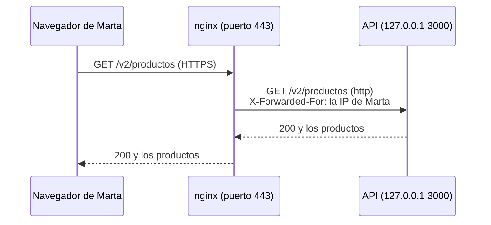

import { Aside } from '@astrojs/starlight/components';
import Term from '~/components/Term.astro';
import TryIt from '~/components/TryIt.astro';
import Analogy from '~/components/Analogy.astro';
import ProjectCode from '~/components/ProjectCode.astro';
import Quiz from '~/components/Quiz.astro';
import QuizQuestion from '~/components/QuizQuestion.astro';
import QuizOption from '~/components/QuizOption.astro';

## El problema

La tienda ya funciona en tu servidor, pero nadie puede entrar. Marta abre `http://192.168.5.15:3000` y no llega nada: en la [lección 3](/fase-8/docker-compose-produccion/), la API se publicó solo en `127.0.0.1`, a propósito.

Podrías publicarla para todo el mundo, pero Node tendría que encargarse del HTTPS y la API se saltaría el cortafuegos, como viste en la [lección 2](/fase-8/proteger-servidor-linux/#docker-se-salta-ufw). Y el día que se cuelgue, Marta verá una pestaña que carga sin fin.

**Casi todas las webs lo resuelven igual:** delante del programa ponen otro servidor que da la cara por él. En esta lección, ese servidor es nginx.

## La analogía

<Analogy>

Piensa en la centralita de una empresa. Llamas a un solo número, el de la empresa, y la telefonista te pasa con la extensión que buscas.

Al pasarte, le dice a su compañero desde qué número llamas. Si nadie coge la extensión, es ella quien te contesta: «no le puedo pasar». Y si dos compañeros atienden lo mismo, reparte las llamadas.

<div slot="limits">

- La telefonista entiende la conversación; nginx no. No sabe qué es un pedido ni comprueba contraseñas: eso lo hace la API.
- Una telefonista ve si su compañero está en su mesa. nginx no pregunta: se entera cuando una petición de verdad falla.

</div>

</Analogy>

## Cómo funciona de verdad

### Un servidor que da la cara por otro

Un *proxy* es un intermediario. El de una oficina trabaja para quien navega: sale a internet en su nombre. Un <Term id="reverse-proxy">proxy inverso</Term> trabaja para el servidor: recibe lo que llega de internet y se lo pasa al programa que tiene detrás.



Lo que te da tenerlo delante:

- **Una sola puerta.** Solo nginx escucha fuera, en el 80 y el 443 que abriste en el [cortafuegos](/fase-8/proteger-servidor-linux/#el-cortafuegos-ufw): el servidor web que te prometimos en la [Fase 7](/fase-7/redes-docker/#sin-ip-delante-el-puerto-se-abre-a-toda-tu-red). Con varios nombres, pasa cada uno a su programa.
- **El HTTPS, en un solo sitio.** nginx descifra, y la API habla HTTP normal por dentro.
- **Un colchón para los clientes lentos.** nginx recoge la respuesta de la API y se la da al visitante a su ritmo, y la API queda libre.
- **Errores claros y varias copias.** Si la API no contesta, nginx lo dice con un código; y puede repartir el trabajo entre dos copias.

En la [Fase 1](/fase-1/usuarios-y-permisos-linux/#por-qué-cada-servidor-tiene-su-propio-usuario) te dijimos que tu programa escucharía en el 3000 con su propio usuario y nginx, en el 80, le pasaría las peticiones. Ya está aquí.

### El sitio de la tienda: nginx/tienda.conf

La carpeta `35-produccion` trae el sitio de nginx de la tienda, `nginx/tienda.conf`. Primero, a quién le pasa las peticiones:

<ProjectCode file="tienda-api/35-produccion/nginx/tienda.conf" region="upstream" />

Un **`upstream`** es un grupo de servidores con un nombre, `tienda`. Tiene dos porque la API se publica en el rango `127.0.0.1:3000-3001`: **una sola copia puede caer en cualquiera de los dos puertos**, y en nuestras pruebas pasó del 3000 al 3001 al volver a arrancarla.

Con una sola copia, el puerto vacío deja de vez en cuando una línea `connect() failed` en el `error.log` aunque la tienda conteste bien: nginx lo prueba, falla, pasa al otro y lo aparta 10 segundos.

El puerto 80 solo redirige:

<ProjectCode file="tienda-api/35-produccion/nginx/tienda.conf" region="puerto-80" />

- **`server_name`**: el nombre al que responde. Con un solo sitio activo, responde a cualquiera; en la lección 5 pondrás el tuyo.
- **`return 301 https://$host$request_uri`**: una <Term id="redirect">redirección</Term> a la misma dirección, con `https`.
- **`/.well-known/acme-challenge/`**: la excepción que necesitará Let's Encrypt.

El 443 descifra el HTTPS:

<ProjectCode file="tienda-api/35-produccion/nginx/tienda.conf" region="https" />

`listen 443 ssl` necesita el certificado y su clave, en `/etc/ssl/tienda/`: sin ellos, `nginx -t` falla. Hoy crearás uno provisional, y el de verdad llega en la lección 5. `http2 on` activa <Term id="http2">HTTP/2</Term>.

Y lo que pasa con cada petición:

<ProjectCode file="tienda-api/35-produccion/nginx/tienda.conf" region="pasar" />

- **`proxy_pass http://tienda`**: pásasela al grupo `tienda`, por `http`: dentro del servidor no hace falta cifrar.
- **`proxy_http_version 1.1`**, `Upgrade` y `Connection`: lo que necesita un WebSocket, con este `map` del principio del fichero:

<ProjectCode file="tienda-api/35-produccion/nginx/tienda.conf" region="websocket" />

`Upgrade` y `Connection` solo valen para un tramo: un *proxy* no las reenvía, así que nginx las pone a mano. El `map` da a `$conexion_cabecera` el valor `upgrade` cuando el navegador pide cambiar a WebSocket, y la deja vacía (nginx no la envía) cuando no.

### La IP del visitante: X-Forwarded-For

Detrás de nginx, la API ve llegar todas las peticiones desde **`172.18.0.1`**, la <Term id="gateway">puerta de enlace</Term> de la red de Compose: Docker reenvía lo que entra por un puerto publicado, y la API lo ve venir de ahí. Por eso la lección 3 fijó la subred.

Con esa dirección sola, el límite de intentos de la [Fase 6](/fase-6/rate-limiting-secretos/#por-email-y-por-ip-los-límites-de-la-tienda) cuenta a todo internet como una IP. Lo comprobamos sin `PROXY_CONFIABLE` en `.env`:

```sh
$ docker compose -f compose.produccion.yaml exec redis redis-cli --scan
…
"limites:cuentas-ip:172.18.0.1"
```

Cinco cuentas por hora para toda la tienda: un solo atacante dejaría fuera a todo el mundo. Te lo avisamos en la Fase 6: detrás de un *proxy*, todo llega desde él. La solución son unas cabeceras que nginx añade:

<ProjectCode file="tienda-api/35-produccion/nginx/tienda.conf" region="cabeceras" />

- **`Host`**: el nombre que escribió el visitante.
- **`X-Real-IP`**: su IP, sola. La API no la usa.
- **<Term id="x-forwarded-for">`X-Forwarded-For`</Term>**: con `$proxy_add_x_forwarded_for`, lo que ya traía la petición y, **al final, la IP del visitante**. Si Marta envía `X-Forwarded-For: 203.0.113.7`, la API recibe `203.0.113.7, 192.168.5.100`. La primera la escribió Marta; la última, nginx.
- **`X-Forwarded-Proto`**: `https`, el protocolo que usó el visitante. La tienda no lo usa; un programa que construye enlaces, sí.

### La API solo se fía de nginx

La cabecera la puede escribir cualquiera. Por eso la API la lee solo si la petición llega desde la dirección de `PROXY_CONFIABLE`, `172.18.0.1`, y entonces se queda con la última entrada:

<ProjectCode file="tienda-api/35-produccion/src/limites.ts" region="ip" />

- **`getConnInfo(c).remote.address`**: la dirección del otro lado de la conexión. Si no es de un proxy de confianza, la cabecera se ignora.
- **`.split(',').at(-1)`**: parte la lista por las comas y toma la última, la de nginx.

Es el cambio de código de este paso. **Tiene un hueco:** lo que se conecta a `127.0.0.1:3000` desde el propio servidor también llega desde `172.18.0.1`, y puede escribir la cabecera que quiera:

```sh
$ curl -sS -i -H 'X-Forwarded-For: 203.0.113.7' --json '{"email":"falsa@tienda.example","contrasena":"clave-larga-de-la-cuenta-falsa"}' http://127.0.0.1:3000/v2/cuentas | grep -iE '^HTTP|^ratelimit:'
HTTP/1.1 201 Created
ratelimit: "cuentas-ip";r=4;t=3600
$ docker compose -f compose.produccion.yaml exec redis redis-cli --scan
"limites:cuentas-ip:203.0.113.7"
"limites:cuentas-ip:192.168.5.100"
```

En tu servidor solo entras tú, así que no es grave. En uno compartido, cualquiera con una cuenta podría saltarse el límite.

### Cuando la API falla: 502 y 504

En la [Fase 2](/fase-2/codigos-de-estado-http/#los-códigos-que-importan) viste que `502` y `504` dicen «ha fallado el de detrás». Ahora el de delante es tuyo:

| Código | Qué le pasó a nginx | En el `error.log` de nginx |
|---|---|---|
| `502 Bad Gateway` | No pudo hablar con la API: nadie escucha en el puerto | `connect() failed (111: Connection refused)` |
| `504 Gateway Time-out` | La API aceptó la petición, pero no contestó en 60 segundos | `upstream timed out (110: Connection timed out)` |

Los 60 segundos son `proxy_read_timeout`. **El `error.log` dice siempre qué pasó:** es lo primero que mirar.

Cuando falla un servidor del `upstream`, nginx **prueba el siguiente**, y te da el código del último intento. Es `proxy_next_upstream`: por defecto salta si no pudo conectar o se agotó el tiempo; un `500` de la API lo pasa tal cual. Un `POST` ya enviado no se reintenta (desde nginx 1.9.13, ningún método que no sea <Term id="idempotent">idempotente</Term>, como viste en la [Fase 2](/fase-2/metodos-http/#idempotente-repetirla-no-cambia-el-resultado)): podría hacerse dos veces. En «Pruébalo», un inicio de sesión esperó 60 segundos y dio `504`, sin probar el otro puerto.

### Dos copias, y nginx que se entera solo

Con dos copias de la API, como el `--scale api=2` de la [Fase 7](/fase-7/docker-compose/#dos-copias-de-la-api-una-sola-cuenta-en-redis), nginx reparte las peticiones: es un <Term id="load-balancer">balanceador de carga</Term>.

nginx no le pregunta al <Term id="healthcheck">healthcheck</Term> de Docker de la [Fase 7](/fase-7/docker-multi-stage/#healthcheck-la-tienda-está-bien). **Mira las peticiones de verdad:** con `max_fails=1`, un fallo aparta esa copia durante `fail_timeout=10s`. Es una comprobación pasiva; las activas son de NGINX Plus, la versión de pago. El healthcheck lo usan Compose y, en la lección 6, el despliegue.

Un efecto que vimos al probar: si todas las copias fallaron en esos 10 segundos, nginx contesta `502` al instante, aunque la API ya haya vuelto:

```
2026/10/17 22:22:22 [error] 14904#14904: *40 no live upstreams while connecting to upstream, client: 192.168.5.100, server: tienda.example, request: "GET /salud HTTP/2.0", upstream: "http://tienda/salud", host: "192.168.5.15"
```

### Eventos que no esperan: SSE y WebSocket

Los eventos de un pedido, de la [Fase 4](/fase-4/websockets-sse/#server-sent-events-una-respuesta-que-no-termina), son una respuesta que no termina. Allí te prometimos `proxy_buffering off`:

<ProjectCode file="tienda-api/35-produccion/nginx/tienda.conf" region="eventos" />

Lo medimos quitando este `location`, siguiendo un pedido y cancelándolo a los 3 segundos:

- **Por HTTP/1.1, casi nunca llegó nada:** nginx guardaba los eventos. Solo la primera petición tras recargarlo los recibió. Por HTTP/2, sí llegaban.
- **A los 60 segundos sin eventos, nginx cortó la conexión.**
- **Con el `location`, los eventos llegaron siempre al momento**, y nginx espera hasta una hora entre uno y otro.

El corte, siguiendo un pedido con la sesión de Marta: `-N` hace que curl escriba cada evento en cuanto llega, sin guardarlo, y `marta.txt` es el fichero de cookies donde curl guardó su sesión al iniciarla (`-c`), que `-b` envía.

```sh
$ time curl -k -N -b marta.txt https://192.168.5.15/v2/pedidos/34/eventos
event: estado
data: {"id":34,"productoId":2,"cantidad":1,"estado":"pendiente","creadoEn":"2026-10-17T20:25:38.189Z","clienteId":5}

curl: (92) HTTP/2 stream 1 was not closed cleanly: INTERNAL_ERROR (err 2)

real	0m59.931s
…
```

**`proxy_read_timeout 1h` vale solo para esta ruta:** subirlo para todas escondería una API lenta.

El eco por WebSocket, `/eco`, también pasa largos ratos callado:

<ProjectCode file="tienda-api/35-produccion/nginx/tienda.conf" region="eco" />

Con la petición de cambio de protocolo de la Fase 4, nginx contesta `HTTP/1.1 101 Switching Protocols`.

### Caddy, la alternativa

**Caddy** es otro proxy inverso, más moderno, que consigue y renueva los certificados HTTPS solo. Usamos nginx porque ya lo instalaste en la Fase 2 y es el que más encontrarás en servidores y ofertas de trabajo.

## Pruébalo

El objetivo: que tu ordenador llegue a la tienda por nginx, que la API sepa tu IP aunque intentes engañarla, y ver con tus ojos un `502` y un `504`.

Las salidas son de la VM de la lección 3, `192.168.5.15`: **usa la IP de tu servidor**. «Tu ordenador» era otra máquina, `192.168.5.100`; tu IP, tus horas, IDs y puertos serán otros. En el servidor, trabaja en `/opt/tienda`.

### Instala el sitio

En un VPS recién alquilado, instala antes nginx con `sudo apt install -y nginx`. En el servidor, mira lo que tiene nginx ahora:

<TryIt
  title="1. Los sitios activos"
  cmd="ls -l /etc/nginx/sites-enabled/"
  output={`total 0
lrwxrwxrwx 1 root root 34 Oct 17 22:19 default -> /etc/nginx/sites-available/default
lrwxrwxrwx 1 root root 33 Oct 17 22:19 tienda -> /etc/nginx/sites-available/tienda`}
>

- **`default`**: la bienvenida de nginx, en el 80, desde la [Fase 1](/fase-1/servicios-systemd-apt/).
- **`tienda`**: la tienda de la [Fase 2](/fase-2/#antes-de-empezar-el-servidor-de-la-tienda), en el 8080, si no la quitaste.

**El sitio nuevo sustituye a los dos.**

</TryIt>

Ahora un certificado provisional, **autofirmado**: lo firma su propia clave, sin una autoridad que responda por él. nginx arranca con él, pero ni curl ni el navegador se fían; la lección 5 lo cambia.

<TryIt
  title="2. Un certificado provisional"
  cmd={`sudo mkdir -p /etc/ssl/tienda
sudo openssl req -x509 -newkey ec -pkeyopt ec_paramgen_curve:prime256v1 -nodes -days 30 \\
  -subj "/CN=tienda.example" -keyout /etc/ssl/tienda/tienda.key -out /etc/ssl/tienda/tienda.crt
sudo ls -l /etc/ssl/tienda`}
  output={`-----
total 8
-rw-r--r-- 1 root root 591 Oct 17 22:20 tienda.crt
-rw------- 1 root root 241 Oct 17 22:20 tienda.key`}
>

`openssl req -x509` crea una clave y un certificado firmado con ella, para `tienda.example`, válido 30 días. `-nodes` deja la clave sin contraseña, para que nginx la lea al arrancar. Fíjate en `-rw-------`: la clave, solo para `root`.

</TryIt>

<TryIt
  title="3. Cópialo, actívalo y recarga"
  cmd={`sudo cp nginx/tienda.conf /etc/nginx/sites-available/tienda
sudo ln -sf /etc/nginx/sites-available/tienda /etc/nginx/sites-enabled/tienda
sudo rm /etc/nginx/sites-enabled/default
sudo nginx -t && sudo systemctl reload nginx`}
  output={`nginx: the configuration file /etc/nginx/nginx.conf syntax is ok
nginx: configuration file /etc/nginx/nginx.conf test is successful`}
>

- **`cp`** pisa la tienda de la Fase 2, y **`ln -sf`** crea el enlace o lo sustituye.
- **`rm …/default`** apaga la bienvenida, el sitio por defecto del 80: si se queda, quien escriba la IP verá «Welcome to nginx».
- **`nginx -t && … reload`**, como en la Fase 2.

Si `nginx -t` dice `cannot load certificate`, repite el paso 2. Ahora `curl localhost:8080/` da `Failed to connect`: la tienda de la Fase 2 se ha ido.

</TryIt>

### La tienda, desde tu ordenador

En **tu ordenador**, pide la tienda por http:

<TryIt
  title="4. Por http, una redirección"
  cmd="curl -i http://192.168.5.15/salud"
  windows="curl.exe -i http://192.168.5.15/salud"
  output={`HTTP/1.1 301 Moved Permanently
Server: nginx/1.28.3 (Ubuntu)
…
Location: https://192.168.5.15/salud
…`}
>

nginx contesta él solo: `301` a la misma dirección con `https`. En Windows, `curl.exe`: en PowerShell, `curl` es otra orden.

</TryIt>

<TryIt
  title="5. Por https"
  cmd={`curl https://192.168.5.15/salud
curl -k -i https://192.168.5.15/salud`}
  windows={`curl.exe https://192.168.5.15/salud
curl.exe -k -i https://192.168.5.15/salud`}
  output={`curl: (60) SSL: certificate subject name 'tienda.example' does not match target hostname '192.168.5.15'
…
HTTP/2 200 
server: nginx/1.28.3 (Ubuntu)
…
strict-transport-security: max-age=15552000; includeSubDomains
…
x-request-id: 1c9671bb-36e1-4cd1-9a5b-2b6d296bcab2
x-xss-protection: 0

{"estado":"ok"}`}
>

Sin más, curl se niega. `(60)`: el certificado es para `tienda.example`, no para la IP, y no lo firma nadie que curl conozca (el texto cambia según tu sistema). **`-k` se salta esa comprobación:** la conexión va cifrada, pero sin saber con quién hablas. Úsalo solo para probar tu servidor; la lección 5 te enseña a quitarlo.

Con `-k`, `HTTP/2 200` y `{"estado":"ok"}`: **la API te contesta a través de nginx**, con `server: nginx` junto a sus cabeceras. Si sale `502`, la API está parada.

</TryIt>

### ¿Quién eres para la API?

En el servidor, comprueba que `PROXY_CONFIABLE`, en `.env` desde la lección 3, es la puerta de enlace de la red:

<TryIt
  title="6. La dirección de confianza"
  cmd={`docker network inspect tienda_default --format "{{(index .IPAM.Config 0).Gateway}}"
grep ^PROXY_CONFIABLE .env`}
  output={`172.18.0.1
PROXY_CONFIABLE=172.18.0.1`}
>

Deben coincidir. Si no, cambia `PROXY_CONFIABLE` y recrea la API: `docker compose -f compose.produccion.yaml up -d api`.

</TryIt>

Desde **tu ordenador**, crea la cuenta de Marta, y otra con una `X-Forwarded-For` inventada:

<TryIt
  title="7. Dos cuentas nuevas"
  cmd={`curl -k -sS -i --json '{"email":"marta@tienda.example","contrasena":"una-clave-larga-de-marta-27"}' https://192.168.5.15/v2/cuentas | grep -iE '^HTTP|^ratelimit|^\\{'
curl -k -sS -i -H 'X-Forwarded-For: 203.0.113.7' --json '{"email":"pablo@tienda.example","contrasena":"otra-clave-larga-de-pablo-38"}' https://192.168.5.15/v2/cuentas | grep -iE '^HTTP|^ratelimit|^\\{'`}
  windows={`'{"email":"marta@tienda.example","contrasena":"una-clave-larga-de-marta-27"}' | Set-Content marta.json
'{"email":"pablo@tienda.example","contrasena":"otra-clave-larga-de-pablo-38"}' | Set-Content pablo.json
curl.exe -k -sS -i -H "Content-Type: application/json" --data "@marta.json" https://192.168.5.15/v2/cuentas
curl.exe -k -sS -i -H "X-Forwarded-For: 203.0.113.7" -H "Content-Type: application/json" --data "@pablo.json" https://192.168.5.15/v2/cuentas`}
  output={`HTTP/2 201 
ratelimit: "cuentas-ip";r=4;t=3600
ratelimit-policy: "cuentas-ip";q=5;w=3600
{"id":5,"email":"marta@tienda.example","rol":"cliente"}
HTTP/2 201 
ratelimit: "cuentas-ip";r=3;t=3600
ratelimit-policy: "cuentas-ip";q=5;w=3600
{"id":6,"email":"pablo@tienda.example","rol":"cliente"}`}
>

Fíjate en **`r`**, las cuentas que te quedan esta hora: `4` y luego `3`. **La cabecera inventada no ha servido:** las dos se descuentan de tu IP. En Windows, el JSON va en un fichero, porque PowerShell trata distinto las comillas.

Si sale `r=4` dos veces, repasa el paso 6.

</TryIt>

<TryIt
  title="8. Lo que apuntó Redis"
  cmd="docker compose -f compose.produccion.yaml exec redis redis-cli --scan"
  output={`"limites:cuentas-ip:192.168.5.100"`}
>

En el servidor, `--scan` lista las claves de Redis. Una sola, con **la IP de tu ordenador**: ni `172.18.0.1` ni `203.0.113.7`.

</TryIt>

### Un 502: la API parada

En el servidor, para la API:

<TryIt
  title="9. Para la API"
  cmd="docker compose -f compose.produccion.yaml stop api"
  output={`[+] stop 1/1
 ✔ Container tienda-api-1 Stopped                                           0.1s`}
>

nginx sigue en marcha; detrás, nadie.

</TryIt>

<TryIt
  title="10. Desde tu ordenador"
  cmd="curl -k -i https://192.168.5.15/salud"
  windows="curl.exe -k -i https://192.168.5.15/salud"
  output={`HTTP/2 502 
server: nginx/1.28.3 (Ubuntu)
date: Sat, 17 Oct 2026 20:21:08 GMT
content-type: text/html
content-length: 166

<html>
<head><title>502 Bad Gateway</title></head>
<body>
<center><h1>502 Bad Gateway</h1></center>
<hr><center>nginx/1.28.3 (Ubuntu)</center>
</body>
</html>`}
>

La página es de nginx, y llega al instante.

</TryIt>

<TryIt
  title="11. Lo que dice nginx, y la vuelta"
  cmd={`sudo tail -2 /var/log/nginx/error.log
docker compose -f compose.produccion.yaml start api`}
  output={`2026/10/17 22:21:08 [error] 14904#14904: *31 connect() failed (111: Connection refused) while connecting to upstream, client: 192.168.5.100, server: tienda.example, request: "GET /salud HTTP/2.0", upstream: "http://127.0.0.1:3001/salud", host: "192.168.5.15"
2026/10/17 22:21:08 [error] 14904#14904: *31 connect() failed (111: Connection refused) while connecting to upstream, client: 192.168.5.100, server: tienda.example, request: "GET /salud HTTP/2.0", upstream: "http://127.0.0.1:3000/salud", host: "192.168.5.15"
…`}
>

Una línea por puerto del `upstream`: **`Connection refused`** en los dos. `client` es tu ordenador. `start` arranca la API otra vez.

</TryIt>

### Un 504: la API colgada

`docker compose pause` congela el contenedor: acepta conexiones, pero no contesta. En el servidor:

<TryIt
  title="12. Congela la API"
  cmd="docker compose -f compose.produccion.yaml pause api"
  output={`[+] pause 1/1
 ✔ Container tienda-api-1 Paused                                            0.0s`}
>

`Paused`: el proceso de la API, detenido en seco.

</TryIt>

Desde tu ordenador, Marta inicia sesión, un `POST` que nginx no reintenta. **Tarda un minuto.**

<TryIt
  title="13. Un minuto esperando"
  cmd={`time curl -k -i --json '{"email":"marta@tienda.example","contrasena":"una-clave-larga-de-marta-27"}' https://192.168.5.15/v2/sesion`}
  windows={`curl.exe -k -i -H "Content-Type: application/json" --data "@marta.json" https://192.168.5.15/v2/sesion`}
  output={`HTTP/2 504 
server: nginx/1.28.3 (Ubuntu)
date: Sat, 17 Oct 2026 20:24:19 GMT
content-type: text/html
content-length: 176

<html>
<head><title>504 Gateway Time-out</title></head>
<body>
<center><h1>504 Gateway Time-out</h1></center>
<hr><center>nginx/1.28.3 (Ubuntu)</center>
</body>
</html>

real	0m59.844s
user	0m0.013s
sys	0m0.007s`}
>

`time` mide **casi 60 segundos**, el `proxy_read_timeout` (en PowerShell no hay `time`). Con un `GET` podrías ver un `502` tras ese minuto: nginx lo reintenta en el puerto vacío.

</TryIt>

<TryIt
  title="14. La API se despierta… y la atiende"
  cmd={`sudo tail -1 /var/log/nginx/error.log
docker compose -f compose.produccion.yaml unpause api
docker compose -f compose.produccion.yaml logs api --since 90s | grep -v /salud`}
  output={`2026/10/17 22:24:19 [error] 14904#14904: *45 upstream timed out (110: Connection timed out) while reading response header from upstream, client: 192.168.5.100, server: tienda.example, request: "POST /v2/sesion HTTP/2.0", upstream: "http://127.0.0.1:3001/v2/sesion", host: "192.168.5.15"
[+] unpause 1/1
 ✔ Container tienda-api-1 Unpaused                                          0.0s
api-1  | {"level":30,"time":1792268659930,"pid":1,"hostname":"5221c2eaf7f7","requestId":"402c01f9-e82a-4847-acf5-927f51584e5c","metodo":"POST","ruta":"/v2/sesion","estado":200,"ms":38,"msg":"petición"}`}
>

`upstream timed out`: el `504`. Y lo que sorprende: **al despertar, la API atendió el inicio de sesión**, con `"estado":200`, aunque nginx ya había contestado a Marta. **Un `504` no deshace nada:** la petición pudo hacerse, o no.

</TryIt>

### Dos copias detrás de nginx

<TryIt
  title="15. Dos copias"
  cmd={`docker compose -f compose.produccion.yaml up -d --scale api=2
docker compose -f compose.produccion.yaml ps api --format "table {{.Name}}\\t{{.Status}}\\t{{.Ports}}"`}
  output={`…
NAME           STATUS                    PORTS
tienda-api-1   Up 8 minutes (healthy)    127.0.0.1:3001->3000/tcp
tienda-api-2   Up 15 seconds (healthy)   127.0.0.1:3000->3000/tcp`}
>

Una copia en cada puerto del `upstream`.

</TryIt>

Desde tu ordenador, cuatro peticiones; después, en el servidor, quién las atendió:

<TryIt
  title="16. ¿Quién contesta?"
  cmd={`for i in 1 2 3 4; do curl -k -s -o /dev/null -w "%{http_code} " https://192.168.5.15/v2/productos; done; echo
# en el servidor:
docker compose -f compose.produccion.yaml logs api --since 20s | grep /v2/productos | cut -c1-90`}
  windows={`1..4 | ForEach-Object { curl.exe -k -s -o NUL -w "%{http_code} " https://192.168.5.15/v2/productos }
# en el servidor:
docker compose -f compose.produccion.yaml logs api --since 20s | grep /v2/productos | cut -c1-90`}
  output={`200 200 200 200 
api-2  | {"level":30,"time":1792268958564,"pid":1,"hostname":"3f364bbe7133","requestId":"4
api-2  | {"level":30,"time":1792268958612,"pid":1,"hostname":"3f364bbe7133","requestId":"c
api-1  | {"level":30,"time":1792268958588,"pid":1,"hostname":"5221c2eaf7f7","requestId":"4
api-1  | {"level":30,"time":1792268958600,"pid":1,"hostname":"5221c2eaf7f7","requestId":"2`}
>

El bucle `for` repite el `curl` cuatro veces, y `-w` escribe solo el código. Dos para cada copia: **nginx las reparte**.

</TryIt>

Ahora tira una copia y vuelve a pedir:

<TryIt
  title="17. Una copia caída"
  cmd={`docker stop tienda-api-2
# en tu ordenador, las cuatro peticiones otra vez; después, en el servidor:
sudo tail -2 /var/log/nginx/error.log
docker start tienda-api-2`}
  output={`tienda-api-2
200 200 200 200 
…
2026/10/17 22:29:18 [error] 28078#28078: *186 connect() failed (111: Connection refused) while connecting to upstream, client: 192.168.5.100, server: tienda.example, request: "GET /v2/productos HTTP/2.0", upstream: "http://127.0.0.1:3000/v2/productos", host: "192.168.5.15"
tienda-api-2`}
>

**Las cuatro, `200`.** Una tropezó con la copia caída, la del 3000: nginx la pasó a la otra y apartó esa durante 10 segundos. Es la comprobación pasiva. `docker start` la vuelve a arrancar.

</TryIt>

`docker compose -f compose.produccion.yaml up -d`, sin `--scale`, vuelve a una copia. La tienda queda con nginx delante: la lección 5 le pone un nombre y un certificado de verdad.

**En un VPS, todo es igual con su IP pública**, pero desde ahora llega cualquiera de internet. El cortafuegos del proveedor también debe dejar pasar el 80 y el 443 (lección 2).

## Ya lo has visto

- **Esta web.** `curl -I https://backenddesdecero.com` responde con `server: cloudflare`: hay un proxy inverso delante, el de Cloudflare.
- **Las páginas de error de otras webs.** Un «502 Bad Gateway» con `nginx` o `cloudflare` al pie no es de la web: es del proxy, diciendo que la web de detrás no contesta.

## Errores comunes

- **Dejar el sitio `default`.** Por http, la IP del servidor enseña «Welcome to nginx» en lugar de redirigir a la tienda.
- **Leer la primera entrada de `X-Forwarded-For`, o fiarse de ella venga de donde venga.** Solo la última, y solo si la conexión llega de tu proxy.
- **Un `PROXY_CONFIABLE` que no es la puerta de enlace de tu red.** Todos tus visitantes comparten un límite.
- **Un `location` con su propio `proxy_set_header`.** Deja de heredar los de fuera y pierde `X-Forwarded-For`. Si añades uno, repite todos.
- **Subir `proxy_read_timeout` para todo.** Esconde los cuelgues: súbelo solo donde haga falta.

## Resumen

- Un proxy inverso recibe las peticiones y se las pasa a tu programa, que se queda detrás: una puerta, el HTTPS en un sitio y errores claros.
- `proxy_pass http://tienda` pasa cada petición al `upstream`, con los dos puertos posibles de la API.
- La API lee la última entrada de `X-Forwarded-For`, la de nginx, y solo si la petición llega de `PROXY_CONFIABLE`.
- `502`: nadie contesta. `504`: la API no respondió en 60 segundos. El `error.log` dice cuál.
- Los eventos SSE necesitan `proxy_buffering off` y un `proxy_read_timeout` largo, solo en su ruta.

## ¿Lo has entendido?

<Quiz>

<QuizQuestion
  question="Son las tres de la mañana y la tienda responde 504 a todo. ¿Qué te dice eso antes de mirar nada?"
  review="Cuando la API falla: 502 y 504"
>

<QuizOption text="Que nginx está caído y hay que reiniciarlo.">

Si nginx estuviera caído, no habría ningún `504`: lo escribe nginx.

</QuizOption>

<QuizOption text="Que la API acepta las conexiones pero no contesta a tiempo." correct>

`504` es «el de detrás no ha respondido en el tiempo de espera». La API está en marcha pero colgada, y el `error.log` dirá `upstream timed out`.

</QuizOption>

<QuizOption text="Que la API está parada y nadie escucha en el puerto donde la busca nginx.">

Eso da `502`, y al instante: `Connection refused`. Con un `504`, la conexión se abrió y nginx esperó 60 segundos.

</QuizOption>

</QuizQuestion>

<QuizQuestion
  question="Una petición llega a la API con X-Forwarded-For: 10.0.0.5, 198.51.100.20, por una conexión desde 172.18.0.1. ¿Qué IP debe apuntar el límite de intentos?"
  review="La API solo se fía de nginx"
>

<QuizOption text="198.51.100.20, la última, la que añadió nginx." correct>

La conexión viene de la dirección de confianza: se lee la cabecera, y solo su última entrada, la de tu nginx.

</QuizOption>

<QuizOption text="10.0.0.5, la primera: es la del visitante original.">

La primera la puede escribir cualquiera; solo la última viene de tu proxy.

</QuizOption>

<QuizOption text="172.18.0.1: la cabecera la puede escribir cualquiera, nunca se lee.">

Desde `172.18.0.1` llega nginx, que es de confianza. Ignorar la cabecera haría que todos los visitantes compartieran un límite.

</QuizOption>

</QuizQuestion>

<QuizQuestion
  question="Añades al location de los eventos la línea proxy_set_header Cache-Control no-cache;. Desde entonces, la API cree que todos los que siguen un pedido son 172.18.0.1. ¿Por qué?"
  review="Errores comunes"
>

<QuizOption text="Porque Cache-Control sustituye a X-Forwarded-For: solo cabe una cabecera por location.">

Un `location` puede poner las cabeceras que quiera; el problema es que deja de heredar las de fuera.

</QuizOption>

<QuizOption text="Porque proxy_buffering off borra las cabeceras del visitante.">

`proxy_buffering` solo decide si nginx guarda la respuesta antes de pasarla. No toca las cabeceras de la petición.

</QuizOption>

<QuizOption text="Porque un location con un proxy_set_header propio deja de heredar los del server." correct>

nginx hereda los `proxy_set_header` de fuera solo si el `location` no define ninguno. Con uno propio, hay que repetir `Host`, `X-Forwarded-For` y los demás.

</QuizOption>

</QuizQuestion>

<QuizQuestion
  question="Tu VM responde «Welcome to nginx!» al abrir http://192.168.5.15, aunque nginx -t dio el visto bueno al sitio de la tienda. ¿Qué falta?"
  review="Instala el sitio"
>

<QuizOption text="Quitar el sitio default, que atiende el 80 por defecto." correct>

`default` lleva `default_server` en el 80 y responde a cualquier nombre que ningún otro sitio reclame, como la IP. Sin él, la tienda atiende todo.

</QuizOption>

<QuizOption text="Reiniciar el servidor: nginx no lee los sitios nuevos hasta arrancar.">

`systemctl reload nginx` ya le hace leer la configuración. Reiniciar no cambia quién atiende el 80.

</QuizOption>

<QuizOption text="Abrir el puerto 443 en ufw: sin él, nginx enseña la bienvenida.">

`ufw` no elige qué página se ve: deja pasar o no. Si el 443 estuviera cerrado, la conexión no llegaría a nginx.

</QuizOption>

</QuizQuestion>

<QuizQuestion
  question="Sin el location de los eventos, alguien sigue un pedido desde el navegador y, al minuto justo, la conexión se corta aunque el pedido siga abierto. ¿Qué lo corta?"
  review="Eventos que no esperan: SSE y WebSocket"
>

<QuizOption text="El navegador, que cierra por su cuenta cualquier respuesta que pase de un minuto.">

El navegador espera lo que haga falta a una respuesta de SSE: para eso existe. El corte llega del servidor.

</QuizOption>

<QuizOption text="nginx, que espera como mucho 60 segundos entre un trozo y el siguiente." correct>

Es `proxy_read_timeout`, 60 segundos por defecto: si la API no envía nada en ese rato, nginx corta. El `location` de los eventos lo sube a una hora.

</QuizOption>

<QuizOption text="La API, que cierra los eventos de un pedido a los 60 segundos.">

La API mantiene la respuesta abierta mientras el pedido pueda cambiar. El corte es de nginx: su `error.log` dice `upstream timed out`.

</QuizOption>

</QuizQuestion>

<QuizQuestion
  question="Tienes dos copias de la API y el contenedor de una se para. Nadie se queja: las peticiones siguen saliendo bien. ¿Cómo lo ha sabido nginx?"
  review="Dos copias, y nginx que se entera solo"
>

<QuizOption text="Pregunta a /salud de cada copia cada pocos segundos, y aparta la que no contesta.">

Eso es una comprobación activa, y en nginx es de la versión de pago. El nginx libre no pregunta a nadie.

</QuizOption>

<QuizOption text="Docker le avisa cuando el healthcheck marca la copia como unhealthy.">

Docker no le cuenta nada a nginx. El healthcheck lo usan Compose y tus scripts.

</QuizOption>

<QuizOption text="Una petición de verdad falló en esa copia, y la aparta durante fail_timeout." correct>

Es la comprobación pasiva: con `max_fails=1`, un fallo basta para dejarla de lado 10 segundos. La petición que falló se pasa a la otra copia: con `Connection refused` no llegó a enviarse, así que da igual el método.

</QuizOption>

</QuizQuestion>

</Quiz>

## Para profundizar

- [Module ngx_http_proxy_module](https://nginx.org/en/docs/http/ngx_http_proxy_module.html), de la documentación de nginx, en inglés: `proxy_pass`, `proxy_set_header`, `proxy_buffering`, `proxy_read_timeout` y `proxy_next_upstream`.
- [Module ngx_http_upstream_module](https://nginx.org/en/docs/http/ngx_http_upstream_module.html), en inglés: `upstream`, `max_fails` y `fail_timeout`.
- [WebSocket proxying](https://nginx.org/en/docs/http/websocket.html), en inglés: el `map` y las cabeceras `Upgrade` y `Connection`.
- [X-Forwarded-For](https://developer.mozilla.org/es/docs/Web/HTTP/Reference/Headers/X-Forwarded-For), en MDN: qué contiene y por qué no hay que fiarse de ella.
- [Automatic HTTPS](https://caddyserver.com/docs/automatic-https), de la documentación de Caddy, en inglés: cómo consigue los certificados solo.
