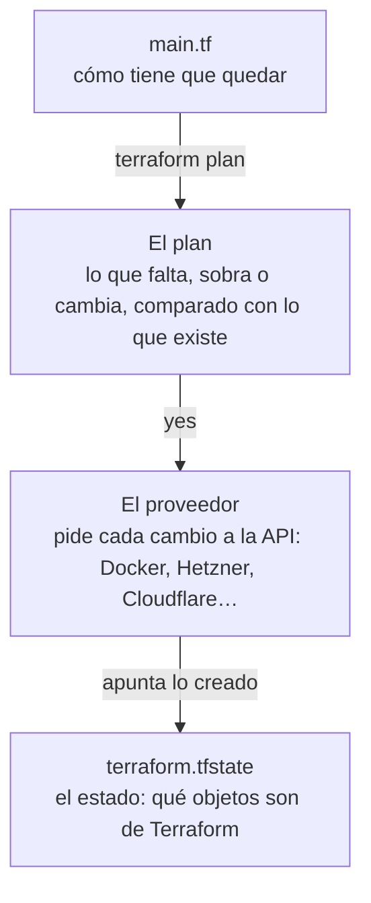

import { Aside, Tabs, TabItem } from '@astrojs/starlight/components';
import Term from '~/components/Term.astro';
import TryIt from '~/components/TryIt.astro';
import Analogy from '~/components/Analogy.astro';
import SelfCheck from '~/components/SelfCheck.astro';
import Quiz from '~/components/Quiz.astro';
import QuizQuestion from '~/components/QuizQuestion.astro';
import QuizOption from '~/components/QuizOption.astro';

## El problema

Imagina que Ana montó su VPS con clics: el servidor y su clave SSH ([lección 1](/fase-8/que-es-un-vps/#camino-de-pago-crea-tu-servidor)), el cortafuegos del proveedor ([lección 2](/fase-8/proteger-servidor-linux/#el-cortafuegos-del-proveedor-camino-de-pago)) y el registro DNS ([lección 5](/fase-8/lets-encrypt-nginx/#un-nombre-el-dominio-y-sus-registros)). Funciona. Seis meses después:

- **Repetirlo.** Quiere un segundo servidor igual, para pruebas. Lo rehace de memoria, y se olvida de una regla.
- **Revisarlo.** Luis pregunta qué cambió en el cortafuegos la semana pasada. El panel enseña cómo está, no quién lo cambió.
- **Deshacerlo.** Al terminar, borra el servidor de pruebas, pero no su cortafuegos. Queda olvidado en la cuenta.

**Terraform convierte esos clics en un fichero** que va a Git y se revisa como el código. Terraform crea lo que dice, lo cambia con el fichero y lo borra todo de una vez.

## La analogía

<Analogy>

Piensa en una nota pegada en la nevera de un piso compartido: «Tiene que haber 6 huevos, 2 litros de leche y pan». No dice «compra 4 huevos»: dice cómo tiene que quedar la nevera.

Ana compara la nevera con la nota, apunta lo que falta (4 huevos y pan) y lo compra. Al día siguiente no falta nada, y no compra nada. En su libreta apunta qué puso ella, para no tocar lo de los demás.

La nota es tu fichero `.tf`; apuntar lo que falta, `terraform plan`; comprarlo, `terraform apply`. La libreta es el estado.

<div slot="limits">

- En la nevera ves todo. Terraform solo se ocupa de lo que tiene en su estado: el servidor que creaste a mano en el panel no lo ve.
- Si la nota cambia «leche entera» por «desnatada», Ana compra la otra y tira la vieja. Terraform hace lo mismo con lo que no puede cambiar en su sitio. Con un servidor, tirar el viejo es perder su disco.

</div>

</Analogy>

## Cómo funciona de verdad

### Describir cómo tiene que quedar, no qué hacer

Ya has trabajado así. En la Fase 7, tres `docker run` seguidos arrancaban la tienda: cada orden **hace** algo, y si la repites, falla o crea otro. Eso es **imperativo**.

Un [`compose.yaml`](/fase-7/docker-compose/), en cambio, **describe** cómo tiene que quedar la tienda, y `docker compose up` crea lo que falta: un segundo `up` no crea nada. Eso es **declarativo**.

Terraform hace lo mismo con cualquier cosa que tenga una API: un servidor en Hetzner o en AWS, un registro DNS en Cloudflare, un contenedor en tu Docker. Describir así la infraestructura, en ficheros que van a Git, es la <Term id="infrastructure-as-code">infraestructura como código</Term> (*infrastructure as code*, IaC). Los tres problemas de Ana, antes y después:

| Problema | Con clics en un panel | Con Terraform |
|---|---|---|
| Repetirlo | De memoria, paso a paso | `terraform apply` con el mismo fichero |
| Revisarlo | No queda rastro | La historia de Git y su pull request, como el código de la [lección 6](/fase-8/ci-cd-github-actions/) |
| Deshacerlo | Buscando pieza a pieza | `terraform destroy` borra todo lo que creó |

### Un fichero de Terraform, pieza a pieza

<Term id="terraform">Terraform</Term> es un programa de HashiCorp. Sus ficheros acaban en `.tf` y se escriben en **HCL** (*HashiCorp Configuration Language*): bloques con un tipo, unos nombres entre comillas y, entre llaves, `nombre = valor`. `#` empieza un comentario.

La práctica de esta lección es un fichero, `main.tf`, que describe un contenedor de nginx con una página tuya. Empieza así:

```hcl title="main.tf"
terraform {
  required_providers {
    # Un proveedor es el plugin que sabe hablar con un servicio. Este habla con Docker.
    # Fijamos la versión exacta, como el curso fija todo lo demás.
    docker = {
      source  = "kreuzwerker/docker"
      version = "4.6.0"
    }
  }
}

# Sin más datos, el proveedor usa el Docker de tu ordenador (el socket /var/run/docker.sock).
provider "docker" {}
```

- **Un proveedor** (*provider*) traduce lo que describes a llamadas a la API de un servicio. Terraform no sabe nada de Docker ni de Hetzner: lo saben sus proveedores, que están en el [registro de Terraform](https://registry.terraform.io/).
- **`source`** dice cuál: `kreuzwerker/docker`, el de Docker, que mantiene la comunidad. **`version`** lo fija a una versión exacta.
- **`provider "docker" {}`** lo configura. Vacío, habla con el Docker de tu ordenador.

Después, un dato que puedes cambiar sin tocar el resto, y la imagen:

```hcl title="main.tf"
# Una variable es un dato que cambias sin tocar el resto del código.
variable "texto_pagina" {
  description = "El texto de la página que sirve nginx"
  type        = string
  default     = "Hola desde Terraform"
}

# La imagen de nginx, fijada por su versión y por su huella (digest): siempre la misma imagen.
resource "docker_image" "nginx" {
  name         = "nginx:1.29.8@sha256:1881968aff6f7cdcc4b888c00a11f4ce241ad7ec957e0cb4a9e19e93a3ff87ea"
  keep_locally = true # al destruir, deja la imagen descargada en tu ordenador
}
```

- **`variable`** declara un dato con su tipo y su valor por defecto. Se usa como `var.texto_pagina`, y puedes cambiarlo al ejecutar Terraform.
- **`resource`** es una pieza que Terraform crea y cuida. Lleva el tipo, que viene del proveedor (`docker_image`), y tu nombre (`nginx`): juntos, `docker_image.nginx`.
- La imagen va fijada por su <Term id="image-digest">huella</Term>, como en la [Fase 7](/fase-7/docker-hub-registro/).

El contenedor:

```hcl title="main.tf"
# El contenedor. Lo publicamos solo en 127.0.0.1: únicamente tu ordenador llega a él.
resource "docker_container" "web" {
  name  = "practica-terraform"
  image = docker_image.nginx.image_id # así Terraform sabe que primero va la imagen

  ports {
    internal = 80
    external = 8081
    ip       = "127.0.0.1"
  }

  # Crea dentro del contenedor la página de inicio con el texto de la variable.
  upload {
    file    = "/usr/share/nginx/html/index.html"
    content = "<h1>${var.texto_pagina}</h1>\n"
  }
}
```

- **`image = docker_image.nginx.image_id`** usa un dato de otro recurso. Así Terraform deduce el orden: **primero la imagen, después el contenedor**.
- **`ports`** es el `-p 127.0.0.1:8081:80` de `docker run`.
- **`upload`** escribe la portada de nginx dentro del contenedor, con el valor de la variable en medio del texto.

Y lo que te enseña al terminar:

```hcl title="main.tf"
# Una salida es un dato que Terraform te muestra al terminar.
output "url" {
  description = "Dónde ver la página"
  value       = "http://127.0.0.1:8081"
}
```

Una **salida** (*output*) enseña datos de lo creado: con un servidor, su IP pública.

### Cuatro órdenes: init, plan, apply y destroy

| Orden | Qué hace |
|---|---|
| `terraform init` | Prepara la carpeta: descarga los proveedores |
| `terraform plan` | Compara el fichero con lo que existe y enseña qué haría. **No cambia nada** |
| `terraform apply` | Enseña el mismo plan, te pide `yes` y lo hace |
| `terraform destroy` | Te pide `yes` y borra todo lo que creó |

Así va un `apply`:



El plan marca cada recurso con un símbolo, y **es lo que tienes que leer antes de escribir `yes`**:

| Símbolo | Significa |
|---|---|
| `+` | Lo crea |
| `-` | Lo borra |
| `~` | Lo cambia en su sitio, sin borrarlo |
| `-/+` | Lo **reemplaza**: borra el viejo y crea uno nuevo |

`-/+` aparece cuando el proveedor no puede cambiar algo en marcha. Con un servidor, es una máquina nueva: **otro disco, vacío, y quizá otra IP**.

### El estado: la memoria de Terraform

Cada `apply` escribe `terraform.tfstate`, el <Term id="terraform-state">estado</Term>: un JSON que une cada recurso del fichero con el objeto real que creó. Sin él, Terraform no sabría qué es suyo, ni qué borrar.

En cada `plan`, Terraform lee el estado, **pregunta al proveedor cómo está cada objeto de verdad** y lo compara con el fichero. Lo que alguien cambió a mano, el plan lo devuelve a lo que dice el fichero.

**El estado guarda todos los datos de cada recurso, en claro**, contraseñas y tokens incluidos. `sensitive = true` en una variable solo evita que salga en la pantalla. Por eso:

- **El estado nunca va a Git,** como el `.env` de la [Fase 6](/fase-6/rate-limiting-secretos/#los-secretos-fuera-del-código-y-de-git). En el `.gitignore`: `*.tfstate`, `*.tfstate.*` y `.terraform/`.
- **En un equipo se guarda en un estado remoto** (*remote backend*), como un *bucket* de S3 de la [lección 7](/fase-8/iaas-paas-saas-serverless/#los-nombres-de-aws-traducidos), cifrado, o HCP Terraform, de HashiCorp. Se **bloquea** mientras alguien aplica, para que dos `apply` no se pisen.

### El fichero de bloqueo: .terraform.lock.hcl

`init` crea otro fichero, `.terraform.lock.hcl`, con la versión exacta de cada proveedor y sus <Term id="hash">hashes</Term>: el siguiente `init`, tuyo o de Luis, descarga lo mismo y comprueba que nadie lo ha cambiado. Es el `package-lock.json` de la [Fase 3](/fase-3/que-es-node-js/), para los proveedores.

Al revés que el estado, **este sí va a Git**: no tiene secretos. La práctica no trae uno, porque `version = "4.6.0"` ya fija la versión; tu `init` creará el tuyo.

### Terraform, OpenTofu y la licencia

El 10 de agosto de 2023, HashiCorp [cambió la licencia](https://www.hashicorp.com/en/blog/hashicorp-adopts-business-source-license) de sus programas, Terraform incluido, de la MPL 2.0, de código abierto, a la **BUSL 1.1** (*Business Source License*). Puedes usarlo gratis para tu propia infraestructura. Lo que no puedes es ofrecer con él un producto que compita con los de HashiCorp.

Como respuesta, varias empresas partieron del código anterior y crearon [**OpenTofu**](https://opentofu.org/), con la MPL 2.0, en la Linux Foundation. Lee los mismos ficheros y proveedores, con la orden `tofu`: `tofu init` y `tofu validate` funcionan con esta práctica.

En octubre de 2026, la última versión de Terraform era la 1.16.6, del 14 de octubre, y la de OpenTofu, la 1.13.1, del 1 de octubre. Lo que cuenta esta lección vale para los dos.

### Leer el servidor del camino de pago, sin aplicarlo

Junto a la práctica está `servidor.tf.ejemplo`: tus clics de las lecciones 1, 2 y 5, escritos para Terraform. No acaba en `.tf` a propósito: Terraform no lo carga, y no crea ni cobra nada. El cortafuegos:

```hcl title="servidor.tf.ejemplo"
# El cortafuegos del proveedor: SSH, HTTP y HTTPS desde cualquier sitio, y nada más.
resource "hcloud_firewall" "web" {
  name = "tienda-web"

  dynamic "rule" {
    for_each = ["22", "80", "443"]
    content {
      direction  = "in"
      protocol   = "tcp"
      port       = rule.value
      source_ips = ["0.0.0.0/0", "::/0"]
    }
  }
}
```

**`dynamic "rule"`** escribe una regla por cada puerto de `for_each`, y **`source_ips`** dice desde dónde se llega: `0.0.0.0/0` es cualquier IPv4, y `::/0`, cualquier IPv6.

**El 22 no necesita estar abierto a todo internet:** si tu IP es fija, deja solo la tuya (`["203.0.113.25/32"]`) y los bots de la [lección 2](/fase-8/proteger-servidor-linux/) ni llegarán a SSH.

El servidor y su nombre:

```hcl title="servidor.tf.ejemplo"
# El servidor: Ubuntu 26.04, el plan más pequeño, con la clave y el cortafuegos de arriba.
resource "hcloud_server" "web" {
  name         = "tienda"
  server_type  = "cx23"
  image        = "ubuntu-26.04"
  location     = "nbg1"
  ssh_keys     = [hcloud_ssh_key.tienda.id]
  firewall_ids = [hcloud_firewall.web.id]
}

# El registro DNS de tipo A (Fase 0): el nombre apunta a la IPv4 del servidor.
resource "cloudflare_dns_record" "web" {
  zone_id = var.zona_id
  name    = var.dominio
  type    = "A"
  content = hcloud_server.web.ipv4_address
  ttl     = 300
  proxied = false # DNS solo: el tráfico va directo a tu servidor
}
```

- **El servidor** es el CX23 de la lección 1, en Núremberg (`nbg1`), con tu clave y el cortafuegos de arriba.
- **El registro DNS** va a Cloudflare, otro proveedor en el mismo fichero, con la IP que Hetzner le dé al servidor: Terraform crea el servidor, lee su IP y crea el registro. **Ya no copias la IP a mano.**
- **Solo hay un registro `A`**, para la IPv4: por IPv6 faltaría un `AAAA` ([lección 5](/fase-8/lets-encrypt-nginx/#un-nombre-el-dominio-y-sus-registros)).

Los tokens llegan como variables, no escritos en el fichero; aun así, **acaban en el estado**. Y aplicarlo crearía un servidor **nuevo**, que se cobra: el que creaste a mano, Terraform no lo conoce. Para adoptarlo está `terraform import`.

## Pruébalo

El objetivo: crear un contenedor con Terraform, cambiarlo leyendo el plan, descubrir qué pasa si alguien lo borra a mano y no dejar nada atrás. Todo en **tu ordenador**, con Docker: abre Docker Desktop si lo cerraste en la [introducción](/fase-8/#si-tu-ordenador-tiene-8-gb-de-memoria).

### Instala Terraform

<Tabs syncKey="os">
<TabItem label="macOS">

Con Homebrew, desde el catálogo de HashiCorp (`hashicorp/tap`): el principal de Homebrew no lo tiene.

```sh
brew tap hashicorp/tap
brew install hashicorp/tap/terraform
```

</TabItem>
<TabItem label="Linux">

Desde el repositorio `apt` de HashiCorp, como el de Docker en la [introducción](/fase-8/#instala-docker-en-la-vm).

```sh
wget -O - https://apt.releases.hashicorp.com/gpg | sudo gpg --dearmor -o /usr/share/keyrings/hashicorp-archive-keyring.gpg
echo "deb [arch=$(dpkg --print-architecture) signed-by=/usr/share/keyrings/hashicorp-archive-keyring.gpg] https://apt.releases.hashicorp.com $(grep -oP '(?<=UBUNTU_CODENAME=).*' /etc/os-release || lsb_release -cs) main" | sudo tee /etc/apt/sources.list.d/hashicorp.list
sudo apt update && sudo apt install terraform
```

</TabItem>
<TabItem label="Windows">

En WSL, con las órdenes de la pestaña Linux: tu Docker Desktop ya trabaja con WSL desde la Fase 7.

</TabItem>
</Tabs>

Son las órdenes de la [página de instalación de Terraform](https://developer.hashicorp.com/terraform/install). Compruébalo:

<TryIt
  title="¿Qué Terraform tienes?"
  cmd="terraform version"
  output={`Terraform v1.16.6
on linux_arm64`}
>

Las salidas son de la 1.16.6; con una más nueva, algún mensaje puede cambiar. En un Mac con Apple Silicon dirá `darwin_arm64`.

</TryIt>

**O sin instalar nada, con Docker**, como capturamos las salidas. Este alias convierte `terraform` en un contenedor con la imagen oficial, fijada por su huella:

```sh
alias terraform='docker run --rm -it -v "$PWD":/tf -w /tf -v /var/run/docker.sock:/var/run/docker.sock hashicorp/terraform:1.16.6@sha256:bfffc1ded5fbf0a17beaaf22eb4793980abdb19d0761ff6a3a0efb2ab4d9b316'
```

- **`-v "$PWD":/tf -w /tf`** monta tu carpeta actual y trabaja en ella.
- **`-v /var/run/docker.sock:/var/run/docker.sock`** monta el *socket* de Docker, la puerta por la que se le piden cosas al motor, para que el proveedor cree contenedores en tu Docker. **Quien tiene esa puerta manda en todo tu Docker y, en Linux, equivale a ser `root`, como el [grupo `docker`](/fase-7/#sin-sudo-el-grupo-docker)**: dásela solo a imágenes de confianza.

El alias dura lo que la terminal. En Linux y WSL, lo que crea el contenedor queda a nombre de `root`: bórralo al final con `sudo rm -rf ~/curso-backend/fase-8/terraform`.

### Descarga la práctica

En tu ordenador, una carpeta nueva para la práctica, y el fichero:

```sh
mkdir -p ~/curso-backend/fase-8/terraform
cd ~/curso-backend/fase-8/terraform
curl -O https://backenddesdecero.com/practicas/terraform/es/main.tf
```

**Léelo antes de ejecutarlo**, con `less main.tf`: es el de «Cómo funciona de verdad», entero.

### Crea el contenedor

<TryIt
  title="1. init: prepara la carpeta"
  cmd="terraform init"
  output={`Initializing the backend...

Initializing provider plugins...
- Finding kreuzwerker/docker versions matching "4.6.0"...
- Installing kreuzwerker/docker v4.6.0...
- Installed kreuzwerker/docker v4.6.0 (self-signed, key ID 0DCE698927DAF8EC)
Partner and community providers are signed by their developers.
If you'd like to know more about provider signing, you can read about it here:
https://developer.hashicorp.com/terraform/cli/plugins/signing

Terraform has created a lock file .terraform.lock.hcl to record the provider
selections it made above. Include this file in your version control repository
so that Terraform can guarantee to make the same selections by default when
you run "terraform init" in the future.

Terraform has been successfully initialized!
…`}
>

- **`Installed kreuzwerker/docker v4.6.0`**: el proveedor, en la versión exacta del fichero, ya está en `.terraform/`. **`self-signed`**: lo firma quien lo mantiene, no HashiCorp, y Terraform comprueba la firma.
- **`created a lock file`**: el `.terraform.lock.hcl`, que te dice que guardes en Git.

Si sale `Failed to query available provider packages`, no llega a internet. Hemos recortado el final (`…`).

</TryIt>

<TryIt
  title="2. plan: qué haría, sin hacerlo"
  cmd="terraform plan"
  output={`Terraform used the selected providers to generate the following execution
plan. Resource actions are indicated with the following symbols:
  + create

Terraform will perform the following actions:

  # docker_container.web will be created
  + resource "docker_container" "web" {
      + attach                                      = false
      + bridge                                      = (known after apply)
…
      + name                                        = "practica-terraform"
…
      + ports {
          + external = 8081
          + internal = 80
          + ip       = "127.0.0.1"
          + protocol = "tcp"
        }
…
    }

  # docker_image.nginx will be created
  + resource "docker_image" "nginx" {
…
    }

Plan: 2 to add, 0 to change, 0 to destroy.

Changes to Outputs:
  + url = "http://127.0.0.1:8081"
…`}
>

Dos recursos con `+` y el resumen: **`Plan: 2 to add, 0 to change, 0 to destroy`**. `(known after apply)` son datos que no se saben hasta que el contenedor exista, como su ID. Lo hemos recortado (`…`). **No se ha creado nada todavía.**

</TryIt>

<TryIt
  title="3. apply: hazlo"
  cmd="terraform apply"
  output={`…
Plan: 2 to add, 0 to change, 0 to destroy.

Changes to Outputs:
  + url = "http://127.0.0.1:8081"

Do you want to perform these actions?
  Terraform will perform the actions described above.
  Only 'yes' will be accepted to approve.

  Enter a value: yes

docker_image.nginx: Creating...
docker_image.nginx: Creation complete after 1s [id=sha256:1881968aff6f7cdcc4b888c00a11f4ce241ad7ec957e0cb4a9e19e93a3ff87eanginx:1.29.8@sha256:1881968aff6f7cdcc4b888c00a11f4ce241ad7ec957e0cb4a9e19e93a3ff87ea]
docker_container.web: Creating...
docker_container.web: Creation complete after 0s [id=1b0483b9fb5c21bd59bb0238abaefe29b985314e416c2af2b38b03217f93b32b]

Apply complete! Resources: 2 added, 0 changed, 0 destroyed.

Outputs:

url = "http://127.0.0.1:8081"`}
>

`apply` repite el plan (recortado aquí) y espera. **Escribe `yes`**, entero: con otra cosa, no hace nada. Fíjate en el orden, **primero la imagen y después el contenedor**, y en la salida `url` del final.

Si sale `Cannot connect to the Docker daemon`, Docker no está en marcha. Si el puerto 8081 está ocupado, cambia `external` en `main.tf` y vuelve a aplicar.

</TryIt>

<TryIt
  title="4. Pregúntale a tu nginx, y otra vez plan"
  cmd={`curl http://127.0.0.1:8081\ndocker ps --filter name=practica-terraform\nterraform plan`}
  output={`<h1>Hola desde Terraform</h1>
CONTAINER ID   IMAGE          COMMAND                  CREATED                  STATUS                  PORTS                    NAMES
1b0483b9fb5c   1881968aff6f   "/docker-entrypoint.…"   Less than a second ago   Up Less than a second   127.0.0.1:8081->80/tcp   practica-terraform
docker_image.nginx: Refreshing state... [id=sha256:1881968aff6f7cdcc4b888c00a11f4ce241ad7ec957e0cb4a9e19e93a3ff87eanginx:1.29.8@sha256:1881968aff6f7cdcc4b888c00a11f4ce241ad7ec957e0cb4a9e19e93a3ff87ea]
docker_container.web: Refreshing state... [id=1b0483b9fb5c21bd59bb0238abaefe29b985314e416c2af2b38b03217f93b32b]

No changes. Your infrastructure matches the configuration.

Terraform has compared your real infrastructure against your configuration
and found no differences, so no changes are needed.`}
>

La página tiene el texto de la variable, y `docker ps` ve un contenedor normal, con el nombre y el puerto del fichero. Tu ID será otro.

En el segundo `plan`, **`Refreshing state`** es Terraform preguntándole a Docker cómo está cada objeto de su estado. Todo coincide con el fichero: **`No changes`**. Es lo declarativo: repetir no crea un segundo contenedor.

</TryIt>

Mira qué ha guardado en el estado:

<TryIt
  title="5. Tu texto, en el estado"
  cmd={`grep '"content"' terraform.tfstate`}
  output={`                "content": "\\u003ch1\\u003eHola desde Terraform\\u003c/h1\\u003e\\n",`}
>

El contenido del `upload`, en claro (`\u003c` y `\u003e` son `<` y `>`, escritos a la manera de JSON). Si fuera un token, estaría igual de legible.

</TryIt>

### Cambia la variable y lee el plan

`-var` da otro valor a la variable sin tocar el fichero:

<TryIt
  title="6. El plan del cambio"
  cmd="terraform plan -var 'texto_pagina=Hola, cambiado con Terraform'"
  output={`…
Terraform used the selected providers to generate the following execution
plan. Resource actions are indicated with the following symbols:
-/+ destroy and then create replacement

Terraform will perform the following actions:

  # docker_container.web must be replaced
-/+ resource "docker_container" "web" {
…
      - upload { # forces replacement
          - content        = <<-EOT
                <h1>Hola desde Terraform</h1>
            EOT -> null
          - executable     = false -> null
          - file           = "/usr/share/nginx/html/index.html" -> null
            # (6 unchanged attributes hidden)
        }
      + upload { # forces replacement
          + content        = <<-EOT
                <h1>Hola, cambiado con Terraform</h1>
            EOT
          + executable     = false
          + file           = "/usr/share/nginx/html/index.html"
            # (6 unchanged attributes hidden)
        }
…
    }

Plan: 1 to add, 0 to change, 1 to destroy.
…`}
>

Hemos recortado los datos que cambian porque será otro contenedor. **Busca dos cosas:**

- **`-/+` y `must be replaced`**: el contenedor se borra y se crea otro. La imagen no aparece: no cambia.
- **`# forces replacement`**: lo que obliga a reemplazarlo. El fichero subido no se puede cambiar en un contenedor en marcha.

Con un contenedor de prácticas da igual; con un servidor, **este es el momento de parar y pensar**.

</TryIt>

<TryIt
  title="7. Aplica el cambio"
  cmd={`terraform apply -var 'texto_pagina=Hola, cambiado con Terraform'\ncurl http://127.0.0.1:8081`}
  output={`…
docker_container.web: Destroying... [id=1b0483b9fb5c21bd59bb0238abaefe29b985314e416c2af2b38b03217f93b32b]
docker_container.web: Destruction complete after 1s
docker_container.web: Creating...
docker_container.web: Creation complete after 0s [id=24d1fb6cc8abf03e8659adb76a957b4c8805878a2f7a28ad480002161e446200]

Apply complete! Resources: 1 added, 0 changed, 1 destroyed.

Outputs:

url = "http://127.0.0.1:8081"
<h1>Hola, cambiado con Terraform</h1>`}
>

Escribe `yes`. **Destroying, después Creating**: el ID nuevo es otro contenedor, y entre las dos líneas no había página.

`-var` no se guarda: **repítelo en cada orden**, o el siguiente `plan` querrá volver al texto por defecto. En un proyecto, los valores van en un fichero `terraform.tfvars`, que Terraform lee solo.

</TryIt>

### Alguien lo borra a mano

Imagina que Luis ve un contenedor que no conoce y lo borra:

<TryIt
  title="8. Borrado fuera de Terraform"
  cmd={`docker rm -f practica-terraform\nterraform plan -var 'texto_pagina=Hola, cambiado con Terraform'`}
  output={`practica-terraform
…
  # docker_container.web will be created
  + resource "docker_container" "web" {
…
Plan: 1 to add, 0 to change, 0 to destroy.
…`}
>

Al refrescar el estado, Docker le dijo a Terraform que el contenedor ya no existe, y el fichero dice que tiene que existir: el plan **lo vuelve a crear**. Haz `terraform apply` con el mismo `-var`, escribe `yes`, y `curl` vuelve a contestar.

Con cualquier cambio a mano en algo que gestiona Terraform pasa igual: **el siguiente `apply` lo deshace**. El fichero manda.

</TryIt>

<SelfCheck question="Reto: imagina que borras terraform.tfstate y haces terraform plan. ¿Qué dirá, y qué pasaría con apply?">

Sin estado, Terraform no recuerda nada: el plan dice `Plan: 2 to add`, como la primera vez. Pero el contenedor existe, así que `apply` fallaría al crear otro con el mismo nombre, que Docker no repite; sin nombre fijo, tendrías dos. **Perder el estado es perder la memoria.** No lo hagas: sigue con `destroy`.

</SelfCheck>

### Destrúyelo todo

<TryIt
  title="9. destroy"
  cmd={`terraform destroy\ndocker ps -a --filter name=practica-terraform`}
  output={`…
Plan: 0 to add, 0 to change, 2 to destroy.

Changes to Outputs:
  - url = "http://127.0.0.1:8081" -> null

Do you really want to destroy all resources?
  Terraform will destroy all your managed infrastructure, as shown above.
  There is no undo. Only 'yes' will be accepted to confirm.

  Enter a value: yes

docker_container.web: Destroying... [id=117359559e82281ddd30e1e2375fea880d4bdb6687d6e0cdb51b3d7848273f6f]
docker_container.web: Destruction complete after 0s
docker_image.nginx: Destroying... [id=sha256:1881968aff6f7cdcc4b888c00a11f4ce241ad7ec957e0cb4a9e19e93a3ff87eanginx:1.29.8@sha256:1881968aff6f7cdcc4b888c00a11f4ce241ad7ec957e0cb4a9e19e93a3ff87ea]
docker_image.nginx: Destruction complete after 0s

Destroy complete! Resources: 2 destroyed.
CONTAINER ID   IMAGE     COMMAND   CREATED   STATUS    PORTS     NAMES`}
>

`destroy` no necesita el `-var`: borra lo que dice el estado, ahora en **orden contrario**, primero el contenedor y después la imagen. `docker ps -a` ya no lo encuentra. La imagen sigue en tu ordenador, porque `keep_locally = true` le pide a Terraform que la olvide sin borrarla.

</TryIt>

Puedes borrar la carpeta. El ejemplo del camino de pago entero se descarga igual, con `curl -O https://backenddesdecero.com/practicas/terraform/es/servidor.tf.ejemplo`: léelo, sin aplicarlo.

## Ya lo has visto

- **Tu `compose.yaml`** de la Fase 7: describe cómo tiene que quedar todo, y un segundo `up` no duplica nada.
- **El `package-lock.json` y las huellas de las imágenes:** versiones exactas y comprobadas, como el `.terraform.lock.hcl`.
- **El CI de este curso:** comprueba los ficheros de esta práctica con `terraform fmt -check` (el formato) y `terraform validate` (que tengan sentido).

## Errores comunes

- **Subir `terraform.tfstate` a Git.** Lleva los tokens en claro: a `.gitignore` desde el primer commit.
- **Escribir `yes` sin leer el plan.** Un `-/+` en un servidor es una máquina nueva, con el disco vacío.
- **Mezclar clics y Terraform.** El siguiente `apply` deshace lo que cambiaste en el panel.
- **Olvidar `destroy` en una nube de pago.** Se cobra hasta que lo borras.

## Resumen

- La infraestructura como código describe servidores, cortafuegos o registros DNS en ficheros que se repiten, se revisan en Git y se borran de una vez.
- Un fichero de Terraform tiene proveedores, recursos, variables y salidas; las referencias entre recursos deciden el orden.
- `plan` enseña qué cambiará sin tocar nada, `apply` lo hace tras tu `yes` y `destroy` lo borra. Lee el plan: `-/+` es reemplazar.
- El estado lleva los datos en claro: nunca en Git, y en un equipo, remoto. El `.terraform.lock.hcl`, en cambio, sí va a Git.
- Terraform tiene licencia BUSL desde 2023; OpenTofu es su versión de código abierto.

### Lo que has construido en esta fase

Empezaste la fase con la tienda en tu portátil, y la acabas en un servidor:

- cerrado: tu usuario, SSH solo con clave, un cortafuegos y actualizaciones solas;
- con la tienda en Compose de producción, secretos solo allí y una copia cada noche;
- con nginx delante y un nombre con HTTPS;
- que recibe cada `git push` a `main` comprobado y desplegado, con vuelta atrás;
- y con el mapa de lo demás: IaaS, PaaS, serverless y la infraestructura en un fichero.

Pero la tienda vive en una sola copia, y cada despliegue la deja [unos segundos sin contestar](/fase-8/ci-cd-github-actions/#unos-segundos-sin-tienda). En la Fase 9, «Arquitectura y escalado», aprenderás a desplegar sin cortes, a mandar el trabajo lento a una cola y a repartir las visitas entre varios servidores.

## ¿Lo has entendido?

<Quiz>

<QuizQuestion
  question="Cambias la location del servidor de nbg1 a fsn1, otro centro de datos, y el plan dice: hcloud_server.web must be replaced. ¿Qué haces?"
  review="Cuatro órdenes: init, plan, apply y destroy"
>

<QuizOption text="Aplicar: must be replaced solo mueve el servidor que ya tienes, con su disco.">

Cambiar algo en su sitio sería `~`. `must be replaced`, con `-/+`, es borrar el servidor y crear otro.

</QuizOption>

<QuizOption text="Parar: sería un servidor nuevo, con el disco vacío y quizá otra IP." correct>

Antes, saca los datos de ese disco, y piensa en el DNS si cambia la IP.

</QuizOption>

<QuizOption text="Aplicar: Terraform copia el disco del viejo al nuevo antes de borrarlo.">

Terraform no copia nada: borra uno y crea otro.

</QuizOption>

</QuizQuestion>

<QuizQuestion
  question="Luis propone subir terraform.tfstate a Git, para que todo el equipo tenga el mismo. Las variables de los tokens llevan sensitive = true. ¿Es buena idea?"
  review="El estado: la memoria de Terraform"
>

<QuizOption text="Sí: con sensitive = true, los tokens no se guardan en el estado.">

`sensitive` solo los oculta en la pantalla. En el estado están en claro.

</QuizOption>

<QuizOption text="Sí: el estado solo guarda los ID de los objetos, no sus datos.">

Guarda todos los datos de cada recurso, como el texto de tu página en «Pruébalo».

</QuizOption>

<QuizOption text="No: lleva los datos en claro, y para compartirlo está el estado remoto." correct>

Un estado remoto lo comparte sin meterlo en Git, y se bloquea para que dos `apply` no se pisen.

</QuizOption>

</QuizQuestion>

<QuizQuestion
  question="Ana abre a mano el puerto 8080 en el cortafuegos del proveedor, que gestiona Terraform. Días después, Luis hace terraform apply de otro cambio. ¿Qué pasa con el 8080?"
  review="Alguien lo borra a mano"
>

<QuizOption text="Se cierra: el plan lo quita, porque el fichero no lo tiene." correct>

El fichero manda. Si el puerto tiene que estar abierto, se añade al fichero.

</QuizOption>

<QuizOption text="Se queda abierto: Terraform solo mira su estado, no lo que hay en el proveedor.">

En cada `plan`, Terraform pregunta al proveedor cómo está cada objeto (`Refreshing state`). Ve la regla nueva.

</QuizOption>

<QuizOption text="Se queda abierto, y Terraform añade la regla al fichero main.tf.">

Terraform nunca escribe tus ficheros `.tf`: cambia la infraestructura para que se parezca a ellos.

</QuizOption>

</QuizQuestion>

<QuizQuestion
  question="Haces terraform apply de la práctica, y justo después, otra vez terraform apply sin cambiar nada. ¿Qué hace la segunda vez?"
  review="Describir cómo tiene que quedar, no qué hacer"
>

<QuizOption text="Crea un segundo contenedor, practica-terraform-2.">

Eso haría repetir un `docker run`. El fichero describe un contenedor, y ya existe.

</QuizOption>

<QuizOption text="Borra el contenedor y lo crea de nuevo, para asegurarse de que está bien.">

Terraform solo reemplaza lo que difiere del fichero. Aquí no difiere nada.

</QuizOption>

<QuizOption text="Nada: No changes, porque lo que existe ya coincide con el fichero." correct>

Solo hace lo que falta, y no falta nada.

</QuizOption>

</QuizQuestion>

<QuizQuestion
  question="Preparas un repositorio con tu infraestructura. ¿Qué haces con .terraform.lock.hcl?"
  review="El fichero de bloqueo: .terraform.lock.hcl"
>

<QuizOption text="Fuera de Git, como el estado: también lleva secretos.">

No lleva ninguno: solo las versiones de los proveedores y sus hashes.

</QuizOption>

<QuizOption text="A Git: fija las versiones de los proveedores y sus hashes." correct>

Como `package-lock.json`: cada `init`, también el del CI, descarga lo mismo y lo comprueba.

</QuizOption>

<QuizOption text="Fuera de Git: es una caché, y Terraform siempre baja la última versión del proveedor.">

`init` sigue el fichero de bloqueo: sin él, cada uno podría bajar una versión distinta.

</QuizOption>

</QuizQuestion>

<QuizQuestion
  question="Tu empresa quiere pasar de Terraform a OpenTofu por la licencia. ¿Qué cambia en vuestros ficheros .tf?"
  review="Terraform, OpenTofu y la licencia"
>

<QuizOption text="Hay que reescribirlos: OpenTofu usa su propio lenguaje.">

OpenTofu salió del código de Terraform: lee el mismo HCL y usa los mismos proveedores.

</QuizOption>

<QuizOption text="Nada, y tampoco el programa: OpenTofu es Terraform con otro nombre.">

Los ficheros sirven, pero son dos proyectos distintos desde 2023, con otra licencia y otra orden.

</QuizOption>

<QuizOption text="En principio nada: OpenTofu lee los mismos ficheros con su orden tofu." correct>

Cambia la orden y la licencia. Prueba `tofu plan` antes, por si usáis algo que solo tiene Terraform.

</QuizOption>

</QuizQuestion>

</Quiz>

## Para profundizar

- [What is Terraform?](https://developer.hashicorp.com/terraform/intro), de la documentación de HashiCorp, en inglés: qué es y cómo trabaja.
- [State](https://developer.hashicorp.com/terraform/language/state), en inglés: para qué sirve el estado, los estados remotos y el bloqueo.
- [Dependency lock file](https://developer.hashicorp.com/terraform/language/files/dependency-lock), en inglés: qué apunta `.terraform.lock.hcl`.
- [El proveedor de Docker](https://registry.terraform.io/providers/kreuzwerker/docker/latest/docs), en el registro de Terraform, en inglés: `docker_image`, `docker_container` y los demás.
- [OpenTofu](https://opentofu.org/docs/), en inglés: su documentación y en qué se diferencia de Terraform.
