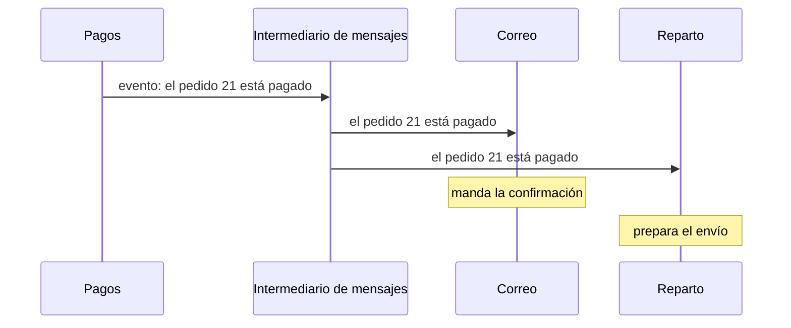
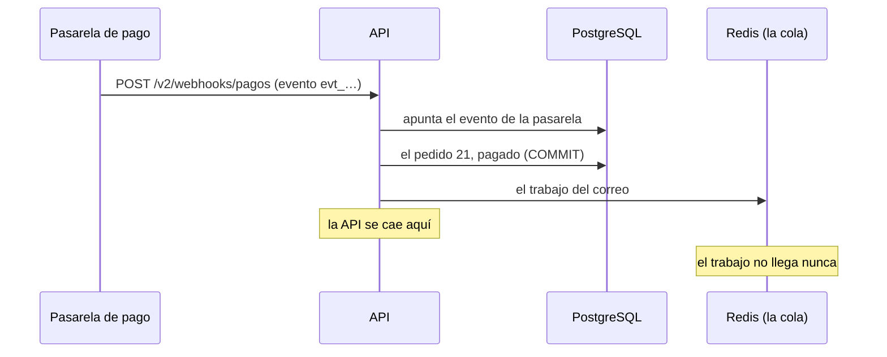
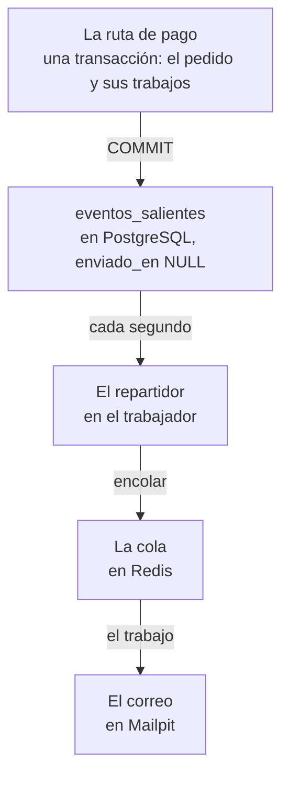

import Term from '~/components/Term.astro';
import TryIt from '~/components/TryIt.astro';
import Analogy from '~/components/Analogy.astro';
import ProjectCode from '~/components/ProjectCode.astro';
import Quiz from '~/components/Quiz.astro';
import QuizQuestion from '~/components/QuizQuestion.astro';
import QuizOption from '~/components/QuizOption.astro';

## El problema

Carmen paga el pedido 21. La pasarela de pago avisa a la tienda, y la tienda hace dos cosas: pasa el pedido a `pagado` en PostgreSQL y deja el correo de confirmación en la cola de Redis, como en la [lección 1](/fase-9/colas-trabajos-segundo-plano/).

Allí te lo dijimos: son **dos escrituras en dos sitios**. Si la API se cae entre una y otra, o Redis falla, el pedido queda pagado y el correo no existe en ninguna parte. Nadie lo echa en falta, porque nadie sabe que debería existir.

Y la pasarela no lo arregla al reintentar: la tienda ya apuntó su evento, y le contesta «repetido». **El correo se ha perdido para siempre.** Esta lección lo arregla, y te enseña lo que hay detrás: los eventos.

## La analogía

<Analogy>

Piensa en la bandeja de salida de una oficina. Cuando firmas un contrato, no sales corriendo a Correos en mitad de la reunión: archivas el contrato y, en el mismo gesto, dejas la carta para el cliente en la bandeja.

Cada pocos minutos pasa el mensajero, coge las cartas, las lleva a Correos y tacha cada una en la lista. Si un día no viene, las cartas esperan. **Ninguna se pierde**, porque la carta y el contrato se guardaron a la vez, en la misma mesa.

<div slot="limits">

- La bandeja funciona porque está en la misma mesa que el archivo. En la tienda, la tabla de salida está en la misma base de datos que el pedido: si estuviera en Redis, volvería el problema.
- Si el mensajero entrega las cartas y se pone malo antes de tacharlas, el de mañana las entrega otra vez. Una carta repetida se nota; un trabajo repetido, no, si no lleva un número que lo identifique.
- El correo sale un poco después del pago, nunca en el mismo momento.

</div>

</Analogy>

## Cómo funciona de verdad

### Un comando dice qué hacer; un evento, qué ha pasado

Compara estos dos mensajes:

- «Manda el correo de confirmación del pedido 21».
- «El pedido 21 está pagado».

El primero es un **comando**: va a alguien concreto, que tiene que hacerlo. El segundo es un **evento**: cuenta algo que ya ha pasado, y no dice a quién le importa ni qué hacer con ello.

| | Comando | Evento |
|---|---|---|
| Cómo se escribe | En imperativo: «manda», «cobra» | En pasado: «pagado», «creado» |
| A quién va | A uno, que sabe hacerlo | A quien quiera: cero, uno o muchos |
| Quién decide qué pasa | Quien lo envía | Cada uno que lo recibe |

La tienda ya usa los dos. Los trabajos de la cola son comandos: «manda este correo». Los cambios de un pedido de la [lección 3](/fase-9/escalado-horizontal/#redis-pubsub-un-canal-para-todas-las-copias) son eventos: la API publica «el pedido 21 ha cambiado» en Redis y no sabe quién lo sigue, si nadie o diez navegadores.

### Publicar y suscribirse: quien avisa no sabe quién escucha

En una <Term id="event-driven-architecture">arquitectura orientada a eventos</Term>, las partes de un sistema se hablan sobre todo con eventos. Pagos publica «pedido pagado», y cada parte que se ha suscrito reacciona por su cuenta. Es el <Term id="pub-sub">pub/sub</Term> de la lección 3, como forma de organizar todo el sistema.



- **Añadir una reacción no toca a quien avisa.** Si mañana facturación se suscribe, el código de pagos no cambia.
- **Una parte caída no frena a las demás.** Con el correo parado, el pago se guarda igual, y el aviso espera.

El intermediario (*broker*) es un programa que recibe los mensajes y los reparte. Los más conocidos son **Kafka**, que guarda los eventos días y deja volver a leerlos; **RabbitMQ**, que reparte cada mensaje por colas según unas reglas; y **NATS**, ligero y muy rápido. Lo que la tienda necesita, con Redis, es no perder mensajes por el camino.

### Dos escrituras, dos sitios: el hueco de la lección 1

Así pagaba la tienda hasta el paso `40-sin-cortes`:



Es el **problema de la doble escritura** (*dual write*): dos sistemas que no comparten una <Term id="transaction">transacción</Term>, así que no hay forma de guardar en los dos a la vez. Entre una escritura y la otra queda un hueco, y tarde o temprano algo cae dentro: un despliegue, un fallo de memoria, un Redis que tarda.

**Cambiar el orden no lo arregla.** Si encolas primero y guardas el pago después, una caída en medio manda el correo de un pedido sin pagar. Hay protocolos para que dos sistemas confirmen juntos (el *commit* en dos fases), pero Redis no los tiene.

Y había otro hueco, dentro de PostgreSQL: el evento de la pasarela se guardaba por su cuenta, fuera de la transacción del pago, antes de pagar. Por eso el reintento recibía «repetido».

### El outbox: el aviso, en la misma transacción

La solución es no escribir en dos sitios. El trabajo se guarda **en PostgreSQL, en la misma transacción que el pago**: o se guardan los dos, o ninguno. Después, otro proceso lo lleva a la cola. Es el <Term id="transactional-outbox">outbox transaccional</Term> (*outbox* es «bandeja de salida»).

La tabla nueva, en la migración `011`:

<ProjectCode file="tienda-api/41-eventos/bd/migraciones/011-eventos-salientes.sql" region="eventos-salientes" />

- **`datos`**: el trabajo entero, tal y como irá a la cola, en una columna <Term id="jsonb">JSONB</Term>.
- **`enviado_en`**: cuándo llegó a la cola. Mientras es `NULL`, está pendiente.
- **El <Term id="database-index">índice</Term> parcial** (`WHERE enviado_en IS NULL`) solo guarda las filas pendientes: las enviadas, casi todas con el tiempo, no lo hacen crecer.

Se llama `eventos_salientes` por el patrón, aunque cada fila de la tienda es un comando: «manda este correo».

La ruta que recibe el pago, en `src/v2.ts`, con las líneas clave marcadas:

<ProjectCode file="tienda-api/41-eventos/src/v2.ts" region="recibir-pago" mark={[13, 15, 17, 24, 26, 31]} />

- **`bd.transaction(async (tx) => …)`**: todo lo de dentro, en una transacción, como en la [Fase 5](/fase-5/transacciones-acid/#begin-y-commit-varias-órdenes-como-una-sola). `tx` es su conexión.
- **`apuntarEvento(evento.id, tx)`**: el evento de la pasarela, ahora dentro. Si algo falla después, se deshace, y el reintento de la pasarela lo intenta todo otra vez.
- **`cambiarEstadoEn(…, 'pagado', 'pendiente')`**: paga solo si sigue pendiente, en el mismo `UPDATE`, como el [arreglo 1 de la Fase 5](/fase-5/transacciones-acid/#arreglo-1-comprobar-y-quitar-en-la-misma-orden).
- **`guardarSaliente(tx, …)`**: un aviso por cada URL de reparto, y el correo.
- **`cambiosDePedidos.emitir`**, después del `COMMIT`, cuando el cambio ya se puede leer.

**La ruta ya no habla con la cola.** Guardar un trabajo es una fila más:

<ProjectCode file="tienda-api/41-eventos/src/salientes.ts" region="guardar-saliente" />

### El repartidor: de la tabla a la cola

Alguien tiene que llevar las filas a la cola: el **repartidor** (en inglés, *relay*). No es el contenedor `repartidor` de la lección 1, la empresa de reparto de mentira: este vive en el <Term id="worker">trabajador</Term>, en `scripts/trabajador.ts`:

<ProjectCode file="tienda-api/41-eventos/scripts/trabajador.ts" region="repartidor" />



Cada vuelta, en `src/salientes.ts`, es una transacción en tres pasos: todo lo que sigue va dentro de su `bd.transaction(async (tx) => …)`. Primero, coge las filas pendientes:

<ProjectCode file="tienda-api/41-eventos/src/salientes.ts" region="leer-pendientes" />

**`FOR UPDATE`** bloquea las filas leídas hasta el final de la transacción, como en el [arreglo 2 de la Fase 5](/fase-5/transacciones-acid/#arreglo-2-select--for-update-leer-y-quedarte-la-fila). **`SKIP LOCKED`** se salta las que ya ha bloqueado otro, sin esperar: con dos trabajadores, nunca cogen la misma.

Después, las lleva a la cola, con un plazo:

<ProjectCode file="tienda-api/41-eventos/src/salientes.ts" region="encolar-a-tiempo" />

- **`ESPERA_COLA`, 2 segundos por vuelta.** Un Redis colgado no contestaría nunca, y el límite del cliente de Redis no cuenta una vez enviada la orden ([lección 2](/fase-9/cache-redis/#si-la-caché-falla-la-tienda-sigue)): lo pone la aplicación, con `Promise.race`, una carrera entre cada orden y un único reloj de 2 segundos para toda la vuelta.
- **Solo apunta lo que Redis ha confirmado.** Si va lento, se queda con lo que ha llegado y deja el resto. Si no llega nada, lanza un error: `ROLLBACK`, y todo sigue pendiente.

Por último, apunta las que llegaron, y `COMMIT`:

<ProjectCode file="tienda-api/41-eventos/src/salientes.ts" region="apuntar-enviados" />

- **Encola antes del `COMMIT`.** Al revés (apuntar como enviadas y encolar después), un trabajador que se cae en medio las perdería: el mismo hueco de antes.
- **`clock_timestamp()`**: la hora de después de encolar; `now()` daría la del principio de la transacción.

Hay una vuelta al arrancar el trabajador, para lo que dejó pendiente una caída, y otra cada segundo. Sin Redis, reparte la propia API.

### Un trabajador que desaparece con las filas bloqueadas

Antes de leer, la vuelta empieza con una línea que cubre un caso raro y grave:

<ProjectCode file="tienda-api/41-eventos/src/salientes.ts" region="sin-dueno" />

Si la máquina del trabajador se apaga de golpe, PostgreSQL puede tardar horas en dar la conexión por perdida, y mientras sus filas siguen bloqueadas. Con este ajuste, una transacción que pasa 5 segundos sin mandar nada se corta y suelta sus filas.

### Al menos una vez, otra vez: ids que absorben los repetidos

El outbox garantiza la <Term id="at-least-once-delivery">entrega al menos una vez</Term> de la lección 1. A veces, dos:

- el repartidor encola y se cae antes del `COMMIT`, y la siguiente vuelta encola lo mismo;
- Redis contesta tarde, cuando la vuelta ya había dejado ese trabajo para la siguiente.

Por eso cada trabajo lleva un id sacado de lo que es, no uno al azar:

<ProjectCode file="tienda-api/41-eventos/src/cola.ts" region="id-del-trabajo" />

**Un correo por pedido: `correo-21`.** BullMQ no apunta un trabajo con un id que ya tiene, mientras lo guarde: esperando, a medias o entre los 1000 últimos hechos o fallidos. Un repetido llega en segundos, así que casi siempre lo encuentra. Para lo que se repita más tarde, los avisos llevan `X-Id-Evento`: **quien recibe tiene que ser <Term id="idempotent">idempotente</Term>**, como en los [webhooks de la Fase 4](/fase-4/webhooks-idempotencia/#los-avisos-se-repiten-procesa-cada-evento-una-vez).

Un trabajo que agotó sus cinco intentos también conserva su id, así que volver a encolarlo no hace nada: se repite con `job.retry()` de BullMQ. Y la tabla no se limpia sola: una tienda de verdad borraría cada día las filas enviadas antiguas.

### Cuándo ayudan los eventos y cuándo esconden el flujo

Los eventos **ayudan** cuando varias partes reaccionan a lo mismo; cuando quien avisa no debe depender de quien escucha; y cuando equipos distintos llevan partes distintas, como en los [microservicios](/fase-9/monolito-vs-microservicios/).

**Esconden el flujo** si los usas para todo. Con llamadas, lees la ruta de pago y sabes qué pasa después. Con eventos, eso está repartido entre los suscriptores, y para saber por qué un pedido no salió sigues el evento por los logs de cada uno. Y las cosas pasan un poco después: la <Term id="eventual-consistency">consistencia eventual</Term> de la [lección 6](/fase-9/teorema-cap/#consistencia-eventual-las-copias-acaban-de-acuerdo).

Una regla práctica: **llama cuando necesitas la respuesta ahora; publica un evento cuando es una noticia que a otros les puede interesar.**

## Pruébalo

El objetivo: perder un correo a propósito con el paso 40 y ver cómo el paso 41 lo entrega, con las mismas órdenes.

El truco es **congelar Redis** con `docker compose pause`, como congelaste la API en la [Fase 8](/fase-8/nginx-proxy-inverso/#un-504-la-api-colgada): acepta conexiones, pero no contesta. En el paso 40, la ruta de pago guarda el pedido y se queda esperando a la cola: matas la API ahí, en el hueco.

Las salidas son de un Apple M1 Pro con Docker en Colima (4 CPU y 2 GiB), el 22 de octubre de 2026, con Node 26. Tus ids, horas y nombres de contenedor pueden variar.

### El paso 40: el correo se pierde

Trabajas en tu proyecto, `~/curso-backend/fase-3/tienda-api`, en el paso 40 de la [lección 4](/fase-9/despliegue-sin-cortes/). Si no la hiciste, ponlo en el 40 como en la [introducción](/fase-9/#cada-lección-su-paso). Borra los datos de práctica, para que el pedido 21 vuelva a estar pendiente, y arranca todo:

```sh
cd ~/curso-backend/fase-3/tienda-api
docker compose down -v
```

<TryIt
  title="1. La tienda, con su cola y Mailpit"
  cmd="docker compose up --build --wait 2>&1 | tail -n 9"
  output={` Container tienda-mailpit-1 Waiting 
 Container tienda-db-1 Waiting 
 Container tienda-db-1 Healthy 
 Container tienda-mailpit-1 Healthy 
 Container tienda-cache-1 Healthy 
 Container tienda-redis-1 Healthy 
 Container tienda-trabajador-1 Healthy 
 Container tienda-migrar-1 Exited 
 Container tienda-api-1 Healthy `}
>

`tail -n 9` deja las últimas líneas. Fíjate en `tienda-api-1` y `tienda-trabajador-1`: los dos en marcha.

</TryIt>

<TryIt
  title="2. Congela la cola"
  cmd="docker compose pause redis"
  output={` Container tienda-redis-1 Paused `}
>

Redis ya no contesta, pero sus conexiones siguen abiertas: la API no recibe ningún error, solo silencio.

</TryIt>

La pasarela paga el pedido 21, pendiente en los datos de ejemplo:

<TryIt
  title="3. Paga, y mata la API"
  cmd={`docker run --rm --network tienda_default --env-file .env -e TIENDA_URL=http://api:3000 -v "$PWD":/p -w /p node:26 node scripts/pasarela.ts 21 > pago.txt 2>&1 &
sleep 3
docker compose kill api`}
  output={` Container tienda-api-1 Killing 
 Container tienda-api-1 Killed `}
>

- **`docker run … scripts/pasarela.ts 21`**: la pasarela de la Fase 4, en un contenedor de Node 26 dentro de la red de Compose, así que llega a la API por su nombre, `api`.
- **`--env-file .env`**: el secreto de tus webhooks, como en la lección 1.
- **`> pago.txt 2>&1 &`**: lo que diga, a `pago.txt`, y en [segundo plano](/fase-1/procesos-y-senales/#primer-plano-y-segundo-plano): puede que no reciba respuesta nunca. Tu terminal escribe también `[1]` y un número.
- **`docker compose kill api`**: mata la API de golpe (`SIGKILL`), sin apagado ordenado. Una caída de verdad.

</TryIt>

<TryIt
  title="4. Descongela, y mira lo que vio la pasarela"
  cmd={`sleep 5
docker compose unpause redis
sleep 1
cat pago.txt`}
  output={` Container tienda-redis-1 Unpaused 
→ POST /v2/webhooks/pagos {"id":"evt_4b6de2f9-eaba-4b15-a66c-29a1810f80bb","tipo":"pago.completado","pedidoId":21}
node:internal/modules/run_main:111
    triggerUncaughtException(
    ^

[TypeError: fetch failed] {
  [cause]: SocketError: other side closed
…`}
>

Hemos cortado el final del error. **`other side closed`**: la API se cerró sin contestar.

</TryIt>

Espera unos segundos, por si el trabajador tuviera algo que hacer, y mira qué quedó en cada sitio:

<TryIt
  title="5. ¿Dónde está el correo?"
  cmd={`docker compose exec -T db psql -U tienda -c 'SELECT id, estado FROM pedidos WHERE id = 21'
docker compose exec -T redis redis-cli keys 'bull:tienda:*' | sort
curl -s http://localhost:8025/api/v1/messages
docker compose logs --no-log-prefix trabajador`}
  output={` id | estado 
----+--------
 21 | pagado
(1 row)

bull:tienda:meta
bull:tienda:stalled-check
{"total":0,"unread":0,"count":0,"messages_count":0,"messages_unread":0,"start":0,"tags":[],"messages":[]}
{"level":30,"time":1792670872197,"pid":1,"hostname":"cc14cf7a6dfa","msg":"El trabajador espera trabajos de la cola"}`}
>

- **PostgreSQL**: el pedido 21, `pagado`. La primera escritura se hizo.
- **Redis**: solo las claves de la propia cola, ningún trabajo. La segunda no llegó.
- **Mailpit**: `"total":0`. **El trabajador**: su línea de arranque, y nada más.

Si la pasarela reintentara, recibiría «repetido». **El correo se ha perdido para siempre.**

</TryIt>

### El paso 41: el correo llega

Borra los datos del paso 40, para que el pedido 21 vuelva a estar pendiente, y pon tu proyecto en el 41:

```sh
docker compose down -v
cd ~/curso-backend/fase-3
curl -O https://backenddesdecero.com/practicas/tienda-api/41-eventos.tar.gz
tar -xzf 41-eventos.tar.gz
cp -R 41-eventos/. tienda-api/
cd tienda-api
```

Repite aquí los pasos 1 a 4, las mismas órdenes. Esta vez, el `cat pago.txt` del paso 4 enseña otra cosa:

<TryIt
  title="6. Lo que vio la pasarela, ahora"
  cmd="cat pago.txt"
  output={`→ POST /v2/webhooks/pagos {"id":"evt_d8e6f361-0a4f-4f64-8a01-515912069dc6","tipo":"pago.completado","pedidoId":21}
← 200 {"recibido":"evt_d8e6f361-0a4f-4f64-8a01-515912069dc6","repetido":false}`}
>

**`200`**, con Redis congelado: la ruta de pago ya no habla con la cola, y contestó antes de que la mataras.

</TryIt>

<TryIt
  title="7. La bandeja de salida"
  cmd={`docker compose exec -T db psql -U tienda -c 'SELECT id, tipo, creado_en, enviado_en FROM eventos_salientes'`}
  output={` id |          tipo          |           creado_en           |          enviado_en           
----+------------------------+-------------------------------+-------------------------------
  1 | correo-de-confirmacion | 2026-10-22 12:09:41.695259+00 | 2026-10-22 12:09:51.144466+00
(1 row)`}
>

Una fila, el correo: los datos de ejemplo no traen URLs de reparto, así que no hay avisos. **`enviado_en` va unos 9 segundos y medio detrás de `creado_en`**: lo que Redis estuvo congelado, más lo que tardó el repartidor en volver a probar. Las horas, en UTC (`+00`). Si `enviado_en` sale vacío, espera un segundo y repite.

</TryIt>

<TryIt
  title="8. La cola, el correo y el trabajador"
  cmd={`docker compose exec -T redis redis-cli keys 'bull:tienda:*' | sort
curl -s http://localhost:8025/api/v1/messages
docker compose logs --no-log-prefix trabajador`}
  output={`bull:tienda:completed
bull:tienda:correo-21
bull:tienda:events
bull:tienda:id
bull:tienda:meta
bull:tienda:stalled-check
{"total":1,"unread":1,"count":1,…,"To":[{"Name":"","Address":"carmen@ejemplo.com"}],…,"Subject":"Tu pedido 21 está pagado",…}
{"level":30,"time":1792670974035,"pid":1,"hostname":"97327f1058ab","msg":"El trabajador espera trabajos de la cola"}
{"level":40,"time":1792670983888,"pid":1,"hostname":"97327f1058ab","motivo":"la cola no contesta en 2000 ms","msg":"los eventos salientes no han llegado a la cola: se reintentará"}
{"level":40,"time":1792670986968,"pid":1,"hostname":"97327f1058ab","motivo":"la cola no contesta en 2000 ms","msg":"los eventos salientes no han llegado a la cola: se reintentará"}
{"level":40,"time":1792670990043,"pid":1,"hostname":"97327f1058ab","motivo":"la cola no contesta en 2000 ms","msg":"los eventos salientes no han llegado a la cola: se reintentará"}
{"level":30,"time":1792670991189,"pid":1,"hostname":"97327f1058ab","eventos":1,"msg":"eventos salientes, a la cola"}
{"level":30,"time":1792670991653,"pid":1,"hostname":"97327f1058ab","id":"correo-21","tipo":"correo-de-confirmacion","msg":"trabajo hecho"}`}
>

Hemos recortado con «…» la respuesta de Mailpit, que es muy larga.

- **Redis**: un trabajo, **`bull:tienda:correo-21`**, con el id sacado del pedido.
- **Mailpit**: «Tu pedido 21 está pagado», para Carmen. También en `http://localhost:8025`.
- **El trabajador**: tres vueltas que no llegan (`la cola no contesta en 2000 ms`), cada unos 3 segundos (`time` va en milisegundos: 2 de espera y 1 de pausa). Después, la buena, y `trabajo hecho`.

En tu log, la vuelta buena dice `eventos salientes repartidos`: cambiamos el texto después de esta captura. Si Redis contesta antes de que el repartidor pruebe, no verás reintentos, y el correo llega igual. Al terminar, `docker compose down -v` y `rm pago.txt`.

</TryIt>

### En tu servidor

Tu proyecto ya está en el paso 41: haz commit y `git push` desde `tienda-api`, y espera a Publicar. No hace falta nada nuevo en `.env`. `desplegar.sh` aplica la migración `011` antes del relevo de la [lección 4](/fase-9/despliegue-sin-cortes/#migraciones-para-dos-versiones-a-la-vez), en el que conviven una copia vieja, que encola como antes, y una nueva, que escribe en la tabla. El trabajador se cambia el último: hasta entonces, esas filas esperan en la tabla, sin perderse.

## Ya lo has visto

- **GitHub Actions.** El `on: push` del [workflow de la Fase 8](/fase-8/ci-cd-github-actions/#cuándo-se-ejecuta-pull-request-y-push-a-main) es una suscripción a un evento: GitHub anuncia «ha llegado un push», y cada workflow suscrito reacciona por su cuenta.

## Errores comunes

- **Guardar y encolar por separado «porque casi nunca falla».** Si falla uno de cada cien mil, con miles de pagos al día son varios al mes.
- **Apuntar como enviado antes de encolar.** Si el proceso se cae en medio, el trabajo se pierde.
- **Leer el outbox sin `SKIP LOCKED`.** Con dos trabajadores, el segundo espera al primero; sin `FOR UPDATE`, los dos encolan las mismas filas.
- **Suponer que cada mensaje llega exactamente una vez.** Llega al menos una vez: quien lo recibe reconoce los repetidos por su id.
- **Usar `bd` en lugar de `tx` dentro de la transacción.** Pide [otra conexión al pool](/fase-5/transacciones-acid/#en-node-una-transacción-necesita-un-solo-cliente-del-pool): con más pagos a la vez que conexiones (10), todas esperan una más, y la tienda se cuelga. Por eso `avisosGuardados(tx)` recibe la transacción.

## Resumen

- Un comando dice qué hacer y va a uno; un evento cuenta qué ha pasado, y reacciona quien quiera.
- Escribir en la base de datos y en la cola por separado deja un hueco donde se pierden trabajos, en cualquier orden: es la doble escritura.
- El outbox guarda el trabajo en la misma transacción que el cambio, y un repartidor lo lleva a la cola con `FOR UPDATE SKIP LOCKED`, un tiempo límite y apuntando solo lo que Redis confirmó.
- Cada trabajo llega al menos una vez: ids sacados del contenido (`correo-21`) y `X-Id-Evento` absorben los repetidos.
- Los eventos ayudan cuando varias partes reaccionan a lo mismo; usados para todo, esconden el flujo.

## ¿Lo has entendido?

<Quiz>

<QuizQuestion
  question="Al crearse una cuenta, la tienda tiene que mandar un correo de bienvenida. ¿Cuál de estos mensajes es un evento?"
  review="Un comando dice qué hacer; un evento, qué ha pasado"
>

<QuizOption text="«Manda el correo de bienvenida a la cuenta 7».">

Es un comando: en imperativo, para alguien que sabe hacerlo.

</QuizOption>

<QuizOption text="«La cuenta 7 se ha creado»." correct>

Cuenta algo que ya ha pasado, sin decir a quién le importa. El correo, o lo que venga mañana, reacciona sin que quien avisa cambie.

</QuizOption>

<QuizOption text="«Cuenta 7 creada: mándale el correo de bienvenida».">

Empieza contando algo que ha pasado, pero termina pidiendo algo a alguien: es un comando. Un evento no dice qué hacer.

</QuizOption>

</QuizQuestion>

<QuizQuestion
  question="Con el paso 40, Carmen se queja: su pedido está pagado en la base de datos, pero el correo nunca llegó, y en Redis no hay ningún trabajo suyo. ¿Qué pasó, lo más probable?"
  review="Dos escrituras, dos sitios: el hueco de la lección 1"
>

<QuizOption text="La API se cayó, o Redis falló, entre guardar el pago y encolar el correo." correct>

Es el hueco de la doble escritura: la primera se hizo y la segunda no.

</QuizOption>

<QuizOption text="El trabajador falló cinco veces al mandarlo y después borró el trabajo de Redis.">

Los trabajos que fallan cinco veces se quedan en Redis (los 1.000 últimos), para mirarlos. Lo verías.

</QuizOption>

<QuizOption text="La pasarela no reintentó el aviso; con un reintento, el correo habría salido.">

En el paso 40, el evento ya estaba apuntado: el reintento recibiría «repetido» y no haría nada.

</QuizOption>

</QuizQuestion>

<QuizQuestion
  question="Un compañero propone: «Encolemos el correo primero y guardemos el pago después; así el correo nunca se pierde». ¿Qué le contestas?"
  review="Dos escrituras, dos sitios: el hueco de la lección 1"
>

<QuizOption text="Que funciona: si Redis acepta el trabajo, el correo ya está asegurado pase lo que pase.">

El correo sí, el pago no: si la API se cae antes de guardarlo, Carmen recibe la confirmación de un pedido pendiente.

</QuizOption>

<QuizOption text="Que es lo mismo que el outbox, solo que más rápido.">

Siguen siendo dos escrituras en dos sistemas, con un hueco en medio. El outbox hace una sola, en PostgreSQL.

</QuizOption>

<QuizOption text="Que cambia un problema por otro: un correo de un pago que quizá no se guarde." correct>

Ningún orden cierra el hueco entre dos sistemas sin una transacción común.

</QuizOption>

</QuizQuestion>

<QuizQuestion
  question="El repartidor ha puesto 3 trabajos en la cola y, antes del COMMIT, su máquina se apaga de golpe. ¿Qué pasa con esas 3 filas?"
  review="Al menos una vez, otra vez: ids que absorben los repetidos"
>

<QuizOption text="Se pierden: las bloqueó un trabajador que ya no existe, y nadie más puede cogerlas.">

PostgreSQL corta la transacción a los 5 segundos sin actividad (`idle_in_transaction_session_timeout`), y las filas quedan libres.

</QuizOption>

<QuizOption text="Siguen pendientes: otra vuelta las encola, y su id evita que se hagan dos veces." correct>

Sin `COMMIT`, `enviado_en` sigue en `NULL`. BullMQ ignora los ids que ya tiene, como `correo-21`.

</QuizOption>

<QuizOption text="Quedan apuntadas como enviadas, porque Redis ya las había recibido.">

Apuntar es un `UPDATE` de la transacción: sin `COMMIT`, no se guarda.

</QuizOption>

</QuizQuestion>

<QuizQuestion
  question="Pones dos trabajadores para repartir más deprisa. ¿Qué hace SKIP LOCKED cuando los dos buscan filas pendientes a la vez?"
  review="El repartidor: de la tabla a la cola"
>

<QuizOption text="Cada uno se salta las que ha bloqueado el otro y coge otras." correct>

Los dos trabajan a la vez sin pisarse: ninguna fila la reparten dos.

</QuizOption>

<QuizOption text="El segundo espera a que el primero termine su transacción.">

Eso hace `FOR UPDATE` sin `SKIP LOCKED`: los dos trabajadores irían como uno.

</QuizOption>

<QuizOption text="Los dos cogen las mismas filas, y BullMQ descarta los repetidos.">

Los ids absorben repetidos ocasionales, no un reparto doble de todo. `SKIP LOCKED` evita que pase.

</QuizOption>

</QuizQuestion>

<QuizQuestion
  question="Tu sistema publica «pedido pagado» y cinco partes reaccionan. Un día el pedido 88 no se marca como enviado, y nadie sabe qué parte falló. ¿Qué te dice eso?"
  review="Cuándo ayudan los eventos y cuándo esconden el flujo"
>

<QuizOption text="Que el evento se ha perdido seguro: con eventos, si algo no pasa, es que el aviso no llegó.">

Pudo llegar y fallar quien lo recibió. Que falte un efecto no dice dónde está el fallo.

</QuizOption>

<QuizOption text="Que con Kafka no pasaría: guarda los eventos, así que ninguna parte puede fallar.">

Kafka guarda los eventos para volver a leerlos, pero quien los recibe puede fallar igual, y sigues sin saber cuál fue.

</QuizOption>

<QuizOption text="Que es el precio de los eventos: el flujo no está en un solo sitio." correct>

Lo que pasa al pagar está repartido entre los suscriptores: hay que seguir el pedido por los logs de cada uno.

</QuizOption>

</QuizQuestion>

</Quiz>

## Para profundizar

- [Pattern: Transactional outbox](https://microservices.io/patterns/data/transactional-outbox.html), de Chris Richardson, en inglés: el patrón, sus variantes y sus problemas.
- [What do you mean by “Event-Driven”?](https://martinfowler.com/articles/201701-event-driven.html), de Martin Fowler, en inglés: las cosas distintas que se llaman «orientado a eventos», y el flujo que se esconde.
- [The Locking Clause](https://www.postgresql.org/docs/18/sql-select.html#SQL-FOR-UPDATE-SHARE), de la documentación de PostgreSQL, en inglés: `FOR UPDATE` y `SKIP LOCKED`.
- [Client Connection Defaults](https://www.postgresql.org/docs/18/runtime-config-client.html), de la documentación de PostgreSQL, en inglés: `idle_in_transaction_session_timeout`.
- [Job Ids](https://docs.bullmq.io/guide/jobs/job-ids), de la documentación de BullMQ, en inglés: qué pasa al añadir un trabajo con un id que ya existe.
