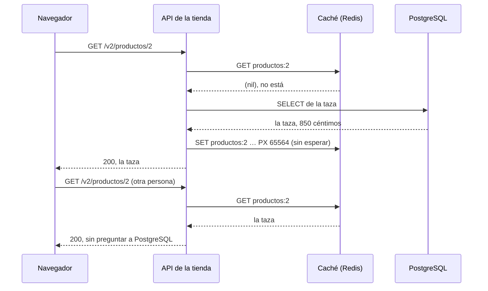

import Term from '~/components/Term.astro';
import TryIt from '~/components/TryIt.astro';
import Analogy from '~/components/Analogy.astro';
import ProjectCode from '~/components/ProjectCode.astro';
import SelfCheck from '~/components/SelfCheck.astro';
import Quiz from '~/components/Quiz.astro';
import QuizQuestion from '~/components/QuizQuestion.astro';
import QuizOption from '~/components/QuizOption.astro';

## El problema

En la [introducción](/fase-9/) mediste la lista de productos: unas 666 peticiones por segundo, con una mediana de 13 ms. Cada una hace la misma consulta a PostgreSQL, que contesta lo mismo cada vez: cuatro productos que cambian unas pocas veces al día.

Imagina que la tienda manda un correo con una oferta y miles de personas abren el catálogo a la vez. PostgreSQL pasa el rato repitiendo la misma respuesta, y los pedidos, que sí necesitan la base de datos, esperan su turno detrás.

**La solución es guardar la respuesta un rato y dársela a todos: una caché.** Lo difícil es saber cuándo tirarla: según una frase famosa de Phil Karlton, en informática solo hay [dos cosas difíciles](https://martinfowler.com/bliki/TwoHardThings.html), invalidar la caché y ponerle nombre a las cosas.

## La analogía

<Analogy>

En un bar, el camarero escribe por la mañana las tapas del día en una pizarra. Quien entra la mira, y nadie tiene que ir a la cocina a preguntar qué hay.

Cuando se acaba la tortilla, alguien tiene que borrarla de la pizarra; si no, la gente la seguirá pidiendo. Y aunque esté escrita, cuando pides, la cocina mira si de verdad queda.

<div slot="limits">

- La pizarra no se borra sola. Lo que guarda la caché, sí: caduca al minuto, aunque nadie lo borre.
- En el bar, quien cambia el menú está junto a la pizarra. En la tienda, los cambios salen de varios sitios del código, y uno puede olvidarse de borrar.

</div>

</Analogy>

## Cómo funciona de verdad

### Cuatro sitios donde se guardan copias

Una <Term id="cache">caché</Term> es una copia guardada para no pedir otra vez lo mismo. Dos ya las conoces de la [Fase 2](/fase-2/cache-http/):

| Dónde | Quién guarda la copia | ¿Puedes borrarla cuando cambia el dato? |
|---|---|---|
| El navegador | Cada visitante, según tu `Cache-Control` | No: solo caduca, o pregunta con el `ETag` |
| Una CDN | Servidores repartidos por el mundo | Con su panel o su API |
| **Tu aplicación** | **Tu API, en un Redis** | **Sí: tu código borra lo que quiera, cuando quiera** |
| La base de datos | PostgreSQL, en su memoria | No hace falta: nunca está vieja, PostgreSQL la mantiene al día |

La de esta lección es la tercera: tu código la borra en el mismo momento en que cambia el dato, algo que en la Fase 2 era [lo difícil](/fase-2/cache-http/#invalidar-es-lo-difícil).

### Cache-aside: primero la caché, si no, PostgreSQL

Así contesta la tienda a dos personas que piden la misma taza, una detrás de otra:



Es el diagrama de la [Fase 5](/fase-5/sql-vs-nosql/#una-caché-delante-de-postgresql), ahora en la tienda. Se llama <Term id="cache-aside">cache-aside</Term> («la caché a un lado»): la base de datos no sabe que existe, y la aplicación mira, lee y guarda. En `src/cache.ts`:

<ProjectCode file="tienda-api/38-cache/src/cache.ts" region="cache-aside" />

- **`leer`**: la función que pregunta a PostgreSQL; solo se llama si la caché no tiene la clave.
- **`preguntar(…)`**: le pide la clave a Redis, con el límite de tiempo que verás más abajo.
- **`JSON.parse` y `JSON.stringify`**: Redis guarda texto, así que el producto va como <Term id="json">JSON</Term>.
- **`valor === undefined`**: un producto que no existe no se guarda.
- **El `SET` va sin `await`**: la respuesta no espera a que Redis la guarde.
- **El `catch` devuelve `leer()`**: si la caché falla, se lee de PostgreSQL. **Más lento, nunca un error.**

### Una clave por cada pregunta distinta

¿Qué se guarda, y con qué nombre? En `src/datos.ts`:

<ProjectCode file="tienda-api/38-cache/src/datos.ts" region="de-cache" />

- **`productos:<id>`**: cada producto, en su clave. La taza es `productos:2`.
- **`productos:lista:` y el filtro en JSON**: cada lista, en la suya. La entera es `productos:lista:{}`; ordenada por precio, `productos:lista:{"orden":"precio"}`. Los campos van siempre en el mismo orden, para que la misma pregunta dé la misma clave.
- **`SEGUNDOS_EN_CACHE = 60`**: un minuto, como mucho, sin preguntar a PostgreSQL.

Cada valor distinto de `?categoria=` es otra clave, también los que no existen: el límite de memoria de la caché impide que eso la llene sin fin.

### Un minuto, más un poco de azar

¿Por qué caduca, si la tienda ya borra lo que cambia? **Porque la caducidad es la red de seguridad:** si algún día un cambio se olvida de borrar, el dato viejo dura como mucho un minuto. Es el TTL (*time to live*, «tiempo de vida») de la clave, el mismo `EXPIRE` de la Fase 5. Pero no es un minuto justo:

<ProjectCode file="tienda-api/38-cache/src/cache.ts" region="ttl" />

`duracion(60)` da entre 60.000 y 66.000 milisegundos, al azar. Cuando una clave caduca, las peticiones de ese instante no la encuentran y van a PostgreSQL a la vez: es una <Term id="cache-stampede">avalancha de caché</Term> (*cache stampede*). Si muchas claves se guardaron a la vez (al arrancar, o al borrar las listas) y duran lo mismo, caducan juntas, y las avalanchas llegan todas a la vez. **Con el azar, cada una caduca en un momento distinto.**

El azar no ayuda con **una sola clave muy pedida**: no hay nada que repartir. Ahí el arreglo es que solo una petición lea: con un candado corto en Redis (`SET productos:2:candado 1 NX PX 2000`, que solo sale bien si no existe, y caduca a los 2 segundos por si quien lo tiene se cae), o, dentro de cada copia de la API, con una sola lectura que esperan todas (*single flight*).

La tienda no lo necesita: cuatro productos y una consulta corta. Con una consulta de segundos, sí.

### Lo que no se guarda: lo de cada uno y lo que debe ser exacto

No todo merece una caché. La tienda deja fuera dos cosas:

- **Lo que es de cada persona**, como tus pedidos. Cada una necesitaría su clave, que casi nadie más leería; y con una clave sin el id de la persona, Carmen vería los pedidos de Marta.
- **Lo que tiene que ser exacto**, como el stock al comprar. La caché puede enseñar «quedan 60» justo después de una compra, pero **comprar nunca mira la caché**:

<ProjectCode file="tienda-api/38-cache/src/datos.ts" region="pedido-olvida" />

La comprobación del stock es el `UPDATE … WHERE stock >= cantidad` de la [Fase 5](/fase-5/transacciones-acid/#arreglo-1-comprobar-y-quitar-en-la-misma-orden), dentro de una <Term id="transaction">transacción</Term>: la hace PostgreSQL con el número de verdad. **Un número viejo en la caché se puede ver un momento, pero no se puede vender.** Un test del paso lo comprueba: con un stock de 1000 en la caché y 2 de verdad, comprar 5 da `409`.

### Invalidar: borrar justo después de cambiar

En la [Fase 5](/fase-5/sql-vs-nosql/#una-caché-delante-de-postgresql) te prometimos esto: si Ana cambia un precio, la API borra la clave. Es la <Term id="cache-invalidation">invalidación de caché</Term>, y en la tienda es una función:

<ProjectCode file="tienda-api/38-cache/src/datos.ts" region="olvidar-productos" />

Borra el producto y **todas las listas**, que lo llevan dentro. La llaman los cinco sitios que cambian un producto: crearlo, cambiarlo, borrarlo y, **los fáciles de olvidar, hacer un pedido y cancelarlo**, que cambian su stock. Cambiarlo es una ruta nueva, `PATCH /v2/productos/{id}`: solo admin, para el nombre, el precio o los dos.

<ProjectCode file="tienda-api/38-cache/src/datos.ts" region="actualizar-producto" />

**Fíjate en el orden: primero el `UPDATE`, después `olvidarProductos`.** Si se borrara antes, otra petición podría colarse entre medias, leer de PostgreSQL el precio viejo y guardarlo otra vez, para un minuto.

Aun así queda una <Term id="race-condition">condición de carrera</Term> pequeña: una lectura que empezó antes del cambio puede guardar el precio viejo justo después del borrado. Por eso todo caduca: **lo viejo dura, como mucho, su TTL.**

Y así borra la caché:

<ProjectCode file="tienda-api/38-cache/src/cache.ts" region="olvidar" />

`productos:lista:*` es un patrón: todas las listas. Redis no sabe borrar por patrón, así que `SCAN` recorre las claves de cien en cien y `DEL` borra las que encajan.

### Dos Redis, con trabajos opuestos

La tienda ya tenía un Redis, el de los límites de intentos y, desde la [lección 1](/fase-9/colas-trabajos-segundo-plano/), la cola. **La caché va en otro**, porque necesita justo lo contrario:

| | `redis`: los límites y la cola | `cache`: el catálogo |
|---|---|---|
| Si pierde sus datos… | Se pierden avisos y correos | Se vuelve a llenar sola desde PostgreSQL |
| En disco | Todo (`--appendonly yes`), en un volumen | Nada |
| Límite de memoria | Ninguno: crece hasta lo que tenga la máquina | 64 MB |
| Para hacer sitio | Nunca borra nada (`noeviction`) | Borra lo que hace más tiempo que nadie lee (`allkeys-lru`) |

Borrar datos para hacer sitio se llama <Term id="eviction">expulsión</Term> (*eviction*): a la cola le haría perder trabajos sin avisar; a la caché le viene bien. LRU viene de *least recently used*, «la usada hace más tiempo». En `compose.yaml`:

<ProjectCode file="tienda-api/38-cache/compose.yaml" region="cache" />

La API la encuentra en `CACHE_URL` (`redis://cache:6379`), y la cola sigue en `REDIS_URL`.

### Si la caché falla, la tienda sigue

Una caché puede fallar de dos maneras:

- **Caída:** el Redis se para y la conexión se corta. El cliente lo sabe al momento.
- **Colgada:** la conexión sigue abierta, pero no llega ninguna respuesta. Un Redis congelado, o una red que pierde paquetes. El cliente manda la orden y espera.

La primera la resuelve la configuración del cliente:

<ProjectCode file="tienda-api/38-cache/src/cache.ts" region="cliente" />

- **`disableOfflineQueue: true`**: sin conexión, la orden falla al momento. El cliente de los límites guarda las órdenes hasta que Redis vuelve, y la petición esperaría con ellas. A los límites se les espera; a una caché, no.
- **`connectTimeout: 1000`**: un segundo para conectarse; después, otro intento.

La segunda tiene una historia. node-redis, la biblioteca de Redis, tiene un `timeout` por orden, y la primera versión de este paso confiaba en él. **Al revisarla descubrimos que solo cuenta mientras la orden espera para salir, no después de mandarla:** una prueba con un Redis falso que nunca contesta se quedó esperando hasta que la cortó su propio límite de 8 segundos.

La lección: **un límite de tiempo tiene que medir lo que espera tu petición**. El arreglo, en la región `caida` del mismo fichero:

- **`aTiempo(orden)`**: una carrera entre la orden y un reloj de 200 ms. Redis contesta en menos de un milisegundo; si tarda 200, algo va mal.
- **`preguntar(orden)`**, la que usan `deCache` y `olvidar`: al primer fallo marca la caché como caída, y **mientras lo esté, ni le pregunta**.
- **Mientras está caída, cada petición puede mandarle un `PING`** (una orden que solo pide «aquí estoy»), uno por segundo como mucho, para ver si ha vuelto. Así no se amontonan órdenes sin respuesta.

### Al volver, borra todo el catálogo

Mientras estaba caída, la tienda pudo cambiar un precio sin poder borrarlo de ella, y un Redis congelado conserva lo que tenía:

<ProjectCode file="tienda-api/38-cache/src/cache.ts" region="al-volver" />

**La caché no sabe qué se perdió, así que borra todo lo de productos** (`productos:*`) antes de usarse otra vez. Si no lo consigue en 200 ms, sigue caída y lo intenta con el próximo `PING`. Pasa también la primera vez que la API se conecta. `FLUSHDB` lo borraría todo, también lo que no fuera del catálogo.

## Pruébalo

El objetivo: ver qué guarda la caché, cambiar el precio de la taza y comprobar que nadie ve el viejo, y luego tirar la caché sin que la tienda deje de contestar.

Las salidas son de Docker en Colima (4 CPU y 2 GiB) en un Apple M1 Pro, del 21 y el 22 de octubre de 2026. Las capturamos con otro nombre de proyecto de Compose, cambiado por el de la lección, y con `curl` dentro de un contenedor; las respuestas son las mismas. Tus tiempos, ids y fechas serán otros.

### Prepara el paso

Para la tienda del paso 37 (`-v` borra sus datos de práctica) y pon tu proyecto en el 38, como en la [introducción](/fase-9/#cada-lección-su-paso):

```sh
cd ~/curso-backend/fase-3/tienda-api
docker compose down -v
cd ..
curl -O https://backenddesdecero.com/practicas/tienda-api/38-cache.tar.gz
tar -xzf 38-cache.tar.gz
cp -R 38-cache/. tienda-api/
cd tienda-api
```

Lo nuevo: `src/cache.ts`, su uso en `src/datos.ts`, la ruta `PATCH`, `CACHE_URL` en `config.ts` y el servicio `cache` en los dos Compose. No hay paquetes nuevos. Arráncala:

<TryIt
  title="1. Seis contenedores"
  cmd={`docker compose up --build --wait
docker compose ps --format "table {{.Name}}\\t{{.Service}}\\t{{.Status}}"`}
  output={`…
NAME                  SERVICE      STATUS
tienda-api-1          api          Up 10 seconds (healthy)
tienda-cache-1        cache        Up 14 seconds (healthy)
tienda-db-1           db           Up 14 seconds (healthy)
tienda-mailpit-1      mailpit      Up 14 seconds (healthy)
tienda-redis-1        redis        Up 14 seconds (healthy)
tienda-trabajador-1   trabajador   Up 10 seconds (healthy)`}
>

`tienda-cache-1` es el Redis nuevo. Si tu API está en el `3001` (`docker compose port api 3000` lo dice), usa ese puerto en el resto de la práctica.

</TryIt>

### ¿Qué guarda la caché?

<TryIt
  title="2. La taza, dos veces"
  cmd={`curl -s -w '\\n' localhost:3000/v2/productos/2
docker compose exec cache redis-cli keys '*'
curl -s -w '\\n' localhost:3000/v2/productos/2
docker compose exec cache redis-cli keys '*'
docker compose exec cache redis-cli pttl productos:2`}
  output={`{"id":2,"nombre":"Taza","precioCentimos":850,"stock":60,"categorias":["Hogar","Regalos"]}
(empty array)
{"id":2,"nombre":"Taza","precioCentimos":850,"stock":60,"categorias":["Hogar","Regalos"]}
1) "productos:2"
(integer) 65564`}
>

Tras la primera, **la caché está vacía**: la API abre la conexión la primera vez que la necesita, y esa lectura va a PostgreSQL. Tras la segunda, ahí está `productos:2`, y `pttl` dice los milisegundos que le quedan: `65564`, por el azar. `keys '*'` lista todas las claves: vale en una caché pequeña, pero con millones bloquearía Redis un rato.

</TryIt>

### Ana cambia el precio de la taza

Ana es una de las cuentas de práctica, admin, con su contraseña en el README del proyecto. Pide antes la taza y la lista entera, para que haya dos claves:

<TryIt
  title="3. El cambio, y la caché vacía"
  cmd={`curl -s -o /dev/null localhost:3000/v2/productos/2
curl -s -o /dev/null localhost:3000/v2/productos
docker compose exec cache redis-cli keys '*'
curl -s -w '\\n' -c ana.txt --json '{"email":"ana@tienda.example","contrasena":"ana-practica-2026"}' localhost:3000/v2/sesion
curl -s -w '\\n' -b ana.txt -X PATCH --json '{"precioCentimos":900}' localhost:3000/v2/productos/2
docker compose exec cache redis-cli keys '*'`}
  output={`1) "productos:lista:{}"
2) "productos:2"
{"id":1,"email":"ana@tienda.example","rol":"admin"}
{"id":2,"nombre":"Taza","precioCentimos":900,"stock":60,"categorias":["Hogar","Regalos"]}
(empty array)`}
>

El `PATCH` contesta con la taza a `900`, y después, **`(empty array)`**: ha borrado las dos claves. Si da `401`, repite la línea de `ana.txt`; con `403`, la cuenta no es admin.

</TryIt>

<TryIt
  title="4. La siguiente lectura ya da el nuevo"
  cmd={`curl -s -w '\\n' localhost:3000/v2/productos/2
docker compose exec cache redis-cli keys '*'`}
  output={`{"id":2,"nombre":"Taza","precioCentimos":900,"stock":60,"categorias":["Hogar","Regalos"]}
1) "productos:2"`}
>

**`900`, y la clave vuelve** con el precio nuevo.

</TryIt>

<SelfCheck question="Reto: Carmen (carmen@ejemplo.com, contraseña carmen-practica-2026) compra una taza. Antes de que lo haga, ¿qué esperas ver en la caché después de su pedido, y qué stock dará la taza?">

Las claves desaparecen (un pedido cambia el stock) y la taza da uno menos. Lo nuestro, con las dos claves ya en la caché:

```sh
$ curl -s -w '\n' -c carmen.txt --json '{"email":"carmen@ejemplo.com","contrasena":"carmen-practica-2026"}' localhost:3000/v2/sesion
{"id":3,"email":"carmen@ejemplo.com","rol":"cliente"}
$ curl -s -w '\n' -b carmen.txt --json '{"productoId":2,"cantidad":1}' localhost:3000/v2/pedidos
{"id":26,"productoId":2,"cantidad":1,"estado":"pendiente","creadoEn":"2026-10-22T13:47:30.707Z","clienteId":3}
$ docker compose exec cache redis-cli keys '*'
(empty array)
$ curl -s -w '\n' localhost:3000/v2/productos/2
{"id":2,"nombre":"Taza","precioCentimos":900,"stock":59,"categorias":["Hogar","Regalos"]}
```

</SelfCheck>

### Con caché y sin ella

La <Term id="load-test">prueba de carga</Term> de la introducción, ahora con la caché. Esta salida es del 21 de octubre, y hemos quitado las líneas de aviso de npm:

<TryIt
  title="5. La prueba de carga, con caché"
  cmd="docker run --rm --network tienda_default node:26 npx -y autocannon@8.0.0 -d 10 http://api:3000/v2/productos"
  output={`Running 10s test @ http://api:3000/v2/productos
10 connections


┌─────────┬──────┬──────┬───────┬──────┬─────────┬─────────┬───────┐
│ Stat    │ 2.5% │ 50%  │ 97.5% │ 99%  │ Avg     │ Stdev   │ Max   │
├─────────┼──────┼──────┼───────┼──────┼─────────┼─────────┼───────┤
│ Latency │ 0 ms │ 0 ms │ 1 ms  │ 2 ms │ 0.15 ms │ 0.54 ms │ 18 ms │
└─────────┴──────┴──────┴───────┴──────┴─────────┴─────────┴───────┘
┌───────────┬─────────┬─────────┬─────────┬─────────┬──────────┬──────────┬─────────┐
│ Stat      │ 1%      │ 2.5%    │ 50%     │ 97.5%   │ Avg      │ Stdev    │ Min     │
├───────────┼─────────┼─────────┼─────────┼─────────┼──────────┼──────────┼─────────┤
│ Req/Sec   │ 10,255  │ 10,255  │ 12,927  │ 14,119  │ 12,878.4 │ 1,073.47 │ 10,254  │
├───────────┼─────────┼─────────┼─────────┼─────────┼──────────┼──────────┼─────────┤
│ Bytes/Sec │ 9.81 MB │ 9.81 MB │ 12.4 MB │ 13.5 MB │ 12.3 MB  │ 1.03 MB  │ 9.81 MB │
└───────────┴─────────┴─────────┴─────────┴─────────┴──────────┴──────────┴─────────┘

Req/Bytes counts sampled once per second.
# of samples: 10

129k requests in 9.91s, 123 MB read`}
>

Compara **`Req/Sec`, columna `Avg`**, con la tuya de la introducción: nosotros pasamos de 665,8 a 12.878,4 peticiones por segundo, **unas 19 veces más**, y el <Term id="percentile">percentil</Term> 99 bajó de 46 ms a 2 (el `0 ms` es un redondeo de 0,15). La prueba solo lee, así que nada borra la caché mientras dura. Ten en cuenta que `autocannon` y la API comparten las mismas 4 CPU de la máquina virtual de Docker, así que los números son honestos, pero no son los de un servidor que solo atiende a la API.

</TryIt>

Ahora para la caché, como si se cayera:

<TryIt
  title="6. Sin caché, la tienda sigue"
  cmd={`docker compose stop cache
for i in 1 2 3; do curl -s -o /dev/null -w '%{http_code} %{time_total}\\n' localhost:3000/v2/productos; done
docker compose logs api --since 1m | grep caché`}
  output={`…
200 0.026285
200 0.007229
200 0.006816
api-1  | {"level":40,"time":1792676783068,"pid":1,"hostname":"072dfc6b9d45","motivo":"Socket closed unexpectedly","msg":"la caché no contesta: se lee de la base de datos"}`}
>

**Tres `200`** (`-w` escribe el código y el tiempo, en segundos), y **una sola línea en el log**, de nivel `40` (aviso).

</TryIt>

<TryIt
  title="7. La prueba de carga, con la caché parada"
  cmd="docker run --rm --network tienda_default node:26 npx -y autocannon@8.0.0 -d 10 http://api:3000/v2/productos"
  output={`…
┌─────────┬──────┬───────┬───────┬───────┬──────────┬─────────┬────────┐
│ Stat    │ 2.5% │ 50%   │ 97.5% │ 99%   │ Avg      │ Stdev   │ Max    │
├─────────┼──────┼───────┼───────┼───────┼──────────┼─────────┼────────┤
│ Latency │ 6 ms │ 12 ms │ 33 ms │ 45 ms │ 14.23 ms │ 8.82 ms │ 174 ms │
└─────────┴──────┴───────┴───────┴───────┴──────────┴─────────┴────────┘
┌───────────┬────────┬────────┬────────┬────────┬────────┬─────────┬────────┐
│ Stat      │ 1%     │ 2.5%   │ 50%    │ 97.5%  │ Avg    │ Stdev   │ Min    │
├───────────┼────────┼────────┼────────┼────────┼────────┼─────────┼────────┤
│ Req/Sec   │ 495    │ 495    │ 689    │ 827    │ 678.3  │ 86.4    │ 495    │
…
7k requests in 10.03s, 6.49 MB read`}
>

**678,3 por segundo, como sin caché**, y sin errores: la API ni le pregunta a una caché caída. Hemos recortado el principio y la fila de bytes.

</TryIt>

<TryIt
  title="8. La caché vuelve"
  cmd={`docker compose start cache
docker compose logs api --since 2m | grep caché`}
  output={`…
api-1  | {"level":40,"time":1792676783068,"pid":1,"hostname":"072dfc6b9d45","motivo":"Socket closed unexpectedly","msg":"la caché no contesta: se lee de la base de datos"}
api-1  | {"level":30,"time":1792676822614,"pid":1,"hostname":"072dfc6b9d45","msg":"la caché contesta otra vez"}`}
>

El cliente se reconecta solo, borra el catálogo (aquí ya venía vacía: no guarda nada en disco) y avisa: **`la caché contesta otra vez`**. Si no sale aún, espera unos segundos.

</TryIt>

### Una caché colgada

`docker compose pause` congela el contenedor: la conexión sigue abierta, pero Redis no contesta. Es el caso difícil:

<TryIt
  title="9. Congela la caché"
  cmd={`docker compose pause cache
for i in 1 2 3; do curl -s -o /dev/null -w '%{http_code} %{time_total}\\n' localhost:3000/v2/productos; done
docker compose logs api --since 1m | grep caché`}
  output={`…
200 0.225388
200 0.007018
200 0.006750
…
api-1  | {"level":40,"time":1792676833862,"pid":1,"hostname":"072dfc6b9d45","motivo":"no contesta en 200 ms","msg":"la caché no contesta: se lee de la base de datos"}`}
>

**La primera petición tarda 0,225 segundos**: los 200 ms del reloj, y la lectura de PostgreSQL. **Las siguientes, 7 ms**: la caché ya está marcada como caída. Sin el reloj, esperarían a Redis sin límite. Las líneas recortadas del log son las de los pasos 6 y 8.

</TryIt>

<TryIt
  title="10. Descongélala"
  cmd={`docker compose unpause cache
for i in 1 2 3; do curl -s -o /dev/null -w '%{http_code} %{time_total}\\n' localhost:3000/v2/productos; done
docker compose logs api --since 1m | grep caché`}
  output={`…
200 0.006874
200 0.006278
200 0.001535
…
api-1  | {"level":40,"time":1792676833862,"pid":1,"hostname":"072dfc6b9d45","motivo":"no contesta en 200 ms","msg":"la caché no contesta: se lee de la base de datos"}
api-1  | {"level":30,"time":1792676837338,"pid":1,"hostname":"072dfc6b9d45","msg":"la caché contesta otra vez"}`}
>

Descongelada, nadie se entera hasta que llega una petición: la API aún no le pregunta, pero de paso le manda un `PING`. Redis contesta, la API borra `productos:*`, por si guardaba algo viejo, y vuelve a usarla: la tercera petición ya sale de la caché. Sin peticiones, la última línea no sale.

</TryIt>

Cuando acabes, borra las sesiones, que no van a Git: `rm ana.txt carmen.txt` (`carmen.txt` solo existe si creaste el reto).

### En tu servidor

Como en la lección 1, primero los ficheros que el servidor lee de su disco, desde `~/curso-backend/fase-3`, con tu usuario y tu IP:

```sh
rsync -av 38-cache/compose.produccion.yaml ubuntu@192.168.5.15:/opt/tienda/
rsync -av 38-cache/despliegue/ ubuntu@192.168.5.15:/opt/tienda/despliegue/
```

Después, el código: ya está en tu proyecto, así que commit y `git push` desde `tienda-api`. **No hay que añadir nada al `.env` del servidor:** `compose.produccion.yaml` le da a la API `CACHE_URL=redis://cache:6379`, y `desplegar.sh` arranca el servicio `cache` junto a `db` y `redis`. Suma a la memoria del servidor hasta 64 MB de datos, más el propio Redis.

## Ya lo has visto

- **«Quedan 3», y al pagar, agotado.** La ficha de la tienda venía de una caché; el pago miró la base de datos, como el `409` de la tienda.
- **Un contador de «me gusta» que tarda en subir.** Lo que ves puede ir unos segundos por detrás de la verdad. En la [lección 6](/fase-9/teorema-cap/#consistencia-eventual-las-copias-acaban-de-acuerdo) verás que tiene nombre: consistencia eventual.
- **El Redis de la [Fase 5](/fase-5/sql-vs-nosql/).** El `SET` y el `EXPIRE` que escribiste a mano son lo que hace ahora `deCache`, en una sola orden (`SET … PX`).

## Errores comunes

- **Borrar antes de cambiar la base de datos**, en vez de después del `COMMIT`.
- **Olvidar un sitio que cambia el dato,** como los pedidos, que cambian el stock.
- **Decidir con lo que dice la caché:** vender o dar permisos con un dato que puede ser viejo.
- **Guardar lo de cada persona con una clave sin su id.**
- **Esperar a la caché sin límite:** una caché colgada cuelga la API entera.
- **La cola y la caché en el mismo Redis:** la cola puede perder trabajos para hacer sitio.

## Resumen

- Una caché guarda un rato lo que se pide mucho y cambia poco. Con cache-aside, la API mira primero la caché y, si no está, lee de PostgreSQL y la guarda.
- En la tienda, el catálogo: en nuestra prueba, unas 19 veces más peticiones por segundo, y un p99 de 2 ms.
- Cada cambio de un producto, también de su stock, borra el producto y las listas, después del `COMMIT`. El TTL, de 60 a 66 segundos, es la red de seguridad.
- Lo que debe ser exacto no sale de la caché: comprar comprueba el stock en PostgreSQL.
- La caché es otro Redis, que puede perderlo todo. Si cae o se cuelga, la API espera como mucho 200 ms, lee de PostgreSQL y, al volver, borra el catálogo.

## ¿Lo has entendido?

<Quiz>

<QuizQuestion
  question="Ana cambia el nombre de la sudadera con un UPDATE que alguien añadió a un script de la tienda. El script termina bien, pero el catálogo enseña el nombre viejo durante casi un minuto. ¿Qué falta?"
  review="Invalidar: borrar justo después de cambiar"
>

<QuizOption text="Bajar el TTL a un segundo, para que el nombre viejo apenas se vea.">

Esconde el fallo y deja la caché casi sin uso. El problema es que ese cambio no borra nada.

</QuizOption>

<QuizOption text="Que el script borre ese producto y las listas de la caché, tras su UPDATE." correct>

Cada sitio que cambia un producto tiene que borrarlo de la caché. Si no, el nombre viejo dura hasta que la clave caduca: de 60 a 66 segundos.

</QuizOption>

<QuizOption text="Activar la persistencia en disco de la caché, para que guarde el cambio del script.">

La persistencia solo decide si la caché sobrevive a un reinicio. Lo que falta es borrar el nombre viejo.

</QuizOption>

</QuizQuestion>

<QuizQuestion
  question="Un compañero propone borrar la clave de la caché antes del UPDATE, «para que nadie lea el precio viejo mientras cambia». ¿Qué le contestas?"
  review="Invalidar: borrar justo después de cambiar"
>

<QuizOption text="Que, entre los dos, otra petición puede guardar otra vez el precio viejo." correct>

Sin la clave, la siguiente lectura va a PostgreSQL, que aún tiene el precio viejo, y lo deja en la caché. Después del `COMMIT`, ya encuentra el nuevo.

</QuizOption>

<QuizOption text="Que da igual el orden: el TTL lo arregla todo en un minuto, sin hacer nada más.">

El TTL limita el daño, pero un minuto de precio viejo es justo lo que la invalidación evita.

</QuizOption>

<QuizOption text="Que tiene razón: borrar primero es la forma segura de invalidar.">

Borrar primero abre un hueco: una lectura entre el borrado y el cambio guarda el dato viejo otra vez.

</QuizOption>

</QuizQuestion>

<QuizQuestion
  question="El Redis de la caché se queda congelado: la conexión sigue abierta, pero no contesta. ¿Qué notan los visitantes de la tienda?"
  review="Si la caché falla, la tienda sigue"
>

<QuizOption text="Que cada petición del catálogo se queda esperando hasta que Redis vuelva.">

Eso pasaba con la primera versión del paso. Con el reloj propio, nadie espera más de 200 ms.

</QuizOption>

<QuizOption text="Que la API contesta 503 a todas las peticiones del catálogo hasta que la caché vuelve.">

La caché no es imprescindible: si falla, la API lee de PostgreSQL y contesta `200`.

</QuizOption>

<QuizOption text="Casi nada: las de ese momento esperan 200 ms; las siguientes van a PostgreSQL." correct>

`aTiempo` corta la espera a los 200 ms, y la caché queda marcada como caída: las que llegan después ni le preguntan. En nuestra prueba, 0,225 segundos la primera y unos 7 ms las siguientes.

</QuizOption>

</QuizQuestion>

<QuizQuestion
  question="Para ahorrarse un contenedor, alguien propone guardar la caché en el Redis de la cola, con un límite de 64 MB y allkeys-lru. ¿Qué puede pasar?"
  review="Dos Redis, con trabajos opuestos"
>

<QuizOption text="Nada: allkeys-lru solo borra las claves que tienen caducidad, y los trabajos no la tienen.">

Esa es otra política, `volatile-lru`. `allkeys-lru` puede borrar cualquier clave, también un trabajo de la cola.

</QuizOption>

<QuizOption text="Que, con la memoria llena, Redis borre trabajos y se pierdan correos sin avisar." correct>

La política de expulsión es de todo el Redis, no de cada clave. Por eso la cola pide `noeviction`, y la caché va en otro.

</QuizOption>

<QuizOption text="Que la caché vaya más lenta, y eso es lo único que se pierde.">

El problema no es la velocidad: es que la cola podría perder trabajos para hacer sitio a la caché.

</QuizOption>

</QuizQuestion>

<QuizQuestion
  question="La caché dice que quedan 3 tazas, pero en PostgreSQL ya no queda ninguna. Marta pide una. ¿Qué pasa?"
  review="Lo que no se guarda: lo de cada uno y lo que debe ser exacto"
>

<QuizOption text="Se vende: la API comprueba el stock en la caché, que dice 3.">

Comprar nunca mira la caché. La comprobación la hace PostgreSQL, con el número de verdad.

</QuizOption>

<QuizOption text="Se vende, y el stock en PostgreSQL queda en -1 hasta que caduque la clave de la caché.">

El `UPDATE` solo quita stock si queda bastante (`WHERE stock >= cantidad`), así que nunca baja de cero.

</QuizOption>

<QuizOption text="La API contesta 409: PostgreSQL comprueba el stock dentro de la transacción." correct>

El `UPDATE … WHERE stock >= cantidad` no encuentra ninguna fila con stock suficiente, así que no cambia nada y la API contesta `409`. Lo que diga la caché no cuenta.

</QuizOption>

</QuizQuestion>

<QuizQuestion
  question="La ficha de un producto en oferta es la clave más pedida de la tienda. Cada minuto, al caducar, cientos de peticiones van a la vez a PostgreSQL. ¿Qué lo arregla?"
  review="Un minuto, más un poco de azar"
>

<QuizOption text="Un candado corto en Redis: solo la primera va a PostgreSQL, y las demás esperan." correct>

Con el candado, solo una petición va a PostgreSQL, y las demás encuentran la clave al volver a mirar.

</QuizOption>

<QuizOption text="El azar en la caducidad, que ya reparte en el tiempo las peticiones que van a PostgreSQL.">

El azar reparte muchas claves guardadas a la vez. Con una sola, no hay nada que repartir.

</QuizOption>

<QuizOption text="Quitarle la caducidad a esa clave, para que no caduque nunca.">

Cada pedido la sigue borrando, y la avalancha llega igual. Y si un cambio se olvida de borrarla, el dato viejo se queda para siempre.

</QuizOption>

</QuizQuestion>

</Quiz>

## Para profundizar

- [Key eviction](https://redis.io/docs/latest/develop/reference/eviction/), de la documentación de Redis, en inglés: `maxmemory` y cada política, de `noeviction` a `allkeys-lru`.
- [SCAN](https://redis.io/docs/latest/commands/scan/) y [SET](https://redis.io/docs/latest/commands/set/), en inglés: recorrer claves sin bloquear Redis, y las opciones `PX` y `NX` del candado.
- [Caching Best Practices](https://aws.amazon.com/caching/best-practices/), de AWS, en inglés: cache-aside, TTL y las avalanchas.
- [Scaling Memcache at Facebook](https://www.usenix.org/conference/nsdi13/technical-sessions/presentation/nishtala), en inglés: cómo Facebook evita las avalanchas y los datos viejos en una de las cachés más grandes del mundo.
- [TwoHardThings](https://martinfowler.com/bliki/TwoHardThings.html), de Martin Fowler, en inglés: la frase de Phil Karlton y sus variantes.
