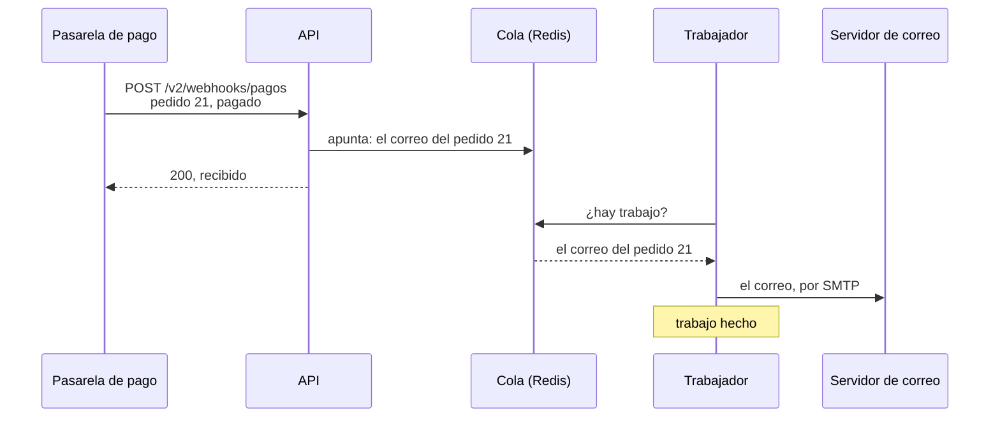
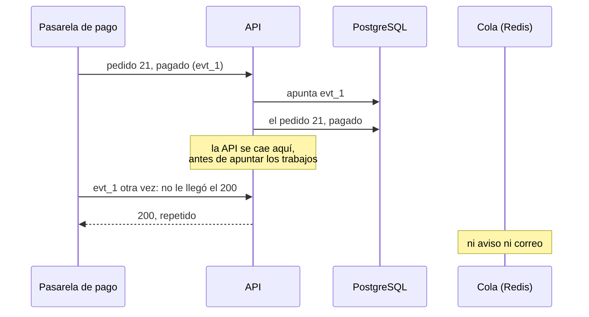

import Term from '~/components/Term.astro';
import TryIt from '~/components/TryIt.astro';
import Analogy from '~/components/Analogy.astro';
import ProjectCode from '~/components/ProjectCode.astro';
import Quiz from '~/components/Quiz.astro';
import QuizQuestion from '~/components/QuizQuestion.astro';
import QuizOption from '~/components/QuizOption.astro';

## El problema

Carmen paga su pedido. La pasarela de pago avisa a la tienda con el <Term id="webhook">webhook</Term> de la [Fase 4](/fase-4/webhooks-idempotencia/), y a la tienda le quedan dos cosas: avisar a Reparto Rápido, que lleva el paquete, y mandarle a Carmen un correo de confirmación.

Hasta ahora, el aviso salía con `void avisarDePago(pagado)`: la tienda lo empezaba y contestaba sin esperarlo. Si Reparto Rápido no contestaba, quedaba un `aviso no entregado` en el log, como viste en la [Fase 6](/fase-6/csrf-ssrf/#un-aviso-de-verdad-en-tu-ordenador), y nadie lo volvía a intentar. Si la API se reiniciaba a medias, el aviso desaparecía.

Esperarlo dentro de la petición tampoco vale: un servidor de correo lento haría esperar a la pasarela. **La salida es apuntar el trabajo en una lista y que otro programa lo haga, y lo reintente si falla.** Te lo prometimos en la [Fase 0](/fase-0/que-es-el-backend/), dejar para luego lo que puede esperar, y en la [Fase 4](/fase-4/webhooks-idempotencia/#responder-rápido-y-dejar-el-trabajo-para-después): «un correo o una factura irían a una cola».

## La analogía

<Analogy>

Piensa en un restaurante. El camarero apunta tu pedido en una comanda, la cuelga en la barra de la cocina y vuelve a atenderte: no se queda mirando cómo se hace la paella.

El cocinero coge las comandas en orden. Si sale un momento, se acumulan en la barra; cuando vuelve, salen. Camarero, API; comanda, trabajo; barra, cola; cocinero, trabajador.

<div slot="limits">

- Una comanda se cocina una vez. Un trabajo de una cola puede hacerse dos, y hay que estar preparado.
- La cola reintenta sola lo que falla, cada vez esperando más, y se rinde tras unos intentos.
- Las comandas de papel siguen ahí si se va la luz. Las de Redis, solo si las guarda en disco.

</div>

</Analogy>

## Cómo funciona de verdad

### Una cola, quien apunta y quien hace

Así se paga ahora:



- **La <Term id="message-queue">cola</Term>:** una lista de tareas pendientes, fuera de la API. Aquí vive en Redis.
- **Quien apunta**, la API: deja un <Term id="background-job">trabajo</Term> con lo necesario para hacerlo (el pedido, en JSON) y sigue.
- **Quien hace**, el <Term id="worker">trabajador</Term> (*worker*): otro proceso, que coge trabajos de la cola y los hace.

La pasarela recibe su `200` en cuanto el trabajo está apuntado, y la cola lo guarda aunque no haya trabajador. Es la última fila de la tabla de la [Fase 3](/fase-3/event-loop-node/#cómo-no-bloquear-el-servidor).

### BullMQ: la cola, en el Redis que ya tenías

La tienda tiene Redis desde la [Fase 7](/fase-7/docker-compose/#dos-copias-de-la-api-una-sola-cuenta-en-redis). **BullMQ** es una biblioteca de Node que guarda una cola en Redis. El paso la instala con versión exacta (`bullmq@6.3.15`), junto a `nodemailer@10.1.1`, que manda los correos. En `src/cola.ts`:

<ProjectCode file="tienda-api/37-cola/src/cola.ts" region="encolar" />

- **`new Queue(NOMBRE_COLA, …)`**: la cola `tienda`, con su propia conexión a Redis.
- **`.add(trabajo.tipo, trabajo)`**: apunta el trabajo con su tipo (`aviso-de-pago` o `correo-de-confirmacion`) y sus datos. El `await` espera a que Redis lo guarde, no a que se haga.
- **Sin `REDIS_URL`**, sin Docker, se hace en el mismo proceso, sin reintentos: lo de antes.

### La ruta de pago apunta y contesta

La ruta del webhook, en `src/v2.ts`:

<ProjectCode file="tienda-api/37-cola/src/v2.ts" region="recibir-pago" />

Donde el paso 36 tenía `void avisarDePago(pagado)`, ahora se apuntan trabajos:

- **Un aviso por cada URL guardada**: si una empresa falla y otra no, solo se reintenta el suyo.
- **`idEvento`**: un id para este pago, el mismo en todos los avisos y en cada reintento.
- **El correo**, otro trabajo.

`avisarDePago` es ahora `avisarUno`, en `src/avisos.ts`, la función del trabajo. **Si el aviso no llega, o la empresa no contesta con un `2xx`, lanza un error**, y así la cola sabe que ha fallado.

### El trabajador: el mismo código, otro proceso

El trabajador es `scripts/trabajador.ts`, con el mismo código y la misma imagen que la API. En `compose.yaml`:

<ProjectCode file="tienda-api/37-cola/compose.yaml" region="trabajador" />

La imagen de la API con otra orden (`command`) y la misma configuración, porque usa PostgreSQL, Redis y el servidor de correo. Sin puertos ni healthcheck: no atiende peticiones.

Dentro, un `Worker` de BullMQ coge trabajos de la cola, **hasta cinco a la vez**: un aviso lento no retrasa un correo. Escribe `trabajo hecho` o `trabajo fallido` en el log. Un código y dos procesos: la [lección 5](/fase-9/monolito-vs-microservicios/#la-tienda-dos-procesos-un-solo-código) vuelve sobre ello.

### Reintentos con espera exponencial

Lo que pasa cuando un trabajo falla, en `src/cola.ts`:

<ProjectCode file="tienda-api/37-cola/src/cola.ts" region="reintentos" />

- **`attempts: 5`**: cinco intentos en total.
- **`backoff`**: entre uno y otro, una <Term id="exponential-backoff">espera exponencial</Term>, que empieza en 1 segundo y se duplica.
- **`removeOnComplete` y `removeOnFail`**: Redis guarda los últimos 1.000 trabajos hechos y los últimos 1.000 fallidos, para mirar qué pasó.

Con una empresa que contestaba siempre `500`, en «Pruébalo» (horas de Docker en UTC, la hora universal: dos horas menos que en España hasta el cambio de hora de finales de octubre):

| Intento | Hora | Espera desde el anterior |
|---|---|---|
| 1 | 13:30:38.56 | — |
| 2 | 13:30:39.61 | 1,05 s |
| 3 | 13:30:41.69 | 2,08 s |
| 4 | 13:30:45.80 | 4,11 s |
| 5 | 13:30:53.88 | 8,08 s |

Esperar cada vez más da tiempo a un receptor caído un momento, sin ahogar a uno caído del todo. **Cinco intentos en unos 15 segundos valen para practicar;** una tienda de verdad espera horas, y los servicios de pago reintentan durante días.

### Al menos una vez: un trabajo puede hacerse dos veces

Imagina que el `200` de Reparto Rápido se pierde: para la tienda, el aviso ha fallado, y lo reintenta. O que el trabajador se apaga de golpe tras mandar un correo y antes de apuntarlo como hecho: BullMQ lo devuelve a la cola.

Por eso las colas prometen <Term id="at-least-once-delivery">entrega al menos una vez</Term>: ningún trabajo que la cola haya guardado se pierde, pero alguno se hace dos veces. **Lo que hace el trabajador tiene que aguantar repetirse:** la idempotencia de la [Fase 4](/fase-4/webhooks-idempotencia/#los-avisos-se-repiten-procesa-cada-evento-una-vez), del otro lado.

- **El aviso lleva `X-Id-Evento`**, el mismo en cada reintento. Reparto Rápido debe ignorar los ids que ya ha procesado, como hace la tienda con la pasarela.
- **El correo no lleva id:** si se repite, Carmen recibe dos. Es una molestia; lo que no puede pasar dos veces, como un cobro, necesita un id.

### El correo: Mailpit y esperas cortas

El trabajo del correo, en `src/correo.ts`, busca el email del cliente y se lo manda con Nodemailer, que habla SMTP, el protocolo de los correos, con el servidor de `SMTP_URL`. En tu ordenador es **Mailpit**: recibe los correos, no los manda a nadie y los enseña en una bandeja web.

<ProjectCode file="tienda-api/37-cola/compose.yaml" region="mailpit" />

**Las esperas son cortas a propósito.** Nodemailer, por defecto, espera hasta 2 minutos para conectar y 10 sin noticias del servidor. Con un servidor de correo atascado, `docker stop` mataría al trabajador a los 10 segundos con el correo a medias, y la cola lo repetiría. La tienda espera **5 segundos como mucho** en cada paso, como en un aviso: falla pronto, y la cola reintenta.

Al recibir `SIGTERM`, el trabajador termina lo que tiene a medias y sale, como la API desde la [Fase 7](/fase-7/dockerfile/#apagarse-bien-el-pid-1-y-las-señales).

### Redis ya no puede olvidar: disco y noeviction

Hasta la Fase 8, Redis no guardaba nada en disco: perder los intentos del límite no importaba. **Perder la cola, sí:** serían avisos y correos que no salen nunca.

<ProjectCode file="tienda-api/37-cola/compose.yaml" region="redis" />

- **`--appendonly yes`**: Redis apunta cada cambio en un fichero, en el <Term id="volume">volumen</Term> `redis`, y lo relee al arrancar. Lo pasa al disco cada segundo: un apagón puede costar el último segundo de cambios.
- **`--maxmemory-policy noeviction`**: Redis nunca borra claves para hacer sitio. Si llega a un límite de memoria, da un error: el trabajo falla a la vista en vez de desaparecer. Es el valor por defecto, pero va escrito: BullMQ avisa si no lo es.

Una caché quiere lo contrario: tendrá su propio Redis en la [lección 2](/fase-9/cache-redis/#dos-redis-con-trabajos-opuestos).

### El hueco que queda: dos escrituras

Pagar escribe en dos sitios: el pedido, en PostgreSQL; los trabajos, en Redis. Si la API se cae entre una escritura y otra:



La tienda ya conoce `evt_1` y no repite nada: **el pedido está pagado, pero nadie avisa a Reparto Rápido ni a Carmen.** Si Redis no contesta, `await encolar` se queda esperando y la pasarela se cansa: su reintento recibe `repetido`. Los trabajos salen cuando Redis vuelve, si la API sigue viva; si se reinicia antes, se pierden.

Lo dejamos abierto a propósito: la [lección 7](/fase-9/arquitectura-orientada-a-eventos/#el-outbox-el-aviso-en-la-misma-transacción) lo cierra apuntando los trabajos en la misma <Term id="transaction">transacción</Term> que el pedido ([Fase 5](/fase-5/transacciones-acid/)).

### Otras colas: RabbitMQ, Kafka, SQS y PostgreSQL

BullMQ encaja porque la tienda ya tiene Redis. Hay más:

| Herramienta | Qué es | Cuándo encaja |
|---|---|---|
| **RabbitMQ** | Un servidor de mensajes aparte, con su protocolo (AMQP) | Programas en varios lenguajes que se pasan mensajes |
| **Kafka** | Un registro de eventos que se guardan días, en orden: varios lectores leen lo mismo y pueden volver atrás | Muchísimos eventos, leídos por muchos |
| **Amazon SQS** | Una cola de AWS, sin servidor que mantener; pagas por mensaje | Si ya vives en AWS |
| **PostgreSQL** (pg-boss, en Node) | La cola es una tabla de tu base de datos | Poco volumen, sin Redis, y el trabajo en la misma transacción que el pedido |

Con todas, lo normal es entregar al menos una vez.

## Pruébalo

El objetivo: ver llegar el correo de un pedido pagado, ver la cola reintentar un aviso que falla y comprobar que, sin trabajador, los trabajos esperan sin perderse.

Las salidas son del 22 de octubre de 2026, en un Mac (Apple M1 Pro) con Docker 29 en Colima, una máquina virtual de 4 procesadores y 2 GiB. Tus ids, horas y secretos serán otros.

### Prepara el paso

Pon tu proyecto en el paso 37, como en la [introducción](/fase-9/#cada-lección-su-paso):

```sh
cd ~/curso-backend/fase-3
curl -O https://backenddesdecero.com/practicas/tienda-api/37-cola.tar.gz
tar -xzf 37-cola.tar.gz
cp -R 37-cola/. tienda-api/
cd tienda-api
```

Tu `.env` sigue siendo el de la [Fase 7](/fase-7/docker-compose/#arranca-la-tienda), con tus secretos. Añade una línea, o cámbiala si ya la tienes, para que la tienda avise a la empresa de práctica: `AVISOS_HOSTS_DESARROLLO=repartidor`.

Después, borra los datos de práctica, para que el pedido 21 vuelva a estar pendiente, y arranca la tienda:

```sh
docker compose down -v
docker compose up --build --wait
```

`--wait` vuelve cuando todo está sano, con dos servicios nuevos: `trabajador` y `mailpit`.

### Un pago, un correo

El pedido 21 está pendiente en los datos de ejemplo. Págalo con la pasarela de mentira de la [Fase 4](/fase-4/webhooks-idempotencia/), en un contenedor de Node 26:

<TryIt
  title="1. La pasarela paga el pedido 21"
  cmd={`docker run --rm --network tienda_default --env-file .env -e TIENDA_URL=http://api:3000 -v "$PWD":/p -w /p node:26 node scripts/pasarela.ts 21`}
  output={`→ POST /v2/webhooks/pagos {"id":"evt_ff48366e-5038-4a42-9b1b-bc0b81a890f7","tipo":"pago.completado","pedidoId":21}
← 200 {"recibido":"evt_ff48366e-5038-4a42-9b1b-bc0b81a890f7","repetido":false}`}
>

El contenedor entra en la red de la tienda, firma con el `WEBHOOK_SECRET` de tu `.env` y monta tu proyecto (`-v`, [Fase 7](/fase-7/volumenes-docker/)). `200` y `"repetido":false`: la tienda ha contestado sin esperar al correo. Si sale `firma-no-valida`, cambiaste `.env` después del `up`: `docker compose up -d` la recrea.

</TryIt>

Después, pregúntale a Mailpit, con `jq` ([Fase 3](/fase-3/errores-y-logs-node/)):

<TryIt
  title="2. El correo, en Mailpit"
  cmd={`curl -s http://127.0.0.1:8025/api/v1/messages | jq ".messages[0] | {Subject, To: .To[0].Address}"`}
  output={`{
  "Subject": "Tu pedido 21 está pagado",
  "To": "carmen@ejemplo.com"
}`}
>

El asunto y el destinatario del primer correo: Carmen, la clienta del pedido 21. En el navegador, `http://127.0.0.1:8025` es la misma bandeja. Si salen `null`, mira el log del trabajador.

</TryIt>

<TryIt
  title="3. Lo que hizo el trabajador"
  cmd="docker compose logs trabajador --no-log-prefix"
  output={`{"level":30,"time":1792675662504,"pid":1,"hostname":"b458b743f1d6","msg":"El trabajador espera trabajos de la cola"}
{"level":30,"time":1792675684185,"pid":1,"hostname":"b458b743f1d6","id":"1","tipo":"correo-de-confirmacion","msg":"trabajo hecho"}`}
>

El trabajador arranca, y el trabajo `1`, un `correo-de-confirmacion`, queda `hecho`. Con `trabajo fallido`, mira su `motivo`; sin esa línea, espera y repite.

</TryIt>

### Un aviso que falla cinco veces

Ahora, una empresa de reparto que contesta siempre `500`: un contenedor de Node, `repartidor`, que escribe cada petición que recibe.

```sh
docker run -d --rm --name repartidor --network tienda_default --network-alias repartidor node:26 node --eval "require('node:http').createServer((pet, res) => { console.log(pet.method, pet.url); res.writeHead(500).end(); }).listen(8080)"
```

La tienda solo avisa a direcciones de internet por `https`, por el <Term id="ssrf">SSRF</Term> de la [Fase 6](/fase-6/csrf-ssrf/#ssrf-el-servidor-visita-la-url-que-le-dan); `AVISOS_HOSTS_DESARROLLO` es la excepción de práctica. Reparto Rápido necesita su [clave de API](/fase-6/que-es-jwt/#las-claves-de-api-cómo-se-identifica-un-programa), y el script que la crea no va en la imagen: cópialo dentro y ejecútalo.

```sh
docker compose cp scripts/crear-clave.ts api:/app/scripts/
docker compose exec api node scripts/crear-clave.ts "Reparto Rápido"
```

Enseña la clave una vez, empezando por `tienda_`. Guárdala: `CLAVE=tienda_…`, con la tuya entera.

<TryIt
  title="4. La URL de Reparto Rápido"
  cmd={`curl -s -X PUT http://127.0.0.1:3000/v2/reparto/aviso -H "Authorization: Bearer $CLAVE" -H "Content-Type: application/json" -d '{"url":"http://repartidor:8080/aviso"}'`}
  output={`{"url":"http://repartidor:8080/aviso","secreto":"…"}`}
>

La tienda guarda la URL y devuelve el secreto de las firmas (tapado, `…`). Si tu API está en el 3001 (`docker compose port api 3000`), cambia el puerto. Con `401`, revisa `$CLAVE`.

</TryIt>

<TryIt
  title="5. Paga el pedido 22"
  cmd={`docker run --rm --network tienda_default --env-file .env -e TIENDA_URL=http://api:3000 -v "$PWD":/p -w /p node:26 node scripts/pasarela.ts 22`}
  output={`→ POST /v2/webhooks/pagos {"id":"evt_2db8e607-735f-4945-a84e-29f810a1ed84","tipo":"pago.completado","pedidoId":22}
← 200 {"recibido":"evt_2db8e607-735f-4945-a84e-29f810a1ed84","repetido":false}`}
>

`200` al momento, aunque el aviso va a fallar.

</TryIt>

Espera unos 20 segundos, lo que duran los intentos. `--timestamps` añade la hora de Docker, en UTC:

<TryIt
  title="6. Cinco intentos"
  cmd="docker compose logs --timestamps --no-log-prefix trabajador"
  output={`…
2026-10-22T13:30:38.563935380Z {"level":40,"time":1792675838563,"pid":1,"hostname":"b458b743f1d6","id":"2","tipo":"aviso-de-pago","intento":1,"de":5,"motivo":"aviso no entregado: la empresa responde 500","msg":"trabajo fallido: se reintentará"}
2026-10-22T13:30:38.568004091Z {"level":30,"time":1792675838567,"pid":1,"hostname":"b458b743f1d6","id":"3","tipo":"correo-de-confirmacion","msg":"trabajo hecho"}
2026-10-22T13:30:39.610500425Z {"level":40,"time":1792675839609,"pid":1,"hostname":"b458b743f1d6","id":"2","tipo":"aviso-de-pago","intento":2,"de":5,"motivo":"aviso no entregado: la empresa responde 500","msg":"trabajo fallido: se reintentará"}
2026-10-22T13:30:41.693723400Z {"level":40,"time":1792675841693,"pid":1,"hostname":"b458b743f1d6","id":"2","tipo":"aviso-de-pago","intento":3,"de":5,"motivo":"aviso no entregado: la empresa responde 500","msg":"trabajo fallido: se reintentará"}
2026-10-22T13:30:45.799695244Z {"level":40,"time":1792675845798,"pid":1,"hostname":"b458b743f1d6","id":"2","tipo":"aviso-de-pago","intento":4,"de":5,"motivo":"aviso no entregado: la empresa responde 500","msg":"trabajo fallido: se reintentará"}
2026-10-22T13:30:53.879817275Z {"level":40,"time":1792675853879,"pid":1,"hostname":"b458b743f1d6","id":"2","tipo":"aviso-de-pago","intento":5,"de":5,"motivo":"aviso no entregado: la empresa responde 500","msg":"trabajo fallido: sin más intentos"}`}
>

Hemos quitado las dos líneas del paso 3 (`…`). Fíjate en:

- **El trabajo `2`**, el aviso: `intento` 1 a 5, con 1, 2, 4 y 8 segundos entre las horas, y `sin más intentos` en el último.
- **El trabajo `3`**, el correo del mismo pago: `hecho` 4 milisegundos tras el primer fallo, sin esperar al aviso.

`docker logs repartidor` enseña cinco líneas `POST /aviso`: llegaron los cinco intentos. Si ves menos, espera: el último sale unos 15 segundos tras el primero.

</TryIt>

Quita el repartidor y su URL, para que el pago siguiente solo apunte el correo:

```sh
docker rm -f repartidor
docker compose exec db psql -U tienda -c "delete from avisos"
```

### Sin trabajador, los trabajos esperan

<TryIt
  title="7. Sin trabajador, un pago"
  cmd={`docker compose stop trabajador
docker run --rm --network tienda_default --env-file .env -e TIENDA_URL=http://api:3000 -v "$PWD":/p -w /p node:26 node scripts/pasarela.ts 23`}
  output={` Container tienda-trabajador-1 Stopping 
 Container tienda-trabajador-1 Stopped 
→ POST /v2/webhooks/pagos {"id":"evt_b7e320a8-8560-44f5-b38c-653e12bb44d7","tipo":"pago.completado","pedidoId":23}
← 200 {"recibido":"evt_b7e320a8-8560-44f5-b38c-653e12bb44d7","repetido":false}`}
>

**La pasarela recibe su `200` igual:** para apuntar, la API no necesita al trabajador.

</TryIt>

<TryIt
  title="8. En Mailpit, nada nuevo"
  cmd={`curl -s http://127.0.0.1:8025/api/v1/messages | jq "{total, subjects: [.messages[].Subject]}"`}
  output={`{
  "total": 2,
  "subjects": [
    "Tu pedido 22 está pagado",
    "Tu pedido 21 está pagado"
  ]
}`}
>

Los correos del 21 y el 22. Del 23, ninguno.

</TryIt>

<TryIt
  title="9. El trabajo, esperando en Redis"
  cmd={`docker compose exec redis redis-cli LRANGE bull:tienda:wait 0 -1
docker compose exec redis redis-cli HMGET bull:tienda:4 name data`}
  output={`4
correo-de-confirmacion
{"tipo":"correo-de-confirmacion","pedido":{"id":23,"productoId":3,"cantidad":4,"estado":"pagado","creadoEn":"2026-10-07T19:00:00.000Z","clienteId":3}}`}
>

- **`bull:tienda:wait`**, la lista de espera de la cola `tienda`: un trabajo, el `4`.
- **`bull:tienda:4`**, ese trabajo: su nombre y sus datos, el pedido 23 en JSON. Si el tuyo tiene otro número, cámbialo en el `HMGET`.

</TryIt>

<TryIt
  title="10. El trabajador vuelve"
  cmd={`docker compose start trabajador
docker compose exec redis redis-cli LLEN bull:tienda:wait
curl -s http://127.0.0.1:8025/api/v1/messages | jq "{total, subjects: [.messages[].Subject]}"`}
  output={`…
 Container tienda-trabajador-1 Starting 
 Container tienda-trabajador-1 Started 
0
{
  "total": 3,
  "subjects": [
    "Tu pedido 23 está pagado",
    "Tu pedido 22 está pagado",
    "Tu pedido 21 está pagado"
  ]
}`}
>

Compose arranca el trabajador (hemos recortado líneas, `…`). La lista de espera, `LLEN`, queda en `0`, y el correo del 23 está en Mailpit.

</TryIt>

<TryIt
  title="11. Cuándo salió"
  cmd="docker compose logs --timestamps --no-log-prefix trabajador | tail -n 3"
  output={`2026-10-22T13:31:32.935430234Z {"level":30,"time":1792675892933,"pid":1,"hostname":"b458b743f1d6","msg":"SIGTERM: el trabajador acaba lo que tiene a medias y se apaga"}
2026-10-22T13:31:43.137030307Z {"level":30,"time":1792675903136,"pid":1,"hostname":"b458b743f1d6","msg":"El trabajador espera trabajos de la cola"}
2026-10-22T13:31:43.200618130Z {"level":30,"time":1792675903200,"pid":1,"hostname":"b458b743f1d6","id":"4","tipo":"correo-de-confirmacion","msg":"trabajo hecho"}`}
>

El `SIGTERM` es tu `stop`. Al volver, el trabajador espera y, **63 milisegundos después**, el trabajo 4 está hecho. Nada se perdió. Si no sale, mira `docker compose ps trabajador`.

</TryIt>

Al terminar, `docker compose down` lo para todo; con `-v`, borra también los datos y la cola.

### En tu servidor

Con la tienda en tu servidor de la [Fase 8](/fase-8/ci-cd-github-actions/), **primero copia los ficheros que el servidor lee de su disco**, que no van en la imagen. Desde `~/curso-backend/fase-3`, con tu usuario y tu IP. En Windows, desde PowerShell como en la Fase 8, con el paso descargado allí (`curl.exe -O` y `tar -xzf`), y `scp` en lugar de `rsync -av`:

```sh
rsync -av 37-cola/compose.produccion.yaml ubuntu@192.168.5.15:/opt/tienda/
rsync -av 37-cola/despliegue/ ubuntu@192.168.5.15:/opt/tienda/despliegue/
```

En el servidor, `chmod +x /opt/tienda/despliegue/*.sh`, como en la [Fase 8](/fase-8/ci-cd-github-actions/#el-servidor-sigue-tu-imagen). Después, **el código**: ya está en tu proyecto, así que haz commit y `git push` desde `tienda-api` (tu `.env` no se sube: lo deja fuera el `.gitignore`). Con la imagen nueva, `desplegar.sh` pone al día los otros servicios:

<ProjectCode file="tienda-api/37-cola/despliegue/desplegar.sh" region="otros-servicios" />

Redis se recrea con disco (olvida los intentos del límite, sin más), y la API y el trabajador arrancan con la imagen nueva; la vuelta atrás cubre a los dos. **Pero el script solo mira la salud de la API:** un trabajador que se cae al arrancar, una y otra vez, no lo hace volver atrás. Míralo con `docker compose -f compose.produccion.yaml ps trabajador`.

**El correo es opcional.** Sin `SMTP_URL`, el trabajo deja en el log `sin SMTP_URL: el correo de confirmación no se manda` y termina. Para mandarlos de verdad:

1. Contrata un proveedor de correo: te da un servidor SMTP, un usuario y una contraseña.
2. Añade en el DNS de tu dominio los registros TXT que te pida ([Fase 0](/fase-0/que-es-dns/#los-tipos-de-registro)), casi siempre SPF, que dice qué servidores mandan correo de tu dominio, y DKIM, que firma cada correo. Sin ellos, acaban en spam.
3. Pon tus datos en el `.env` del servidor:

<ProjectCode file="tienda-api/37-cola/.env.produccion.ejemplo" region="correo" />

4. Recrea el trabajador: `docker compose -f compose.produccion.yaml up -d --no-build --no-deps trabajador`.

## Ya lo has visto

- **El correo de «pedido confirmado»** que llega unos segundos después de pagar: lo manda un trabajador.
- **Un vídeo que «se está procesando»** tras subirlo: se convierte en segundo plano.

## Errores comunes

- **Hacer el trabajo lento dentro de la petición.** Quien llama espera, y si se cansa, reintenta. Un `void` sin cola, si falla, se pierde.
- **Trabajos que no aguantan repetirse.** Lo que no puede pasar dos veces necesita un id, como `X-Id-Evento`.
- **La cola en un Redis que olvida.** Sin disco, un reinicio se lleva los trabajos; si borra claves para hacer sitio, desaparecen sin un error.
- **Reintentar sin esperar, o sin límite.** Ahoga al receptor caído, y un trabajo imposible se repite para siempre.
- **Esperas largas dentro del trabajo.** `docker stop` mata al trabajador a medias, y el trabajo se repite.

## Resumen

- Lo que una petición no tiene por qué esperar va a una cola: la API lo apunta y contesta, y el trabajador lo hace después.
- BullMQ guarda la cola en Redis; el trabajador es el código de la API con otra orden.
- Un trabajo que falla se reintenta con espera exponencial: cinco intentos, con 1, 2, 4 y 8 segundos entre ellos.
- Las colas entregan al menos una vez: cada trabajo tiene que aguantar repetirse.
- El Redis de la cola guarda en disco y no borra claves. Queda un hueco: el pedido y sus trabajos se escriben en dos pasos.

## ¿Lo has entendido?

<Quiz>

<QuizQuestion
  question="Al pagar un pedido, la tienda también tiene que generar la factura en PDF, que tarda unos 3 segundos. ¿Dónde la haces?"
  review="Una cola, quien apunta y quien hace"
>

<QuizOption text="En la ruta del webhook, antes de contestar, para que la factura esté lista cuando llega el 200.">

La pasarela esperaría 3 segundos por algo que no necesita, y si se cansa, reintenta.

</QuizOption>

<QuizOption text="En la misma API, con void y sin esperarla, para contestar enseguida.">

Si la factura falla o la API se reinicia a medias, se pierde y nadie la reintenta.

</QuizOption>

<QuizOption text="Como un trabajo más de la cola, que hace el trabajador." correct>

La API la apunta, contesta enseguida y el trabajador la genera después. Si falla, la cola la reintenta.

</QuizOption>

</QuizQuestion>

<QuizQuestion
  question="Reparto Rápido se cae justo cuando Carmen paga, y vuelve un minuto después. Con las opciones de la tienda, ¿le llega el aviso?"
  review="Reintentos con espera exponencial"
>

<QuizOption text="No: los intentos se acaban en unos 15 segundos, y el trabajo queda fallido." correct>

`attempts: 5`, con esperas de 1, 2, 4 y 8 segundos: el último intento llega mucho antes del minuto. El trabajo se guarda como fallido, para mirarlo.

</QuizOption>

<QuizOption text="Sí: la cola reintenta hasta que el receptor conteste bien, tarde lo que tarde.">

Sin límite, un trabajo que nunca saldrá bien se repetiría para siempre. BullMQ se rinde tras `attempts`.

</QuizOption>

<QuizOption text="Sí: la espera entre intentos crece sin parar, y pronto pasa del minuto.">

La espera se duplica, pero solo hay cinco intentos: entre el cuarto y el quinto, 8 segundos.

</QuizOption>

</QuizQuestion>

<QuizQuestion
  question="Reparto Rápido recibe dos veces el aviso del pedido 22, con el mismo X-Id-Evento. ¿Qué ha pasado y qué debe hacer?"
  review="Al menos una vez: un trabajo puede hacerse dos veces"
>

<QuizOption text="La tienda tiene un error: una cola bien hecha entrega cada trabajo exactamente una vez.">

Si se pierde una respuesta, la tienda no sabe si el aviso llegó: por eso las colas prometen «al menos una vez».

</QuizOption>

<QuizOption text="El primero llegó, pero la tienda no lo supo y lo repitió: debe ignorar el segundo." correct>

`X-Id-Evento` es el mismo en cada reintento justo para esto: quien recibe reconoce el repetido y contesta `200` sin hacer nada.

</QuizOption>

<QuizOption text="Son dos pagos distintos del mismo pedido, y debe preparar un envío por cada uno.">

Cada pago tiene un solo `idEvento`, el mismo en todos sus reintentos. Mismo id, mismo aviso.

</QuizOption>

</QuizQuestion>

<QuizQuestion
  question="Para ahorrar un contenedor, un compañero propone guardar la cola en un Redis con allkeys-lru y sin disco, como una caché. ¿Qué le contestas?"
  review="Redis ya no puede olvidar: disco y noeviction"
>

<QuizOption text="Que vale: los trabajos duran segundos en Redis, así que la configuración da igual.">

Un trabajo puede esperar mucho: con el trabajador parado, toda la noche.

</QuizOption>

<QuizOption text="Que vale si le da poca memoria, para que no ocupe sitio.">

Con poca memoria es peor: llega antes al límite y empieza a borrar claves, trabajos incluidos.

</QuizOption>

<QuizOption text="Que no: al llenarse borraría trabajos, y un reinicio se los llevaría todos." correct>

`allkeys-lru` borra claves para hacer sitio, y sin disco Redis arranca vacío. Una cola necesita `noeviction` y `appendonly`.

</QuizOption>

</QuizQuestion>

<QuizQuestion
  question="Paras el trabajador diez minutos para mirar algo y, mientras, se pagan tres pedidos. ¿Qué pasa con sus correos?"
  review="Sin trabajador, los trabajos esperan"
>

<QuizOption text="Esperan en Redis y salen en cuanto el trabajador vuelve." correct>

La API los apunta igual. Al volver, el trabajador coge lo que hay en la lista de espera.

</QuizOption>

<QuizOption text="La pasarela recibe un error y vuelve a avisar cuando el trabajador esté.">

La ruta de pago no necesita al trabajador: solo apunta en Redis, y contesta `200`.

</QuizOption>

<QuizOption text="Se pierden: sin trabajador, nadie los recoge de la memoria de la API.">

La API no los guarda en su memoria: los deja en Redis, que los conserva hasta que alguien los coge.

</QuizOption>

</QuizQuestion>

<QuizQuestion
  question="La API se cae justo después de pasar un pedido a pagado y antes de apuntar sus trabajos. La pasarela reintenta. ¿Recibe Carmen el correo?"
  review="El hueco que queda: dos escrituras"
>

<QuizOption text="Sí: con el reintento de la pasarela, la tienda apunta entonces los trabajos.">

La tienda ya había apuntado el evento: el reintento le parece repetido, contesta `200` y no hace nada más.

</QuizOption>

<QuizOption text="No: el reintento le parece repetido, y nadie apunta los trabajos." correct>

PostgreSQL ya dice «pagado» y Redis nunca recibió nada: el hueco que cierra la lección 7.

</QuizOption>

<QuizOption text="Sí: Redis guarda en disco y recupera los trabajos que la API iba a apuntar.">

El disco de Redis guarda lo que llegó a Redis. Estos trabajos nunca llegaron.

</QuizOption>

</QuizQuestion>

</Quiz>

## Para profundizar

- [Documentación de BullMQ](https://docs.bullmq.io/), en inglés: colas, trabajadores y opciones de los trabajos.
- [Retrying failing jobs](https://docs.bullmq.io/guide/retrying-failing-jobs), en inglés: `attempts` y los tipos de `backoff`.
- [Redis persistence](https://redis.io/docs/latest/operate/oss_and_stack/management/persistence/), en inglés: cómo guarda Redis en disco y qué puede perder.
- [Mailpit](https://mailpit.axllent.org/), en inglés: el servidor de correo de práctica y su API.
- [RabbitMQ Tutorials](https://www.rabbitmq.com/tutorials), en inglés: las mismas ideas, con un servidor de mensajes aparte.
