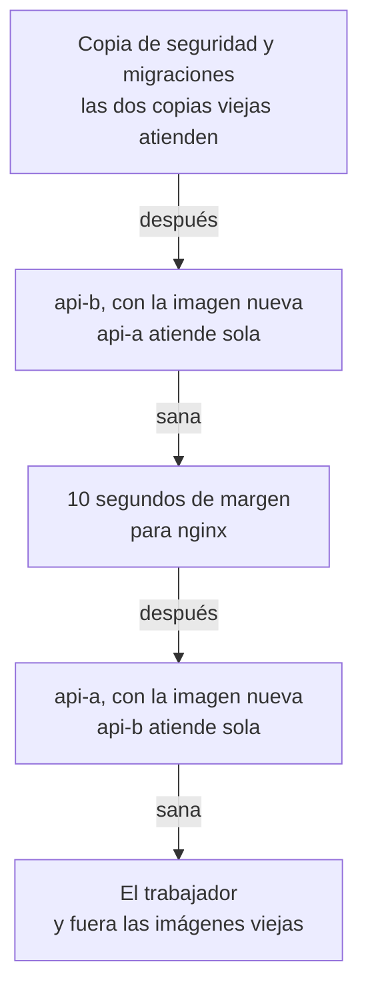
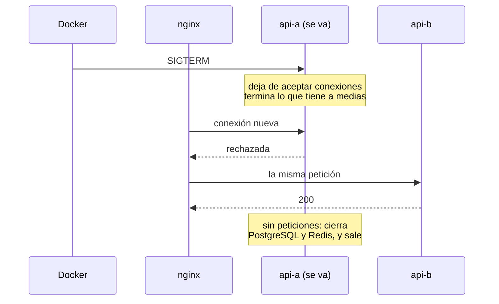

import Term from '~/components/Term.astro';
import TryIt from '~/components/TryIt.astro';
import Analogy from '~/components/Analogy.astro';
import ProjectCode from '~/components/ProjectCode.astro';
import Quiz from '~/components/Quiz.astro';
import QuizQuestion from '~/components/QuizQuestion.astro';
import QuizOption from '~/components/QuizOption.astro';

## El problema

Ana sube un cambio pequeño, el título de la tienda, y el temporizador de la [Fase 8](/fase-8/ci-cd-github-actions/) lo despliega solo. Mientras cambia la API, **todo el que entra recibe `502`**.

Lo medimos otra vez, con el script de la Fase 8, mientras un bucle pedía productos e iniciaba sesiones sin parar: **unos 13 segundos de `502`**, diez de ellos sin una sola respuesta buena. Imagina que Marta estaba pagando justo entonces: con un `502`, no sabe si se ha cobrado.

En la Fase 8 te prometimos desplegar sin cortes, con dos copias que se relevan. Es esta lección.

## La analogía

<Analogy>

Piensa en un supermercado con dos cajas. A la cajera de la caja 2 le toca el relevo: pone el cartel de «caja cerrada», los clientes nuevos van a la caja 1, y ella atiende hasta el último de su cola. Solo entonces deja el sitio a su compañera. Después, la caja 1 hace lo mismo. El súper nunca se queda sin cajas abiertas.

<div slot="limits">

- Un cliente puede llegar justo cuando cuelga el cartel, y en un servidor esa conexión se corta: es la carrera rara del final.
- nginx no mira ningún cartel: se entera cuando una copia le rechaza la conexión.
- En el relevo atienden la versión vieja y la nueva, con una sola base de datos.

</div>

</Analogy>

## Cómo funciona de verdad

### Trece segundos de 502, medidos otra vez

Un trozo de esa medida, con el paso 39: cuántas peticiones salieron cada segundo con cada código (recortado, `…`).

```
11:44:23: GET_200x6 POST_200x31
11:44:24: GET_200x1 GET_502x3 POST_200x7 POST_502x34
11:44:25: GET_502x6 POST_502x59
…
11:44:37: GET_200x6 GET_502x1 POST_200x51 POST_502x3
11:44:38: GET_200x7 POST_200x49
```

Son las dos ventanas de la [Fase 8](/fase-8/ci-cd-github-actions/#unos-segundos-sin-tienda): el contenedor que se cambia y los 10 segundos en que nginx aparta una copia que le falló. Con tráfico continuo, alguna petición siempre tropieza con la copia nueva antes de que Node escuche.

Con una copia, nginx no tiene a quién pasar nada. Para un <Term id="zero-downtime-deployment">despliegue sin caída</Term>, siempre tiene que haber una atendiendo.

### Dos copias fijas: api-a y api-b

Desde el paso 40, producción corre dos copias de la API:

<ProjectCode file="tienda-api/40-sin-cortes/compose.produccion.yaml" region="copias" />

- **`<<: *api`**: copia aquí lo que comparten las dos, escrito una vez más arriba con el nombre `&api` (un ancla de YAML).
- **`3000` y `3001`**: los dos puertos que el `upstream` de nginx ya tenía desde la [Fase 8](/fase-8/nginx-proxy-inverso/#el-sitio-de-la-tienda-nginxtiendaconf). **nginx no cambia.**

Son dos servicios con nombre, no el `--scale` de la [lección 3](/fase-9/escalado-horizontal/): con un puerto fijo cada una, el script sabe qué copia cambia.

### Una copia cada vez

`desplegar.sh` hace lo de la Fase 8, pero cambia las copias de una en una:



Es un **despliegue progresivo** (*rolling deployment*):

<ProjectCode file="tienda-api/40-sin-cortes/despliegue/desplegar.sh" region="copias" />

- **`cambiar`**: `docker compose up -d` de un solo servicio con la imagen nueva. Docker manda la <Term id="signal">señal</Term> `SIGTERM` al contenedor viejo ([Fase 7](/fase-7/dockerfile/#apagarse-bien-el-pid-1-y-las-señales)), espera a que salga y arranca el nuevo.
- **`|| volver`**: si no se pone sano, vuelve a la imagen anterior.
- **`api_vieja`**: la copia única de los pasos 37 a 39, solo la primera vez.

**`api-b` va primero por esa primera vez.** La copia única estaba en el 3000 o en el 3001: Compose le daba el primer puerto libre, y en cada despliegue saltaba de uno a otro (lo vimos ir del 3000 al 3001 y volver).

La primera copia nueva ocupa el puerto libre y, cuando está sana, la vieja le deja el suyo a la segunda. Si la vieja está en el 3001, el script empieza por `api-a`.

El trabajador va el último: los trabajos que lleguen mientras tanto esperan en la cola. Un despliegue dura unos 40 segundos.

### Diez segundos de margen para nginx

Entre una copia y otra, espera:

<ProjectCode file="tienda-api/40-sin-cortes/despliegue/desplegar.sh" region="pausa" />

Mientras se cambiaba `api-b`, sus conexiones fallaron, y nginx la apartó 10 segundos [desde el último fallo](/fase-8/nginx-proxy-inverso/#dos-copias-y-nginx-que-se-entera-solo). El primer <Term id="healthcheck">healthcheck</Term> de Docker llega a los 10 segundos de arrancar: `api-b` puede estar sana y nginx, apartándola todavía. Si `api-a` se parase entonces, nginx no tendría a nadie: **`502`, incluso a un GET.**

En nuestra medida, de 13:01:28 a 13:01:49: unos 10 segundos hasta estar sana y 10 de margen.

### Apagarse sin cortar a nadie

La copia que se va recibe `SIGTERM`. Hasta el paso 39, el apagado iba a medias: un flujo de eventos abierto retenía la copia hasta que salía a los 5 segundos, cortándolo. Ahora hace un <Term id="graceful-shutdown">apagado ordenado</Term>:

<ProjectCode file="tienda-api/40-sin-cortes/src/apagado.ts" region="apagar" />

1. **`controlador.abort()`** avisa: los flujos de eventos de los pedidos y los WebSocket, que no terminan nunca, se cierran ya, y `/salud` contesta `503`. Sus clientes vuelven a conectar, y llegan a la otra copia.
2. **`servidor.close(…)`** deja de aceptar conexiones: el siguiente intento de nginx es rechazado, y nginx lo pasa a la otra copia.
3. Las conexiones *keep-alive*, que HTTP/1.1 deja abiertas para la siguiente petición, no se cierran solas: lo que llegue por ellas sale con **`Connection: close`**, y cada 100 ms se cierran las libres.
4. **Espera a las peticiones a medias**, como mucho 8 segundos: Docker espera 10 (`stop_grace_period`) antes de mandar `SIGKILL`.
5. **Al final, lo que esas peticiones usan**, uno detrás de otro: PostgreSQL, la cola, los avisos de los pedidos, la caché y los límites (`src/servidor.ts`).



### Lo que nginx repite y lo que no

Cuando una copia falla, nginx [prueba la otra](/fase-8/nginx-proxy-inverso/#cuando-la-api-falla-502-y-504). No siempre:

| Lo que le pasa a nginx | En su `error.log` | ¿La repite en la otra copia? |
|---|---|---|
| La conexión es rechazada | `connect() failed (111: Connection refused)` | Sí, **también un POST**: no llegó a salir |
| Se acepta y se corta después de mandar la petición | `recv() failed (104: Connection reset by peer)` o `upstream prematurely closed connection` | Un GET, sí. Un POST, no: `502` |

Un POST que ya salió pudo hacerse, y repetirlo podría cobrar dos veces: no es <Term id="idempotent">idempotente</Term>.

Un log que añadimos a nginx (`$upstream_addr`, `$upstream_status`) lo enseña. Un inicio de sesión durante el cambio de `api-b`:

```
13:01:28.285000000 POST /v2/sesion 200 upstream=127.0.0.1:3001, 127.0.0.1:3000 ustatus=502, 200 urt=0.003, 0.140 rt=0.143
```

**Dos copias probadas**: el 3001 rechazó la conexión (nginx lo apunta como `502`) y el 3000 contestó `200`. La hora lleva ceros de más: son milisegundos.

### El proxy de Docker acepta y corta

En la primera medida del paso 40, los GET salieron todos bien, pero **5 de 6.679 POST recibieron `502`**, uno o dos por cada copia cambiada. Una sola copia probada:

```
11:53:08.241000000 POST /v2/sesion 502 upstream=127.0.0.1:3001 ustatus=502 urt=0.000 rt=0.001
```

En el `error.log`, `recv() failed (104: Connection reset by peer)`: la conexión **se aceptó y se cortó**. Para [publicar un puerto](/fase-7/redes-docker/), Docker arranca por defecto un programa pequeño, **docker-proxy**, que escucha en `127.0.0.1:3001` y pasa cada conexión al contenedor. Mientras la copia vieja termina lo suyo, su contenedor sigue vivo y docker-proxy sigue aceptando: no encuentra a nadie escuchando dentro, y corta.

Se apaga con `{"userland-proxy": false}` en la configuración de Docker. Entonces es el núcleo de Linux quien lleva las conexiones al contenedor, y un puerto sin nadie escuchando las rechaza. **Sin él, 0 de 1.091 GET y 0 de 6.130 POST fallaron.** La API sigue viendo a nginx llegar desde `172.18.0.1`, y los puertos de `127.0.0.1` siguen cerrados desde fuera.

Mientras siga encendido, `desplegar.sh` te avisa:

<ProjectCode file="tienda-api/40-sin-cortes/despliegue/desplegar.sh" region="docker-proxy" />

### Casi cero: la carrera que queda

Sin docker-proxy, en unas 30 paradas de copias medidas, **un POST recibió `502` una vez**. Lo más probable: una conexión que llegó justo cuando la API dejaba de escuchar.

Por eso decimos **casi cero**. Cerrar ese hueco pide **sacar la copia del <Term id="load-balancer">balanceador</Term> antes de pararla**:

- en nginx, marcarla `down` en el `upstream` y recargar, con `sudo` en cada despliegue;
- en NGINX Plus, la versión de pago, con su API;
- en Kubernetes, un sistema que reparte contenedores entre servidores: deja de mandarle tráfico y espera antes de pararla.

El otro lado es el cliente: una app que reintenta un POST con su <Term id="idempotency-key">clave de idempotencia</Term> de la [Fase 4](/fase-4/webhooks-idempotencia/#idempotency-key-un-post-que-se-puede-repetir) no cobra dos veces.

### Viva y lista: liveness y readiness

`/salud` contesta `503` mientras la copia se apaga, aunque la base de datos responda:

<ProjectCode file="tienda-api/40-sin-cortes/src/app.ts" region="salud" />

Son dos preguntas que solemos mezclar:

- **¿Está viva?** (*liveness*): si no, hay que reiniciarla.
- **¿Está lista?** (*readiness*): si no, no hay que mandarle peticiones.

Una copia que se apaga está viva, pero ya no está lista: su `503` es la respuesta honesta para quien pregunte. Kubernetes hace las dos preguntas por separado. Docker tiene un solo healthcheck, y una copia que lo suspende no se reinicia: queda `unhealthy`. **Aquí leen `/salud` Docker y `desplegar.sh`**; nginx [solo mira las peticiones de verdad](/fase-8/nginx-proxy-inverso/#dos-copias-y-nginx-que-se-entera-solo).

### Si la copia nueva no se pone sana

El script ya no espera siempre 60 segundos: **se rinde en cuanto Docker la da por `unhealthy`** o el contenedor deja de correr. Si falla la primera copia nueva, solo ella vuelve a la imagen anterior; si falla la segunda, vuelven las dos, de una en una, y si falla el trabajador, los tres. Rompimos la primera de dos maneras, sin un error en el bucle:

- **`/salud` siempre `503`**: rota a los 32 segundos, al tercer healthcheck fallido. Entretanto atendía bien las demás rutas: nginx no pregunta a `/salud`.
- **La API sale al arrancar**: 13 segundos, no al momento. Entre reinicios, el contenedor parece en marcha casi todo el rato.

Al final, `docker image prune` borra las imágenes sin etiqueta que ningún contenedor usa: quedan la nueva (`main`) y `:anterior`. El script de la Fase 8 no lo hacía.

### Migraciones para dos versiones a la vez

Las <Term id="migration">migraciones</Term> se aplican antes de tocar ninguna copia, y durante unos 20 segundos atienden una copia vieja y una nueva: **dos versiones del código con el mismo esquema**.

En la Fase 8, [expandir y contraer](/fase-8/ci-cd-github-actions/#volver-atrás-devuelve-el-código-no-el-esquema) era un consejo; ahora es obligatorio. Si renombras `nombre` a `titulo` en una migración, **las copias viejas fallan** en cuanto se aplica: al principio, las dos. Primero expandir (añadir `titulo` y escribir en las dos columnas); en otro despliegue, contraer.

### Blue-green y canary

Otras dos formas de desplegar sin cortes:

- Un <Term id="blue-green-deployment">despliegue blue-green</Term> monta un entorno entero con la versión nueva (el verde) junto al que atiende (el azul), lo prueba y pasa todo el tráfico de golpe.
- Un **canary** («canario») da la versión nueva a una parte de las visitas, por ejemplo una de cada veinte, y mira sus errores antes de dársela a todos.

| | Progresivo (la tienda) | Blue-green | Canary |
|---|---|---|---|
| Cómo llega la versión nueva | Copia a copia | Toda de golpe | Primero a una parte |
| Qué hace falta de más | Que una copia aguante sola un rato | Un entorno entero | Repartir por porcentaje (en nginx, `weight`) |
| Volver atrás | Otra vuelta, unos 40 s | Al momento | Quitar la parte nueva |

## Pruébalo

El objetivo: medir los `502` del despliegue de la Fase 8 en tu servidor, pasar a dos copias y medir otra vez, hasta no ver ninguno.

Las salidas son de nuestra VM `curso` (2 CPUs, 2 GiB, Docker 29.9.2, nginx 1.28.3) del 22 de octubre de 2026, con un registro de prueba (`localhost:5000`) en lugar de ghcr.io. Tus horas, números e IDs serán otros. Todo va en el servidor, salvo lo de «tu ordenador»; en un VPS, igual.

### Prepara la medida

Detén el temporizador y guarda el email y la contraseña de tu cuenta en un fichero solo tuyo:

```sh
sudo systemctl stop tienda-despliegue.timer
cat > ~/.login.json <<'FIN'
{"email":"admin@tienda.example","contrasena":"la-contraseña-de-tu-cuenta"}
FIN
chmod 600 ~/.login.json
```

Un inicio de sesión correcto es la ruta más lenta (argon2), y el límite solo cuenta los fallidos: se puede repetir sin parar. Abre `nano ~/bucle.sh`, pega este bucle, guarda (<kbd>Ctrl</kbd> + <kbd>O</kbd>) y sal (<kbd>Ctrl</kbd> + <kbd>X</kbd>):

```sh
#!/usr/bin/env bash
# Bucle de medida: durante $1 segundos, a través de nginx (https://tienda.example):
#   1 bucle de GET /v2/productos, uno cada 0,1 s
#   4 bucles de POST /v2/sesion (inicio de sesión correcto: argon2), seguidos
# Cada petición, una línea en $2: hora (ms), método, código, tiempo total de curl (s).
set -u
dur="$1"; out="$2"; : > "$out"
fin=$(( $(date +%s) + dur ))
marca() { local t=$EPOCHREALTIME; printf "%(%T)T.%s" "${t%.*}" "${t#*.}" | cut -c1-12; }
get() { while [ "$(date +%s)" -lt "$fin" ]; do
  t="$(marca)"; r="$(curl -s -o /dev/null -w "%{http_code} %{time_total}" --cacert ~/ca/ca.crt https://tienda.example/v2/productos)"
  echo "$t GET $r" >> "$out"; sleep 0.1; done; }
post() { while [ "$(date +%s)" -lt "$fin" ]; do
  t="$(marca)"; r="$(curl -s -o /dev/null -w "%{http_code} %{time_total}" --cacert ~/ca/ca.crt -H "Content-Type: application/json" --data @"$HOME/.login.json" https://tienda.example/v2/sesion)"
  echo "$t POST $r" >> "$out"; done; }
get & for i in 1 2 3 4; do post & done; wait
```

Es el nuestro, tal cual: los `get &` y `post &` corren a la vez, y cada petición deja una línea con su hora (`marca`), su método y su código. Cambia el nombre y el certificado de nuestra VM por los tuyos de la [lección 5 de la Fase 8](/fase-8/lets-encrypt-nginx/), y dale permiso. En el camino gratuito, con tu IP en el nombre de sslip.io:

```sh
sed -i 's|tienda.example|192-168-5-15.sslip.io|g; s|~/ca/ca.crt|~/autoridad/ca.crt|g' ~/bucle.sh
chmod +x ~/bucle.sh
```

Con Let's Encrypt, tu dominio y sin `--cacert`: `sed -i 's|tienda.example|tu-dominio.com|g; s|--cacert ~/ca/ca.crt ||g' ~/bucle.sh`, y el mismo `chmod`.

### Antes: el despliegue de la Fase 8

En **tu ordenador**, con tu proyecto (`~/curso-backend/fase-3/tienda-api`) aún en el paso 39, cambia el título en `src/tienda.ts` (por ejemplo, «La tienda de Ana y Luis (versión 2)»), haz push a `main` y espera a que *Publicar* termine. En el servidor:

<TryIt
  title="1. Un despliegue con una sola copia"
  cmd={`cd /opt/tienda
(~/bucle.sh 75 antes.txt & sleep 5; despliegue/desplegar.sh > antes.log 2>&1; wait)
awk '{print $2, $3}' antes.txt | sort | uniq -c
awk '$3 != 200' antes.txt | sort | sed -n '1p;$p'`}
  output={`    405 GET 200
     79 GET 502
   3014 POST 200
   1482 POST 502
11:44:24.262 POST 502 0.030273
11:44:37.036 POST 502 0.005726`}
>

El bucle corre 75 segundos y, a los 5, el despliegue (su salida, a `antes.log`). El primer **`awk`** cuenta las peticiones por método y código; el segundo da el primer y el último error.

Fíjate en los **`502`**, de las 11:44:24 a las 11:44:37: unos 13 segundos. Hay tantos POST porque un `502` vuelve en milisegundos. Si no sale ninguno, mira `antes.log`: sin imagen nueva, el script no despliega. Códigos `000`: curl no llega, revisa el nombre y el `ca.crt` de `~/bucle.sh`. POST con `400` o `429`: la contraseña de `~/.login.json` no es la de tu cuenta.

</TryIt>

### Apaga el proxy de Docker

Una sola vez. Mira primero la configuración de Docker:

```sh
cat /etc/docker/daemon.json
```

Desde la [lección 3 de la Fase 8](/fase-8/docker-compose-produccion/), tiene los límites de los logs. **`tee` sustituye el fichero entero**: escríbelo con ellos y la clave nueva. Si el `cat` enseña algo más que los límites, añádelo al bloque antes de ejecutarlo.

```sh
sudo tee /etc/docker/daemon.json <<'EOF'
{
  "log-driver": "json-file",
  "log-opts": {
    "max-size": "10m",
    "max-file": "3"
  },
  "userland-proxy": false
}
EOF
sudo systemctl restart docker
pgrep -a docker-proxy
```

Si no existía, lo crea igual. `tee` repite el fichero, y **`pgrep` no debe escribir nada**. Reiniciar Docker para y arranca todos los contenedores, una sola vez: nuestra tienda tardó unos 13 segundos en volver a estar sana. Si Docker no arranca, el JSON tiene un error: `sudo journalctl -u docker -n 20` dice cuál.

### Después: dos copias que se relevan

En **tu ordenador**, pon tu proyecto en el paso 40, como en la [introducción](/fase-9/#cada-lección-su-paso). El script y el `compose.produccion.yaml` no van en la imagen: cópialos al servidor, con tu usuario y su IP.

```sh
cd ~/curso-backend/fase-3
curl -O https://backenddesdecero.com/practicas/tienda-api/40-sin-cortes.tar.gz
tar -xzf 40-sin-cortes.tar.gz
cp -R 40-sin-cortes/. tienda-api/
rsync -av 40-sin-cortes/compose.produccion.yaml 40-sin-cortes/despliegue ubuntu@192.168.5.15:/opt/tienda/
```

En Windows, todo en WSL salvo la copia a la VM, desde PowerShell, con el paso descargado allí (`curl.exe -O` y `tar -xzf`): `scp -r` en lugar de `rsync -av`. Después, desde `tienda-api`, haz commit y push, y espera a *Publicar*. En el servidor, `chmod +x despliegue/*.sh`, como en la Fase 8. Y mide:

<TryIt
  title="2. El primer despliegue con dos copias"
  cmd={`cd /opt/tienda
(~/bucle.sh 100 despues.txt & sleep 5; despliegue/desplegar.sh > despues.log 2>&1; wait)
awk '{print $2, $3}' despues.txt | sort | uniq -c`}
  output={`    690 GET 200
   4896 POST 200`}
>

**Ni un `502`.** Uno suelto puede ser la carrera rara de [Casi cero](#casi-cero-la-carrera-que-queda). Varios: busca en `despues.log` el aviso de docker-proxy y repasa [Apaga el proxy de Docker](#apaga-el-proxy-de-docker).

</TryIt>

Esto escribió nuestro despliegue, con la hora que añadimos al medir (recortado, `…`):

```
13:17:55.760 despliegue: imagen nueva: 13e74fa07ed3 -> 2edfae20707b (la que corre queda como localhost:5000/tienda-api:anterior)
13:17:56.042 time="2026-10-22T13:17:56+02:00" level=warning msg="Found orphan containers (tienda-api-1) for this project. If you removed or renamed this service in your compose file, you can run this command with the --remove-orphans flag to clean it up."
…
13:17:59.315 despliegue: api-a, con la imagen nueva (la otra copia sigue atendiendo)
…
13:18:20.333 despliegue: la API de una sola copia deja su puerto a api-b
13:18:20.755 despliegue: api-b, con la imagen nueva (api-a ya atiende con ella)
…
13:18:33.128 despliegue: hecho: api-a, api-b y el trabajador corren con 2edfae20707b
```

Nuestra copia única estaba en el 3001: empezó por `api-a`. **`Found orphan containers`** es Compose avisando de la copia única, cuyo servicio ya no está en el fichero: es esperado.

Otro cambio de título, ya entre dos versiones del paso 40: 605 GET y 4.106 POST, sin un error.

### ¿Caben dos copias en 2 GiB?

Con todo en marcha, tras esos miles de inicios de sesión:

<TryIt
  title="3. La memoria"
  cmd={`free -m
docker stats --no-stream`}
  output={`               total        used        free      shared  buff/cache   available
Mem:            1949        1229          66          27         774         720
Swap:              0           0           0
NAME                  CPU %     MEM USAGE / LIMIT     MEM %
tienda-trabajador-1   0.00%     198MiB / 1.904GiB     10.16%
tienda-api-a-1        9.34%     249.4MiB / 1.904GiB   12.79%
tienda-api-b-1        0.00%     218.9MiB / 1.904GiB   11.23%
tienda-db-1           0.48%     43.71MiB / 1.904GiB   2.24%
tienda-cache-1        1.07%     19.37MiB / 1.904GiB   0.99%
tienda-redis-1        0.51%     11.95MiB / 1.904GiB   0.61%`}
>

**`available`: 720 MiB libres**, sin *swap*: caben. Hemos quitado la línea de nuestro registro de prueba, que tu servidor no tiene.

</TryIt>

Al acabar, enciende el temporizador:

```sh
sudo systemctl start tienda-despliegue.timer
rm ~/.login.json /opt/tienda/antes.* /opt/tienda/despues.*
```

## Ya lo has visto

- **Los avisos de «mantenimiento de 2:00 a 4:00»** de algunos bancos: despliegan con corte, a la hora con menos gente.
- **Una función nueva de una app que a un amigo ya le sale y a ti no**: a menudo, un canary.
- **Las webs grandes que nunca cierran para actualizarse**: muchas copias que se relevan.

## Errores comunes

- **Dejar docker-proxy encendido.** Los GET pasan, pero algún POST recibe `502` en cada despliegue.
- **Cambiar la segunda copia en cuanto la primera está sana.** nginx aún puede tenerla apartada, y se queda sin copias.
- **Un apagado más largo que la espera de Docker.** Pasados 10 segundos, `SIGKILL` corta lo que quede.
- **Renombrar una columna en el mismo despliegue que el código.** Las copias viejas fallan en cuanto se aplica la migración.
- **Arreglar los POST con `proxy_next_upstream non_idempotent`.** nginx repetiría los que ya llegaron: un pago, dos veces.

## Resumen

- El script cambia una copia, espera a que esté sana y 10 segundos más, y después la otra.
- La copia que se va deja de aceptar conexiones, termina lo que tiene a medias y cierra lo demás al final.
- nginx repite una conexión rechazada, aunque sea un POST, pero no un POST ya enviado: por eso, sin docker-proxy.
- Queda una carrera rara, que se cierra sacando la copia del balanceador antes de pararla.
- Durante el relevo corren dos versiones: las migraciones tienen que servir a las dos.

## ¿Lo has entendido?

<Quiz>

<QuizQuestion
  question="Durante un despliegue, los GET salen bien, pero un inicio de sesión recibe 502, y el error.log dice recv() failed (104: Connection reset by peer). ¿Qué es lo más probable?"
  review="El proxy de Docker acepta y corta"
>

<QuizOption text="Que la copia nueva no llegó a estar sana y el script volvió atrás.">

Una vuelta atrás no da `502`: mientras una copia se cambia, la otra atiende.

</QuizOption>

<QuizOption text="Que docker-proxy aceptó la conexión de una copia que se apagaba, y la cortó." correct>

`104` es una conexión aceptada y cortada con la petición ya enviada, y nginx no repite ese POST. Sin docker-proxy, se rechaza (`111`) y nginx la pasa a la otra copia.

</QuizOption>

<QuizOption text="Que nginx nunca repite un POST en la otra copia, y por eso siempre fallará alguno.">

Lo repite si la conexión fue rechazada: la petición no llegó a salir.

</QuizOption>

</QuizQuestion>

<QuizQuestion
  question="Quitas del script la pausa de 10 segundos entre api-b y api-a para desplegar más rápido. ¿Qué puede pasar?"
  review="Diez segundos de margen para nginx"
>

<QuizOption text="Unos segundos de 502, incluso a GET: nginx aún puede apartar api-b." correct>

nginx aparta una copia 10 segundos tras un fallo, aunque Docker ya la dé por sana. Si entonces se para la otra, no queda ninguna.

</QuizOption>

<QuizOption text="Nada: el script ya espera a que api-b esté sana antes de tocar api-a.">

Sana para Docker no es disponible para nginx, que no pregunta a `/salud` y sigue contando su `fail_timeout`.

</QuizOption>

<QuizOption text="Que las migraciones se aplicarían con api-a todavía vieja.">

Las migraciones se aplican antes de tocar ninguna copia; la pausa no tiene que ver con ellas.

</QuizOption>

</QuizQuestion>

<QuizQuestion
  question="Al apagarse, ¿por qué la API cierra PostgreSQL y Redis al final, y no nada más recibir SIGTERM?"
  review="Apagarse sin cortar a nadie"
>

<QuizOption text="Porque Docker exige cerrar las conexiones en ese orden antes de parar un contenedor.">

Docker no sabe nada de las conexiones de la API: manda `SIGTERM`, espera y, si hace falta, `SIGKILL`.

</QuizOption>

<QuizOption text="Porque si los cerrase antes, nginx no podría pasar las peticiones a la otra copia.">

nginx solo mira si la conexión se acepta; no depende de la base de datos de una copia.

</QuizOption>

<QuizOption text="Porque las peticiones que aún están a medias los necesitan para terminar." correct>

Un inicio de sesión a medias tiene que leer la cuenta y guardar la sesión. Cerrar PostgreSQL antes sería cortarlo.

</QuizOption>

</QuizQuestion>

<QuizQuestion
  question="Ana renombra la columna nombre a titulo, con la migración y el código nuevo en el mismo push. ¿Qué pasa con el despliegue del paso 40?"
  review="Migraciones para dos versiones a la vez"
>

<QuizOption text="Nada malo: el script cambia las copias de una en una, así que nadie nota ningún corte.">

La migración se aplica antes de cambiar ninguna copia, y las viejas buscan `nombre`, que ya no existe.

</QuizOption>

<QuizOption text="Las copias aún viejas fallan desde que se aplica la migración: al principio, las dos." correct>

La migración va antes que el relevo, así que este no lo suaviza. Primero se expande (añadir `titulo` sin quitar `nombre`) y, en otro despliegue, se contrae.

</QuizOption>

<QuizOption text="El script detecta la migración incompatible y vuelve atrás solo.">

El script solo mira si las copias nuevas se ponen sanas. Y volver atrás cambia el código, no el esquema.

</QuizOption>

</QuizQuestion>

<QuizQuestion
  question="Una versión nueva contesta 503 en /salud, pero atiende bien todo lo demás. Durante su despliegue, ¿quién se da cuenta y qué pasa?"
  review="Si la copia nueva no se pone sana"
>

<QuizOption text="nginx, que deja de mandarle peticiones en cuanto ve el primer 503 de /salud.">

El nginx libre no lee `/salud`: solo ve si las peticiones de verdad fallan, y estas salían bien.

</QuizOption>

<QuizOption text="Nadie: como las demás rutas contestan bien, el script la da por buena y sigue.">

El script espera a que Docker la dé por sana, y con `/salud` fallando no llega a estarlo.

</QuizOption>

<QuizOption text="Docker, unos 30 segundos después, y el script vuelve a la anterior." correct>

Docker la marca `unhealthy` al tercer `/salud` fallido, uno cada 10 segundos. Mientras, nginx le seguía mandando peticiones.

</QuizOption>

</QuizQuestion>

<QuizQuestion
  question="Antes de dar una versión nueva a todos, quieres que solo una de cada veinte visitas la use durante una hora, y mirar sus errores. ¿Qué forma de desplegar es?"
  review="Blue-green y canary"
>

<QuizOption text="Un canary: una parte pequeña de las visitas va a la versión nueva." correct>

Si la versión nueva falla, solo lo nota esa parte, y se quita sin más.

</QuizOption>

<QuizOption text="Un blue-green: dos entornos, y el nuevo recibe una parte de las visitas.">

En un blue-green el tráfico pasa de golpe de un entorno a otro, no por partes.

</QuizOption>

<QuizOption text="El despliegue progresivo de la tienda, con una copia de cada veinte.">

El progresivo cambia copias, y cada una recibe su parte en cuanto está sana.

</QuizOption>

</QuizQuestion>

</Quiz>

## Para profundizar

- [Module ngx_http_upstream_module](https://nginx.org/en/docs/http/ngx_http_upstream_module.html), de nginx, en inglés: `fail_timeout`, `down` y `weight`.
- [proxy_next_upstream](https://nginx.org/en/docs/http/ngx_http_proxy_module.html#proxy_next_upstream), en inglés.
- [dockerd](https://docs.docker.com/reference/cli/dockerd/), de Docker, en inglés: `daemon.json` y `userland-proxy`.
- [BlueGreenDeployment](https://martinfowler.com/bliki/BlueGreenDeployment.html) y [CanaryRelease](https://martinfowler.com/bliki/CanaryRelease.html), de Martin Fowler, en inglés.
