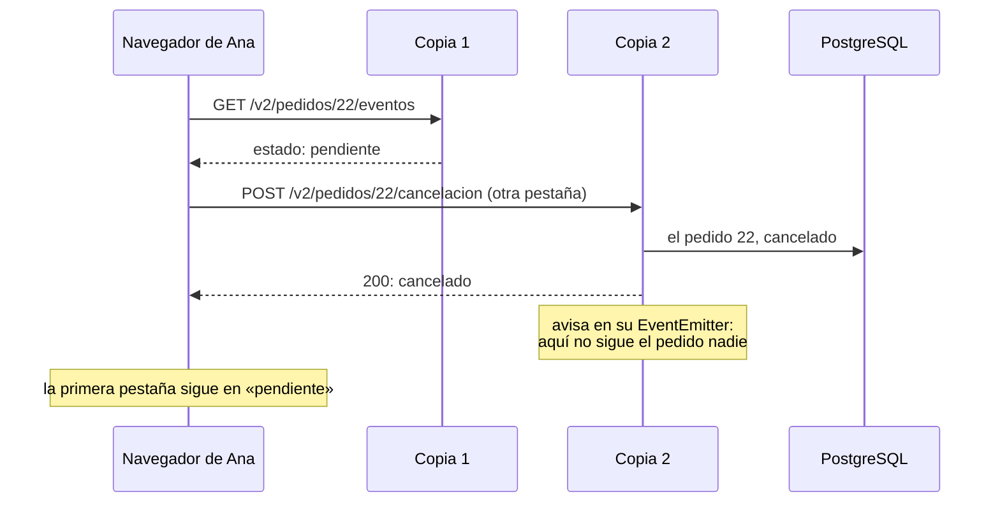
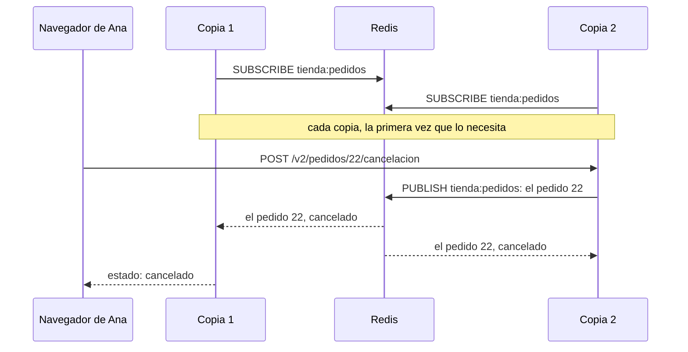

import Term from '~/components/Term.astro';
import TryIt from '~/components/TryIt.astro';
import Analogy from '~/components/Analogy.astro';
import ProjectCode from '~/components/ProjectCode.astro';
import Quiz from '~/components/Quiz.astro';
import QuizQuestion from '~/components/QuizQuestion.astro';
import QuizOption from '~/components/QuizOption.astro';

## El problema

Imagina la tienda con dos copias de la API detrás de nginx, como las que probaste en la [Fase 8](/fase-8/nginx-proxy-inverso/#dos-copias-y-nginx-que-se-entera-solo). Ana sigue en directo el pedido 22 en una pestaña y, en otra, lo cancela. nginx manda la cancelación a la otra copia.

El pedido queda cancelado en PostgreSQL, pero **la primera pestaña sigue diciendo «pendiente»**: el aviso se quedó en la memoria de la otra copia.

Y otra sorpresa: dos copias en el mismo ordenador **no atienden el doble**, y a veces menos. Esta lección arregla lo primero y explica lo segundo.

## La analogía

<Analogy>

Vuelve al súper de la [introducción](/fase-9/). Si una cajera te guardó la bolsa detrás del mostrador, tienes que volver a su caja, aunque otra esté libre.

Y cuando hay que avisar a todas de algo, como «ha cambiado el precio de la leche», no se va caja por caja: se usa la megafonía, y lo oyen todas a la vez.

<div slot="limits">

- Las cajas no se quitan sitio entre ellas. Dos copias en el mismo ordenador, sí: comparten sus núcleos.
- La megafonía no guarda nada: quien no escuchaba se lo pierde. Redis pub/sub tampoco, y no sirve para un trabajo que tiene que hacerse.

</div>

</Analogy>

## Cómo funciona de verdad

### Más grande o más copias

Hay dos formas de que un programa aguante más:

- El <Term id="vertical-scaling">escalado vertical</Term>: la misma máquina, con más procesador y más memoria. Es subir de plan tu [VPS](/fase-8/que-es-un-vps/).
- El <Term id="horizontal-scaling">escalado horizontal</Term>: más copias del programa, en el mismo servidor o en varios, con un <Term id="load-balancer">balanceador de carga</Term> delante.

| | Vertical | Horizontal |
|---|---|---|
| El código | No cambia | Lo que vive en la memoria de una copia sale de ella |
| El tope | La máquina más grande que alquiles | Las piezas compartidas, como la base de datos |
| Si una copia se cae | Cae todo | Las demás siguen; pero si están todas en la misma máquina y cae la máquina, cae todo |
| Lo que cuesta | Máquinas caras; cambiar de tamaño suele pedir un reinicio | Un balanceador, y más piezas que vigilar |

**Casi siempre se empieza por el vertical**, que no pide cambiar el código. Con Node, eso sí, los núcleos de más solo se aprovechan con más procesos, como ves ahora.

### Node usa un núcleo para tu código, y a veces más

En la [Fase 3](/fase-3/event-loop-node/#por-qué-importa-con-muchos-usuarios) viste que tu JavaScript va en un <Term id="thread">hilo</Term>, y un hilo usa un núcleo. Con cuatro núcleos, tu código deja tres sin usar. **Un segundo <Term id="process">proceso</Term> usa otro**: así se reparte el trabajo entre varios procesos de Node, como te prometimos.

Node trae un módulo para eso, `node:cluster`: un proceso principal arranca varios hijos que comparten el puerto. La tienda usa contenedores (`--scale api=2`): la misma idea, que además vale cuando las copias van en máquinas distintas, donde `node:cluster` no llega.

Pero tu código no es lo único que calcula. Lo que libuv hace en sus [cuatro hilos de ayuda](/fase-3/event-loop-node/#esperar-no-bloquea), como el [argon2id del inicio de sesión](/fase-6/guardar-contrasenas-hash/#argon2id-en-node-sin-instalar-nada), ya usa otros núcleos.

### Dos copias no son el doble: lo que medimos

Lo medimos con autocannon, como en la [introducción](/fase-9/), el 21 de octubre de 2026: un Apple M1 Pro con Docker en Colima, una máquina virtual de **4 CPU y 2 GiB** donde también iba autocannon, con 10 conexiones durante 10 segundos. Peticiones por segundo, de media:

| Prueba | Una copia | Dos copias, cada una con su autocannon | Dos copias, detrás de nginx |
|---|---|---|---|
| Inicio de sesión (`POST /v2/sesion`, argon2id) | 176,8 | 78,9 + 85,9 ≈ 164,8 | 159,4 |
| Lista de productos (`GET /v2/productos`, de la caché) | 13.376 | 8.807 + 8.971 ≈ 17.778 | 7.311, y 19 errores |

**El inicio de sesión no mejora.** Con una sola copia, `docker stats` la veía al 383 % (el 100 % es un núcleo): argon2 calcula en los hilos de ayuda, y una copia ya ocupaba casi los cuatro. Con dos detrás de nginx, cada una se quedó en un 184 %: se reparten los mismos núcleos.

**La lista sí mejora, un 33 %.** Ahí el límite era el hilo de tu JavaScript (la copia, al 112 %), y la segunda usa otro núcleo. No llega al doble porque autocannon calcula en los mismos.

Detrás de nginx, la lista cae por debajo de una sola copia. Con la configuración de la Fase 8, nginx abre una conexión nueva con una copia para cada petición, y también calcula en esos cuatro núcleos.

Con una reserva de conexiones abiertas (`keepalive 16`), unas 11.200: aún menos que una copia. La tienda no la usa: una conexión nueva por petición es lo que deja a nginx pasar a la otra copia cuando una se apaga, en la [lección 4](/fase-9/despliegue-sin-cortes/#lo-que-nginx-repite-y-lo-que-no).

Los 19 errores no son de la tienda: al repetirlo hubo 17, pero nginx apuntó 84.297 respuestas, todas `200`, y ningún error en su registro. Lo probable es que nginx cierre cada conexión del cliente tras 1.000 peticiones (`keepalive_requests`), y autocannon cuente como error la que pilla el cierre. Con `keepalive_requests 100000`, ninguno.

En un solo ordenador, las copias compiten por los mismos núcleos. Lo que sí dan ya es que, si una cae, la otra contesta. El horizontal rinde de verdad cuando cada copia trae su máquina.

### Sin estado: lo que no puede vivir en una copia

En la [Fase 4](/fase-4/que-es-api-rest/#sin-estado-cada-petición-se-entiende-sola) te dijimos que, si la API es <Term id="stateless">sin estado</Term>, cualquier copia puede responder. Toca comprobarlo. Lo que la tienda recuerda entre una petición y otra:

| Qué | Dónde vive | ¿Lo ve otra copia? |
|---|---|---|
| Las <Term id="session">sesiones</Term> | En PostgreSQL, desde la [Fase 6](/fase-6/sesiones-cookies/) | Sí |
| Los intentos del límite | En Redis, desde la [Fase 7](/fase-7/docker-compose/#dos-copias-de-la-api-una-sola-cuenta-en-redis) | Sí |
| La cola de trabajos | En Redis, desde la [lección 1](/fase-9/colas-trabajos-segundo-plano/) | Sí |
| La caché del catálogo | En el otro Redis, desde la [lección 2](/fase-9/cache-redis/) | Sí |
| Ficheros subidos | No tiene; irían a un almacén como [S3](/fase-8/iaas-paas-saas-serverless/#los-nombres-de-aws-traducidos), no al disco de una copia | — |
| Los avisos de los pedidos | En un `EventEmitter`, en la memoria de cada proceso | **No** |

Todo está fuera menos el tablón de avisos de la [Fase 4](/fase-4/websockets-sse/#avisar-de-cada-cambio-con-un-eventemitter), el de la ruta que sigue un pedido con <Term id="sse">SSE</Term>.

### El aviso que se queda en una copia

Cada copia tiene su propio `EventEmitter`. Cuando la copia 2 cancela el pedido, avisa en el suyo, y allí no escucha nadie:



Te lo anunciamos en la [Fase 4](/fase-4/websockets-sse/#lo-que-cuesta-un-websocket): **cada conexión vive en un servidor**, y el aviso tiene que llegar al que tiene la del cliente.

### Redis pub/sub: un canal para todas las copias

La solución es la megafonía: <Term id="pub-sub">pub/sub</Term> (publicación y suscripción). Cada copia se **suscribe** a un canal de Redis, `tienda:pedidos`. Lo que cualquiera **publica** en él les llega a todas las que escuchan:



Todo está en un fichero nuevo, `src/eventos-pedidos.ts`. Sin `REDIS_URL`, con `npm start`, sigue siendo un `EventEmitter`: con un proceso, basta. Con Redis, usa dos conexiones:

<ProjectCode file="tienda-api/39-escalado/src/eventos-pedidos.ts" region="dos-conexiones" />

- **Dos**, porque una conexión suscrita a un canal solo sirve para escuchar. `duplicate()` crea otra con las mismas opciones menos una: la que escucha sí guarda su `SUBSCRIBE` hasta que haya conexión.
- **`disableOfflineQueue: true`**: sin conexión, publicar falla al momento. Un aviso guardado para luego podría llegar después de otro más nuevo, y enseñar «pagado» después de «cancelado».
- Y se suscribe otra vez sola tras cada corte.

Publicar es lo que hace `emitir`, al que llaman `cambiarEstado` y `cancelarPedido` igual que antes:

<ProjectCode file="tienda-api/39-escalado/src/eventos-pedidos.ts" region="emitir" />

- **La copia que hace el cambio no avisa a los suyos:** lo publica y lo recibe de vuelta, como todas. Si avisara a los suyos y además lo recibiera de Redis, a quien sigue el pedido en esa copia le llegaría dos veces.
- **No espera a Redis.** La cancelación contesta sin esperar al aviso: en la [lección 2](/fase-9/cache-redis/#si-la-caché-falla-la-tienda-sigue) viste que un Redis colgado puede no contestar nunca.
- **Solo la primera vez, el aviso** (no la respuesta) espera, como mucho un segundo, a que se abra la conexión. Después, si está cortada, el aviso se pierde ahora en lugar de salir tarde y desordenado.

Y lo que llega del canal:

<ProjectCode file="tienda-api/39-escalado/src/eventos-pedidos.ts" region="escuchar-canal" />

Cualquiera con acceso a ese Redis puede publicar en el canal. Por eso cada mensaje pasa por un esquema de [zod](/fase-3/validar-datos-zod/): **lo que no es un pedido se ignora**.

Y si Redis se corta y vuelve, lo publicado mientras tanto se ha perdido. Así que, al volver, la API **cierra los flujos SSE abiertos**, y `EventSource` se conecta otra vez solo y recibe el estado de ahora.

### Pub/sub no es una cola

Las dos van por Redis, con trabajos opuestos:

| | La cola (lección 1) | Pub/sub |
|---|---|---|
| Quién recibe cada mensaje | Un trabajador | Todos los que escuchan |
| Si no escucha nadie | El trabajo espera | El mensaje se pierde |
| Para qué | Algo que tiene que hacerse, como un correo | Un aviso que solo importa a quien está ahí |

Redis lo llama entrega «como mucho una vez» (*at-most-once*), frente a la [entrega al menos una vez](/fase-9/colas-trabajos-segundo-plano/#al-menos-una-vez-un-trabajo-puede-hacerse-dos-veces) de la cola. Para un aviso en pantalla basta.

### Cómo reparte el balanceador

El balanceador de la tienda es nginx, con su `upstream` de la [Fase 8](/fase-8/nginx-proxy-inverso/#el-sitio-de-la-tienda-nginxtiendaconf). Las dos formas de repartir que más verás:

- **Por turnos** (*round robin*): una petición a cada copia, en orden. Es lo que hace nginx por defecto.
- **A la que menos tiene** (`least_conn` dentro del `upstream`): a la copia con menos conexiones abiertas. Ayuda cuando unas peticiones duran mucho más que otras, como un flujo SSE que dura minutos.

### Capa 4 o capa 7

En el [modelo TCP/IP](/fase-0/modelo-tcp-ip/#el-modelo-osi-como-referencia) te anunciamos los balanceadores «de capa 4» y «de capa 7»:

| | Capa 4 (transporte) | Capa 7 (aplicación) |
|---|---|---|
| Qué ve | IPs y puertos | La petición HTTP entera: URL, cabeceras, cookies |
| Qué reparte | Conexiones <Term id="tcp">TCP</Term>, sin mirar lo que llevan dentro | Peticiones, una a una |
| Qué más puede hacer | Poco más: reparte muy deprisa | Elegir copia por la URL, añadir `X-Forwarded-For`, reintentar en otra copia, el HTTPS |
| Ejemplos | El módulo `stream` de nginx; el *Network Load Balancer* de AWS | nginx con `proxy_pass`, como la tienda; el *Application Load Balancer* de AWS |

**El de la tienda es de capa 7:** por eso en la Fase 8 contestaba con un `502`, una respuesta HTTP, cuando no podía hablar con ninguna copia.

### Sesiones pegajosas, y por qué la tienda no las necesita

Otra forma de repartir: cada visitante, **siempre a la misma copia**, por su IP (`ip_hash` en nginx) o con una cookie. Son las sesiones pegajosas (*sticky sessions*), para APIs que guardan estado en memoria, como la cajera que te guardó la bolsa.

El precio: el reparto queda desigual y, si una copia cae, sus visitantes pierden lo que guardaba. **La tienda no las necesita:** las sesiones están en PostgreSQL y los avisos van por Redis.

### Varios servidores: el balanceador, en su máquina

Con varias máquinas, la idea es la misma: cada copia en su servidor, y el balanceador en otro, o como servicio de tu proveedor, que es el único que da la cara a internet.

PostgreSQL y Redis pasan a su propia máquina y se convierten en el siguiente límite: ahí empiezan las [réplicas](/fase-9/teorema-cap/#réplicas-el-mismo-dato-en-dos-máquinas) de la lección 6.

## Pruébalo

El objetivo: ver cómo se pierde un aviso con dos copias, arreglarlo con el paso 39, y medir cuánto ganas con la segunda.

Las salidas son del Mac de las medidas, con Node 26 en los contenedores; tus horas, IDs y números serán otros. Trabajas en tu proyecto, `~/curso-backend/fase-3/tienda-api`, en el paso 38 de la [lección 2](/fase-9/cache-redis/).

### Con el paso 38: el aviso se pierde

<TryIt
  title="1. Dos copias de la API"
  cmd={`docker compose up --build --scale api=2 --wait
docker compose port --index 1 api 3000
docker compose port --index 2 api 3000`}
  output={`…
 Container tienda-api-1 Healthy 
 Container tienda-api-2 Healthy 
127.0.0.1:3000
127.0.0.1:3001`}
>

`--wait` espera a que las dos copias estén sanas, y `docker compose port --index N api 3000` dice en qué puerto quedó cada una. **Pregúntalo siempre:** cada copia toma el que esté libre del rango, y en otra prueba la 1 se quedó con el 3001. Si te pasa, cambia los puertos de los pasos siguientes.

</TryIt>

<TryIt
  title="2. Ana entra por la copia 1"
  cmd={`curl -s -c ana.txt -H 'Content-Type: application/json' -d '{"email":"ana@tienda.example","contrasena":"ana-practica-2026"}' http://localhost:3000/v2/sesion`}
  output={`{"id":1,"email":"ana@tienda.example","rol":"admin"}`}
>

`-c ana.txt` guarda la cookie de la sesión. **La sesión vive en PostgreSQL**, así que vale en las dos copias.

</TryIt>

Ahora necesitas dos terminales. En la primera, Ana sigue el pedido 22 por la copia 1 durante 6 segundos (`-m 6`). Abre la segunda, entra también en tu proyecto (`cd ~/curso-backend/fase-3/tienda-api`, donde está `ana.txt`) y cancela el pedido por la copia 2 antes de que pasen.

<TryIt
  title="3. Seguir por una copia, cancelar por la otra"
  cmd={`# terminal 1
curl -sN -m 6 -b ana.txt http://localhost:3000/v2/pedidos/22/eventos
# terminal 2
curl -s -b ana.txt -H 'Origin: http://localhost:3000' -X POST http://localhost:3001/v2/pedidos/22/cancelacion`}
  output={`# terminal 2
{"id":22,"productoId":2,"cantidad":3,"estado":"cancelado","creadoEn":"2026-10-07T12:00:00.000Z","clienteId":4}
# terminal 1, lo que llegó en esos 6 segundos
event: estado
data: {"id":22,"productoId":2,"cantidad":3,"estado":"pendiente","creadoEn":"2026-10-07T12:00:00.000Z","clienteId":4}`}
>

La cancelación contesta `"estado":"cancelado"`. `Origin` es la cabecera que la tienda pide a un `POST` con cookie desde la [lección de CSRF](/fase-6/csrf-ssrf/#segunda-muralla-de-dónde-viene-la-petición).

**Fíjate en la terminal 1:** un solo evento, `pendiente`. La cancelación no llegó nunca.

Si la cancelación da `401`, esa terminal no encuentra `ana.txt`; si da `403`, falta el `Origin`. Si se te pasan los 6 segundos, el 22 ya está cancelado y no volverá a avisar: repite con otro pedido pendiente, el 23 o el 24, y `-m 30`: la salida mostrará el id de ese pedido.

</TryIt>

<TryIt
  title="4. ¿Está cancelado?"
  cmd={`curl -s -b ana.txt http://localhost:3000/v2/pedidos/22
curl -s -b ana.txt http://localhost:3001/v2/pedidos/22`}
  output={`{"id":22,"productoId":2,"cantidad":3,"estado":"cancelado","creadoEn":"2026-10-07T12:00:00.000Z","clienteId":4}
{"id":22,"productoId":2,"cantidad":3,"estado":"cancelado","creadoEn":"2026-10-07T12:00:00.000Z","clienteId":4}`}
>

Las dos copias leen `cancelado` de PostgreSQL. **El dato está bien; lo que se perdió fue el aviso.**

</TryIt>

### Actualiza tu proyecto

Primero, `docker compose down -v`: el pedido 22 ya está cancelado, y `-v` borra los volúmenes para que la tienda cargue otra vez sus datos de práctica (y se lleva tu sesión). Después, pon tu proyecto en el paso 39, como en la [introducción](/fase-9/#cada-lección-su-paso):

```sh
docker compose down -v
cd ~/curso-backend/fase-3
curl -O https://backenddesdecero.com/practicas/tienda-api/39-escalado.tar.gz
tar -xzf 39-escalado.tar.gz
cp -R 39-escalado/. tienda-api/
cd tienda-api
```

`eventos-pedidos.ts` es nuevo; `datos.ts` y `v2.ts` lo usan, y `config.ts` lee el nombre del canal, `CANAL_PEDIDOS` (por defecto, `tienda:pedidos`). No hay paquetes nuevos.

### Con el paso 39: el aviso llega

Repite los pasos 1 a 3: `up` con `--build`, para construir la imagen nueva, los puertos, la sesión de Ana, y seguir y cancelar, con las dos terminales en tu proyecto.

<TryIt
  title="5. Seguir por una copia, cancelar por la otra, otra vez"
  cmd={`# terminal 1
curl -sN -m 6 -b ana.txt http://localhost:3000/v2/pedidos/22/eventos
# terminal 2
curl -s -b ana.txt -H 'Origin: http://localhost:3000' -X POST http://localhost:3001/v2/pedidos/22/cancelacion`}
  output={`# terminal 2
{"id":22,"productoId":2,"cantidad":3,"estado":"cancelado","creadoEn":"2026-10-07T12:00:00.000Z","clienteId":4}
# terminal 1, lo que llegó en esos 6 segundos
event: estado
data: {"id":22,"productoId":2,"cantidad":3,"estado":"pendiente","creadoEn":"2026-10-07T12:00:00.000Z","clienteId":4}

event: estado
data: {"id":22,"productoId":2,"cantidad":3,"estado":"cancelado","creadoEn":"2026-10-07T12:00:00.000Z","clienteId":4}`}
>

**Ahora son dos eventos:** `pendiente` y, en cuanto cancelas, `cancelado`. El aviso fue de la copia 2 a Redis, y de Redis a la copia 1. Si solo ves uno, mira el paso 6: las dos copias deben escuchar el canal.

</TryIt>

<TryIt
  title="6. Lo que dicen las copias"
  cmd={`docker compose logs api 2>&1 | grep -v '"ruta":"/salud"' | cut -c1-300`}
  output={`api-2  | {"level":30,"time":1792609643057,"pid":1,"hostname":"fa1b1152086d","msg":"La tienda escucha en http://localhost:3000"}
api-2  | {"level":30,"time":1792609654638,"pid":1,"hostname":"fa1b1152086d","requestId":"2e2e5827-0394-4486-ae4d-ea95c607e51e","metodo":"POST","ruta":"/v2/pedidos/22/cancelacion","estado":200,"ms":17,"msg":"petición"}
api-2  | {"level":30,"time":1792609654644,"pid":1,"hostname":"fa1b1152086d","canal":"tienda:pedidos","msg":"la API escucha el canal de los avisos de los pedidos"}
…
api-1  | {"level":30,"time":1792609643122,"pid":1,"hostname":"a092e6d6b04c","msg":"La tienda escucha en http://localhost:3000"}
…
api-1  | {"level":30,"time":1792609653607,"pid":1,"hostname":"a092e6d6b04c","requestId":"44cb6b24-762e-4848-acf5-2a9278fe2496","metodo":"GET","ruta":"/v2/pedidos/22/eventos","estado":200,"ms":8,"msg":"petición"}
api-1  | {"level":30,"time":1792609653610,"pid":1,"hostname":"a092e6d6b04c","canal":"tienda:pedidos","msg":"la API escucha el canal de los avisos de los pedidos"}
…`}
>

`grep -v` quita las líneas del healthcheck; hemos quitado otras con «…». **Cada copia se suscribe al canal la primera vez que lo necesita:** la 1, con la petición que sigue el pedido; la 2, con la cancelación.

Si una copia no dice `la API escucha el canal`, comprueba que `compose.yaml` le pasa `REDIS_URL`.

</TryIt>

### Una copia contra dos, medido

Con las dos copias en marcha, lanza un autocannon contra cada una a la vez, con 5 conexiones cada uno. Va en un contenedor de `node:26` dentro de la red de la tienda, `tienda_default`, para llegar a cada copia por su nombre. Antes, como hicimos nosotros, una pasada de 3 segundos para calentar: la primera lectura llena la caché, que comparten las dos copias.

```sh
docker run --rm --network tienda_default node:26 npx -y autocannon@8.0.0 -d 3 http://api:3000/v2/productos
```

<TryIt
  title="7. Dos copias, cada una con su autocannon"
  cmd={`docker run --rm --network tienda_default node:26 npx -y autocannon@8.0.0 -c 5 -d 10 http://tienda-api-1:3000/v2/productos &
docker run --rm --network tienda_default node:26 npx -y autocannon@8.0.0 -c 5 -d 10 http://tienda-api-2:3000/v2/productos &
wait`}
  output={`Running 10s test @ http://tienda-api-1:3000/v2/productos
5 connections
…
│ Stat      │ 1%      │ 2.5%    │ 50%     │ 97.5%   │ Avg     │ Stdev  │ Min     │
├───────────┼─────────┼─────────┼─────────┼─────────┼─────────┼────────┼─────────┤
│ Req/Sec   │ 8,143   │ 8,143   │ 8,807   │ 9,703   │ 8,807.4 │ 445.95 │ 8,141   │
…
88k requests in 10.01s, 84.3 MB read
Running 10s test @ http://tienda-api-2:3000/v2/productos
5 connections
…
│ Stat      │ 1%     │ 2.5%   │ 50%     │ 97.5%   │ Avg      │ Stdev  │ Min    │
├───────────┼────────┼────────┼─────────┼─────────┼──────────┼────────┼────────┤
│ Req/Sec   │ 7,943  │ 7,943  │ 9,031   │ 9,679   │ 8,971.21 │ 560.09 │ 7,943  │
…
90k requests in 10.01s, 85.9 MB read`}
>

El `&` del final lanza cada orden sin esperar a que acabe, y `wait` espera a las dos. Cada contenedor descarga autocannon con `npx` antes de empezar, así que los dos 10 segundos se solapan, pero no son exactos. Las tablas salen mezcladas con las cabeceras; aquí, ordenadas y solo con la fila de las peticiones por segundo. **Suma las dos medias, `Avg`:** 8.807 + 8.971, unas 17.778 por segundo.

</TryIt>

Vuelve a una sola copia con `docker compose up -d --scale api=1 --wait` y mide con 10 conexiones, las mismas en total. autocannon la encuentra por el nombre del servicio, `api`:

<TryIt
  title="8. Una copia"
  cmd="docker run --rm --network tienda_default node:26 npx -y autocannon@8.0.0 -d 10 http://api:3000/v2/productos"
  output={`Running 10s test @ http://api:3000/v2/productos
10 connections


┌─────────┬──────┬──────┬───────┬──────┬─────────┬────────┬───────┐
│ Stat    │ 2.5% │ 50%  │ 97.5% │ 99%  │ Avg     │ Stdev  │ Max   │
├─────────┼──────┼──────┼───────┼──────┼─────────┼────────┼───────┤
│ Latency │ 0 ms │ 0 ms │ 1 ms  │ 1 ms │ 0.11 ms │ 0.4 ms │ 10 ms │
└─────────┴──────┴──────┴───────┴──────┴─────────┴────────┴───────┘
┌───────────┬─────────┬─────────┬─────────┬─────────┬───────────┬────────┬─────────┐
│ Stat      │ 1%      │ 2.5%    │ 50%     │ 97.5%   │ Avg       │ Stdev  │ Min     │
├───────────┼─────────┼─────────┼─────────┼─────────┼───────────┼────────┼─────────┤
│ Req/Sec   │ 12,463  │ 12,463  │ 13,663  │ 14,111  │ 13,375.64 │ 591.49 │ 12,462  │
├───────────┼─────────┼─────────┼─────────┼─────────┼───────────┼────────┼─────────┤
│ Bytes/Sec │ 11.9 MB │ 11.9 MB │ 13.1 MB │ 13.5 MB │ 12.8 MB   │ 566 kB │ 11.9 MB │
└───────────┴─────────┴─────────┴─────────┴─────────┴───────────┴────────┴─────────┘

Req/Bytes counts sampled once per second.
# of samples: 11

147k requests in 11.01s, 141 MB read`}
>

**Unas 13.376 por segundo:** dos copias dan un 33 % más, no el doble. El p99 de la latencia es `1 ms`: la lista sale de la caché.

</TryIt>

Al terminar: `docker compose down` y `rm ana.txt`.

### En tu servidor

Esta vez no hay que copiar nada al servidor: ni `compose.produccion.yaml` ni `despliegue/` cambian. Haz commit y `git push` desde `tienda-api`, y el temporizador despliega el paso 39. **No hay nada que añadir a `.env`:** los avisos usan el mismo `REDIS_URL` que la cola. Producción sigue con **una sola copia**, que publica y se oye a sí misma, hasta la [lección 4](/fase-9/despliegue-sin-cortes/#dos-copias-fijas-api-a-y-api-b): allí pasa a tener dos, `api-a` y `api-b`.

## Ya lo has visto

- **Los planes de tu proveedor.** Pasar tu VPS de 2 a 4 GB de memoria es escalar en vertical; alquilar un segundo servidor, en horizontal.
- **La tienda de la Fase 7.** Con `--scale api=2` ya tenías dos copias, y el límite funcionaba porque estaba en Redis.

## Errores comunes

- **Esperar el doble con dos copias en la misma máquina.** Mide antes.
- **Guardar algo en la memoria del proceso y escalar después.** Un `Map` de sesiones, un contador: cada copia tendría los suyos.
- **Avisar a los propios y además publicar.** Quien sigue el pedido en esa copia lo recibe dos veces.
- **Usar pub/sub para un trabajo que tiene que hacerse.** Si nadie escucha, se pierde: para eso está la cola.

## Resumen

- En vertical, una máquina más grande; en horizontal, más copias con un balanceador delante.
- En una sola máquina, las copias comparten los núcleos: medimos +33 % en la lista y nada en el inicio de sesión.
- Para escalar en horizontal, nada puede vivir solo en una copia: en la tienda quedaba el `EventEmitter` de los avisos.
- Con Redis pub/sub, cada copia publica los cambios y todas, ella incluida, los reciben. Sin nadie escuchando, se pierden.
- Un balanceador reparte por turnos o a la que menos tiene; el de capa 7 lee la petición HTTP.

## ¿Lo has entendido?

<Quiz>

<QuizQuestion
  question="Tu API va lenta en hora punta. El servidor tiene 4 núcleos, y docker stats enseña la API al 100 % todo el rato. ¿Qué ayuda más?"
  review="Node usa un núcleo para tu código, y a veces más"
>

<QuizOption text="Pasar a un servidor con el doble de memoria.">

El 100 % es un núcleo ocupado por el hilo de tu JavaScript. Más memoria no le da otro núcleo.

</QuizOption>

<QuizOption text="Una segunda copia de la API en el mismo servidor." correct>

Quedan tres núcleos libres, y un segundo proceso usa otro: la lista de productos ganó así un 33 %.

</QuizOption>

<QuizOption text="Nada: Node ya reparte tu código entre los núcleos libres.">

Tu JavaScript va en un hilo, que usa un núcleo. Solo lo que hace libuv en sus hilos de ayuda usa otros.

</QuizOption>

</QuizQuestion>

<QuizQuestion
  question="Una ruta comprime ficheros con la versión asíncrona de zlib, que calcula en los hilos de ayuda, y tiene la API al 390 % en un servidor de 4 núcleos. ¿Ayuda una segunda copia en el mismo servidor?"
  review="Dos copias no son el doble: lo que medimos"
>

<QuizOption text="Casi nada: los hilos de ayuda ya llenan los núcleos." correct>

Es el caso del argon2 de la tienda: una copia ya llenaba la máquina, y con dos medimos 164,8 inicios de sesión por segundo, frente a 176,8.

</QuizOption>

<QuizOption text="Sí, el doble: cada copia trae su propio hilo principal.">

El límite no es el hilo principal, sino los núcleos, y una copia más no añade ninguno.

</QuizOption>

<QuizOption text="Sí, si va detrás de un balanceador, que reparte el trabajo y lo aligera.">

Repartir no crea núcleos. Con el inicio de sesión, detrás de nginx medimos 159,4 por segundo, algo menos que con una sola copia.

</QuizOption>

</QuizQuestion>

<QuizQuestion
  question="Una API guarda los carritos de la compra en un Map, en su memoria. La pones en tres copias detrás de nginx, con su reparto de siempre. ¿Qué ve quien compra?"
  review="Sin estado: lo que no puede vivir en una copia"
>

<QuizOption text="Nada raro: nginx manda siempre a cada visitante a la misma copia.">

nginx reparte por turnos. Mandar a cada uno a la misma copia es una sesión pegajosa, y hay que pedirla (`ip_hash`).

</QuizOption>

<QuizOption text="Nada raro: las copias se pasan sus carritos por la red local.">

Cada proceso tiene su memoria. Para compartir hace falta un almacén común, como PostgreSQL o Redis.

</QuizOption>

<QuizOption text="Un carrito que aparece y desaparece según la copia que conteste." correct>

Cada petición puede caer en otra copia, con su propio `Map`. El carrito tiene que ir a un sitio que vean todas.

</QuizOption>

</QuizQuestion>

<QuizQuestion
  question="Con el paso 39, Ana sigue un pedido en la copia 2 y la propia copia 2 lo cancela. ¿Cómo le llega el aviso?"
  review="Redis pub/sub: un canal para todas las copias"
>

<QuizOption text="La copia 2 avisa a los suyos al momento, y además lo publica para las otras.">

A Ana le llegaría dos veces: una por el aviso directo y otra de Redis.

</QuizOption>

<QuizOption text="La copia 2 lo publica en Redis y lo recibe de vuelta, como las demás." correct>

Redis lo entrega a todas las conexiones suscritas, también a la de la copia que publicó: un solo camino.

</QuizOption>

<QuizOption text="No le llega: Redis no devuelve a una copia lo que ella misma publica.">

Redis entrega el mensaje a todas las conexiones suscritas al canal, y la copia 2 tiene la suya.

</QuizOption>

</QuizQuestion>

<QuizQuestion
  question="Un compañero propone mandar los correos de confirmación por pub/sub en lugar de por la cola, «que es más directo». ¿Qué le contestas?"
  review="Pub/sub no es una cola"
>

<QuizOption text="Que vale: pub/sub guarda cada mensaje hasta que alguien lo lee.">

Pub/sub no guarda nada: entrega lo publicado a quien escucha en ese momento.

</QuizOption>

<QuizOption text="Que vale si hay dos trabajadores escuchando, para no perder ninguno.">

Con dos escuchando saldrían dos correos, y con los dos parados se perdería igual.

</QuizOption>

<QuizOption text="Que no: si nadie escucha justo entonces, el correo no sale nunca." correct>

Pub/sub entrega a quien está, como mucho una vez. La cola guarda el trabajo hasta que un trabajador lo coge, y lo reintenta.

</QuizOption>

</QuizQuestion>

<QuizQuestion
  question="La tienda crece, y quieres que las peticiones a /v2/pedidos vayan a unas copias y el resto a otras. ¿Qué balanceador te sirve?"
  review="Capa 4 o capa 7"
>

<QuizOption text="Uno de capa 7, que lee la URL de cada petición." correct>

Para elegir por la ruta hay que leer la petición HTTP, y eso solo lo hace uno de capa 7, como nginx con `proxy_pass`.

</QuizOption>

<QuizOption text="Uno de capa 4, que es más rápido y ve también la URL.">

Uno de capa 4 reparte conexiones TCP mirando IPs y puertos. La URL va dentro de la petición, que no abre.

</QuizOption>

<QuizOption text="Sesiones pegajosas, para que cada ruta vaya siempre a una copia.">

Las sesiones pegajosas atan un visitante a una copia, no una ruta: sus `/v2/pedidos` y `/v2/productos` irían juntos.

</QuizOption>

</QuizQuestion>

</Quiz>

## Para profundizar

- [Using nginx as HTTP load balancer](https://nginx.org/en/docs/http/load_balancing.html), de la documentación de nginx, en inglés: por turnos, `least_conn` e `ip_hash`.
- [Redis Pub/sub](https://redis.io/docs/latest/develop/pubsub/), de la documentación de Redis, en inglés: los canales y por qué la entrega es «como mucho una vez».
- [Cluster](https://nodejs.org/api/cluster.html), de la documentación de Node, en inglés: varios procesos de Node en el mismo puerto.
- [Procesos](https://12factor.net/es/processes), de *The Twelve-Factor App*: por qué una aplicación no debe guardar nada en la memoria de un proceso, y qué dice de las sesiones pegajosas.
