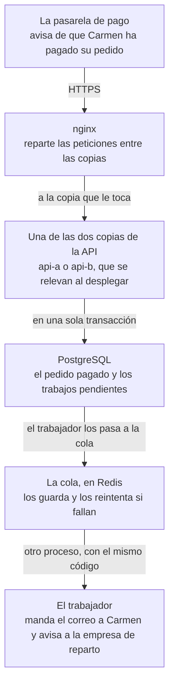

import Term from '~/components/Term.astro';
import TryIt from '~/components/TryIt.astro';
import Analogy from '~/components/Analogy.astro';
import SelfCheck from '~/components/SelfCheck.astro';

Al terminar la Fase 8, la tienda vive en un servidor, detrás de nginx, con su nombre y su HTTPS, y cada `git push` a `main` llega a ella sin que entres. Para unos pocos clientes, funciona.

Esta fase va de **lo que se rompe cuando llegan muchos más**, y de las formas que toma un backend para aguantarlo.

## Qué es escalar, y qué no

Imagina que una cuenta con muchos seguidores enseña la taza de la tienda un viernes por la noche. En diez minutos llegan más visitas que en todo el mes. La lista de productos empieza a tardar, el aviso a la empresa de reparto que falla no se vuelve a intentar y, si justo despliegas una versión nueva, la tienda contesta errores durante unos segundos.

**Escalar es aguantar más trabajo sin que cada persona lo note:** más visitas, más pedidos, más datos, y que cada una siga recibiendo su respuesta igual de rápido y sin errores.

Escalar no es lo mismo que ir rápido. Una ruta que tarda dos segundos con una sola visita es lenta, y eso se arregla en la ruta: con un [índice de la Fase 5](/fase-5/indices-sql-explain/), o sin bloquear el [event loop de la Fase 3](/fase-3/event-loop-node/). Escalar es lo que pasa cuando son mil a la vez.

Y casi ninguna aplicación necesita casi nada de esto. En el «Pruébalo» de abajo, la lista de productos contesta en un portátil unas 666 peticiones por segundo. No es su límite exacto (al final verás por qué), pero da el orden: mantenidas un día entero, serían más de 50 millones. Cada pieza de esta fase añade cosas en marcha y cosas que vigilar, así que **solo merece la pena cuando una medida dice que hace falta**.

## Más grande o más copias

Cuando una medida dice que la tienda no aguanta, hay dos salidas: darle una máquina más grande, o poner más copias de ella.

<Analogy>

Piensa en un supermercado con una sola caja y una cola que llega hasta el fondo. Puedes poner en esa caja a la cajera más rápida, con el mejor escáner: atiende a más gente, pero hasta cierto punto, y si se va a comer, la cola se para entera.

O puedes abrir más cajas, y poner a alguien a la entrada de la cola que manda a cada cliente a una caja libre. Si una cierra, las demás siguen. Cada cliente lleva su carro consigo, así que da igual en qué caja acabe.

<div slot="limits">

- La persona de la entrada ve qué caja está libre. El balanceador no siempre lo sabe: el reparto por turnos de nginx manda una petición a cada copia, vaya como vaya. La lección 3 te cuenta cómo decide.
- El cliente lleva su carro a cualquier caja. En una API, lo que una copia guarda en su memoria no lo ven las demás: la lección 3 busca qué guarda la tienda así y lo saca de ahí.
- Más cajas no ayudan si todas esperan al mismo almacén. Si todas las copias preguntan a la misma base de datos, el atasco se muda allí, y por eso existe la caché de la lección 2.

</div>

</Analogy>

La cajera más rápida es el <Term id="vertical-scaling">escalado vertical</Term>, y abrir más cajas, el <Term id="horizontal-scaling">escalado horizontal</Term>. Puestos uno al lado del otro:

| | Vertical: una máquina más grande | Horizontal: más copias |
|---|---|---|
| Qué haces | Cambias el servidor por uno con más núcleos y más memoria | Arrancas otra copia de la API, y un <Term id="load-balancer">balanceador de carga</Term> reparte las peticiones |
| El programa | No cambia | No puede guardar en su memoria nada que necesiten las demás copias |
| Si una copia se cae | Se cae la tienda | Las otras siguen atendiendo; pero si están todas en la misma máquina y cae la máquina, cae todo |
| En la tienda | Depende de la ruta: tu JavaScript usa un solo núcleo por proceso ([Fase 3](/fase-3/event-loop-node/)); los demás los aprovechan los [hilos de ayuda](/fase-3/event-loop-node/#esperar-no-bloquea) de Node, como el argon2 del inicio de sesión, o más procesos | Dos copias en tu ordenador (lección 3) y en tu servidor (lección 4), las dos en la misma máquina |

## La regla de la fase: primero, medir

Lo que va lento no siempre es lo que uno cree. En esta fase lo verás dos veces con números: la caché multiplica por unas 19 las peticiones por segundo del catálogo, y una segunda copia de la API, en un portátil, no hace más rápido el inicio de sesión. Las dos cosas se ven en una medida; no se adivinan.

La herramienta es una <Term id="load-test">prueba de carga</Term>: un programa que hace de muchas visitas a la vez contra tu API y apunta cuánto tarda cada respuesta. La de este curso es **autocannon**, que funciona con Node, como la tienda. Hay otras muy usadas, como k6, oha o `ab`, de Apache.

**Las lecciones de caché y de escalado repiten esta medida** antes y después de su cambio; las demás enseñan el suyo a su manera, como un despliegue con y sin `502`. Por eso la primera medida va aquí, en la introducción: con la tienda tal como la dejó la Fase 8. Antes, el mapa de lo que vas a cambiar.

## El mapa de la fase

Este es el camino que hace el pago de Carmen, una clienta, al final de la fase. Empieza, como en la [Fase 4](/fase-4/webhooks-idempotencia/), con la pasarela de pago avisando a la tienda, y pasa por las piezas del [mapa de la Fase 8](/fase-8/#adónde-llega-la-tienda-al-final-de-la-fase) (nginx, la API, PostgreSQL), con otras nuevas:



Falta una pieza que no está en el camino de un pago: **la caché**, un segundo Redis delante de PostgreSQL donde la API lee el catálogo. Cada lección pone una pieza, y empieza por lo que no aguanta:

| Lección | Lo que no aguanta | Lo que gana la tienda | Carpeta |
|---|---|---|---|
| 1. Colas | El aviso a la empresa de reparto sale una vez: si falla, se pierde. Y no hay correo de confirmación | Una <Term id="message-queue">cola</Term> con reintentos y un <Term id="worker">trabajador</Term> aparte; el correo, que ves llegar a una bandeja de práctica | `37-cola` |
| 2. Caché | Cada visita a la lista de productos le pregunta a PostgreSQL | El catálogo, guardado un minuto en una <Term id="cache">caché</Term>: en nuestra medida, casi 13.000 peticiones por segundo, unas 19 veces las de esta introducción | `38-cache` |
| 3. Escalado | Una sola copia de la API, y los cambios de los pedidos que el navegador sigue en directo ([Fase 4](/fase-4/websockets-sse/)) viven en su memoria | Varias copias en tu ordenador, y esos cambios por Redis, para que lleguen a todas | `39-escalado` |
| 4. Sin cortes | Cada despliegue deja la tienda unos 12–13 segundos contestando `502`, en nuestra medida | Dos copias en tu servidor que se relevan, y una API que se apaga sin cortar a nadie | `40-sin-cortes` |
| 5. Microservicios | Nada: la pregunta es si partir la tienda en varios programas | Nada nuevo: sigue siendo un <Term id="monolith">monolito</Term>, y verás por qué | — |
| 6. CAP | Nada: es la teoría de lo que pasa con varias copias de los datos | Nada en la tienda: un Redis con una réplica que rompes a propósito en tu ordenador | Un fichero de práctica |
| 7. Eventos | Desde la lección 1, entre guardar el pago y poner el correo en la cola, una caída lo pierde | Los trabajos se guardan con el pedido, en la misma transacción, y ya no se pierde ninguno | `41-eventos` |

## Lo que vas a aprender

Al terminar esta fase sabrás:

- Medir antes de cambiar nada: una prueba de carga, las peticiones por segundo y los <Term id="percentile">percentiles</Term> de la <Term id="latency">latencia</Term>.
- Sacar el trabajo lento a una cola, poner una caché delante de la base de datos y arrancar varias copias de la API.
- Desplegar sin los segundos de error que la Fase 8 aceptaba: un <Term id="zero-downtime-deployment">despliegue sin caída</Term>.
- Cuándo compensa partir una aplicación en <Term id="microservices">microservicios</Term>, el <Term id="cap-theorem">teorema CAP</Term> y la <Term id="eventual-consistency">consistencia eventual</Term>, y la <Term id="event-driven-architecture">arquitectura orientada a eventos</Term> con el patrón <Term id="transactional-outbox">outbox</Term>.

## Las lecciones

1. [Colas](/fase-9/colas-trabajos-segundo-plano/)
2. [Caché](/fase-9/cache-redis/)
3. [Escalado](/fase-9/escalado-horizontal/)
4. [Sin cortes](/fase-9/despliegue-sin-cortes/)
5. [Microservicios](/fase-9/monolito-vs-microservicios/)
6. [CAP](/fase-9/teorema-cap/)
7. [Eventos](/fase-9/arquitectura-orientada-a-eventos/)

## Dónde vas a practicar

Casi todo, en tu ordenador, con Docker Compose como en la [Fase 7](/fase-7/docker-compose/). Solo la lección 4 vuelve al servidor:

| Dónde | Para qué | Lecciones |
|---|---|---|
| Tu ordenador, con Docker Compose | Tu proyecto, en `~/curso-backend/fase-3/tienda-api`: la tienda entera, con los servicios que gana cada lección (el trabajador, una bandeja de correo de práctica y la caché); la lección 6, en su propia carpeta, `~/curso-backend/fase-9/replicas` | 0 a 3 y 5 a 7 |
| Tu servidor de la Fase 8 (la VM `curso` o tu VPS) | Desplegar sin cortes, con nginx, el temporizador y la imagen publicada | La [lección 4](/fase-9/despliegue-sin-cortes/) |

- **Las medidas de tu ordenador** están hechas en un portátil con Apple M1 Pro, con Docker en Colima (otra forma de tener Docker en el Mac, como Docker Desktop) limitado a 4 núcleos y 2 GB de memoria. Las del servidor, en una VM con Ubuntu 26.04, 2 procesadores y 2 GB, como la de la Fase 8.
- **Tus números serán otros:** dependen de la máquina. Compara tu antes y tu después entre sí, no con los nuestros.
- **Si tu tienda ya está en tu servidor,** cada push sigue desplegando. Las lecciones 1, 2, 3 y 7 terminan su «Pruébalo» con «En tu servidor»: qué copiar al servidor antes del push, si hace falta, y la línea nueva del `.env`, si la hay. Hasta la lección 4, el servidor sigue con una sola copia de la API. La VM de 2 GB basta incluso con dos: con todo en marcha, le quedaban unos 700 MB disponibles (la columna `available` de `free -m`).
- **En Windows,** lo de tu ordenador se hace en WSL, con Docker como en la [introducción de la Fase 7](/fase-7/), y la VM, desde PowerShell, como en la [Fase 8](/fase-8/).

## Antes de empezar

Necesitas lo mismo que al final de la Fase 8:

- **Docker en marcha en tu ordenador.** Si cerraste Docker Desktop para hacer sitio a la VM, ábrelo otra vez.
- **Tu proyecto, en `~/curso-backend/fase-3/tienda-api`,** como en las Fases 7 y 8, al día con el paso `36-despliegue` y con tu `.env`: el que usas desde la [Fase 7](/fase-7/docker-compose/), con `POSTGRES_PASSWORD` y tus secretos. Si sigue como lo dejó la Fase 7, ponlo al día como cuenta [«Cada lección, su paso»](#cada-lección-su-paso).
- **Si en la [lección 6 de la Fase 8](/fase-8/ci-cd-github-actions/) subiste a GitHub la carpeta `36-despliegue`,** haz de ella tu proyecto, para que tus push lleguen al servidor. Desde `~/curso-backend/fase-3`: `mv tienda-api tienda-api-antes`, mueve allí esa carpeta con el nombre `tienda-api` (si la descargaste en tu carpeta personal, `mv ~/36-despliegue tienda-api`) y copia tu `.env` con `cp tienda-api-antes/.env tienda-api/`.

autocannon no se instala: lo descarga la orden de la prueba.

### Si prefieres empezar limpio

Si tu proyecto se ha quedado a medias, empieza con el final de la Fase 8, como en la [introducción de la Fase 6](/fase-6/#si-prefieres-empezar-limpio): desde `~/curso-backend/fase-3`, `curl -O https://backenddesdecero.com/practicas/tienda-api/36-despliegue.tar.gz`, `tar -xzf 36-despliegue.tar.gz`, `mv tienda-api tienda-api-antes` y `mv 36-despliegue tienda-api`. Después, copia tu `.env` con `cp tienda-api-antes/.env tienda-api/`. Si no tenías `.env`, créalo como en la [Fase 7](/fase-7/docker-compose/#arranca-la-tienda).

### Cada lección, su paso

Las lecciones 1 a 4 y la 7 traen su paso, de `37-cola` a `41-eventos`, y todas lo ponen igual: desde `~/curso-backend/fase-3`, lo descargan y lo copian encima de tu proyecto. Para la lección 1:

```sh
cd ~/curso-backend/fase-3
curl -O https://backenddesdecero.com/practicas/tienda-api/37-cola.tar.gz
tar -xzf 37-cola.tar.gz
cp -R 37-cola/. tienda-api/
```

Cada paso es el proyecto entero, tal como queda al final de su lección: copiarlo encima pone el tuyo al día, y pisa lo que hubieras cambiado a mano. No trae `.env`, así que el tuyo se queda. La carpeta del paso sigue al lado, para comparar cuando te atasques.

**Hazlo ya una vez, con `36-despliegue`,** si tu proyecto sigue como lo dejó la Fase 7: la Fase 8 copió sus pasos al servidor, no a tu proyecto. Son las mismas cuatro órdenes, con `36-despliegue` en lugar de `37-cola` (`https://backenddesdecero.com/practicas/tienda-api/36-despliegue.tar.gz`). Ningún paso borra ficheros del anterior, así que copiar encima basta.

## Pruébalo: tu primera prueba de carga

El objetivo: averiguar cuántas peticiones por segundo contesta la lista de productos de tu tienda, y cuánto espera la más lenta de cada cien.

### Arranca la tienda

En tu proyecto, arranca la tienda en segundo plano:

```sh
cd ~/curso-backend/fase-3/tienda-api
docker compose up --build --wait
```

Es el `up --build` de la [Fase 7](/fase-7/docker-compose/), con una opción nueva: `--wait` te devuelve la terminal cuando los servicios están sanos, según sus <Term id="healthcheck">healthchecks</Term>. Si alguno no llega a estarlo, termina con un error y te dice cuál: mira su log con `docker compose logs`.

### Lanza la prueba

<TryIt
  title="Diez segundos de visitas a la lista de productos"
  cmd="docker run --rm --network tienda_default node:26 npx -y autocannon@8.0.0 -d 10 http://api:3000/v2/productos"
  output={`Running 10s test @ http://api:3000/v2/productos
10 connections


┌─────────┬──────┬───────┬───────┬───────┬──────────┬─────────┬────────┐
│ Stat    │ 2.5% │ 50%   │ 97.5% │ 99%   │ Avg      │ Stdev   │ Max    │
├─────────┼──────┼───────┼───────┼───────┼──────────┼─────────┼────────┤
│ Latency │ 6 ms │ 13 ms │ 36 ms │ 46 ms │ 14.51 ms │ 9.44 ms │ 197 ms │
└─────────┴──────┴───────┴───────┴───────┴──────────┴─────────┴────────┘
┌───────────┬────────┬────────┬────────┬────────┬────────┬────────┬────────┐
│ Stat      │ 1%     │ 2.5%   │ 50%    │ 97.5%  │ Avg    │ Stdev  │ Min    │
├───────────┼────────┼────────┼────────┼────────┼────────┼────────┼────────┤
│ Req/Sec   │ 416    │ 416    │ 674    │ 836    │ 665.8  │ 128.8  │ 416    │
├───────────┼────────┼────────┼────────┼────────┼────────┼────────┼────────┤
│ Bytes/Sec │ 398 kB │ 398 kB │ 645 kB │ 800 kB │ 637 kB │ 123 kB │ 398 kB │
└───────────┴────────┴────────┴────────┴────────┴────────┴────────┴────────┘

Req/Bytes counts sampled once per second.
# of samples: 10

7k requests in 10.01s, 6.37 MB read`}
>

Palabra a palabra:

- **`docker run --rm`** arranca un contenedor que se borra al terminar, como en la [Fase 7](/fase-7/imagen-contenedor-docker/).
- **`--network tienda_default`** lo mete en la red que Compose crea para la tienda, la de la [lección de redes](/fase-7/redes-docker/). Desde dentro, la API se llama `api`, igual que la base de datos se llama `db`.
- **`node:26`** es la imagen oficial de Node, que trae `npx`.
- **`npx -y autocannon@8.0.0`** descarga autocannon, en esa versión exacta, y lo ejecuta. `-y` contesta que sí cuando `npx` pregunta si puede instalarlo.
- **`-d 10`** son diez segundos de prueba (*duration*).
- **`http://api:3000/v2/productos`** es la lista de productos, la versión 2 de la [Fase 4](/fase-4/versionado-api/).

autocannon abre **10 conexiones** a la vez, como dice la segunda línea. Cada una pide la lista, espera la respuesta y la vuelve a pedir enseguida.

**Lánzala dos veces y quédate con la segunda.** La primera calienta la tienda: abre las conexiones con PostgreSQL, y Node optimiza el código más usado. Nosotros también tiramos la primera.

Medido el 22 de octubre de 2026, en el portátil con Apple M1 Pro y Docker en Colima con 4 núcleos y 2 GB. **Tus números serán otros.** Antes y después de las tablas, npm escribe unas líneas `npm warn deprecated uuid@8.3.2…` y `npm notice`: son de npm, no de la prueba, no tienes que hacer nada, y las hemos quitado. Si sale `network tienda_default not found`, la tienda no está arrancada: vuelve a `docker compose up`. Si al final aparece una línea con `errors` o `non 2xx responses`, algunas peticiones fallaron: mira qué dice `docker compose logs api`.

</TryIt>

La prueba sale desde un contenedor, y no desde tu ordenador, para que las peticiones lleguen a la API por la red de Docker, sin pasar por el puerto publicado, que en el Mac y en Windows cruza la máquina virtual de Docker: medirías ese camino tanto como la tienda. Las lecciones siguientes miden con esta misma orden.

### La latencia: cuánto espera cada petición

La primera tabla es la latencia: **lo que tardó cada petición** en recibir su respuesta, desde que autocannon la mandó. Unas 7.000 peticiones, resumidas en unos números (`Stdev`, la desviación típica, es cuánto se apartan de la media):

| Columna | Valor | Qué quiere decir |
|---|---|---|
| `2.5%` | 6 ms | Las más rápidas: el 2,5 % tardó esto o menos |
| `50%` | 13 ms | La mitad tardó esto o menos: la petición típica, la **mediana** |
| `97.5%` | 36 ms | Solo 1 de cada 40 tardó más |
| `99%` | 46 ms | Solo 1 de cada 100 tardó más |
| `Avg` | 14,51 ms | La media (*average*) |
| `Max` | 197 ms | La más lenta de todas |

Las columnas con `%` son **percentiles**. El percentil 99, que se escribe **p99**, es el tiempo por debajo del cual queda el 99 % de las peticiones. La mediana es el p50.

### Por qué la media engaña

Imagina 100 peticiones: 99 tardan 10 ms, y una, 2 segundos. La media sale 29,9 ms. **Nadie esperó 29,9 ms:** 99 personas esperaron 10, y una esperó dos segundos. La media no describe a nadie, y esconde justo a quien lo pasó mal.

En tu medida, la media (14,51 ms) se parece a la mediana (13 ms), pero el p99 es más del triple de la media, y la más lenta, más de trece veces. Eso no lo dice la media; lo dicen los percentiles altos.

**Una de cada cien parece poco, y no lo es.** A 666 peticiones por segundo, son seis o siete peticiones lentas cada segundo. Y una página que hace 10 peticiones tiene casi un 10 % de probabilidades de que al menos una caiga en ese 1 % lento. Por eso los equipos que vigilan un backend miran el p99, no la media.

Si has mirado las Core Web Vitals de una web, ya has usado un percentil: Google juzga cada métrica por el percentil 75 de las visitas, no por su media.

### Peticiones por segundo: cuánto aguanta

La segunda tabla cuenta cuánto trabajo hizo la tienda. autocannon mira **una vez por segundo** (`sampled once per second`), así que son 10 medidas (`# of samples: 10`):

- **`Req/Sec`**, las peticiones contestadas en cada segundo. La media, `Avg`, es 665,8, y la mediana, 674. Aquí lo que preocupa es lo bajo: `Min`, el peor segundo, contestó solo 416.
- **La última línea** lo suma todo: unas 7.000 peticiones (`7k requests`) en 10 segundos, y 6,37 MB leídos.

Las dos tablas no son independientes. Con un número fijo de conexiones, **si cada respuesta tarda menos, caben más por segundo**:

<SelfCheck question="Reto: con 10 conexiones y una latencia media de 14,51 ms, ¿cuántas peticiones por segundo esperarías? ¿Y si la latencia bajara a la mitad?">

Cada conexión hace una petición detrás de otra. Si cada una tarda unos 14,5 ms, una conexión hace unas 69 por segundo (1.000 ms entre 14,5), y diez conexiones, unas 690. autocannon midió 665,8: cerca, porque entre una petición y la siguiente se pierde algo de tiempo.

Con la latencia a la mitad, el doble: unas 1.380. Por eso una caché, que hace cada respuesta más rápida, también deja contestar más por segundo. Lo verás en la [lección 2](/fase-9/cache-redis/#con-caché-y-sin-ella).

</SelfCheck>

### Lo que esta prueba no dice

Estos números sirven para **comparar un antes y un después en la misma máquina**, no para decir «mi tienda aguanta 666 peticiones por segundo». Tres razones:

- **autocannon y la tienda comparten ordenador,** y los mismos 4 núcleos: lo que gasta uno, no lo tiene el otro. Una prueba seria se lanza desde otra máquina.
- **Es una sola ruta, que solo lee.** Las visitas de verdad mezclan la lista, los productos, el carrito y el pago, que escribe en la base de datos.
- **Tus 10 conexiones esperan cada respuesta** antes de pedir la siguiente. Las visitas de verdad no esperan: si la tienda va lenta, siguen llegando.

Para la tienda cuando acabes, con `docker compose down`. Tus datos se quedan en su volumen.

Empieza por la [lección 1, «Colas»](/fase-9/colas-trabajos-segundo-plano/): el aviso a la empresa de reparto pasará a una cola que lo reintenta, y Carmen recibirá por fin el correo de su pedido.
