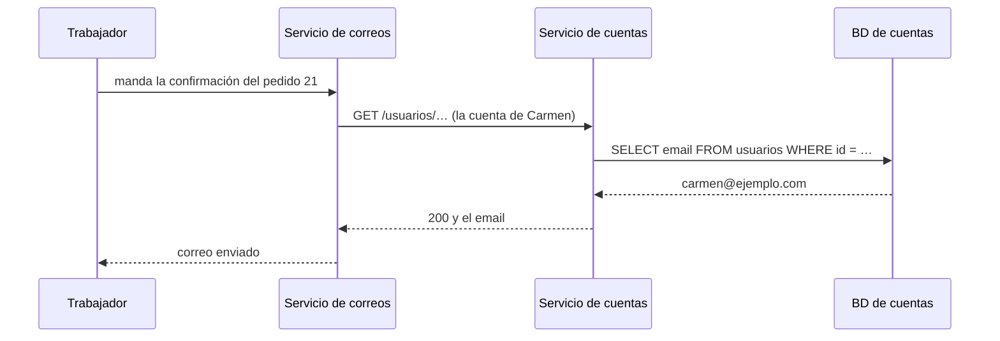

import Term from '~/components/Term.astro';
import TryIt from '~/components/TryIt.astro';
import Analogy from '~/components/Analogy.astro';
import SelfCheck from '~/components/SelfCheck.astro';
import ProjectCode from '~/components/ProjectCode.astro';
import Quiz from '~/components/Quiz.astro';
import QuizQuestion from '~/components/QuizQuestion.astro';
import QuizOption from '~/components/QuizOption.astro';

## El problema

Imagina que la tienda va bien y ya sois tres programando. Alguien lee que «las empresas serias usan microservicios» y propone partirla: un servicio de productos, otro de pedidos, otro de cuentas y otro de correos, cada uno con su base de datos.

Un mes después, Carmen paga un pedido y el correo de confirmación no llega: el servicio de correos le pidió su email al de cuentas, y el de cuentas se estaba desplegando. Lo que era una consulta a una tabla es ahora una petición por la red, que puede fallar.

**Dividir tiene ventajas reales, y un precio.** Aquí verás los dos, medirás el precio y entenderás por qué la tienda sigue siendo un solo programa.

## La analogía

<Analogy>

Piensa en la cocina de un restaurante, con todos en la misma sala. El de los postres pide la nata al de al lado y la tiene en un segundo. Si un menú sale mal, se rehace entero, todos juntos.

Ahora reparte la cocina en cuatro locales del barrio que se piden las cosas por mensajero. Cada local cambia su carta cuando quiere y tiene su propio equipo. Pero cada nata tarda un viaje, el mensajero a veces no vuelve, y si la carne sale mal, el postre ya está hecho en otro local.

<div slot="limits">

- En la cocina, una voz se puede perder. En un programa, una llamada a una función no se pierde nunca: o termina, o el programa entero falla.
- El mensajero, cuando no vuelve, al menos se nota. En la red, a veces no sabes si el pedido llegó y se hizo, o no llegó.

</div>

</Analogy>

## Cómo funciona de verdad

### Un monolito: un código, un despliegue

Un <Term id="monolith">monolito</Term> es una aplicación entera en un solo código que se despliega de una vez. **La tienda es uno:** productos, pedidos, cuentas, avisos y correos viven en `src/`, van en una sola imagen de Docker con un solo `desplegar.sh` y usan una sola base de datos.

Monolito no quiere decir desordenado ni «una sola copia». La tienda ya corre en dos copias, desde las lecciones [3](/fase-9/escalado-horizontal/) y [4](/fase-9/despliegue-sin-cortes/), y con dos tipos de procesos.

### La tienda: dos procesos, un solo código

En la [lección 1](/fase-9/colas-trabajos-segundo-plano/) la tienda ganó un <Term id="worker">trabajador</Term>: el proceso que coge los trabajos de la cola y manda los avisos y los correos. Mira cómo lo arranca Compose:

<ProjectCode file="tienda-api/40-sin-cortes/compose.yaml" region="trabajador" />

- **`build: .`**: la misma imagen que la API.
- **`command`**: solo cambia la orden de arranque, `scripts/trabajador.ts` en lugar de `src/servidor.ts` (fuera de Docker, `npm run trabajador` en lugar de `npm start`).
- **Sin `ports` ni `/salud`**: no escucha peticiones.
- **La misma configuración**: la misma base de datos, el mismo Redis, la misma caché y el mismo servidor de correo.

Con eso, la tienda ya tiene algo de lo que se busca al dividir: **el trabajador falla y escala aparte**. En la lección 1 lo paraste y la API siguió cobrando. Pero es el mismo código, la misma versión y el mismo despliegue: sigue siendo un monolito.

### Microservicios: varios programas que se hablan por la red

Los <Term id="microservices">microservicios</Term> reparten la aplicación en varios programas pequeños, cada uno con su código, su despliegue y, casi siempre, **su propia base de datos**, que los demás no tocan. Si el servicio de correos necesita el email de Carmen, no lee la tabla `usuarios`: se lo pide al servicio de cuentas, por HTTP o con <Term id="grpc">gRPC</Term>, la forma de [llamar a una función de otro servicio](/fase-4/graphql-grpc-rest/#grpc-llamar-a-una-función-de-otro-servicio) que viste en la Fase 4.



En la tienda de hoy, todo eso es una consulta de `enviarConfirmacion`, en `src/correo.ts`, a la tabla `usuarios`. **Dos flechas del diagrama son llamadas por la red que antes no existían.**

Lo que ganas al dividir:

- **Cada equipo despliega lo suyo** cuando quiere, sin esperar a los demás.
- **Cada servicio escala por su cuenta:** diez copias del que más trabaja, una del que casi nada.
- **Cada uno puede usar otra herramienta:** Python para un modelo de IA, Node para lo demás.
- **Un fallo se queda dentro**, si está bien hecho: si caen las recomendaciones, se puede seguir comprando.

### Lo que cuesta: cada llamada viaja por la red

Llamar a una función cuesta **una fracción de microsegundo**. Llamar a otro programa por la red, aunque esté en el mismo ordenador, **del orden de un milisegundo**: miles de veces más. Lo medirás en «Pruébalo».

Y es el mejor caso: entre dos máquinas se suma el <Term id="rtt">RTT</Term> de la red, y entre dos ciudades, mucho más, como viste en la [Fase 0](/fase-0/que-pasa-cuando-escribes-una-url/#cuánto-cuesta-viajes-de-ida-y-vuelta).

La red, además, trae cosas que una función no tiene:

- **Puede fallar o tardar sin fin.** Cada llamada necesita un tiempo máximo de espera, y un plan para cuando se agota.
- **A veces no sabes qué pasó.** Como el `504` de nginx en la [Fase 8](/fase-8/nginx-proxy-inverso/#cuando-la-api-falla-502-y-504), la otra parte pudo hacerlo o no. Reintentar es seguro solo si la operación es <Term id="idempotent">idempotente</Term>, o lleva un id para [descartar las repeticiones](/fase-4/webhooks-idempotencia/#los-avisos-se-repiten-procesa-cada-evento-una-vez).
- **Las llamadas en bucle se notan.** Es el [problema N+1](/fase-5/orm-drizzle-prisma/#el-problema-n1-contado-en-el-log) de la Fase 5, ahora entre servicios: pedir el email de 100 pedidos uno a uno, a un milisegundo cada uno, son 100 ms solo esperando.

### Lo que cuesta: una transacción no cruza servicios

Al hacer un pedido, `crearPedido` quita el stock y guarda el pedido en una sola <Term id="transaction">transacción</Term>, como aprendiste en la [Fase 5](/fase-5/transacciones-acid/#begin-y-commit-varias-órdenes-como-una-sola): o pasan las dos cosas, o ninguna.

Con un servicio de stock y otro de pedidos, cada uno con su base de datos, **ya no hay un `BEGIN` que abarque las dos**. Si el stock se resta y guardar el pedido falla, nadie lo devuelve solo: hace falta un paso que lo compense a propósito («devuelve 1 taza»). A esa cadena de pasos, cada uno con su paso contrario, se la llama *saga*.

Mientras tanto, alguien puede ver el stock restado sin pedido: es la <Term id="eventual-consistency">consistencia eventual</Term> de la [lección 6](/fase-9/teorema-cap/#consistencia-eventual-las-copias-acaban-de-acuerdo). Y que un paso no se pierda entre dos escrituras es el tema de la [lección 7](/fase-9/arquitectura-orientada-a-eventos/#dos-escrituras-dos-sitios-el-hueco-de-la-lección-1).

### Lo que cuesta: muchas piezas que desplegar y vigilar

Cada servicio necesita sus tests, su imagen, su despliegue, sus healthchecks y sus logs: el `desplegar.sh` de la [lección 4](/fase-9/despliegue-sin-cortes/), multiplicado por diez.

Además, **cada servicio es un cliente de otros.** Un cambio en el de cuentas tiene que seguir sirviendo a la versión vieja del de correos, porque no se despliegan a la vez: es el <Term id="api-contract">contrato</Term> y el [versionado](/fase-4/versionado-api/) de la Fase 4, pero entre tus propios programas.

Y buscar un fallo cuesta más: una compra pasa por varios servicios, y hay que seguir su [`requestId`](/fase-3/errores-y-logs-node/#un-id-para-cada-petición) por todos. Para eso existen las trazas (el recorrido de una petición por todos los servicios), parte de la observabilidad de la Fase 10.

| | Monolito | Microservicios |
|---|---|---|
| Hablar con otra parte | Una llamada a una función | Una petición por la red, que puede fallar |
| Cambiar datos de dos partes a la vez | Una transacción | Una saga, con pasos que compensan |
| Desplegar | Una imagen, un script | Uno por servicio, y versiones que conviven |
| Buscar un fallo | Los logs de un programa | Seguir una petición por varios |
| Escalar | Más copias de todo | Más copias solo de lo que lo necesita |
| Equipos | Todos en el mismo código | Cada uno con lo suyo |

### La ley de Conway: el sistema copia a los equipos

En 1968, Melvin Conway escribió que **una organización que diseña un sistema acaba con un diseño que copia cómo se comunica la organización**. Si tres equipos que apenas hablan entre ellos construyen algo, saldrán tres piezas, unidas justo donde los equipos se hablan.

Por eso los microservicios son, ante todo, **una forma de organizar a la gente**: cuando cien personas tocan el mismo código, repartirlo por equipos deja que cada uno despliegue a su ritmo.

Con un equipo pequeño pasa lo contrario. Como escribe Martin Fowler, una o dos docenas de personas se hablan sin esfuerzo, así que, según Conway, construirán un monolito. Y está bien.

### El monolito modular: fronteras dentro de un solo programa

Hay un punto medio que funciona muy bien: el **monolito modular**. Un solo código y un solo despliegue, repartido en partes con fronteras claras: pedidos, cuentas, correo.

Las reglas de los microservicios, sin la red:

- **Cada parte es dueña de sus tablas.** Las demás no las leen ni las escriben.
- **Se piden las cosas con funciones públicas**, como `buscarEmail(id)` del módulo de cuentas, en lugar de con una consulta a su tabla.

La tienda no lo cumple del todo: `enviarConfirmacion` lee la tabla `usuarios` directamente. Es justo el atajo que complica separar algo el día que haga falta.

Shopify, una de las aplicaciones de Ruby on Rails (un framework, como Hono, para el lenguaje Ruby) más grandes que existen, con más de mil personas programando en ella, eligió este camino en lugar de los microservicios, y lo [contó en 2019](https://shopify.engineering/deconstructing-monolith-designing-software-maximizes-developer-productivity).

### Cuándo sí merece la pena dividir

Dividir compensa cuando seguir juntos cuesta más que la red:

- **Muchos equipos** que se estorban en el mismo código y en el mismo despliegue.
- **Necesidades muy distintas:** una parte que necesita mucha CPU o una tarjeta gráfica, y el resto, casi nada.
- **Otra herramienta:** una parte que va mejor en otro lenguaje.
- **Aislar lo delicado:** los pagos, con reglas de seguridad más duras que el resto.

### Empieza con un monolito

En 2015, Martin Fowler contó en [«Monolith First»](https://martinfowler.com/bliki/MonolithFirst.html) un patrón que veía una y otra vez: **casi todas las historias de microservicios que salieron bien empezaron como un monolito que creció demasiado y se partió**. Y casi todos los que conocía que empezaron como microservicios desde cero acabaron con problemas serios.

Da dos razones. **Al principio no sabes si la aplicación servirá**, y lo que importa es ir rápido. Y **al principio no sabes dónde están las fronteras**: mover algo de un servicio a otro cuesta mucho más que dentro de un programa.

La tienda tiene un equipo, una base de datos que cabe en un servidor y una carga que aguantan dos copias. **Seguirá siendo un monolito.**

## Pruébalo

El objetivo: medir en tu ordenador cuánto más cara es una llamada por la red que una llamada a una función.

En tu proyecto, `~/curso-backend/fase-3/tienda-api`, arranca la tienda con `docker compose up --build --wait`, como en las lecciones anteriores. Después, guarda este programa en esa misma carpeta, con el nombre `llamada-vs-red.js`:

```js title="llamada-vs-red.js"
const N = 1000;
const salud = () => ({ estado: 'ok' });

// La suma usa cada respuesta, para que el motor no pueda saltarse las llamadas.
let suma = 0;
let t0 = performance.now();
for (let i = 0; i < N; i++) suma += salud().estado.length;
const llamada = performance.now() - t0;

t0 = performance.now();
for (let i = 0; i < N; i++) {
  const res = await fetch('http://api:3000/salud');
  suma += (await res.text()).length;
}
const red = performance.now() - t0;

console.log(`${N} llamadas a una función: ${llamada.toFixed(3)} ms en total, ${((llamada / N) * 1000).toFixed(3)} µs por llamada`);
console.log(`${N} fetch a /salud:         ${red.toFixed(1)} ms en total, ${(red / N).toFixed(3)} ms por llamada`);
console.log(`la llamada por la red es ${Math.round(red / llamada)} veces más lenta (suma de control ${suma})`);
```

- **`performance.now()`** da los milisegundos que lleva el programa en marcha, con decimales: la resta de dos es lo que tardó lo de en medio.
- **El primer bucle** llama mil veces a `salud`, una función que devuelve lo mismo que la ruta `/salud`. **El segundo** pide `/salud` a la API mil veces con `fetch`.
- **Ojo: la ruta `/salud` no es gratis.** Pregunta a PostgreSQL con un `SELECT 1` ([Fase 7](/fase-7/docker-multi-stage/#healthcheck-la-tienda-está-bien)), así que cada `fetch` son dos viajes: al contenedor de la API, y de ahí al de la base de datos.
- **`suma`** usa cada respuesta: sin ella, el motor de JavaScript podría saltarse llamadas cuyo resultado nadie usa.

<TryIt
  title="Una función contra la red, mil veces cada una"
  cmd={`docker run --rm --network tienda_default node:26 node --input-type=module --eval "$(cat llamada-vs-red.js)"`}
  output={`1000 llamadas a una función: 0.200 ms en total, 0.200 µs por llamada
1000 fetch a /salud:         1180.7 ms en total, 1.181 ms por llamada
la llamada por la red es 5892 veces más lenta (suma de control 17000)`}
>

- **`docker run --rm … node:26`** arranca un contenedor de Node 26 y lo borra al terminar (la primera vez, Docker descarga la imagen).
- **`--network tienda_default`** lo mete en la red de Compose de la tienda, donde la API se llama `api`, como en la [Fase 7](/fase-7/redes-docker/). El `fetch` va **de un contenedor a otro**.
- **`--eval "$(cat llamada-vs-red.js)"`** le pasa el programa a Node, y **`--input-type=module`** deja usar `await` fuera de una función.

Fíjate en «por llamada»: **0,2 µs** contra **1,181 ms**. La suma de control, `17000`, dice que se hicieron todas: mil veces las 2 letras de `ok` y mil veces los 15 caracteres de `{"estado":"ok"}`.

Si Docker dice que la red no existe, la tienda no está en marcha o tu proyecto tiene otro `name:` en `compose.yaml`: busca la red con `docker network ls`. Si el `fetch` falla, espera a que la API esté sana.

</TryIt>

**Tus números serán distintos, y cambiarán de una vez a otra.** Lo ejecutamos tres veces seguidas, el 22 de octubre de 2026, en un Apple M1 Pro con Docker en Colima (4 CPU y 2 GiB):

| Pasada | Una función | Un `fetch` a `/salud` | Veces más lento |
|---|---|---|---|
| 1 | 0,200 µs | 1,181 ms | 5.892 |
| 2 | 0,217 µs | 0,749 ms | 3.450 |
| 3 | 0,171 µs | 1,076 ms | 6.292 |

**Quédate con el orden de magnitud, no con las veces, que bailan entre 3.450 y 6.292:** una fracción de microsegundo contra un milisegundo. Y es el caso más favorable: el mismo ordenador, la tienda sin trabajo y `fetch` reutilizando la conexión.

Para ser justos, la comparación exagera un poco: `/salud` consulta PostgreSQL y `salud()` no. Pero buscar un email es una consulta en los dos mundos: **lo que añaden los microservicios es el viaje de más**, que cuesta menos que estos dos, pero sigue costando mucho más que una función, aunque no lo hayamos medido solo.

<SelfCheck question="Reto: imagina que el correo pasa a ser un servicio aparte, con su propia base de datos. ¿Qué tiene que cambiar en enviarConfirmacion para conseguir el email de Carmen, y qué pasa si el servicio de cuentas no contesta?">

Ya no puede leer la tabla `usuarios`. Tiene dos caminos:

- **Pedírselo al servicio de cuentas**, con un tiempo máximo de espera. Si no contesta, el trabajo falla y la cola lo reintenta, como en la lección 1: cinco intentos en unos 15 segundos. Si el servicio de cuentas tarda más en volver, el trabajo se queda entre los fallidos y el correo no sale, como le pasó a Carmen en «El problema».
- **Recibir el email dentro del trabajo**, copiado cuando se pagó el pedido. No hace falta preguntar, pero si Carmen cambia su email justo antes, el correo va al viejo: una copia puede quedarse atrasada.

</SelfCheck>

Al terminar, `docker compose down` para la tienda y borra `llamada-vs-red.js` si no lo quieres guardar.

## Ya lo has visto

- **«Iniciar sesión con Google»,** en la [Fase 6](/fase-6/oauth-openid-connect/): el servicio de otra empresa, con sus propios usuarios. La tienda no lee sus tablas: le pregunta por la red. Conway en estado puro: dos organizaciones, dos sistemas y un contrato.
- **La pasarela de pago y la empresa de reparto,** en la [Fase 4](/fase-4/webhooks-idempotencia/): servicios ajenos que hablan con la tienda por webhooks, que pueden fallar y repetirse.
- **Una web que carga a medias:** falta un recuadro, como las recomendaciones. A menudo es un servicio aparte que no contestó a tiempo, y la página siguió sin él.

## Errores comunes

- **Dividir para que la aplicación responda más rápido.** Cada salto entre servicios suma tiempo. Mide primero: casi siempre bastan más copias ([lección 3](/fase-9/escalado-horizontal/)) o una [caché](/fase-9/cache-redis/).
- **Servicios que comparten la base de datos.** Un cambio en una tabla los rompe a todos, y hay que desplegarlos juntos: un monolito, repartido por la red.
- **Tratar una llamada por la red como una función:** sin tiempo máximo de espera, sin reintentos y dando por hecho que salió bien.
- **Dividir por capas técnicas,** como un servicio «de base de datos» y otro «de lógica»: cada cambio toca los dos. Se divide por lo que hace el negocio: pedidos, cuentas, pagos.

## Resumen

- Un monolito es un solo código que se despliega de una vez, aunque tenga varias copias y procesos, como la tienda.
- Los microservicios son programas con su propio código, despliegue y datos, que se hablan por la red.
- Dividir cuesta: miles de veces más por llamada (0,2 µs contra cerca de 1 ms en nuestra medida, con una consulta incluida), fallos de red, transacciones partidas y más piezas.
- La ley de Conway: el sistema copia a la organización. Dividir compensa con muchos equipos.
- Empieza con un monolito, ordenado en módulos con fronteras.

## ¿Lo has entendido?

<Quiz>

<QuizQuestion
  question="Sois tres personas y la tienda va lenta en las horas punta. Alguien propone partirla en cinco microservicios para que vaya más rápida. ¿Qué le contestas?"
  review="Errores comunes"
>

<QuizOption text="Que sí: cada servicio tendrá su propio ordenador y responderá antes.">

Cada salto entre servicios suma tiempo de red: repartir hace más lenta cada petición, no más rápida.

</QuizOption>

<QuizOption text="Que primero mida: más copias o una caché suelen bastar." correct>

Lo lento se encuentra midiendo. Más copias del monolito (lección 3) o una caché (lección 2) arreglan la carga sin pagar la red ni las piezas de más.

</QuizOption>

<QuizOption text="Que solo irá más rápida si cada servicio se escribe en un lenguaje más rápido que Node.">

Cambiar de lenguaje no quita los saltos por la red, y en una tienda lo lento suele ser la base de datos, no el lenguaje.

</QuizOption>

</QuizQuestion>

<QuizQuestion
  question="En la tienda, la API y el trabajador corren en contenedores distintos y no comparten proceso. ¿Son dos microservicios?"
  review="La tienda: dos procesos, un solo código"
>

<QuizOption text="No: son el mismo código y la misma imagen, que se despliegan juntos." correct>

Solo cambia la orden de arranque. Un microservicio tiene su propio código, su despliegue y sus datos: aquí no hay nada de eso.

</QuizOption>

<QuizOption text="Sí: cualquier cosa que corra en su propio contenedor es un microservicio.">

Un contenedor es una forma de ejecutar un proceso, no de dividir el código. PostgreSQL también va en su contenedor.

</QuizOption>

<QuizOption text="Sí, porque se comunican por una cola en Redis y no llamándose a funciones.">

Hablarse por una cola no los separa: comparten código, versión y base de datos. Un monolito puede usar colas, como la tienda.

</QuizOption>

</QuizQuestion>

<QuizQuestion
  question="Sacas el stock a un servicio con su propia base de datos. Un pedido resta una taza en ese servicio, y luego falla al guardarse en el de pedidos. ¿Qué pasa con la taza?"
  review="Lo que cuesta: una transacción no cruza servicios"
>

<QuizOption text="PostgreSQL deshace la resta, porque las dos órdenes van en la misma transacción.">

Son dos bases de datos, y cada una tiene sus transacciones. Ningún `BEGIN` abarca las dos, así que nadie deshace la resta por ti.

</QuizOption>

<QuizOption text="El servicio de stock se entera por la red del fallo y la devuelve él solo.">

La red no avisa de nada por su cuenta. Si nadie programa ese aviso y su respuesta, el servicio de stock no sabe que el pedido falló.

</QuizOption>

<QuizOption text="Se queda restada hasta que un paso que compensa la devuelva a propósito." correct>

Sin una transacción común, deshacer es trabajo tuyo: un paso contrario («devuelve 1 taza»), como en una saga.

</QuizOption>

</QuizQuestion>

<QuizQuestion
  question="Una empresa tiene tres equipos que apenas hablan entre sí: web, app móvil y pagos. Según la ley de Conway, ¿qué forma tendrá el sistema que construyan juntos?"
  review="La ley de Conway: el sistema copia a los equipos"
>

<QuizOption text="Un solo programa, porque empezar con un monolito es lo más sensato.">

Empezar con un monolito es un consejo; Conway describe lo que pasa, y tres equipos que apenas se hablan acaban con tres piezas.

</QuizOption>

<QuizOption text="Tres piezas: una por equipo, conectadas solo donde se coordinan." correct>

El diseño copia la comunicación de la organización: cada equipo construye su parte, y las uniones aparecen donde hay conversación entre ellos.

</QuizOption>

<QuizOption text="La que decida quien diseñe, porque la organización no cambia el código.">

Es justo lo que Conway niega: el sistema acaba con la forma en que se habla la gente que lo construye.

</QuizOption>

</QuizQuestion>

<QuizQuestion
  question="Mediste 0,2 µs por llamada a una función y 1 ms por fetch. Una página pide al servicio de cuentas el email de cada uno de sus 100 pedidos, uno detrás de otro. ¿Cuánto tiempo añade?"
  review="Lo que cuesta: cada llamada viaja por la red"
>

<QuizOption text="Unos 100 ms de esperar a la red, como mínimo." correct>

Cien viajes de un milisegundo, uno detrás de otro, son 100 ms en el mejor caso, y más entre máquinas distintas. Es el N+1 de la Fase 5: mejor pedir los 100 emails de una vez.

</QuizOption>

<QuizOption text="Casi nada: 100 llamadas son 0,02 ms, como con la función.">

Eso sería si fueran llamadas a una función. Cada `fetch` es un viaje por la red, miles de veces más caro en nuestra medida.

</QuizOption>

<QuizOption text="Nada, si se hacen con await: esperar no bloquea a Node.">

Esperar no bloquea a otras peticiones, pero esta página sigue esperando cada respuesta antes de pedir la siguiente. Los 100 ms se suman.

</QuizOption>

</QuizQuestion>

<QuizQuestion
  question="En tu monolito, el código del correo lee la tabla usuarios directamente. Queréis poder separarlo algún día. ¿Qué cambio prepara mejor ese día?"
  review="El monolito modular: fronteras dentro de un solo programa"
>

<QuizOption text="Copiar ya la tabla usuarios en una base de datos solo para el correo.">

Tendrías dos copias que mantener iguales, antes de necesitarlo. La frontera se marca en el código, no duplicando datos.

</QuizOption>

<QuizOption text="Sacarlo ya a un microservicio, para que la frontera quede clara.">

Pagarías la red, los despliegues y los fallos parciales antes de saber si hace falta. Se puede marcar la frontera sin salir del programa.

</QuizOption>

<QuizOption text="Que pida el email con una función del módulo de cuentas." correct>

Es el monolito modular: cada parte es dueña de sus tablas. Si un día se separa, esa función pasa a ser una petición por la red, y lo demás no cambia.

</QuizOption>

</QuizQuestion>

</Quiz>

## Para profundizar

- [Monolith First](https://martinfowler.com/bliki/MonolithFirst.html), de Martin Fowler, en inglés: empezar con un monolito, y por qué.
- [Microservices](https://martinfowler.com/articles/microservices.html), de James Lewis y Martin Fowler, en inglés: el artículo de 2014 que describió sus rasgos.
- [Conway's Law](https://martinfowler.com/bliki/ConwaysLaw.html), de Martin Fowler, en inglés, y el [artículo original de Melvin Conway](https://www.melconway.com/Home/Committees_Paper.html), de 1968.
- [Deconstructing the Monolith](https://shopify.engineering/deconstructing-monolith-designing-software-maximizes-developer-productivity), de Shopify, en inglés: su monolito modular.
