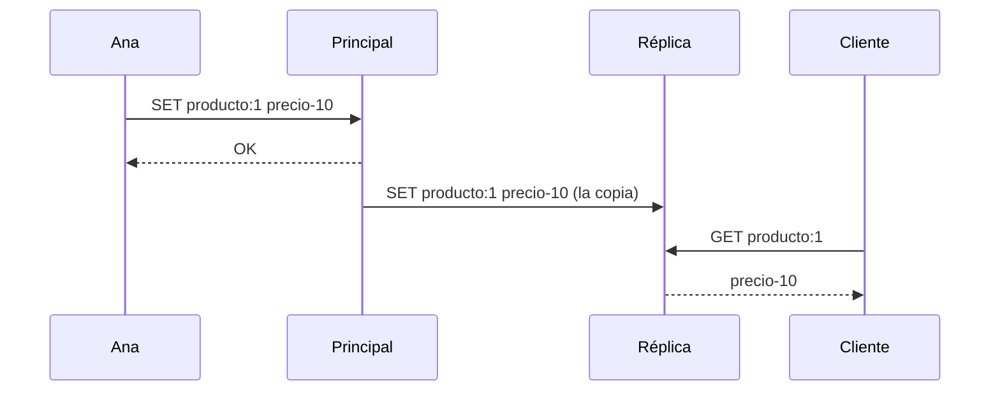
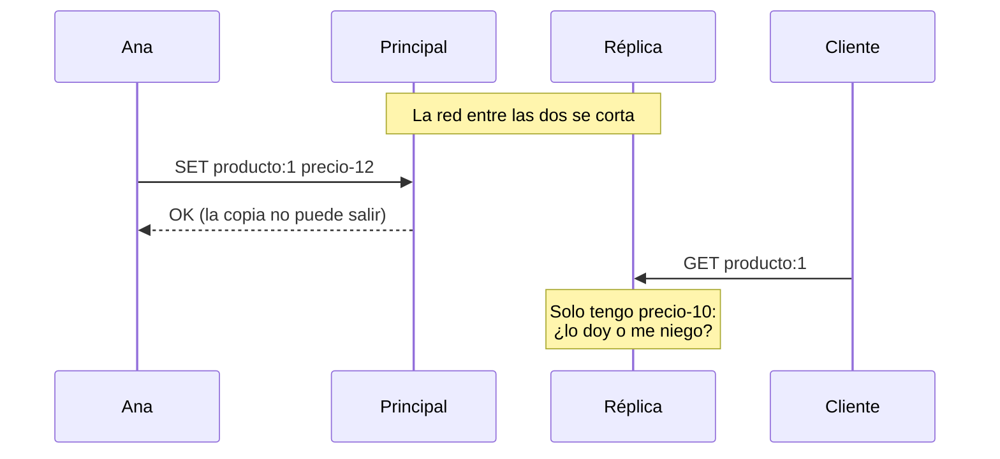

import Term from '~/components/Term.astro';
import TryIt from '~/components/TryIt.astro';
import Analogy from '~/components/Analogy.astro';
import Quiz from '~/components/Quiz.astro';
import QuizQuestion from '~/components/QuizQuestion.astro';
import QuizOption from '~/components/QuizOption.astro';

## El problema

Imagina que la tienda crece y pones una segunda copia de Redis en otra máquina, para repartir las lecturas. Ana, la administradora, escribe en la principal; la otra recibe cada cambio y atiende las lecturas.

Un día se corta la red entre las dos máquinas. Las dos siguen encendidas. Ana sube el precio de un producto de 10 a 12 euros, y el cambio se queda en la principal: no puede llegar a la otra.

Un cliente pregunta el precio a la copia de lectura, que solo tiene el de 10. **¿Qué debería hacer: contestar con lo que tiene o negarse?** No hay una tercera opción.

## La analogía

<Analogy>

Piensa en una tienda con una sucursal. La central decide los precios y llama por teléfono a la sucursal cada vez que cambia uno, para que cambien la etiqueta.

Un día se corta el teléfono. La central sube un precio. En la sucursal, un cliente pregunta cuánto cuesta. El dependiente puede decirle el precio de la etiqueta, que quizá ya no vale, o decirle: «no le puedo atender hasta hablar con la central». Lo que no puede es saber el precio nuevo.

<div slot="limits">

- El dependiente nota enseguida que no hay tono. A un ordenador no le suele llegar ningún aviso del corte: solo nota el silencio. En la práctica, la réplica tardó un minuto.
- El dependiente decide en el momento, cliente a cliente. Un programa lo decide antes, en su configuración: el día del corte no hay nadie para pensarlo.
- Entre ordenadores también fallan las máquinas, y desde fuera no se distingue una máquina caída de una red cortada.

</div>

</Analogy>

## Cómo funciona de verdad

### Varios ordenadores que se hacen pasar por uno

Desde la [lección anterior](/fase-9/monolito-vs-microservicios/) sabes que, en cuanto una parte habla con otra por la red, aparecen la espera y los fallos. Un **<Term id="distributed-system">sistema distribuido</Term>** es eso: varios ordenadores que cooperan por la red y se presentan como uno solo.

La tienda ya lo es: la API, PostgreSQL, los dos Redis y el trabajador se hablan por la red. Lo interesante empieza cuando el mismo dato vive en dos sitios.

### Réplicas: el mismo dato en dos máquinas

Una **<Term id="replication">réplica</Term>** es una copia de una base de datos que se mantiene al día sola. Sirve para dos cosas:

- **Repartir las lecturas.** Si la portada lee miles de veces por segundo, una réplica atiende parte de esas lecturas.
- **No perderlo todo si cae una máquina.** La réplica tiene los datos, y puede ocupar el sitio de la principal.

Solo la **principal** acepta escrituras, y envía cada cambio a las réplicas. Así funciona la práctica de esta lección, con Redis:



Fíjate: **la principal contesta `OK` a Ana sin esperar a que la copia llegue a la réplica.** Es la replicación **asíncrona**, la que usa Redis por defecto: Ana no espera a la réplica, y la réplica va siempre un poco por detrás. Normalmente, milisegundos.

### Una partición: la red se corta y nadie se apaga

Una **<Term id="network-partition">partición de red</Term>** es un corte que deja las máquinas en grupos que no pueden hablar entre sí, aunque todas sigan encendidas: un cable suelto, un *router* que se reinicia, un error en el cortafuegos.



La principal sigue aceptando escrituras: quien llega hasta ella no nota nada. **El problema es de quien solo llega a la réplica.**

### Un corte no avisa

**La réplica no sabe que la red se ha cortado.** No le llega ningún mensaje de «corte»: solo deja de recibir cosas, y un rato sin cambios también puede ser un rato tranquilo.

Por eso espera antes de darlo por perdido. En Redis, ese tiempo es `repl-timeout`, 60 segundos por defecto. Durante ese minuto, la réplica cree que todo va bien.

### CAP: durante el corte, contestar o acertar

El <Term id="cap-theorem">teorema CAP</Term> lo formuló Eric Brewer en el año 2000, y Seth Gilbert y Nancy Lynch lo demostraron en 2002. Sus tres letras:

| Letra | Qué significa | En la práctica |
|---|---|---|
| C, consistencia | Toda lectura devuelve la última escritura, sea cual sea la copia que conteste | La réplica nunca da `precio-10` después de que Ana escribiera `precio-12` |
| A, disponibilidad | Toda copia que sigue encendida contesta, sin error | La réplica contesta siempre, aunque esté cortada |
| P, tolerancia a particiones | El sistema sigue funcionando aunque la red pierda mensajes entre copias | Seguir encendidos cuando el cable se suelta |

Se suele contar como «elige dos de tres», y eso lo cuenta mal. En un sistema que usa la red, las particiones no se eligen: pasan. Lo que dice el teorema es esto: **mientras dure una partición, una copia aislada tiene que elegir entre contestar (A) o garantizar el último dato (C).** No puede las dos cosas, porque el dato nuevo está al otro lado del corte.

- **Si elige disponibilidad**, contesta con lo que tiene, aunque sea viejo.
- **Si elige consistencia**, se niega a contestar, con un error, hasta que vuelva la red.

Y con la red sana, no hay que elegir: las dos cosas son posibles a la vez.

### La elección se hace dato a dato

No hace falta elegir lo mismo para toda la tienda. Cada dato tiene su respuesta:

- **La descripción y las fotos de un producto** pueden ser viejas un rato: nadie sale perjudicado.
- **El stock al pagar** no puede: venderías lo que no hay. Por eso `crearPedido` lo comprueba en PostgreSQL, dentro de su transacción, aunque la [caché](/fase-9/cache-redis/) tenga una copia.
- **Una sesión cerrada** tampoco: no puede seguir valiendo en una copia.

La pregunta útil no es «¿mi sistema es CP o AP?», sino **«si este dato es viejo durante un minuto, ¿qué pasa?»**.

### Con la red sana también se elige: PACELC

CAP solo habla de los cortes. Pero con la red sana, la réplica asíncrona también va unos milisegundos por detrás. Evitarlo tiene un precio: si la principal esperara a la réplica antes de contestar `OK`, cada escritura tardaría un viaje más por la red.

Daniel Abadi le puso nombre a la elección completa, **PACELC**:

- **Si hay partición (P)**, elige entre disponibilidad (A) y consistencia (C): lo de CAP.
- **Si no (*Else*, E)**, elige entre <Term id="latency">latencia</Term> (L), contestar antes, y consistencia (C), esperar a que las copias estén de acuerdo.

Redis, con su configuración por defecto, elige A en el corte y L con la red sana.

### Consistencia eventual: las copias acaban de acuerdo

Cuando un sistema elige contestar, promete otra cosa a cambio: la **<Term id="eventual-consistency">consistencia eventual</Term>**. Si dejan de llegar cambios, todas las copias acabarán teniendo el mismo valor. No dice cuándo; dice que llegarán.

En «Pruébalo», al volver la red, la réplica recupera lo que se perdió sin que hagas nada.

La tienda ya era eventualmente consistente, sin réplicas:

- **La caché** de la [lección 2](/fase-9/cache-redis/#invalidar-borrar-justo-después-de-cambiar) se borra cada vez que cambia un producto. Pero si una lectura que empezó antes del cambio guarda la copia vieja justo después del borrado, el precio viejo dura hasta que caduca: un minuto, más o menos.
- **La cola** de la [lección 1](/fase-9/colas-trabajos-segundo-plano/#sin-trabajador-los-trabajos-esperan): el pedido pasa a `pagado` al momento, pero el correo llega cuando el trabajador lo coge. Si está parado, minutos después.

En los dos casos, la tienda contesta enseguida y se pone de acuerdo después. Es una decisión, no un descuido.

### PostgreSQL también tiene réplicas

PostgreSQL copia sus cambios a otras máquinas con la **replicación en *streaming***: le envía a cada réplica su diario de cambios, el *WAL* de la [lección de transacciones](/fase-5/transacciones-acid/#acid-letra-a-letra). **Por defecto es asíncrona**, como la de Redis, y su documentación dice que la réplica suele ir menos de un segundo por detrás.

También puede ser **síncrona**: con `synchronous_standby_names`, cada `COMMIT` espera a que la réplica confirme que tiene el cambio en su disco, y ya no se pierde si cae la principal. Para que una lectura en la réplica lo vea ya, hace falta además `synchronous_commit = remote_apply`, que espera a que lo aplique. Es PACELC en una línea de configuración: cada escritura tarda más, y si la réplica cae, los `COMMIT` se quedan esperando.

Si la principal cae, herramientas como Patroni (PostgreSQL) o Redis Sentinel ascienden una réplica. Antes votan varias máquinas, y hace falta mayoría: una sola no sabe si la principal ha caído o solo ha dejado de verla. Si la principal sigue viva al otro lado de un corte, habrá **dos principales aceptando escrituras distintas**, y las de una se perderán.

## Pruébalo

El objetivo: **cortar la red entre un Redis y su réplica, y ver las dos respuestas de CAP**: primero la réplica contesta un dato viejo; después, la obligas a negarse. Todo pasa en tu ordenador, con Docker, como en la [Fase 7](/fase-7/docker-compose/), sin tocar tu proyecto.

### Descarga la práctica

Una carpeta nueva, y el fichero de Compose:

```sh
mkdir -p ~/curso-backend/fase-9/replicas
cd ~/curso-backend/fase-9/replicas
curl -O https://backenddesdecero.com/practicas/replicas/es/compose.yaml
```

**Léelo antes de arrancarlo**, con `less compose.yaml`. Dos servicios con la misma imagen de Redis, `principal` y `replica`, en una red propia, `red`. A la réplica la convierte en copia una opción: `--replicaof principal 6379`, «copia todo lo que escriba `principal`».

Las salidas son de un Mac (Apple M1 Pro) con Docker 29.5.2 en Colima y Compose 5.5.1, del 22 de octubre de 2026, y salen de un guion, sin terminal. **En tu terminal se verán un poco distintas:** `docker compose` dibuja su progreso de otra forma, y `redis-cli` pone las respuestas entre comillas (`"precio-10"`), `(nil)` cuando no hay nada y `(error)` delante de los errores.

### Las dos copias, al día

<TryIt
  title="1. Arranca las dos"
  cmd="docker compose up -d"
  output={` Network replicas_red Creating 
 Network replicas_red Creating 
 Network replicas_red Created 
 Network replicas_red Created 
 Container replicas-principal-1 Creating 
 Container replicas-principal-1 Created 
 Container replicas-replica-1 Creating 
 Container replicas-replica-1 Created 
 Container replicas-principal-1 Starting 
 Container replicas-principal-1 Started 
 Container replicas-replica-1 Starting 
 Container replicas-replica-1 Started `}
>

Fíjate en los nombres: la red es **`replicas_red`** y los contenedores, **`replicas-principal-1`** y **`replicas-replica-1`**. Los necesitarás para cortar la red.

**Espera unos diez segundos** antes de seguir: al arrancar, la réplica hace una primera copia entera de la principal. Si lees antes, puede no tener nada.

</TryIt>

<TryIt
  title="2. Escribe en la principal, lee en la réplica"
  cmd={`docker compose exec principal redis-cli SET producto:1 precio-10
docker compose exec replica redis-cli GET producto:1`}
  output={`OK
precio-10`}
>

`docker compose exec principal redis-cli` abre la terminal de Redis dentro del contenedor `principal`, y le pasa una orden. Escribes en una máquina y **lees el dato en la otra**: la copia ha llegado.

Si la réplica contesta `(nil)`, espera unos segundos más y repite el `GET`.

</TryIt>

<TryIt
  title="3. La réplica no acepta escrituras"
  cmd="docker compose exec replica redis-cli SET x 1"
  output={`READONLY You can't write against a read only replica.`}
>

**`READONLY`**: «no puedes escribir en una réplica de solo lectura». Solo la principal acepta cambios. Si le pides `GET x` a la principal, no hay ninguna `x`: la escritura no llegó a ninguna parte.

</TryIt>

<TryIt
  title="4. ¿Van a la par?"
  cmd={`docker compose exec principal redis-cli INFO replication
docker compose exec replica redis-cli INFO replication`}
  output={`# Replication
role:master
connected_slaves:1
slave0:ip=172.20.0.3,port=6379,state=online,offset=68,lag=0,io-thread=0
…
master_repl_offset:68
…
# Replication
role:slave
master_host:principal
master_port:6379
master_link_status:up
…
slave_repl_offset:68
…
slave_read_only:1
…`}
>

`INFO replication` cuenta cómo va la copia; hemos quitado líneas con «…». Redis aún usa *master* y *slave*, los nombres antiguos de principal y réplica.

- **`master_link_status:up`**: la réplica está conectada a la principal.
- **`offset`**: los bytes de cambios que ha enviado la principal (`master_repl_offset`) y los que ha recibido la réplica (`slave_repl_offset`). **Los dos dicen `68`: van a la par.** Tu número puede ser otro.
- **`slave_read_only:1`**: el `READONLY` del paso anterior.

</TryIt>

### Corta la red

<TryIt
  title="5. Saca a la réplica de la red, y cambia el precio"
  cmd={`docker network disconnect replicas_red replicas-replica-1
docker compose exec principal redis-cli SET producto:1 precio-12
docker compose exec principal redis-cli GET producto:1
docker compose exec replica redis-cli GET producto:1`}
  output={`OK
precio-12
precio-10`}
>

`docker network disconnect` saca un contenedor de una <Term id="docker-network">red de Docker</Term>, como desenchufar su cable: no escribe nada. Las dos siguen encendidas, pero ya no se ven: es una partición.

La principal tiene `precio-12`. **La réplica sigue contestando `precio-10`**: el dato viejo, sin ningún error.

</TryIt>

<TryIt
  title="6. La réplica no se ha enterado"
  cmd="docker compose exec replica redis-cli INFO replication"
  output={`# Replication
role:slave
master_host:principal
master_port:6379
master_link_status:up
master_last_io_seconds_ago:1
…
slave_repl_offset:68
…`}
>

**`master_link_status:up`**: para la réplica, todo va bien. Su `offset` sigue en `68`, aunque la principal ya ha recibido más cambios. Es lo de «Un corte no avisa».

</TryIt>

**Ahora espera algo más de un minuto** (en nuestra prueba, 70 segundos): es el `repl-timeout` de la réplica.

<TryIt
  title="7. Un minuto después"
  cmd={`docker compose exec replica redis-cli INFO replication
docker compose exec replica redis-cli GET producto:1`}
  output={`# Replication
role:slave
master_host:principal
master_port:6379
master_link_status:down
master_last_io_seconds_ago:-1
…
master_link_down_since_seconds:11
…
precio-10`}
>

**`master_link_status:down`**: por fin sabe que ha perdido a la principal (y `master_last_io_seconds_ago:-1`: ya no hay conexión). Lleva 11 segundos así: de los 70 de espera, tardó unos 60 en darse cuenta, el `repl-timeout`.

Y aun así, **sigue contestando `precio-10`**. Es la opción por defecto de Redis, `replica-serve-stale-data yes`: «sirve datos viejos». La réplica ha elegido disponibilidad.

Si todavía ves `up`, espera unos segundos más y repite.

</TryIt>

### Ahora, que elija consistencia

<TryIt
  title="8. Que se niegue"
  cmd={`docker compose exec replica redis-cli CONFIG SET replica-serve-stale-data no
docker compose exec replica redis-cli GET producto:1`}
  output={`OK
MASTERDOWN Link with MASTER is down and replica-serve-stale-data is set to 'no'.`}
>

`CONFIG SET` cambia la opción mientras Redis está en marcha. Ahora la réplica contesta **`MASTERDOWN`**: «la conexión con la principal está caída, y no sirvo datos viejos». En tu terminal verás `(error)` delante.

**La réplica ha elegido consistencia:** prefiere un error a un precio que puede ser falso. Pero solo porque ya ha notado el corte: durante el primer minuto, habría contestado `precio-10` igual.

</TryIt>

### Vuelve la red

Vuelve a meter a la réplica en la red:

```sh
docker network connect replicas_red replicas-replica-1
```

No escribe nada. La réplica reintenta la conexión ella sola: **espera unos diez segundos** y mira cómo va.

<TryIt
  title="9. Con la red de vuelta"
  cmd={`docker compose exec replica redis-cli INFO replication
docker compose exec replica redis-cli GET producto:1`}
  output={`# Replication
role:slave
master_host:principal
master_port:6379
master_link_status:up
…
slave_repl_offset:211
…
master_link_up_since_seconds:8
…
precio-12`}
>

**`master_link_status:up`** otra vez, desde hace 8 segundos. Si ves `down`, espera y repite.

Su `offset` ha saltado de `68` a `211`: ha recibido lo que se perdió. Y contesta **`precio-12`**. **Es la consistencia eventual:** con la red de vuelta, las copias se han puesto de acuerdo sin que hagas nada.

</TryIt>

<TryIt
  title="10. Recoge"
  cmd="docker compose down"
  output={` Container replicas-replica-1 Stopping 
 Container replicas-replica-1 Stopped 
 Container replicas-replica-1 Removing 
 Container replicas-replica-1 Removed 
 Container replicas-principal-1 Stopping 
 Container replicas-principal-1 Stopped 
 Container replicas-principal-1 Removing 
 Container replicas-principal-1 Removed 
 Network replicas_red Removing 
 Network replicas_red Removed `}
>

Borra los contenedores y la red; la práctica no guarda nada en disco. Puedes borrar la carpeta.

</TryIt>

## Ya lo has visto

- **Un cambio de DNS que «se propaga».** En la [Fase 0](/fase-0/que-es-dns/#el-ttl-y-la-propagación) viste que unos ven la IP nueva y otros la vieja durante un rato. El DNS elige contestar siempre, y cada caché se pone al día cuando caduca su copia.
- **Un mensaje escrito sin cobertura.** La aplicación te deja enviarlo y lo entrega cuando vuelve la red: disponible ahora, de acuerdo después.

## Errores comunes

- **Confundir la C de CAP con la C de ACID.** La de [ACID](/fase-5/transacciones-acid/#acid-letra-a-letra) dice que se cumplen las reglas de las tablas en una base de datos; la de CAP, que todas las copias dan el último dato. Una base de datos ACID con réplicas asíncronas puede dar datos viejos.
- **Creer que se puede renunciar a la P.** Si hay red entre tus máquinas, habrá cortes. «Elegimos C y A» solo vale para una máquina sola.
- **Leer de la réplica justo después de escribir.** Ana cambia un precio, la página recarga leyendo de la réplica y ve el viejo. Lo que alguien acaba de escribir, léelo de la principal.
- **Tomar la réplica por una copia de seguridad.** Un borrado por error se copia a la réplica en milisegundos. Las [copias de cada noche](/fase-8/docker-compose-produccion/#una-copia-cada-noche) siguen haciendo falta.
- **Esperar que el corte se note al momento.** La réplica de Redis tardó un minuto en darse cuenta. Hasta entonces, contesta como si nada.

## Resumen

- Un sistema distribuido son varios ordenadores que se hablan por la red; una réplica, una copia de los datos que se mantiene al día sola.
- CAP: durante una partición de red, una copia aislada elige entre contestar con lo que tiene (disponibilidad) o negarse hasta tener el último dato (consistencia). Las particiones no se eligen.
- PACELC añade lo que pasa con la red sana: contestar antes (latencia) o esperar a que las copias estén de acuerdo (consistencia).
- La consistencia eventual promete que las copias acaban de acuerdo. La tienda ya la tenía, en la caché y en la cola.
- Se decide dato a dato: una foto puede ser vieja un minuto; el stock al pagar, no.

## ¿Lo has entendido?

<Quiz>

<QuizQuestion
  question="Cortas la red de una réplica de Redis y, veinte segundos después, su INFO replication dice master_link_status:up. ¿Qué está pasando?"
  review="Un corte no avisa"
>

<QuizOption text="Que la red no está cortada de verdad: si lo estuviera, Redis lo sabría al instante y lo diría.">

Un corte no envía ningún aviso: la réplica solo deja de recibir cosas, y hasta que pasa `repl-timeout` lo toma por un rato tranquilo.

</QuizOption>

<QuizOption text="Que aún no ha notado el corte: espera un minuto de silencio antes de darlo por caído." correct>

Desde dentro, un corte y un rato sin cambios se parecen. Redis espera `repl-timeout`, 60 segundos, antes de marcar el enlace como `down`.

</QuizOption>

<QuizOption text="Que la réplica se ha conectado a la principal por otro camino y sigue al día.">

Si siguiera al día, su `offset` subiría con cada cambio de la principal. Sigue igual: no le llega nada, solo que todavía no lo sabe.

</QuizOption>

</QuizQuestion>

<QuizQuestion
  question="La API escribe en la principal y lee de una réplica. Ana cambia el precio de la sudadera, recarga la página y ve el viejo. No hay ningún corte de red. ¿Qué ha pasado?"
  review="Réplicas: el mismo dato en dos máquinas"
>

<QuizOption text="La réplica aún no tenía el cambio: la copia asíncrona va un poco por detrás." correct>

La principal contesta `OK` sin esperar a la réplica. Si la lectura llega a la réplica en esos milisegundos, da el valor viejo.

</QuizOption>

<QuizOption text="Tiene que haber una partición: con la red sana, una réplica siempre tiene lo último.">

Con la red sana también va por detrás, unos milisegundos: es lo que añade PACELC.

</QuizOption>

<QuizOption text="La principal perdió la escritura: si la hubiera guardado, la réplica la tendría.">

La principal la guardó y contestó `OK`. La copia viaja después: llegará, pero no al mismo tiempo.

</QuizOption>

</QuizQuestion>

<QuizQuestion
  question="Un compañero dice: «PostgreSQL es ACID, así que en CAP es consistente aunque leamos de réplicas». ¿Tiene razón?"
  review="Errores comunes"
>

<QuizOption text="Sí: las dos C significan lo mismo, que los datos son correctos.">

Comparten la palabra, no el significado. La de ACID habla de las reglas de las tablas; la de CAP, de que todas las copias den el último dato.

</QuizOption>

<QuizOption text="Sí, siempre que todas las escrituras vayan dentro de una transacción.">

La transacción protege lo que pasa en la principal. La réplica recibe el cambio después, y mientras tanto da el valor viejo, haya transacción o no.

</QuizOption>

<QuizOption text="No: ACID no impide que una réplica asíncrona dé datos viejos." correct>

La replicación de PostgreSQL es asíncrona por defecto. Una lectura en la réplica puede no ver un `COMMIT` que la principal ya confirmó.

</QuizOption>

</QuizQuestion>

<QuizQuestion
  question="Un artículo dice: «Elige dos de tres. Nosotros elegimos consistencia y disponibilidad, y renunciamos a la tolerancia a particiones». Sus servidores están en dos centros de datos. ¿Qué falla?"
  review="CAP: durante el corte, contestar o acertar"
>

<QuizOption text="Que entre dos centros habrá cortes igual: lo que se elige es qué hacer entonces." correct>

Las particiones no se eligen: pasan. Mientras dura una, cada copia aislada contesta con lo que tiene o se niega.

</QuizOption>

<QuizOption text="Nada: con una buena conexión entre los dos centros, la P se puede quitar.">

Una conexión buena falla menos, pero falla, y ese día el sistema elegirá igual, aunque nadie lo haya pensado.

</QuizOption>

<QuizOption text="Que hay que elegir siempre la P, y eso obliga a renunciar a la C y a la A a la vez.">

Con la red sana, se pueden tener las dos. Solo durante un corte hay que elegir una de las dos, y para cada dato puede ser una distinta.

</QuizOption>

</QuizQuestion>

<QuizQuestion
  question="La red se corta y una réplica de la tienda queda aislada. ¿Qué petición puede contestar con datos viejos sin hacer daño?"
  review="La elección se hace dato a dato"
>

<QuizOption text="Comprobar si queda stock antes de cobrar un pedido.">

Con un stock viejo venderías lo que ya no hay. Por eso la tienda lo comprueba en PostgreSQL al crear el pedido, nunca en una copia.

</QuizOption>

<QuizOption text="Comprobar si una sesión sigue abierta después de que su dueño la cerrara.">

Quien cierra sesión espera que deje de valer. Una copia vieja la daría por buena, y otra persona podría seguir usándola.

</QuizOption>

<QuizOption text="Enseñar la descripción y las fotos de un producto." correct>

Una descripción con un minuto de retraso no perjudica a nadie. Este dato puede elegir disponibilidad; el stock y las sesiones, consistencia.

</QuizOption>

</QuizQuestion>

<QuizQuestion
  question="Configuras PostgreSQL para que cada COMMIT espere a que la réplica confirme que tiene el cambio. No hay ningún corte. ¿Qué ganas y qué pagas?"
  review="PostgreSQL también tiene réplicas"
>

<QuizOption text="Nada cambia: sin partición, CAP dice que no hay nada que elegir.">

Con la red sana se elige entre latencia y consistencia: es la otra mitad de PACELC.

</QuizOption>

<QuizOption text="Lo confirmado ya está en las dos máquinas, a cambio de escrituras más lentas." correct>

Cada `COMMIT` espera un viaje de ida y vuelta a la réplica, y si la réplica cae, se queda esperando. Para que una lectura en la réplica ya lo vea, hace falta además `remote_apply`.

</QuizOption>

<QuizOption text="Ganas disponibilidad: si la réplica cae, la principal sigue aceptando escrituras.">

Es al revés: con la réplica síncrona caída, la principal no puede confirmar nada, porque cada `COMMIT` la espera.

</QuizOption>

</QuizQuestion>

</Quiz>

## Para profundizar

- [CAP Twelve Years Later: How the "Rules" Have Changed](https://www.infoq.com/articles/cap-twelve-years-later-how-the-rules-have-changed/), de Eric Brewer, en inglés: el autor de CAP explica por qué «dos de tres» confunde.
- [Please stop calling databases CP or AP](https://martin.kleppmann.com/2015/05/11/please-stop-calling-databases-cp-or-ap.html), de Martin Kleppmann, en inglés: por qué las etiquetas CP y AP se quedan cortas.
- [Consistency Tradeoffs in Modern Distributed Database System Design: CAP is Only Part of the Story](https://www.cs.umd.edu/~abadi/papers/abadi-pacelc.pdf), de Daniel Abadi (IEEE Computer, 2012), en inglés (PDF): el artículo de PACELC.
- [Redis replication](https://redis.io/docs/latest/operate/oss_and_stack/management/replication/), de la documentación de Redis, en inglés: la replicación asíncrona, las réplicas de solo lectura y `replica-serve-stale-data`.
- [Log-Shipping Standby Servers](https://www.postgresql.org/docs/18/warm-standby.html), de la documentación de PostgreSQL 18, en inglés: la replicación en *streaming* y la síncrona.
